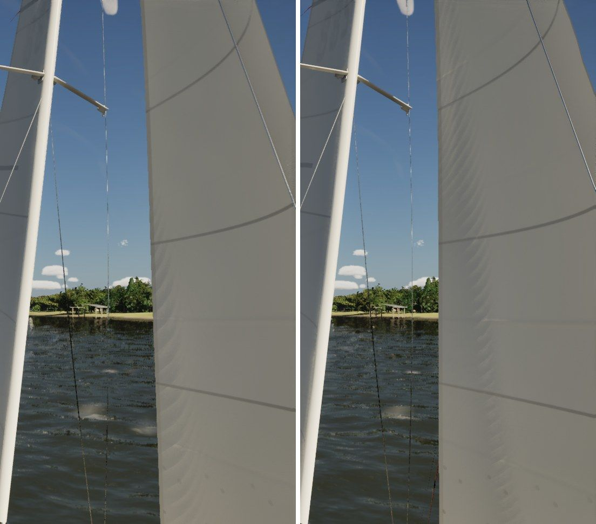
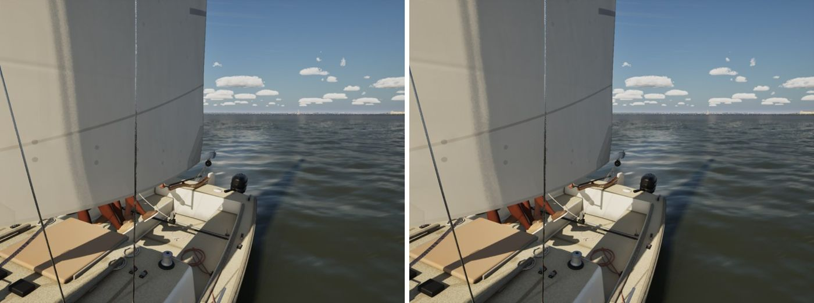
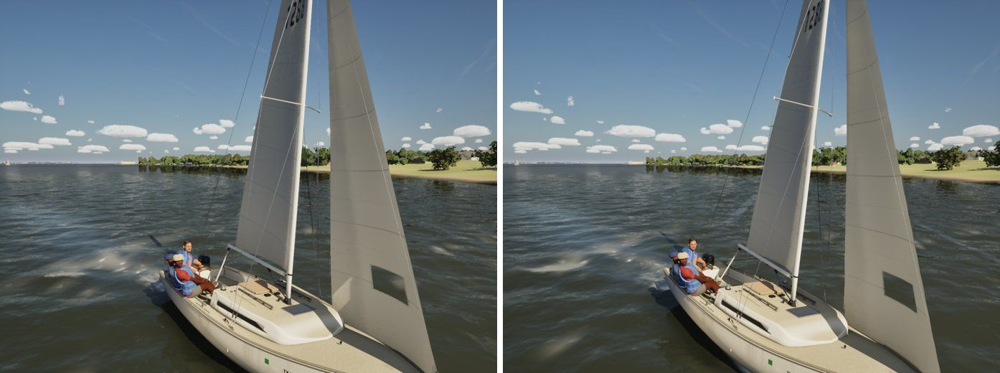

# Sail wrinkles (Ultra audit item 5, the geometry half)

The Ultra audit (docs/ultra-audit-1024/) found the sails smooth sheets close up. The PC does the sail look (shading,
weave); this is the cloth's shape: the fine wrinkles a loaded sail has at its corners and along a soft luff.

## Physics

A wrinkle is the cloth buckling where it is squeezed across a tension (tension field theory). `FSailWrinkles`
(`SailCloth.h`):

- **Corner fans** at the clew and the head. The sheet and halyard loads spread into the sail over the corner's angle beta,
  a radial tension T_r = F / (beta r) at r from the corner; the cloth across it is squeezed by Poisson's ratio,
  e = nu T_r / (E_bias t). F is half the sail's normal force each (q A |C_L| over the strips, times the cloth's load).
- **The luff** when the halyard is soft in a breeze: up to 0.4 % more cloth behind the luff than along it (the old
  target sine at 22 cm on a 20-33 cm grid, which aliased, is gone).
- **Wavelength** (Cerda and Mahadevan 2003): lambda = 2 pi (B L^2 / T)^(1/4), B the cloth's bending stiffness, T the
  tension along the wrinkles, L the length across them (r for a fan, 30 cm for the luff tabling).
- **Amplitude**: a sine of amplitude A and wavelength lambda takes up (pi A / lambda)^2 of extra length, so
  A = (lambda / pi) sqrt(e).
- Cloth: Dacron of about 7 oz, 0.3 mm, E 3 GPa along the threads (B = 6.75e-3 N m) and a twentieth of that on the bias.

A J/22 main's clew in 12 kn (200 N over 75 degrees, 30 cm in): wavelength 21 cm, amplitude 3.9 mm. They are subtle,
as on a real sail: they show in the highlights.

## Drawing

On the render grid (three times the cloth's: about 7 by 11 cm on a J/22 main), each vertex moved along its normal, and
the wrinkles' turn of the normal (the wrinkled surface against the same surface smooth) added to the cloth's normals, so
there is no seam where they end. A wave shorter than three cells along its own direction fades out instead of aliasing.
The cloth simulation, the telltales and the clew stay on the cloth's grid; nothing physical changes. High and Ultra only;
`-SailingNoSailWrinkles` compares.

Cost: the sails' game-thread time on the lake beat (High) is 0.907 ms against 0.853 without (+0.05 ms).

Test: `SailingSim.Visual.SailWrinkles` (the fan's wavelength and amplitude, the amplitude taking up exactly the squeeze,
growth with load and distance, nothing with no load and a tight halyard, a too-coarse grid drawn smooth).

## Stills (smooth left, wrinkled right)

