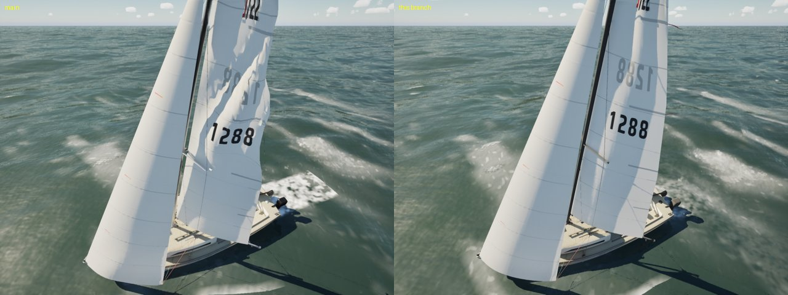
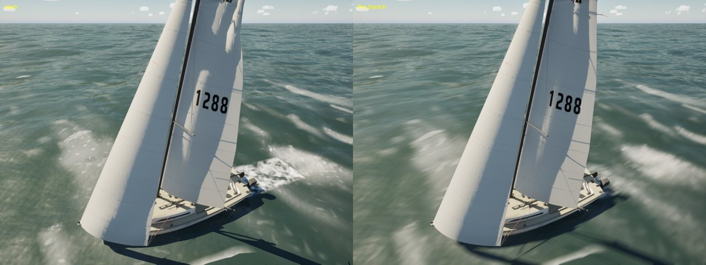
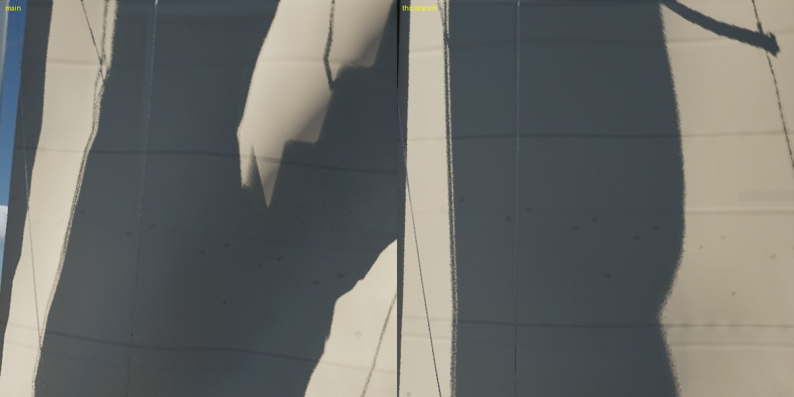
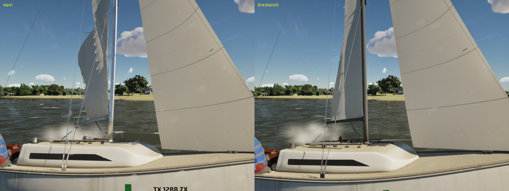
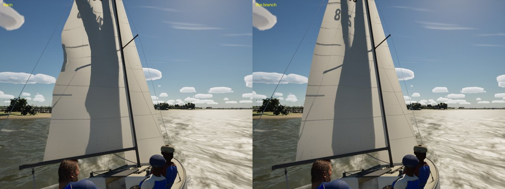

# Sails 1: the cloth crumpling, the leech creases, the churn rectangle (Oct 21 2026)

The PC's report: in a 2 m swell at 16 kn the J/22's mainsail crumples into a jagged, torn-looking shape, and in strong
wind the jib shows dark creases along its leech. Repro on the Mac, High and Ultra (`scripts/run-game.sh`):
`-SailingWorld=Gulf -SailingSwell=2 -SailingBoat=J22 -SailingWind=16 -SailingTWA=70 -SailingHoldTWA=70
-SailingCamYaw=120 -SailingCamPitch=-25 -SailingCamDist=10`. Each pair has main (2dd9d05d) on the left and this branch
on the right, on the same run.

## What was wrong in FSailCloth

1. **The cloth was reset in every breeze.** To lay the luff wrinkles on the target, `Step` copied the target over the
   cloth (`Pos = Target`) to take its normals, while `Prev` kept the cloth's last positions. Every frame of a breeze over
   8 kn with a soft halyard, the cloth jumped to the target, and the Verlet step read the jump as velocity. The normals
   now come from the target itself (`FSailCloth::NormalsOf`).
2. **Tension flipped in a frame.** A row's stiffness followed its strip's flow at once: 0.45 drawing, 0.04 luffing. In a
   seaway the masthead's apparent wind swings with every roll, and the upper strips flicker between the two, so the head
   of the main went from stiff to slack and back several times a second. Rows now ease toward their strip's tension over
   0.4 s. A luffing main or jib keeps 0.15 for its battens and leech tension; only a spinnaker goes fully slack.
3. **Nothing resisted a fold.** The cloth kept only its neighbours' distances (two passes), so it could crease at every
   vertex. It now has three passes, plus a weaker constraint between every other vertex (a bending stiffness), so a fold
   rounds over a few panels as sailcloth does.
4. **The head flipped.** The rows under the headboard are a few centimetres wide, their panels nearly degenerate. When
   they flogged, their normals flipped. The top three rows now hold their shape, and the flogging is scaled by each row's
   chord.
5. **Flogging ran diagonally across the rows.** The phase from row to row was 0.7 rad, which cut diagonal folds across
   the rows. It is now 0.25 rad, so the waves run aft along the chord, and their push is a little smaller.
6. **Leech flutter zigzagged.** The leech's shiver was a push on the cloth at 11 Hz, about five steps a period, with
   neighbouring rows 1.9 rad apart. That was close to the drawing rows' own ringing (about 6 Hz), so it built up into a
   row-by-row zigzag: the dark leech creases. It is now a 1.5 cm movement of the target at 9 Hz, running up the leech
   (0.5 rad a row), which the cloth follows and can't amplify.

In 22 kn upwind, the main's creases and the jib (from port):

## Test

`SailingSim.Visual.SailClothSeaway` drives the J/22's main and jib for 10 s at 18 kn apparent with a soft halyard, eased
for a reach, with the top two strips luffing for 0.35 s in every 0.7 s (the roll). It checks three things:

- the sharpest fold between neighbouring vertex normals stays under 45 deg;
- the mean fold stays under 6 deg;
- the drawing part's leech, off its target, zigzags less than 3 cm from row to row.

| | main: sharpest fold | mean | leech zigzag | jib: sharpest fold | mean | leech zigzag |
|---|---|---|---|---|---|---|
| main (2dd9d05d) | 45.4 | 3.24 | 2.2 cm | 84.4 | 3.92 | 2.2 cm |
| this branch | 35.8 | 3.80 | 2.0 cm | 38.1 | 3.83 | 1.9 cm |

Main's code fails it on the sharpest fold (the head). The synthetic flicker doesn't reproduce the full in-game crumple,
because the reset in (1) needs the game's frame-to-frame strips, so the stills above are the real check.

## The transom churn rectangle (#197)

The churn behind the transom that #197 added came out as a white rectangle in this view. Its distance aft stopped
counting at the hull map's aft edge, where the clamped texel goes flat, and it ran straight aft at the transom's width.
It now keeps counting past the map's edge, spreads (0.3 m a metre) and softens as it goes, and fades out well inside
the branch's reach. The pairs above show it.

## Not touched

- `M_SailCloth`'s look (`build_sail_cloth`): the PC's. The creases came from the cloth, not the shader, so there is
  nothing to hand over.
- Sheet routing at close range: in close stills of the cockpit, the jib lead and the main, I saw no sheet through a sail
  or the deck. The sheets' routing, rope look and widths are the PC's (`BoatModelVisuals.cpp`).
- A blown-out slam mist puff can sit right in front of a close chase camera (`main-swell-high`, lower middle): it reads
  as a soft smudge. To look at with the spray if it bothers.

## Gate

`scripts/gate.sh --scope boats` and `--scope water` on this branch (merged with main fe88d84b) both pass: 197 tests and
the package. Boats on High: beam8 63.6, beat15 62.2, marina 61.6, helm-eye 60.8, slip 57.4, crew 53.5 fps. Water: storm
45.7 on High and 66.8 on Medium, the rest 54 to 65 on High ([gate-boats.csv](gate-boats.csv),
[gate-water.csv](gate-water.csv)). The cloth costs twice its CPU time (`cloth_cpu_ms` 0.074 to 0.151 on beam8; 0.187 in
the crew view): the bending constraints, the third pass and the flutter's target normals. That is still well inside
phase 0's 1.1 ms for boat, rig and sails.
