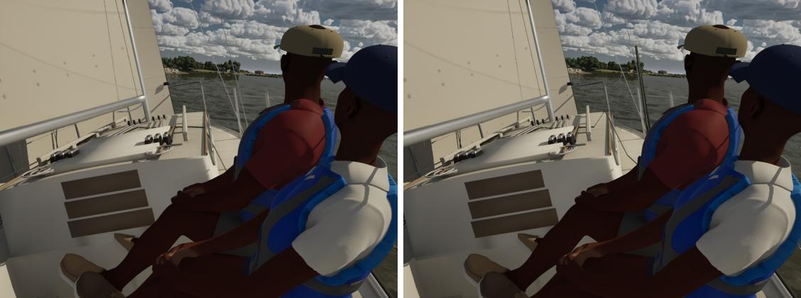
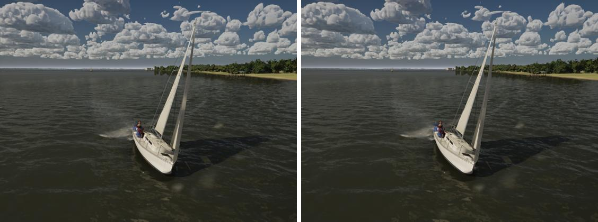
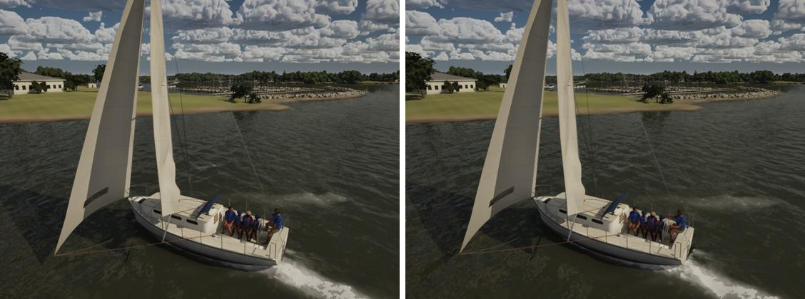
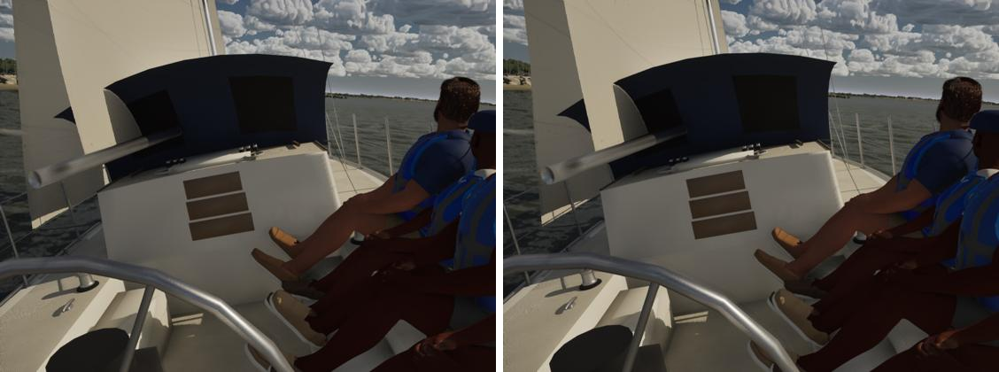
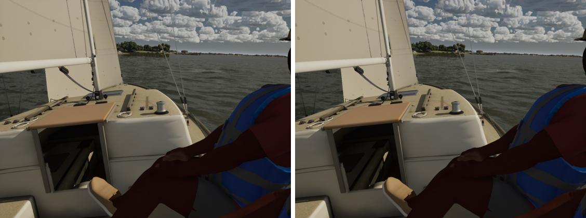
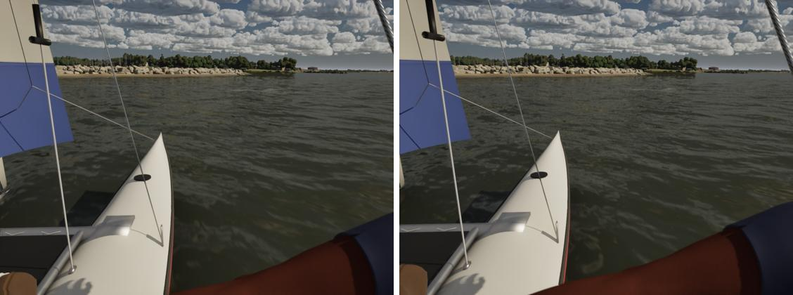

# Sheets over the boat, the crew and the lifelines

Job 3 (sail and sheet look plus clipping), the clipping and sheet routing half; sail cloth look and coloured sails are the
PC's. On main (ae76dafd), `SailingSim.Visual.RigClearance` (every boat, both tacks, close-hauled, reaching and running,
light and fresh) listed 16 kinds of clip:

| Clip on main | Where | After |
|---|---|---|
| lazy jib sheet inside the boat | Catalina 22, Catalina 30, Hobie 16 (104 samples), J/22, Maxi | gone |
| working jib sheet inside the boat, 9.5 cm | J/22 | gone |
| lazy jib sheet through a sailor's calf and thigh | Catalina 22 | gone |
| mainsheet tail through the helm's calf | J/22 | gone |
| mainsheet through a lifeline | Catalina 22 | gone |
| spreader through the main, running | Catalina 30, Corsair, J/22, Maxi | kept: a running main lies on its spreaders |
| shroud through the jib, 1 sample | Hobie 16 | kept: sail cloth (the PC's) |
| tiller extension through the sailor's calf | ILCA 7 | kept: the extension is rigid in the hand; the crew pose's to fix |

## Why

The drape (`UpdateModelRig`, rig clearance) lifted each ring of a sheet's tube out of the solid boat, checking the curve
around each ring. The straight span drawn between two rings was never checked: between a ring lifted onto a cabin top and
the next one down on the side deck it cut the roof's corner. Nothing kept a sheet off the crew or the lifelines.

## The fix

- After the first pass, each drawn span is checked at its eighths and, on the lifeline boats, where it crosses the fence's
  plane (the wires are 3 cm thick); a point still blocked lifts the span's free rings (an end at a fitting stays) until it
  clears, up to six passes.
- Blocked now means inside the boat (`CrewInsideBoat`), in a sailor's flesh (pelvis to chest 10 cm, thighs 7, calves 4.5,
  upper arms 4.5, forearms 3.5; not the arm whose hand holds the line) or on a lifeline wire (the two wires at half and full
  height, as RigClearance has them). A sheet lies on a thigh or bears on the top wire instead of passing through.
- Cost: only spans near a lifted ring, a sailor or a lifeline crossing are checked, and each rope only against the flesh
  within its reach. The rig lines' game thread on the lake beat (High) is 0.139 ms against main's 0.093.
- `SailingSim.Visual.RigClearance` now fails on any sheet through the boat, a lifeline or the crew.

## Checked

Tests 231/231. `scripts/gate.sh --scope boats` passes. On High: beam8 58.9 fps, beat15 58.4, marina 58.2, helm-eye 58.3,
slip 52.0, crew 52.9. Main has moved since the last boats gates: its sails cost about 1.5 ms of game thread now.

Before (left, main) and after (right), High. The moves are a few centimetres, so the test's list above is the evidence:

