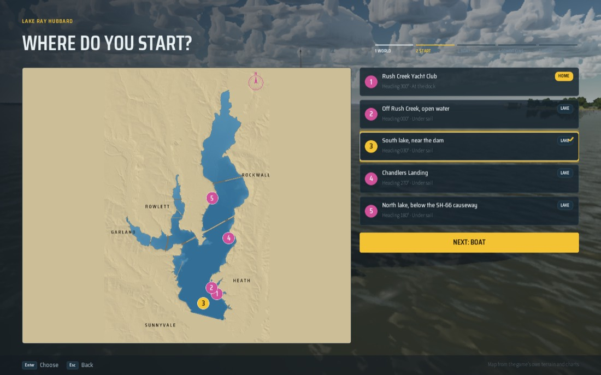
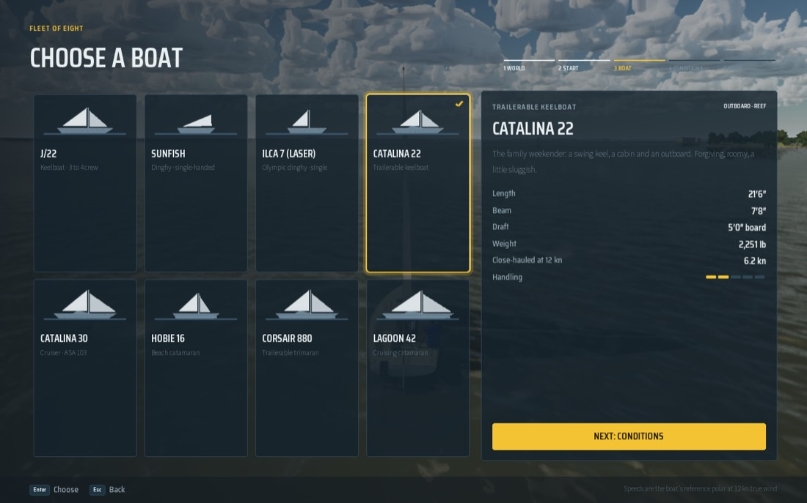

# The save file

One JSON file per profile holds the player's choices, the last session (for Continue) and their progress. It is plain
text so a person can read and diff it, it carries a format version, and every reference in it is a string id, never an
index: adding a boat, a launch spot or a drill never changes what an old save means (online-readiness rule 7).

Code: `FSailSave` and `SailSaveStore` in `Source/SailingSim/Public/SailSave.h` (plain logic, no world). Tests:
`SailingSim.Save.*` in `Source/SailingSimTests/Private/SaveTests.cpp`.

## Where it lives

`Saved/SaveGames/profile.json` under `FPaths::ProjectSavedDir()`. On the Mac the packaged game is sandboxed, so that is
`~/Library/Containers/com.benwmax.SailingSim/Data/Library/Application Support/Epic/SailingSim/Saved/SaveGames/profile.json`
(the container's Saved folder); in the editor it is the repo's own `Saved/SaveGames/`.

`-SailingSave=<path>` points a run at another file (relative paths are under `Saved/`). Bench, capture, shot, demo, drill
and automation runs (`USailingSettings::IgnoresSavedChoices`) never write it, and read it only when `-SailingSave` names
one; the front end's stills use that to show a given save's choices.

Writes are atomic: the text goes to `profile.json.tmp`, which is then renamed over `profile.json`, so a crash or a full
disk leaves the old file whole. The game writes whenever the settings are saved (every Settings row), when a session
starts and ends, when a drill is passed (with its lesson's medal), after each quiz, and when a race is over. `GameUserSettings.ini` is still written beside it, so an older build keeps working.

## Schema (version 1)

```json
{
  "version": 1,
  "game": "SailingSim",
  "writtenAt": "2026-10-18T17:05:12.000Z",
  "settings": {
    "quality": "Medium", "difficulty": "Easy", "controlLayout": "Simple",
    "learningMode": true, "trimAssist": true, "showHud": true,
    "audio": { "volume": 0.8 },
    "display": { "resolutionScale": 0, "frameCap": 0, "cinematicLook": false, "hudScale": 100, "textScale": 100,
                 "speedUnits": "kn", "depthUnits": "ft", "headingsTrue": false, "autoStart": false, "pauseOnFocusLoss": false },
    "start": { "world": "ray-hubbard", "launchSpot": "rush-creek-yacht-club", "launchSpotAt": { "lat": 32.82334959, "lon": -96.50040047 },
               "boat": "J22", "weather": "AfternoonBreeze",
               "startHour": 15, "traffic": 1, "weatherSeed": 2027, "gaugeLakeLevel": false },
    "career": { "freeSail": false },
    "input": { "bindings": "Input.ini" }
  },
  "lastSession": {
    "world": "galveston-bay", "launchSpot": "kemah-channel-outbound", "launchSpotAt": { "lat": 29.54180281, "lon": -95.00795119 },
    "boat": "Hobie16", "mode": "Free",
    "drill": "LeaveTheDock", "learningMode": true, "easy": true, "learningTips": true, "freeSail": false, "traffic": 1,
    "savedAt": "2026-10-18T12:04:55.000Z",
    "conditions": { "preset": "Lesson", "sky": "Fair", "windFromDeg": 180, "windKn": 10, "gustKn": 13, "localHour": 10,
                    "month": 4, "day": 18, "airTempF": 74, "lakeLevelFt": 0, "realDay": "" }
  },
  "progress": {
    "drillsPassed": [ "LeaveTheDock" ],
    "racesSailed": 0, "racesWon": 0,
    "logbook": { "sessions": 0, "entries": 0, "nauticalMiles": 0 },
    "hoursSailed": 0,
    "lessons": { "day-sailor.leave-the-dock": { "medal": "silver", "medalEasy": false, "bestSeconds": 212.4, "runs": 2, "quizPassed": true, "quizBest": 2, "quizOf": 3 } },
    "checkrides": {},
    "certificates": {}
  }
}
```

`lastSession` is `null` until a session has been started. `settings.start` is what the next start uses (the game
mode reads it through `USailingSettings`); `lastSession` is what Continue sails.

| Id | Values | Source |
| --- | --- | --- |
| world | `ray-hubbard`, `galveston-bay`, `gulf` | `FSailSave::WorldId` (settings world 0, 1, 2) |
| launch spot | the spot's name, lower case with dashes (`rush-creek-yacht-club`) | `SailCatalog::SpotIds`: the bake's `launch_spots`; a spot may carry its own `"id"` in the bake |
| boat | `J22`, `Sunfish`, `ILCA7`, `Catalina22`, `Catalina30`, `Hobie16`, `Corsair880`, `Lagoon42` | `EBoatType`'s names (`FSailSave::BoatId`) |
| drill | `LeaveTheDock`, `SailATriangle`, `HeaveTo`, `CrewOverboardFigureEight`, `CrewOverboardQuickStop`, `ReturnAndDock` | the Learning content's ids (`FLearningContent::DrillId`) |
| weather | `CalmMorning`, `AfternoonBreeze`, `Overcast`, `Rain`, `Thunderstorm`, `RandomDay` | `ESailingWeather` |
| preset | `Lesson`, `July`, `Glassy`, `Norther`, `SeaBreeze`, `Today` | `FSailPreset::Id` |
| quality, difficulty, controlLayout, sky, mode | the enum's names (`High`, `Realistic`, `Full`, `Storms`, `Race`) | the UENUMs |
| speed / depth units | `kn`, `mph`, `kmh` / `ft`, `m`, `fathoms` | `USailingSettings::SpeedUnits`, `DepthUnits` |

`launchSpotAt` (optional, added in version 1 without a version change: `docs/geo-anchor/README.md`) is the spot on the
earth. When `launchSpot` names a spot the game no longer has (renamed or removed in a rebake), the spot nearest that
lat/lon within 500 m is used (`FSailSave::SpotIndex`); beyond that, the world's first spot.

Key bindings stay in `Input.ini` (`USailingInputSettings`); `settings.input.bindings` names that file.

The progress block is the career's (`docs/career/README.md`): `lessons` (best medal, whether it was earned on Easy, fastest medal run, quiz),
`checkrides` (the written quiz's best) and `certificates` (when each was earned, UTC), each an object keyed by its id;
`hoursSailed` and the logbook counts grow at each session's end, `racesSailed` and `racesWon` when a race is over.
`settings.career.freeSail` is the title screen's Mode (Free Sail or Career, `docs/free-sail/README.md`) and
`lastSession.freeSail` the mode Continue sails in. These were added in version 1 without a version change: an older
version-1 file reads them as empty. Career 1 wrote `settings.career.openEverything` (Settings > Gameplay > Open
everything); Free Sail replaced it, so a file without `freeSail` reads that field as the mode, and the next write drops it.

## Versions and migration

- **Version 0** is the data before this file: `USailingSettings` and `USailSessionSave` in `GameUserSettings.ini`, with
  indices. When there is no save file, the loader takes what the ini gave those objects (`FSailSave::Capture`, which
  turns every index into its id) and writes a version-1 file. That happens once: afterwards the file wins.
- **Version 1** is the schema above.
- A file with an older version is migrated forward one step at a time (`SailSaveLocal::MigrateStep`, `From` to
  `From + 1`, editing the JSON in place), then read, and written back at the current version.
- A file with a newer version than the game knows is refused: a warning in the log names the file and both versions,
  the game runs on its defaults, and that file is never written over (the newer game still has it).
- A file that is not a save (not JSON, or no version) is moved to `profile.json.bad` and the game starts again from the
  ini's choices.
- Fields the game doesn't know are kept: the file as read is held in `FSailSave::Raw`, and every write puts the known
  fields over it, objects merged all the way down. A drill id the game doesn't know stays in `drillsPassed`.
- An id the game doesn't know (a boat or spot from a later version) falls back to the default with a warning; it never
  becomes a wrong index.

## Adding a field

1. Add it to the right struct in `FSailSave` with its default, and to `ToJson`, `FromJson`, `Capture` and `Apply`.
   A missing field reads as its default, so adding one needs no new version.
2. Refer to anything in the game by a string id, never an index or a display name.
3. Bump `CurrentVersion` only when old files need changing to mean the same thing (a renamed or moved field, a changed
   unit or id). Then add `case <old>:` to `MigrateStep` that rewrites the JSON and sets the new version, and a fixture
   at the old version to `SailingSim.Save.Migration`.
4. Extend `SailingSim.Save.RoundTrip` (`Everything()` must leave nothing at its default).

## Checking it on the packaged game

The front end can drive a whole session and quit with no simulated input (`-SailingUIScript`: `Quit` ends the game,
`Log` prints the save's status and the last session). From the title (Continue first): Sail, the lake, the third spot,
the Catalina 22, the lesson day, free sail, cast off, start, quit:

```bash
open -n -W Packaged/Mac/SailingSim.app --args -windowed -SailingFrontEnd=Title "-SailingUIScript=Down,Enter,Left,Enter,Down,Down,Enter,Enter,Up,Enter,Enter,Enter,Gamepad_Special_Right,Wait,Wait,Wait,Wait,Wait,Enter,Wait,Wait,Log,Quit"
```

Oct 18 2026, on the M5 Pro with no save file and the container's ini holding a Galveston session on the Lagoon 42:
the first launch logged `Save: no save at ...: migrated GameUserSettings.ini (version 0)`, and after the cast off
`profile.json` held `ray-hubbard`, `south-lake-near-the-dam`, `Catalina22`. A second plain launch
(`-SailingFrontEnd=Title -SailingUIScript=Log,Quit`) logged `loaded ... (ok)` with the same last session and left the
file unchanged (same checksum). Stills read from it (`-SailingBench=5 -SailingShot=save-Launch -SailingFrontEnd=Launch
-SailingSave=SaveGames/profile.json`) show the Launch and Boat screens on those choices:



