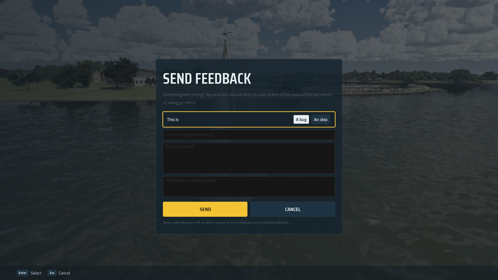

# Crash and bug reports (Sentry, #410)

Tester builds send crashes to Sentry once the player says yes. This is the first step of #410: the plugin and the
consent switch. The bug capture form (shots from the free camera, what happened, the last minute of boat state) builds on it.

## What is in the repo

- `Plugins/Sentry`: [sentry-unreal](https://github.com/getsentry/sentry-unreal) 1.25.0 for UE 5.8 (MIT, `LICENSE`
  beside it), trimmed to the Mac and Win64: their prebuilt SDKs under `Source/ThirdParty/{Mac,Win64}` (Git LFS). Left
  out: the other platforms, the bundled sentry-cli (the PC has its own), the optional external crash reporter apps and
  the plugin's editor Python (AI toolsets). To update, unzip the release's `-engine5.8` asset and copy the same parts.
- `SailingSim.uproject` enables it on Mac and Win64; `SailingSim.Build.cs` links it there and sets
  `WITH_SAILING_SENTRY`. The game's edge is `SailCrashReports` (`CrashReports.h`): consent, the place tags
  (`world`, `boat`, the save's ids), all no-ops without the plugin or a DSN.
- `Config/DefaultEngine.ini` `[/Script/Sentry.SentrySettings]`: no DSN; consent required and not given by default; no
  PII, screenshots, GPU dumps, tracing, metrics, session replay or symbol upload from the build. The log is attached.

## Where the DSN comes from

Never from the repo. `scripts/windows/friday.ps1` appends `Dsn`, `Release=sailing-sim@<commit>` and
`Environment=tester` to `Config/Windows/WindowsEngine.ini` for the cook and restores the file afterwards, then uploads
the Shipping symbols with sentry-cli (`docs/windows/README.md`, "Crash reports"). Mac builds carry no DSN, so the SDK
stays off there.

## The player's switch

Settings > Gameplay > Privacy > **Send crash reports** (Off by default): `USailingSettings::bSendCrashReports`, saved
as `settings.privacy.sendCrashReports` (`docs/save/README.md`), handed to the SDK at every session start and when it
changes (`ApplyCrashReports`: `GiveUserConsent` / `RevokeUserConsent`).

## Bug and idea reports

Pause > **Send feedback** (`SSailFrontEnd::OpenFeedback`, `ESailScreen::Feedback`) takes a shot of the view without the
menus or HUD, then opens the form: **A bug** or **An idea**, a title, what happened (bugs also: what you expected).
Ideas carry where the player is only when "Attach where I am" is on; bugs always do.

| Part | Bug | Idea | Where |
| --- | --- | --- | --- |
| Title and text | yes | yes | the feedback message (`SailFeedback::ComposeMessage`) |
| Tags: `feedback_kind`, `world`, `boat`, `lesson`, `game_mode`, `quality`, `input`, `wind_kts`, `fps` | yes | yes | Sentry tags; `tags.json` |
| Build stamp, platform and GPU, weather, drill | yes | asked | message lines |
| The last 60 s of the boat at 2 Hz (`FFeedbackRecorder` on the player's pawn) | yes | asked | `telemetry.json` |
| A repro arg line (`-SailingWorld`, `-SailingBoat`, `-SailingStartAt`, wind) | yes | asked | message |
| The log's last 200 lines, scrubbed | yes | asked | `log.txt` |
| The view, JPEG under 8 MB (`SailFeedback::ShotToJpeg`) | yes | yes | `shot1.jpg` |

Every report is written to `Saved/Feedback/<UTC>-<kind>/` with user paths scrubbed (`SailCrashReports::ScrubPaths`), and
sent as Sentry user feedback (`SailCrashReports::SendFeedback`) only when Send crash reports is on and the build has a
DSN; otherwise the form says it was kept on this computer. Still `-SailingFrontEnd=Feedback` (4 s in, like Pause).
Tests `SailingSim.UI.Feedback.*`.

## Not checked yet

- A crash, a bug report and an idea reaching Sentry from a Windows tester build (needs the PC and the DSN).
- Photo-mode shots (up to three from the free camera) and the crash event id on a bug: next step of #410.
- Whether Unreal's own CrashReportClient (packaged in Shipping, `bIncludeCrashReporter`) and Sentry's Crashpad handler
  both want the crash on Windows; Sentry's docs suggest one handler. Check on the PC's first Friday build.
