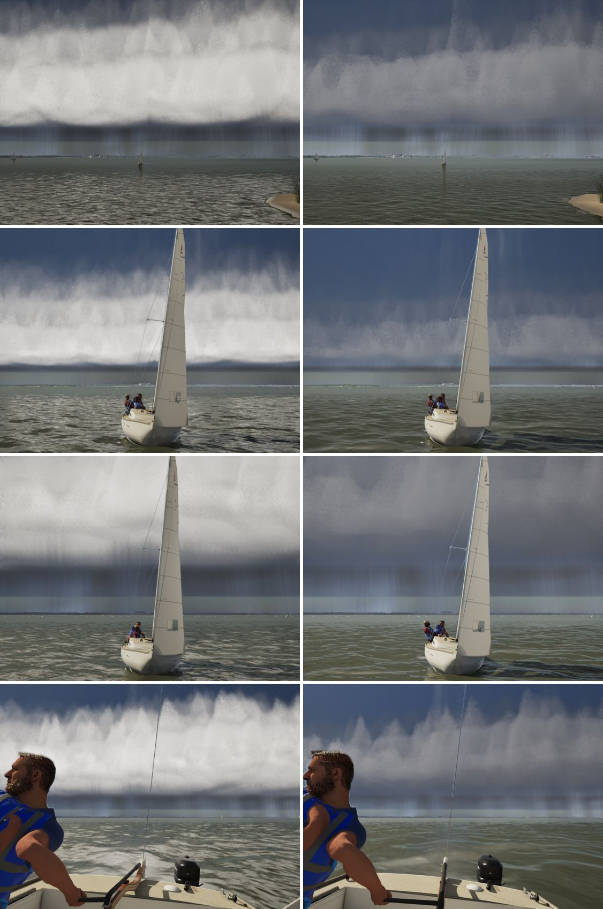

# Shelf face back to dark slate (realism audit item 5)

The realism audit (`docs/realism-audit-1022/`) found the storm's shelf face near white under the deck. Photos show dark
slate with paler bands, light only on the sunlit edge.

## Cause

It was a regression from #255. W8 lights the face by emission (`Emit = SunLum * FACE_PALE * faceLit * faceTone`, per
metre of extinction). While the face was translucent, a ray mixed only a share of that light with the dim storm behind
it. #255 made the face opaque (it closes within two march steps), so the full emitted light shows.

## Fix

`FACE_PALE` from 0.3 to 0.02 (`make_materials.py`). The stills set it:

| FACE_PALE | the face reads |
|---|---|
| 0.3 | near white |
| 0.12 | still near white (it clips) |
| 0.04 | light grey |
| 0.02 | dark slate with paler bands |
| 0 | flat slate (its lit structure is gone) |

Turning the face's scattering cut off (`W8_FACE_CUT=0`) changed little: the emission was the light. The hard lower
edge, the scallops and the striations from #255 are unchanged.

`FStormShape::ShelfShade` (the C++ mirror, held by `SailingSim.Visual.ShelfCloud`) models the face as a pale diffuser
and isn't tied to `FACE_PALE`'s value, so it is unchanged.

## Stills

Left is main 1a843e20, right is this branch. From the top:
- the G5 shelf scene;
- the chase with the front about 6.7 km off;
- the chase with the front about 2.2 km off;
- the helm's height looking aft at 2.2 km.

## Gate

`--scope clouds`: pass, 228/228 tests. beam8 61.8, beat15 60.8, storm High 52.9, gulf-sea 63.2, helm-eye 60.9, bridge
64.3, storm Medium 71.2.
