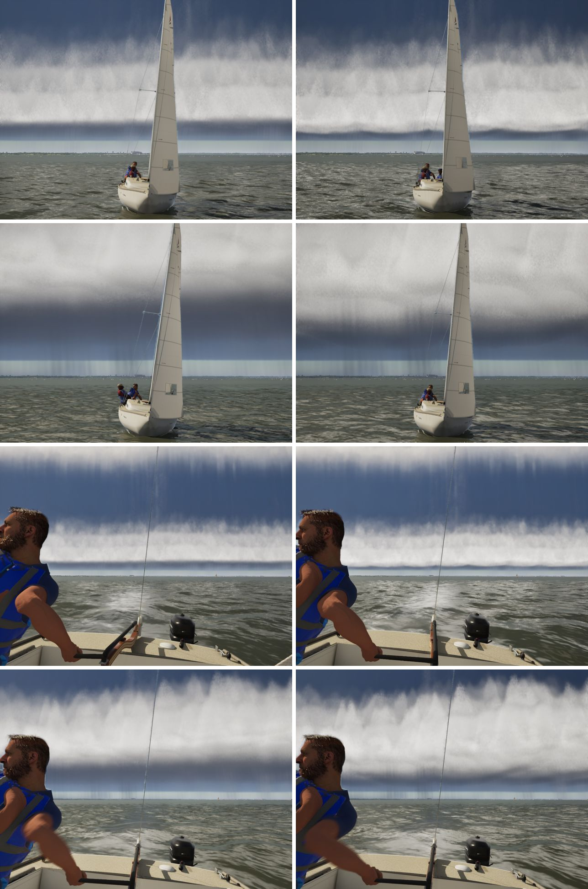
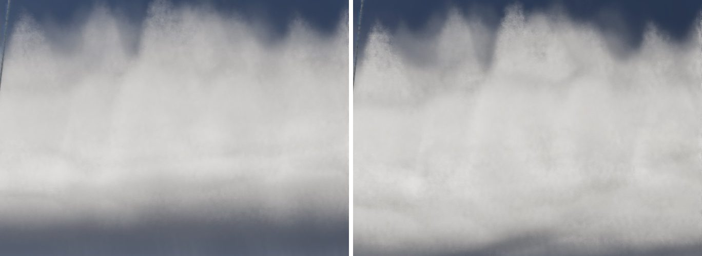

# Shelf cloud structure (fix list item 7)

Under a storm, the shelf cloud still read soft. Its lit face was a translucent, frosted veil with no hard lower edge, no
tiers and an even underside. Three things in `CLOUD_CODE` (scripts/make_materials.py) softened it:

- **The face never closed.** It was capped like the rest of the storm: at most 0.6 of optical depth per shadow-length
  step (about 400 m). A level ray ran 400–500 m into the face before it went opaque, so the lit skin mixed with the dim
  storm behind it, and the march's jitter turned the mix into speckle.
  - Since W8 the face is lit by emission in proportion to its extinction. Its tone changes only over hundreds of metres
    along a ray, so it can close within a step or two without grain.
  - It now has its own cap, `FACE_STEP_DEPTH` (1.5) per view step.
  - At 3, which closes in one step, the shade change over the face's first few hundred metres showed as grain: +30% on
    the near stills.
- **The face lit up over a quarter of its height.** `smoothstep(0.08, 0.35, shelfH)` was a ramp about 150 m tall at the
  face's middle, read as a gradient, not an edge.
  - The face now starts `ShelfFootM` (20 m) over the base.
  - Its ramp is 30 m, or 1.5 × this ray's climb in one step if that's more (15–50 m for a near-level ray).
  - That gives the arcus's hard lower edge over the dark underside.
- **The underside was even.**
  - The base now hangs in rounded lobes, `ShelfScallopM` (70 m) deep and about `ShelfScallopLM` (1.4 km) apart along
    the front, cusped between them. Their spacing wanders.
  - The face's foot follows the lobes, so the lower edge is scalloped.
  - Kilometres apart, the lobes are far coarser than any march step. They live only in the material, like the front's
    own wander (FStormShape has no along-front coordinate).

Across the face, its emitted tone now carries laminar striations: bands `ShelfStriaM` (110 m) tall, each lit at its top
and shaded under its ledge, wandering a little along the front. They vary in height, which a level ray hardly crosses
within a step, and fade out where one step climbs more than half a band (rays looking up into it). So nothing varies
faster than the march: the G1 rule.

`FStormShape` carries the new constants, and `ShelfShade` mirrors the face's foot in metres
(`SailingSim.Visual.ShelfCloud`).

## Stills

Left is main a8cc8ee6, right is this branch. From the top:
- the chase with the front about 6.7 km off;
- the chase with the front about 2.2 km off;
- the same two from the helm's height, looking aft into the storm.

Thunderstorm on the lake, 15:00 on Oct 15, `-SailingNoLightning`. The chase rows are `scenes.csv` through
`scripts/capture-scenes.sh`. The helm rows are `helm-views.txt` through the game camera, because the HelmEye capture
always faces the bow and the storm is astern on this course.

The face close up, from the helm with the front 2.2 km off:

Sky grain (the image less a 2 px blur, over the sky, against its mean):

| view | main | after |
|---|---|---|
| chase, 6.7 km | 0.67% | 0.72% |
| chase, 2.2 km | 0.42% | 0.51% |
| helm, 6.7 km | 2.90% | 3.30% |
| helm, 2.2 km | 2.47% | 2.72% |

Part of the rise is the structure itself: the hard edge and the bands are high-frequency detail too.

## Left open

- **The gap under the shelf** reads pale. Beyond the rain curtains, the horizon under the deck is lit like a clear one.
  In photos the air under a shelf is grey, darker than the sky beyond it.
- **No photo comparison.** I judged the stills against the features shelf clouds show (a hard lower edge, tiers, a
  scalloped base), not against matched photos.
