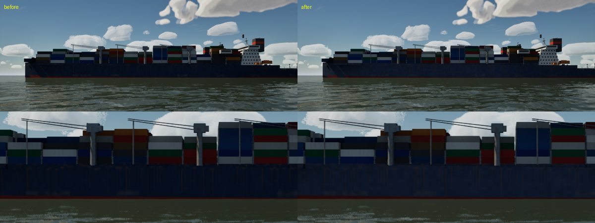
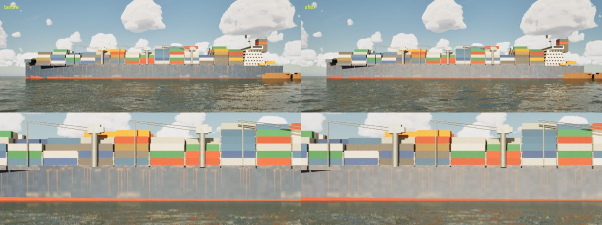
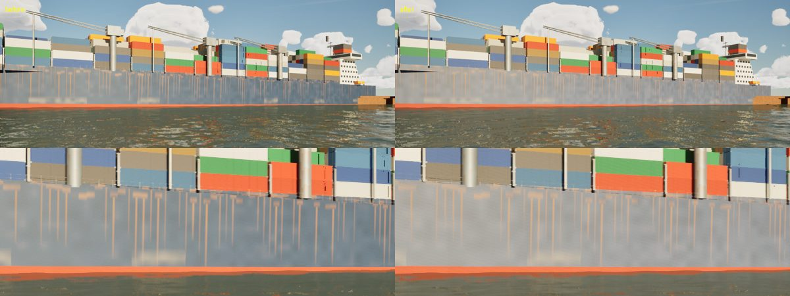

# Ship backlit (realism audit 1022, "Also seen")

The container ship read as a heavy dark silhouette with the sky bright behind it. Ship materials only: the sky, fog and
exposure were not touched.

## What was wrong

- `MI_World_ShipHull` was metallic 0.2 and `MI_World_ContainerPaint` metallic 0.15. Painted steel is a dielectric: the
  paint is what the light sees. A metallic value takes that share off the diffuse, so on the shaded side, lit by the sky
  alone, the hull and boxes lost about a fifth of their light.
- The hull's navy was (0.03, 0.06, 0.12) linear, a light reflectance value (LRV) of about 6: new, dark RAL 5011-type
  paint. A ship's topsides fade in the sun, to around LRV 8–12.

The lighting itself checks out. With the sun behind the ship, the shaded containers come out where a sky-lit vertical
face of their albedo should, against the sky's own value in the same frame. Only the hull's paint was off.

## Change (`scripts/make_materials.py`)

| Instance | Before | After |
|---|---|---|
| `MI_World_ShipHull` | albedo (0.03, 0.06, 0.12), metallic 0.2 | (0.07, 0.10, 0.17), metallic 0 |
| `MI_World_ContainerPaint` | metallic 0.15 | metallic 0 |

The roughness is unchanged (hull 0.55, boxes 0.7). Only the two instances were regenerated; `M_WorldSurface` and
`M_VehiclePaint` are unchanged, so no shaders changed and there is no GPU cost. The barge (`MI_World_Barge`, metallic 0.3)
was left alone because it is outside this item.

## Stills (scene g5-ship, High, uncooked)

The top row of each image is the whole view and the bottom row a crop at full resolution. The numbers are the mean sRGB
of the hull band.

| View | Before | After |
|---|---|---|
| 12:00, hull side in shade (`ship-1200.jpg`) | (7, 13, 26) | (13, 20, 35) |
| 17:00 (`ship-1700.jpg`) | (162, 151, 141) | (174, 160, 148) |
| 17:00, closer, 60° (`ship-side.jpg`) | (147, 146, 142) | (172, 164, 155) |

In this capture, the 17:00 scene has the sun on the near side. The shaded case is the midday view, which is where the
silhouette showed. It now shows the hull's rust streaks and plating instead of a black band. The ship stays darker than
its boxes, as a navy hull should.
