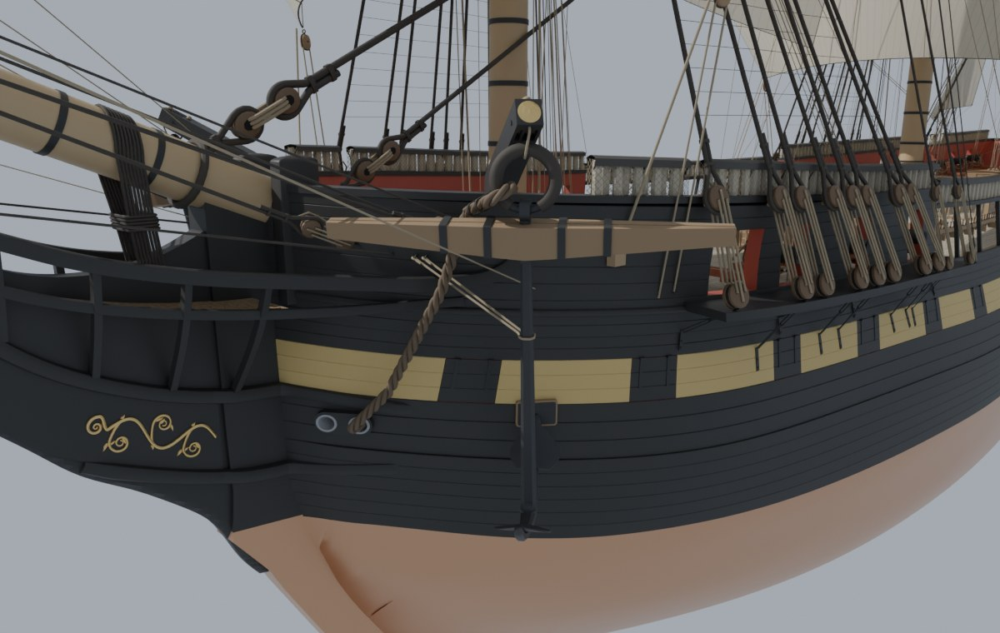
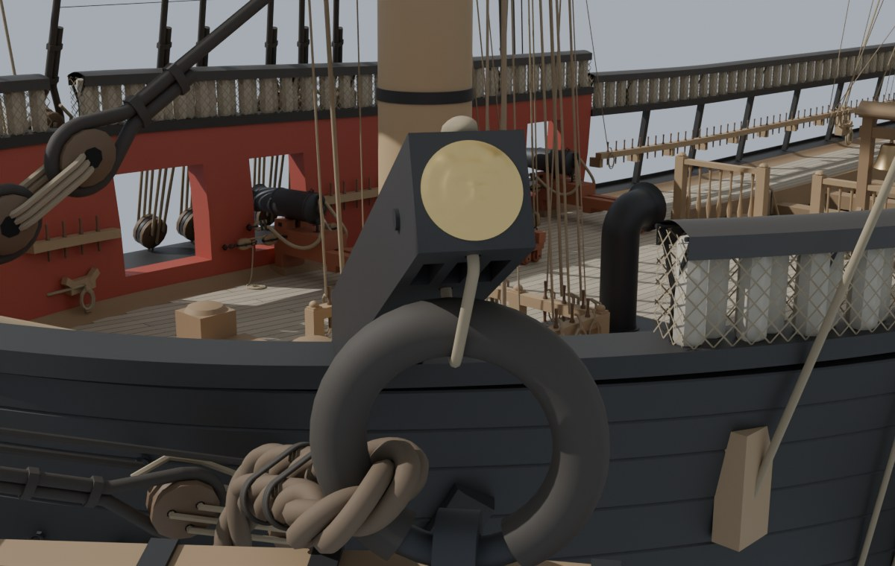
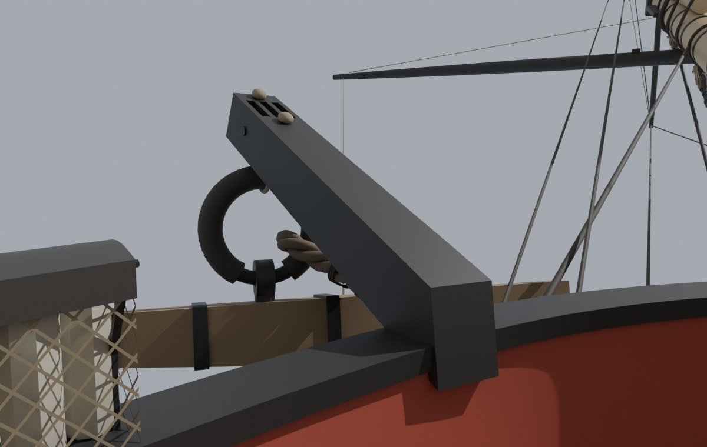
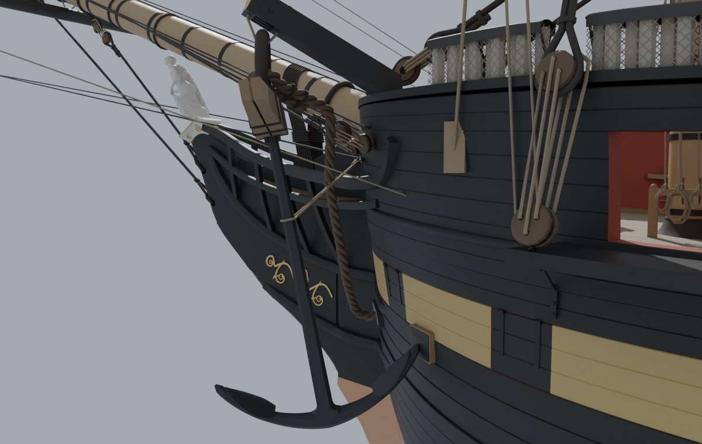
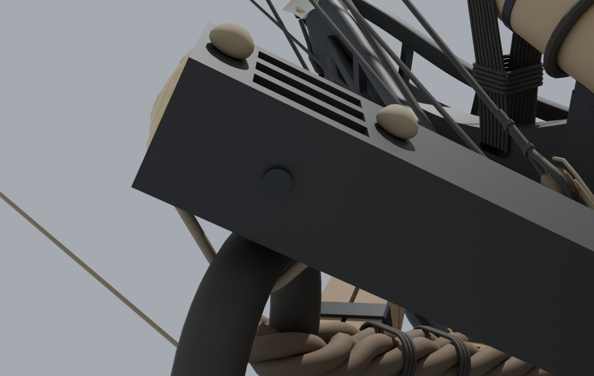
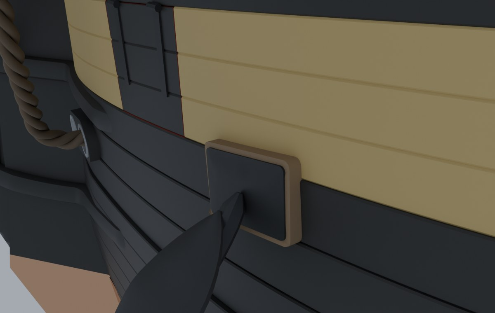
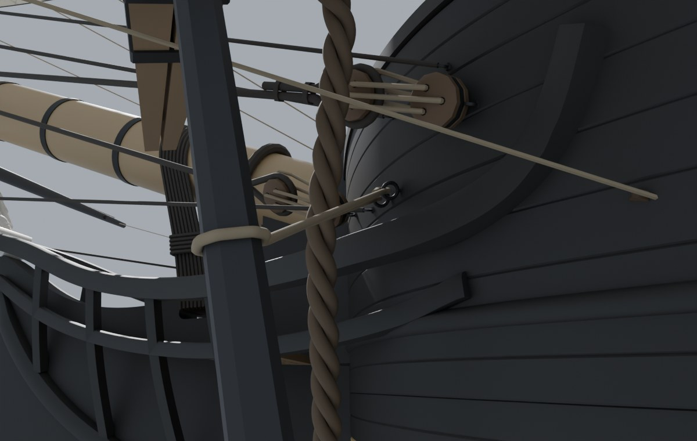
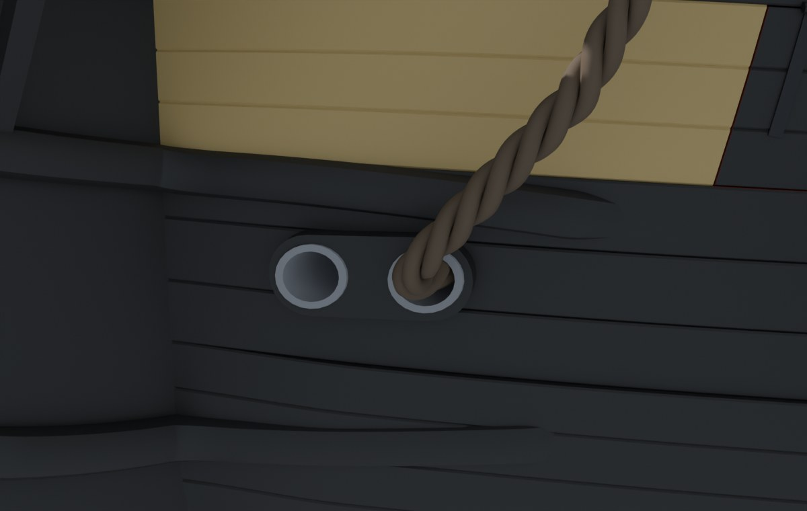
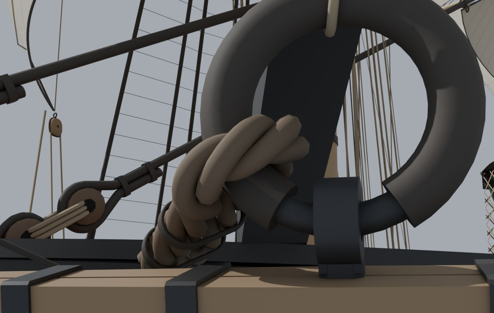

# Shipkit 10: the frigate's anchors and cables

Slice 10 of the frigate *Commonwealth* (plan: <https://claude.ai/artifact/8y6hW8vHjjUPJRovJEuxY7>; slices 0-9 are in
`docs/shipkit-1` to `docs/shipkit-9`). Slice 9 decorated her head and stern. This slice gives her ground tackle: a
cathead each side of the bow, the two bower anchors catted and fished under them, the bills of their flukes on
billboards, two hawse holes a side through the bow, lined with lead in an oak bolster, and the hemp cables bent to the
bowers' rings and led in through the hawse holes, with the cat stoppers and shank painters that hold the anchors. In
1797 the cables were rope, not chain: hers were 22 in round. The sheet, stream and kedge anchors are sized here and
stowed by the slices that build where they go (Spare anchors). It is still post-slice art: nothing here is imported
into Unreal or wired into the game.

Every render on this page is flipped left to right, so it shows her as the game will (docs/shipkit-9 says why).



## What slice 10 builds

### The anchors

An anchor of the period is wrought iron: a long square shank, two curved arms welded to its foot (the crown), each
ending in a broad flat palm (the fluke) with a point (the bill), and at the shank's head an eye with an iron ring for
the cable. Across the shank under the ring goes the stock, two balks of oak bolted round it and bound with iron hoops,
at right angles to the arms so that a dragging anchor is turned to dig a fluke in. An anchor's weight was its iron
alone.

The US Navy's fact file for Constitution gives her anchors: two bowers of 5,300 lb, a sheet anchor of 5,400 lb, a
stream anchor of 1,100 lb and two kedges of 400 and 700 lb. Each is built to its weight (`anchors.Anchor`): its shank
from the period's anchor tables (4.5 ft per cube root of its weight in hundredweight: 16.3 ft for the bowers), and
every other size in proportion to the shank or to the shank's thickness at the throat, the thickness solved so that
the iron weighs the anchor's weight:

* **The shank**: square with its edges taken off, tapering from the throat to 0.62 of it under the stock, curved into
  the arms' tops at the throat. A bower's is 16.3 ft long and 9.2 in square at the throat.
* **The arms**: each struck on a radius of 0.36 of the shank from a centre on it, through about a radian, so the bills
  stand about 60 deg off the shank; pea to pea (bill to bill) 9.9 ft for the bowers, as the RNLI's 1800 anchor's
  12 ft is for a 19 ft shank.
* **The palms**: plates on the arms' inner faces, nearly half the arm long and about as broad as long, square across
  their backs toward the crown with rounded shoulders, their sides curving in to the bill.
* **The ring**: 0.18 of the shank across outside (2.9 ft for the bowers), its bar 4.3 in, puddened (wrapped with old
  rope against the cable's chafe) 1.5 in thick on the bowers.
* **The stock**: as long as the shank and half the ring's diameter (17.7 ft for the bowers), a twelfth of its length
  square in the middle, tapering on its lower face and sides to half at the ends, its top straight; two oak pieces
  bolted round the shank's square with an inch between them, four iron hoops, and two nuts on the shank under it.

The anchors' iron is blacked (tar and lamp black), as the guns' barrels are. `build.json`'s `anchors.anchors` lists
each anchor's sizes as built:

| Anchor | Weight (lb) | Iron as built (lb) | Shank (ft) | Stock (ft) | Pea to pea (ft) | Throat (in) | Ring (ft) | Stowed |
| --- | ---: | ---: | ---: | ---: | ---: | ---: | ---: | --- |
| Best bower | 5,300 | 5,302 | 16.3 | 17.7 | 9.9 | 9.2 | 2.93 | at the cathead (here) |
| Small bower | 5,300 | 5,302 | 16.3 | 17.7 | 9.9 | 9.2 | 2.93 | at the cathead (here) |
| Sheet | 5,400 | 5,402 | 16.4 | 17.9 | 9.9 | 9.3 | 2.95 | on the gun deck (slice 12) |
| Stream | 1,100 | 1,101 | 9.6 | 10.5 | 5.8 | 5.5 | 1.73 | with the boats (slice 11) |
| Kedge (large) | 700 | 701 | 8.3 | 9.0 | 5.0 | 4.7 | 1.49 | with the boats (slice 11) |
| Kedge (small) | 400 | 400 | 6.9 | 7.5 | 4.2 | 3.9 | 1.24 | with the boats (slice 11) |

### The catheads

A cathead is a heavy timber projecting out over the bow on each side, with sheaves in its end, from which the anchor
is hoisted out of the water by its ring (catted) before its flukes are brought up to the side (fished). The 1817
draught of a 44 draws hers over the rail at the head rail's after end, rising about 40 deg as seen from the side, with
a carved cat's face on its end. Ours (`Cathead`) stands 55 deg off fore and aft in plan with a 27 deg steeve, which
the side sees as 40 deg; it is 15 in square at the rail, 13.5 by 14 in at its end, and stands 2.15 m past the rail
cap's outer edge, 2.71 m long in all. It is let into the rail cap and the bulwark's top and bolted through
them. Its heel is cut off just inside the bulwark, square to the bulwark's inner face and a little inboard of all of
it, the rail cap's overhang included, so the heel covers the cap. Three sheaves in its end take the cat fall, with
6 in of solid timber outboard of them; a hole either side of the sheaves takes the cat stopper, and the cat's face,
carved and gilt, is on the end.

Practice would put a heel down on the forecastle deck or an inboard knee, and a knee (the supporter) under the
cathead outboard. Neither fits here: the pin rail and the coils under it fill the bulwark's inside where the heel
would come down, and the headsails' sheet blocks hang where the supporter would stand. The fore topmast staysail's
sheet passed through the cathead's fore edge: its hole in the bow is now 0.35 m further forward (x 24.35), so the sheet
passes about 0.1 m forward of the cathead, its kevel abaft the hole (`running_1797.json`).




### The bowers, catted and fished

At sea a bower anchor hangs at its cathead: its ring hove up close under the sheaves and held there by the cat
stopper, a rope from the cathead down through the ring and back up to it; its flukes hauled up to the
side by the fish tackle until the bill of the inner fluke rests on the billboard, and held there by the shank painter,
a rope round the shank. The best bower is the starboard one, the small bower the port; at the same weight, the port
anchor is the starboard one mirrored.

The bow from the cathead to the fore chains is about 13 ft, and the bower's shank is 16 ft: she cannot lie fished flat
along the side. Laid flatter, her crown and arms come down across the foremost gun deck port, whose lid opens 175 deg
and whose gun runs out 24 deg forward (slice 8), or into the fore chains. So the bill rests at x 24.0, between that
port and the bridle port, and she hangs as her weight takes her about the line from her eye to that bill: her shank
79 deg off level, her crown 1.92 m over the waterline, her stock level.

* **The billboards** (`Billboard`): an oak board on the bow under each bill, 0.7 by 0.45 m, bent to the bow and let
  into the planking, faced with an iron plate; 3.08 in thick, which brings the plate's face to the bill.
* **The cat stoppers** (`CatStopper`): 4.5 in rope with a wall knot in each end. One end is knotted on the cathead's
  top and rove down through the hole in its end; the rope goes through the ring under its bar, so the ring hangs on it,
  and up through the hole inboard of the sheaves, its knot on the cathead's top like the first. The rope crosses the
  bar a little aslant, as a rope pulled up to two holes does, and leaves it along its tangents; every turn it makes is
  on a radius of 0.05 m or more, nearly one and a half times its thickness. A stopper of the period was 'attached to
  the cat-head, passes through the anchor ring, and is afterwards fastened to the timber-head' (the *Encyclopaedia
  Britannica* of 1815, as quoted by the searches), its hauling end belayed so the anchor could be let go: ours knots
  that end too (Known gaps).
* **The shank painters** (`ShankPainter`): 4.5 in rope, from an eyebolt in the bow 0.9 m above where it takes the shank,
  a round turn about the shank and back up to an eyebolt beside the first. Each end goes through its eyebolt's eye,
  round the eye's outer bar and back along itself for 0.1 m (the splice), each eye turned square to the rope's lead.
  The eyebolts (`AnchorEyebolts`) have 4 in eyes of 1 in iron, driven 4 in into the bow.






### The hawse holes and cables

The cables come in through the hawse holes, two a side through the bow between the cheeks of the head, under the upper
cheek, as the later rig plan draws them. Each is an 11 in bore for the 7 in cable, bored aft and a little inboard
(8 deg off fore and aft) and rising 14 deg inboard, lined with lead 0.4 in thick lapped an inch over its mouth
(`HawseLining`), in an oak bolster (`HawseBolster`) round both holes, standing 0.1 m off the planking and let into it.
The bores are cut through the planking (`Anchors.cut_hawse`, with `head.cut_away`, as the bow's opening is in
slice 9). Their inner ends wait for the gun deck (slice 12): each bore ends capped 0.25 m inside the planking.

The cables (`Cable`) are 22 in round (7 in thick), as the USS Constitution Museum gives hers in September 1797:
cable-laid, three ropes laid up left-handed, the lay about three times the cable's thickness. The three ropes are
round and pressed a little into each other where they bear, as a real rope's are flattened against each other. Each
bower's comes out of the after hawse hole straight along its bore for 0.38 m, over the lip, and up the bow to the ring,
every turn on a radius of at least one and a half times its thickness (an estimate of the least a cable this stiff
takes; the build checks it), through the ring and round its puddened bar, and back alongside itself: its end lies about two feet along the standing part, seized to it with two
seizings of three turns (the clinch), the standing part straight alongside the end all the way.




### Spare anchors

The period stowed the sheet anchor on the fore channel abaft the best bower, and the spare abaft the small bower on the
other side. Ours would lie across the forecastle's foremost carronade port and the chase port there: with its stock
upright its arms lie level about 0.45 m over the channel and its shank 1.5 m out from the side. Bean chose (15 Nov
2026) to stow them elsewhere: the sheet anchor lashed in the waist on the gun deck (slice 12), and the stream anchor
and both kedges with the boats, the launch carrying the kedges out to kedge her (slice 11). Their sizes are in
`build.json` (`anchors.anchors`), for those slices to build from.

## Clearance

The build checks every anchor part against everything else in the ship (the sails, running rigging and guns in every
state and pose too) and against each other (`anchors_room`, `build.json` `anchors.room`), as slice 9's decor room
does. Nothing meets anything it doesn't stand on or in by design. The contacts by design are listed in
`anchors_1797.json`'s `meets`, each with why and how deep it may go; the build fails on any other, on one that goes
deeper, or on a pair named twice. Each allowance is the deepest the final build measured, with a quarter inch over.

| Designed contact | Parts | Allowed (in) | Deepest (in) |
| --- | --- | ---: | ---: |
| The cathead is let into the rail cap and bolted through it | `Cathead` with `RailCap` | 1.57 | 1.32 |
| The cathead is let into the bulwark's top under the rail cap | `Cathead` with `BulwarkTop` | 2.67 | 2.42 |
| The cathead's heel is cut off just inside the bulwark's inner face, its sides passing through that face | `Cathead` with `BulwarkIn` | 2.67 | 2.42 |
| The stopper is rove through the bower's ring and takes its weight under the bar | `CatStopper` with `Bower` | 0.28 | 0.03 |
| The billboard is bent to the bow and let into the planking | `Billboard` with `Skin` | 1.15 | 0.90 |
| The bill of the bower's inner fluke rests on the billboard's iron plate | `Billboard` with `Bower` | 0.33 | 0.08 |
| The hawse bolster is bent to the bow and let into the planking | `HawseBolster` with `Skin` | 1.30 | 1.05 |
| The lead linings fill the bolster's holes and are lapped over its face | `HawseBolster` with `HawseLining` | 0.29 | 0.04 |
| The shank painters' eyebolts are driven into the bow | `AnchorEyebolts` with `Skin` | 4.25 | 4.00 |
| The painter's round turn bears on the shank | `ShankPainter` with `Bower` | 0.29 | 0.04 |

The running rigging's world includes the anchors' parts, so every rope clears them with its own check (slice 6), and
the brace limits, the sails' room, the nettings, the deck's room and the guns' room all see them.

## Triangles

| Part | Triangles |
| --- | ---: |
| **The catheads** | **7,060** |
| `Cathead` | 7,060 |
| **The bowers and their gear** | **35,816** |
| `Bower` | 8,976 |
| `Billboard` | 1,528 |
| `CatStopper` | 6,520 |
| `ShankPainter` | 17,656 |
| `AnchorEyebolts` | 1,136 |
| **The hawse holes and cables** | **44,640** |
| `HawseBolster` | 792 |
| `HawseLining` | 1,152 |
| `Cable` | 42,696 |
| **All of it** | **87,516** |

Both sides are counted. The anchors' parts are 87,516 triangles of the plan's 150k, the
cables nearly half of them; cutting the hawse holes adds 5,116 to the planking. The ship as drawn
with her sails set is 3,808,599 triangles (slice 9: 3,715,967), within the plan's 3.9M.

## For the game

In the .blend each part is one object in the ship's frame, both sides in it. Nothing moves yet, but `anchors.json`
holds what a later slice needs to let go an anchor: each anchor's size and stowage, the best bower's own frame (origin
at the crown, z up the shank, x toward the inner arm, y along the stock) with its ring's top and bill, the cathead's
end, the hawse holes' mouths and bores, the cable's length and clinch, the stoppers' holes and the painters'
eyebolts.

## Sources and estimates

* **The fact file** (the US Navy's for USS Constitution, as quoted by the searches; its page is on a host this machine
  cannot open): the anchors' weights.
* **The USS Constitution Museum**: the cables' size (22 in, September 1797).
* **The 1817 draught of a 44** (slice 1's `refs.json`): the cathead's place and rise and the cat's face.
* **The later rig plan** (`refs.json`, p72): two hawse holes a side between the cheeks, under the upper cheek.
* **The *Encyclopaedia Britannica* of 1815**, as quoted by the searches (its page is on a host this machine cannot
  open): the cat stopper attached to the cathead, through the anchor's ring and fastened to a timberhead.
* **Anchor tables of the 1780s-1800s** as quoted in modellers' notes, the RNLI's *Lifeboat* journal on old anchors, and
  the Admiralty's proportions as quoted on a modellers' forum (unverified): the anchors' proportions, the stock, the
  bowers' and sheet anchor's places, the bill on the billboard.
* **Period practice** for a large frigate, by eye where no drawing or table gives it, each value so marked in
  `anchors_1797.json`.

## Checks

```
python Tools/shipkit/frigate/build_frigate.py <out>
```

(Blender's Python, pip `bpy`; about 45 minutes and 7 GB of memory.) The anchors are built right after the head, so the
rigging, sails, deck and guns that follow must clear them with their own checks. The build fails if an anchor part
meets anything it doesn't by design or goes deeper than its contact allows (`anchors_room`), or if a pair of parts is
named twice in the meets. It fails too if any piece of an anchor part crosses itself (`anchors.folds`: a rope bent
tighter than its own radius folds through itself, which the room check can't see, as it sets parts only against other
parts), if the cable bends on a radius under one and a half times its thickness outside the clinch
(`anchors.cable.least_bend_of_diameter`), or if a gun port's lid swings into an anchor part. `anchors.Anchor.solve`
fails if it can't bring an anchor's iron to its weight.

The ropes and the eyebolts are shaded smooth across edges under 50 deg (their sections have 8 and 16 sides), every
other anchor part under 35 deg.

## Review

An independent review measured the first full build and the code as it then stood with its own scripts, given only
the build, `anchors_1797.json` and the slice's code. It found six defects and some smaller points. Each is fixed, and
the final build was measured again:

| The review found | Fixed | Measured again |
| --- | --- | --- |
| 1. The cable kinked tighter than its own radius in free air: 0.3 m outside the after hawse hole it turned 78 deg on a radius of 8.8 cm, half its thickness, and where its standing part joined the lead alongside its end, 88 deg on 8.4 cm. A smooth curve drawn through sharp corners can't bend gently | the cable's course is a line of straight runs, each corner turned on an arc of one and a half times its thickness (or as near as two corners close together allow), laid at an even 2 cm; it leaves the hole straight along its bore for 0.38 m, and its corners stand where the arcs clear the bolster and the bowsprit's rigging. The build fails on a tighter bend | its least bend outside the clinch is 1.50 times its thickness; no strand crosses itself |
| 2. Every round part rendered faceted: the anchors were shaded smooth only across edges under 35 deg, and the 8-sided ropes and strands turn 45 deg at each edge, the 6-sided seizings and eyebolt bars 60 | the ropes, seizings and eyebolts have 8 or 16 sides and are shaded smooth under 50 deg, as the running rigging is; the ring, its pudden and the sheaves' pin have 12 sides, so the anchor keeps its 45 deg chamfers crisp at 35 | no edge along a rope, seizing or eye is shaded sharp |
| 3. The stopper and painter ran through their eyebolts' iron for about 2 cm at each eye: each rope started at its eye's centre, and each eye stood in the plane of the rope's lead. Their 1.6 in holes could not have taken a splice of the 1.43 in rope | each painter's eye stands square to the rope's lead, 4 in across on 1 in iron, and the rope's end goes through it, round its outer bar and back along itself for 0.1 m (the splice). The stopper was spliced the same way at first, but there is no room for a splice between the cathead and the ring, which hangs 3 in under it: the rope folded back through itself. So the stopper now goes as the period's did, down through a hole in the cathead with a wall knot on top (The bowers) | the painter comes no nearer than 0.22 in to its eyebolts' iron (the splice's quarter inch less the facets); the stopper clears the cathead's holes by 0.22 in, its knots bear on the cathead's top, and it bears on the ring's pudden by 0.03 in; no part crosses itself |
| 4. The stopper's outboard eyebolt was in the cathead's end grain, 1 mm from the end, its eye hanging 3.1 cm past it | no eyebolt there: the stopper's hole is in the middle of an end block lengthened from 4 in to 6 in (the cathead 2.15 m past the rail cap, not 2.1; the sheaves stay where they were) | 2 in of timber either side of the 1.9 in hole, to the sheaves' slots and to the end |
| 5. The rail cap poked out through the cathead's heel face by up to 19.6 mm across its whole width; the heel's plane was fitted over 0.6 m of curving bulwark, so its lower edge stood 27 to 30 mm proud of the bulwark, not 15 | the heel's plane is fitted to the bulwark's inner face over the cathead's own footprint, and set 15 mm inboard of every part of the bulwark's face, its top and the rail cap within the cathead's section, so the heel covers the cap | no part of the rail cap comes through the heel's face: its inner edge lies 15 mm inside it, the bulwark's inner face 59 mm |
| 6. The checks could pass wrong things: the allowances for the eyebolts' shanks in the cathead and the bow (4.2 in) would as well have let a rope cut 4 in into either; nothing checked a part against itself, or the cable's bend; and a lid's swing cut short by an anchor would have passed | the eyebolts are their own object (`AnchorEyebolts`) with their own allowance, so a rope meeting the bow or an eyebolt fails; the build fails if any piece of an anchor part crosses itself, if the cable bends tighter than 1.5 times its thickness, or if an anchor part is what stops a lid's swing (Checks) | no part crosses itself; no lid's swing is stopped by an anchor part; every lid's swing is as in slice 9 |
| 7. Small: each anchor's side wasn't exported; a comment called the catheads oak (they are painted with the side); the note on mirroring the bower's frame for port left it left-handed; a helper ignored its guess; the stowing search could index a pose that wasn't there; the hawse holes' and the cathead's sources didn't say where the built parts came out | the sides exported; the comment corrected; the note says to negate the frame's y axis too; the guess removed; the search guarded; the sources say the mouths come out 0.1 m forward of the moulded holes and the cathead stands half a metre forward of the head rails' after ends | |

The review also found that the rest it measured was right: the bower's iron weighs its 5,300 lb within 1.3 kg; she
hangs with her centre of mass at its lowest about the line from her eye to her bill, her stock level and her bill on
the plate; every part on both sides is closed and faces out; nothing comes within 5.9 cm of anything but a designed
contact, in every sail state; the lids swing as in slice 9; the hawse bores, the cut planking, the linings and the
bolster are where they should be; the sheaves sit clear in their slots; and the clinch's seizings take both parts.

## Known gaps

* **The cables stop inside the bow.** Inboard, a cable runs to the riding bitts on the gun deck and down to the cable
  tier: slice 12 builds the gun deck and opens the hawse holes' capped ends.
* **No cat or fish tackle.** With the anchor catted and fished, the tackles are unhooked and stowed; the stopper and
  painter hold it, as drawn. No anchor buoys or buoy ropes are drawn.
* **The cat stopper's hauling end is knotted.** At sea it was belayed to a timberhead or a cleat, to be cast off when
  the anchor was let go; ours goes up through the cathead and is knotted on its top like the standing end.
* **She hangs steep** (The bowers): our bow is too short for a 16 ft shank to lie fished along the side.
* **No supporter and no inboard heel** under the cathead (The catheads).
* **The spare anchors aren't drawn yet** (Spare anchors).
* **Estimates throughout** (Sources), and nothing is in the game yet.

## Files

| File | What it does |
| --- | --- |
| `Tools/shipkit/frigate/anchors.py` | an anchor of the period built to its weight (`Anchor`); the catheads, the bowers catted and fished, the billboards, the hawse holes and their cut, the cables, the cat stoppers and shank painters (`Anchors`) |
| `Tools/shipkit/frigate/anchors_1797.json` | every size and place, each with its source or marked an estimate; the anchors' stowage; the meets by design |
| `Tools/shipkit/frigate/build_frigate.py` | builds the anchors after the head, cuts the hawse holes through the planking, gives the running rigging the new parts, checks their room (`anchors_room`), their folds and the cable's bends, and writes their counts and places in `build.json` and `anchors.json` |
| `Tools/shipkit/frigate/running_1797.json` | the fore topmast staysail's sheet hole moved forward of the cathead |
| `docs/shipkit-10/baseline/` | `build.json`, `anchors.json` and renders |
