# Shipkit 11: the frigate's boats

Slice 11 of the frigate *Commonwealth* (plan: <https://claude.ai/artifact/8y6hW8vHjjUPJRovJEuxY7>; slices 0-10 are in
`docs/shipkit-1` to `docs/shipkit-10`). Slice 10 gave her anchors and cables. This slice gives her boats: a 34 ft
launch, two 26 ft cutters and a 22 ft gig. Each is a small hull lofted from a period draught's lines, the way the shape
loop builds the Sunfish, then planked, framed and fitted out piece by piece, with her gear stowed in her: oars, masts
and furled sails, rudder and tiller, and painter. They ride over the open waist on spare spars laid across its beams:
the launch in the middle, a cutter either side of her and the gig nested in the starboard cutter, each griped down to
her cradles. The stream anchor and the large kedge lie across the launch and the small kedge across the port cutter,
as Bean chose in slice 10. It is still post-slice art: nothing here is imported into Unreal or wired into the game.

Every render on this page is flipped left to right, so it shows her as the game will (docs/shipkit-9 says why).

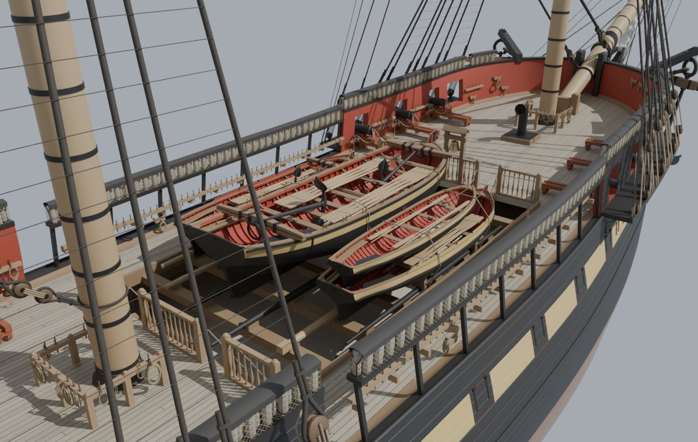

## What slice 11 builds

### Four boats from two draughts

A frigate of 1797 stowed her boats over the waist on the booms: the spare spars, laid fore and aft across the waist's
beams (the spar deck is named for them). Constitution's lists give her later outfit (a 36 ft longboat, two 30 ft
cutters, two 28 ft whaleboats, a 28 ft gig, a 22 ft jolly boat and a 14 ft punt); the plan carries four for 1797.
Their hulls come from two draughts at Royal Museums Greenwich, public domain scans on Wikimedia Commons, measured off
by hand and not in the repository:

* **A 31 ft longboat of about 1801** (J0267): profile, half-breadth and body plans, written 'Length 31 ft 0 in,
  Breadth Moulded 9 ft 6 in, Depth Midship 4 ft 1 in', with her thwarts, windlass, mast steps, stern sheets, sling
  plates and the roller in her stem head drawn. The launch is her lines scaled alike every way to 34 ft.
* **A 30 ft pinnace of 1840** (J0667): 'Length 30 ft 0 in, Breadth 8 ft 7 in, Depth 3 ft 1 in', with a washstrake and
  rowlock notches. The cutters are her lines scaled to 26 ft by 7 ft 3 in, a little finer than a pinnace; the gig is
  her lines narrowed to 22 ft by 4 ft 10 in, long and narrow, pulling four oars single banked.

A third draught, the 27 ft armed launch for *Juste* of 1794 (J0022), shows a launch of the 1790s: the stern sheets,
thwarts and knees follow it by eye.

| Boat | Built | Length (ft) | Breadth moulded (ft) | Depth (ft) | Frames | Thwarts | Oars | Masts (ft) |
| --- | --- | ---: | ---: | ---: | --- | ---: | --- | --- |
| Launch | carvel, 12 strakes of 1 in plank | 34.07 (34.0) | 10.42 (10.42) | 4.57 (4.50) | 31, sawn, 12 in apart | 7 | 14 of 17 ft, double banked | 26 and 23 |
| Cutter (two) | clinker, 10 strakes of 5/8 in | 26.19 (26.0) | 7.18 (7.25) | 2.63 (2.67) | 36, steamed, 8 in apart | 5 | 10 of 13 ft, double banked | 19 and 17 |
| Gig | clinker, 8 strakes of 1/2 in | 22.16 (22.0) | 4.79 (4.83) | 1.88 (1.92) | 35, steamed, 7 in apart | 4 | 4 of 13 ft, single banked | 15 |

The sizes are as built, with the card's in brackets (`boats_1797.json`); the build fails if one is more than 5% off.

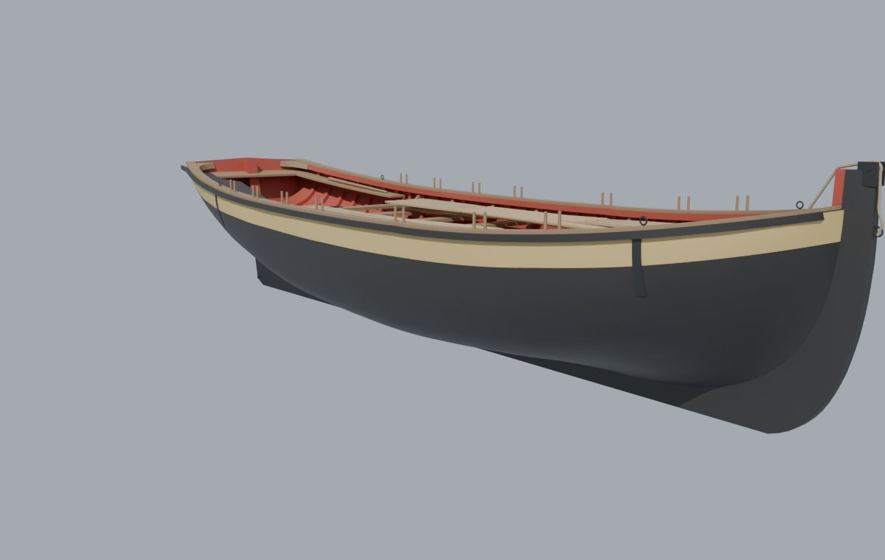
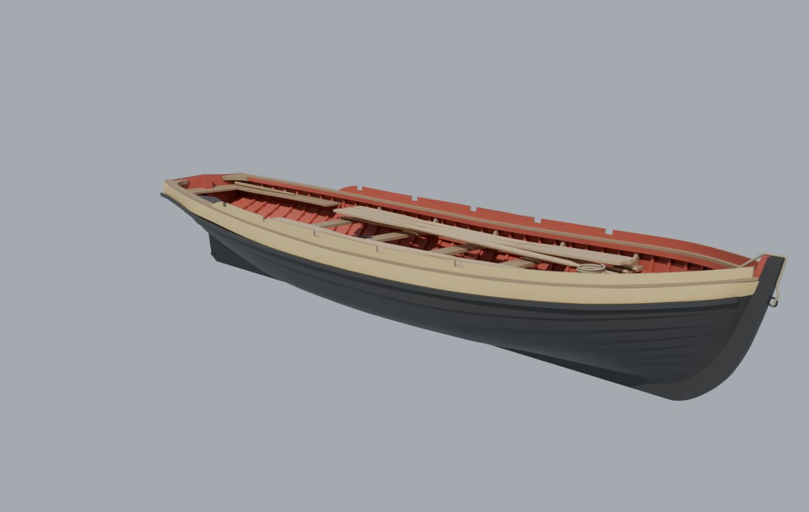
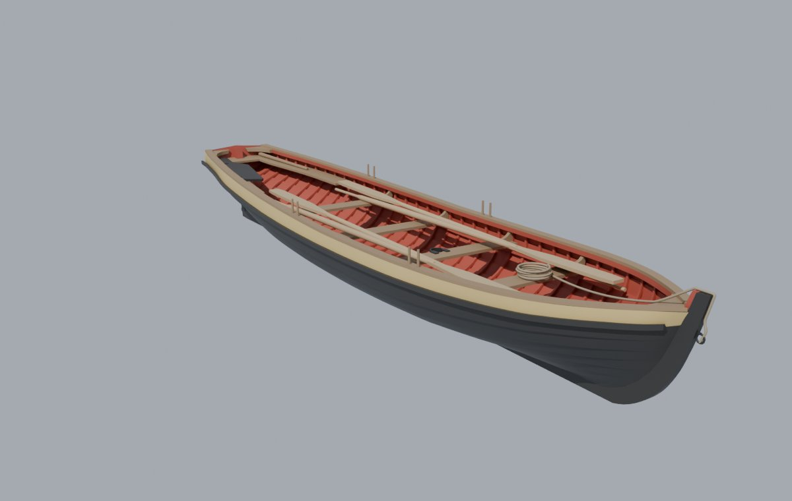

### How a hull is lofted

The draught's lines are the moulded surface: the frames' outside, under the planking. `boats.Lines` lays that
surface strake by strake, as a boatbuilder lines off his planks: a row for each share of the girth, from the
garboard's lower edge on the keel's rabbet to the sheer. Each row runs from where it lands aft (up the deadwood and the
post under the transom, then on the transom's edge) to where it lands forward on the stem's rabbet, so the planks'
hood ends spread up the stem and the transom as they do on a real boat. A station traced off the draught holds the rows
that pass it, and each row is a smooth curve through its points and its two ends. The longboat's cant frames are on
their slanted planes, and the pinnace's ends come from her waterlines.

The loft is held to the drawing (`Lines.check`): every station is within about an inch of its traced line (the worst
1.0 in on the launch, 1.08 on a cutter, 0.72 on the gig), and the sizes written on each draught come out within 2% of
the loft's at the boat's scale.

### The hull

* **The planking.** The launch is carvel built, her planks flush. The cutters and the gig are clinker built: each
  strake laps over the one below it (the land, 7/8 in on a cutter), its lower edge showing outside and its upper edge
  inside. Toward the stem, and on the deadwood aft, the laps are worked away to nothing (the gerald), so the planks come
  into the rabbet flush. A row of the planking runs through the transom's heel, where the rabbet turns up from the
  deadwood to the transom's edge, so the planks' after ends close round it (Review).
* **The backbone.** The keel, deadwood, post and stem outside the rabbet, sided to the planks' outside there and
  tapering to the keel's bottom and the stem's face; the hog, deadwood and apron inside it; the inner post up the
  transom's inside.
* **The transom**: its outer face in the plane of the post's aft edge, its edge where the planks' inside meets that
  plane (a clinker boat's lands stepped round it), its top crowned.

### Framing and fitting out

* **The frames**, each one piece across her from head to head, each face cut to the moulded section in its own plane:
  sawn in the launch (2 1/4 in sided), steamed in the cutters and gig (1 1/4 and 1 in), notched over the hog and
  floored up flat under the bottom boards.
* **The keelson** over the floors with the mast steps on it; **the risings** the thwarts rest on and the stern risings
  under the stern benches; **the inwales** along the frames' heads; **the cappings** over the sheer strake, the frames'
  heads and the inwale; **the rubbing strakes**; and on each cutter **a washstrake** on the capping, a rowlock notch cut
  in it over each rowlock.
* **The thwarts** on the risings, a hanging **knee** on each end, an iron clamp round each mast's notch; **quarter
  knees** in the transom's corners and a **breasthook** in the bow under the cappings, notched round the apron; **stern
  benches** round the stern sheets and a bench across the transom; **bottom boards** on the floors either side of the
  keelson.
* **The rowlocks**: thole pins in pairs on the cappings of the launch (double banked) and the gig (single banked, her
  rowlocks alternating side to side, the stroke oar to port); notches in the cutters' washstrakes.
* **The launch's own gear**, as her draught draws it: a windlass (two bitts fayed to her frames and bolted through
  them, an eight-sided barrel with square heads for the handspikes, the pawl post on the keelson), a roller in her stem
  head, and sling plates down her sides with eyebolts on the cappings for the slings she is hoisted out by.
* **The rudder's gudgeons** on every boat: the upper a strap across the transom's face, the lower a strap round the
  post near its heel with its arms along the post's sides, each eye on the hinge line an inch aft of the post, where
  the stowed rudder's pintles drop in when she is shipped.
* **The painter's ring bolt** in the stem's fore face under the head.

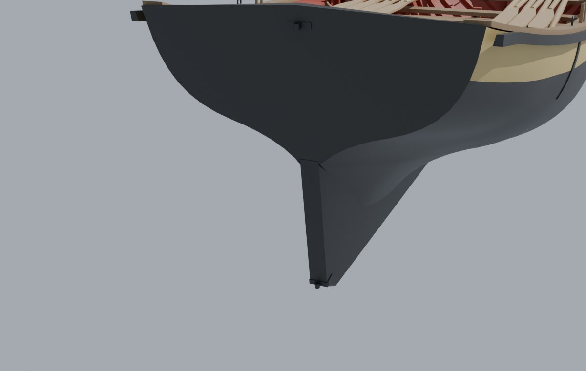
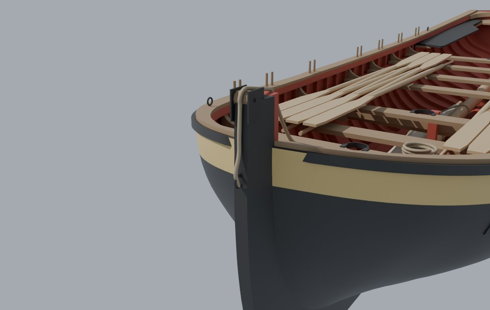

### Her gear, stowed in her

* **The oars** lie along the thwarts on each side, handles and blades alternating, each loom on the thwarts under it
  and each blade on its neighbours' handles.
* **The masts** lie on the bottom boards beside the keelson, each with its sail furled on its yard in a roll beside
  it, the two lashed together and let down onto what is under them.
* **The rudder**, unshipped, lies along the starboard stern bench, the straps of its pintles round its fore edge and
  their pins pointing along it; **the tiller** lies along the port bench.
* **The painter** runs from its ring bolt up over the stem head (over the roller in the launch), down onto the
  breasthook and to a coil on the foremost thwart.

Each of them must rest on something: the build checks that each stowed thing would go into what bears it if it were
let down a millimetre more (`bears_check`).

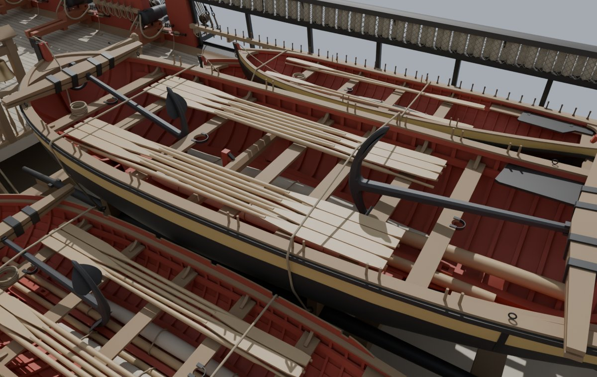

### Stowed over the waist

* **The spare spars.** Six spares the period carried on the booms, those that fit the waist's 43 ft 8 in opening
  (`spars_1795.json`'s sizes): the main and fore topgallant yards under the launch, the mizzen topgallant mast and yard
  under the starboard cutter, the main and fore topmast studding sail booms under the port cutter. Each lies level
  across the waist's beams on a **saddle** on every beam it crosses, hollowed to it and at least 2 in thick.
* **The cradles**: two a boat, across her two spars at about a fifth of her keel from each end, notched over the
  spars, their tops cut to her outside (her keel in a slot, a clinker boat's lands stepped). She sits level on them,
  her keel 4 in over the higher cradle's underside.
* **The boats**: the launch on the middle line, a cutter either side of her as close as 4 in between them allows at
  every height, and the gig in the starboard cutter on two **chocks** across its thwarts, cut to her outside, 1.64 in
  clear of everything in the cutter at the nearest.
* **The anchors** (`anchors_1797.json`): the stream anchor (1,100 lb) across the launch aft and the large kedge
  (700 lb) across her forward, the small kedge (400 lb) across the port cutter. Each stock lies across her gunwales on
  the cappings (the cutter's washstrakes), and the anchor is turned down about it until it rests on something in her:
  the stream anchor on the masts, the large kedge on a thwart, the small kedge on the keelson. The launch carries them
  out to kedge the ship.
* **The gripes**: one at each cradle, 3.5 in rope from an eyebolt in one end of the cradle up her side, over her
  gunwales and whatever rides in her, down to an eyebolt in the other end, each end spliced round its eye. It is set up
  taut over the outline of all of it, turned round each corner on its own radius.

The gangways keep 5.8 ft clear under the boats (the build's least is 5 ft), the spars and saddles stand 5.45 in inside
the waist's coamings, and nothing of the stowage is over a ladder: the nearest is 0.73 ft from the space a man
climbing one takes.

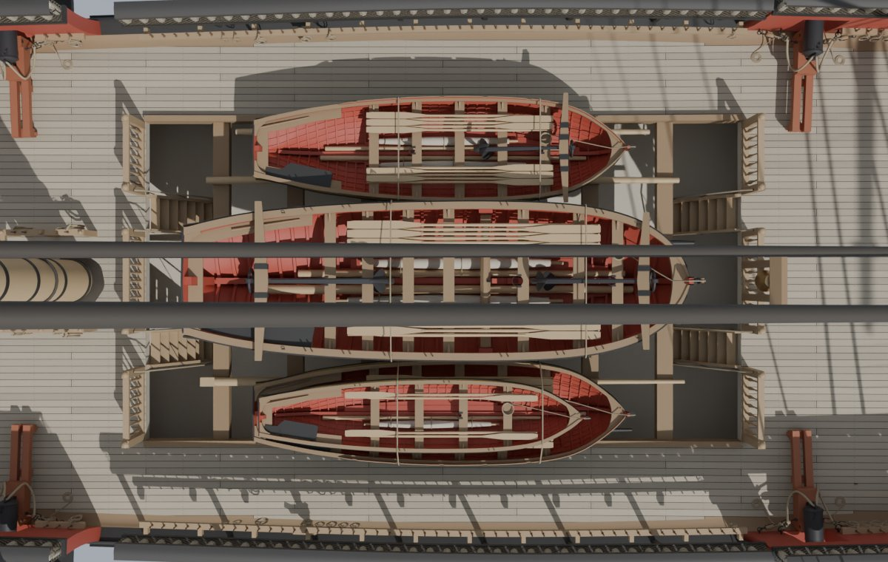
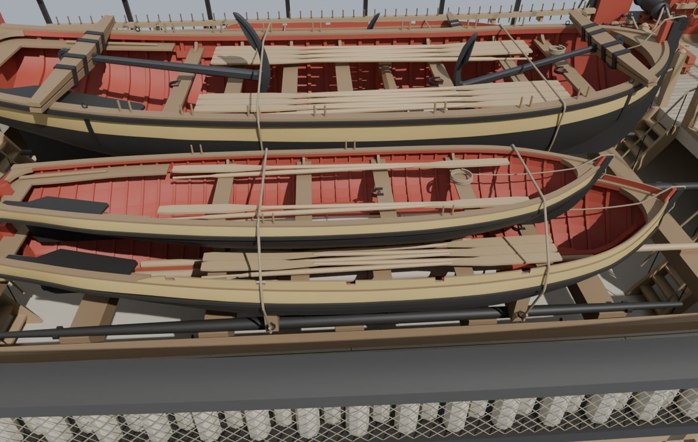
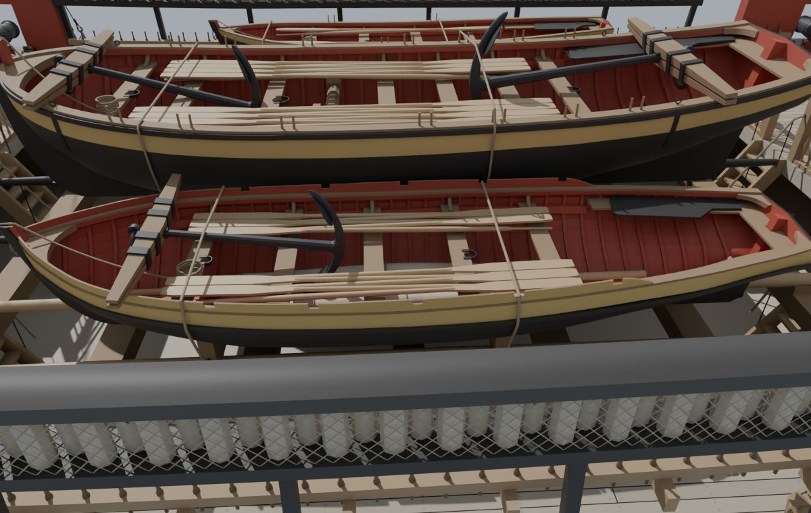
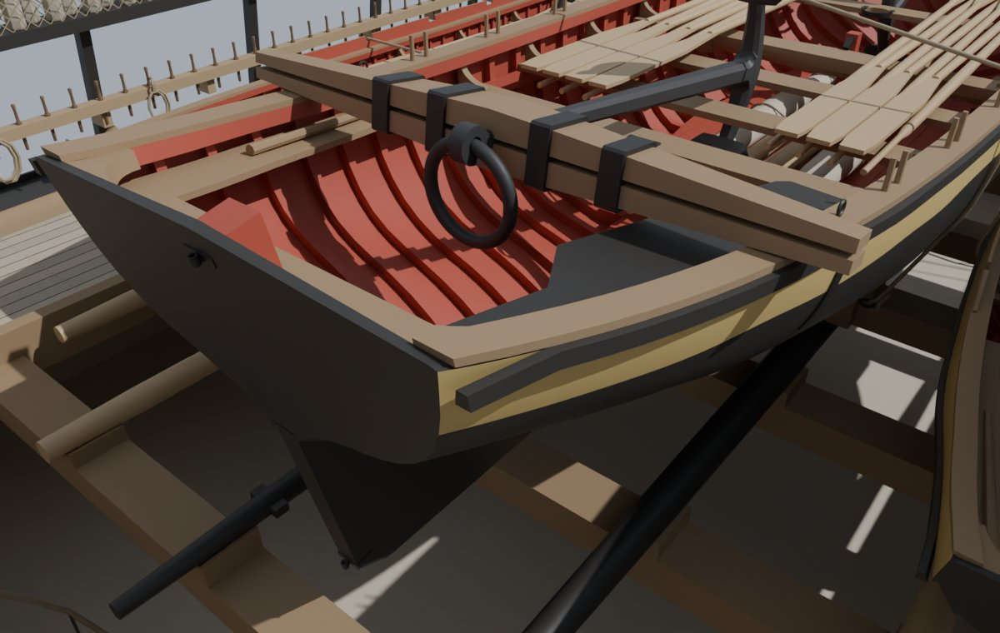
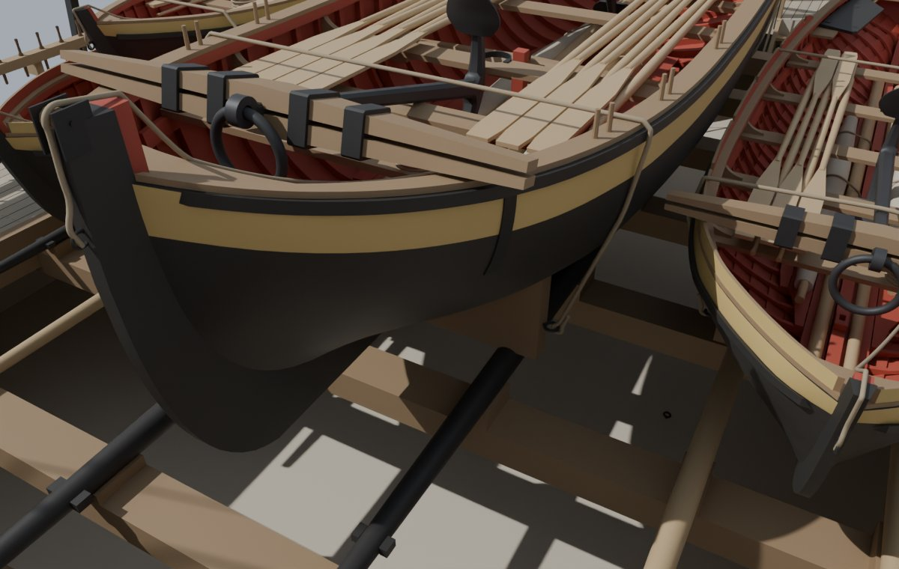
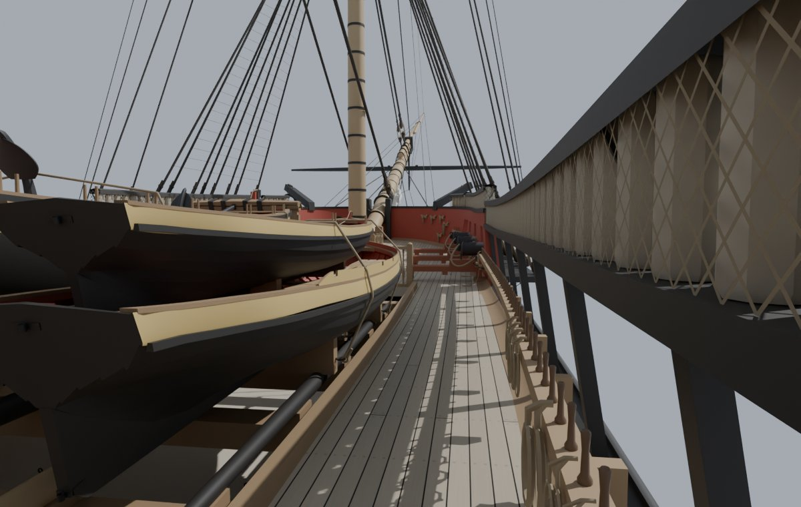
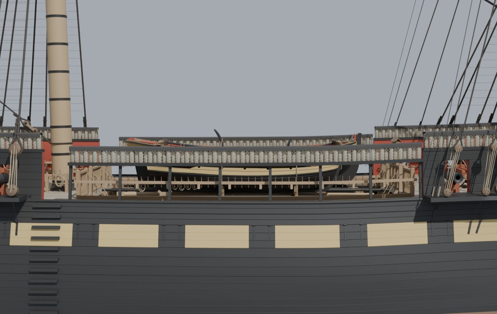

## Clearance

The build checks the boats and their stowage against everything else in the ship (the sails, running rigging and guns
in every state and pose too) and against each other (`boats_room`, `build.json` `boats.room`), as slice 10's anchors
room does, and each boat's own parts against each other (`Boat.room_check`, `build.json` `boats.checks`). Nothing
meets anything it doesn't stand on or in by design. The contacts by design are listed in `boats_1797.json`, the
stowage's in `stowage.meets` and each boat's in `meets`, each with why and how deep it may go; the build fails on any
other contact, or on one that goes deeper. Each allowance is the deepest measured with a quarter inch over (rounded
up to 0.05 in), but the gripes', which is 0: they touch what they pass over and never go into it.

| Designed contact | Parts | Allowed (in) | Deepest (in) |
| --- | --- | ---: | ---: |
| Each saddle on its beam's top | `SparSaddles` with `WaistFrame` | 0.25 | 0.00 |
| Each saddle's top hollowed to its spar | `SparSaddles` with `SpareSpars` | 0.25 | 0.00 |
| Each cradle notched over its boat's two spars | `BoatCradles` with `SpareSpars` | 0.30 | 0.03 |
| Each cradle's top cut to her outside (straight between its faces, so a clinker land crossing it goes in a little) | `BoatCradles` with `Launch`, `Cutter_S`, `Cutter_P` | 0.50 | 0.25 |
| The gig's chocks on the cutter's thwarts, cut to the gig's outside | `GigChocks` with `Cutter_S`, `Gig` | 0.40 | 0.11 |
| Each gripe's eyebolts driven into its cradle's ends | `GripeEyebolts` with `BoatCradles` | 3.25 | 3.00 |
| Each gripe lying on what it passes over (its centre line its radius and 0.05 in off their outline: touching, never into them) | `BoatGripes` with `Launch`, `Cutter_S`, `Cutter_P`, `Gig`, `StreamAnchor`, `KedgeLarge`, `KedgeSmall` | 0.00 | none |
| The stock on her cappings, the anchor resting in her | `StreamAnchor`, `KedgeLarge` with `Launch` | 0.25 | none |
| The stock on her cappings, the anchor resting in her | `KedgeSmall` with `Cutter_P` | 0.25 | none |

Where the deepest is none, the two never met: each gripe is laid 0.05 in off the outline of what it passes over,
and each anchor's stock sits on the highest points of the cappings under it.

Inside each boat a part's depth in another is measured by parity: the deepest that any point of it lies inside a
closed piece of the other, to that piece's surface, however deep. Every piece of every part is closed, and two pieces of
one part may not cross unless they are one fitting (an oar's loom and blade, the windlass's barrel in its bitts). The
deepest in each boat (in; a dash where the boat has no such parts):

| Designed contact | Parts | Allowed (in) | Launch | Cutter | Gig |
| --- | --- | ---: | ---: | ---: | ---: |
| The planks' hood ends let into the rabbet of the keel, stem and post | `planking` with `keel_stem` | 1.15 | 0.89 | 0.60 | 0.48 |
| The garboards' edges on the hog in the rabbet, the planks' after ends round the transom | `planking` with `hog`, `transom` | 0.40 | 0.05 | 0.12 | 0.07 |
| The frames on the planking's inside (bridged over a clinker boat's lands, which they take a little of where her garboards are hollow) | `frames` with `planking` | 0.75 | 0.25 | 0.47 | 0.29 |
| The frames notched over the hog; the keelson, risings, inwales and bottom boards on them, the knees, thwarts and stern benches against them | `frames` with `hog`, `keelson`, `risings`, `stern_risings`, `inwales`, `knees`, `thwarts`, `stern_benches`, `cappings`, `bottom_boards` | 0.45 | 0.16 | 0.19 | 0.08 |
| The thole pins driven through the cappings | `cappings` with `thole_pins` | 0.85 | 0.56 | - | 0.39 |
| The cappings on the top strake (a clinker boat's land under them) | `cappings` with `planking` | 0.60 | 0.15 | 0.33 | 0.23 |
| The cappings on the frames' heads and the inwales (over a launch's rubbing strake), the quarter knees and the breasthook under them, their ends on the transom; the washstrake on them | `cappings` with `inwales`, `quarter_knees`, `rubbing`, `transom`, `washstrake`, `breasthook` | 0.30 | 0.05 | 0.01 | 0.01 |
| The breasthook between the inwales, notched round the apron | `breasthook` with `hog`, `inwales` | 0.35 | 0.03 | 0.07 | 0.05 |
| The hog on the keel and up the stem as the apron, the inner post and the transom on it aft | `hog` with `keel_stem`, `inner_post`, `transom` | 0.25 | 0.00 | 0.00 | 0.00 |
| The inner post on the transom's inside, the transom bench notched round it | `inner_post` with `transom`, `transom_bench` | 0.35 | 0.06 | 0.00 | 0.00 |
| The inner post's foot between the garboards' hood ends at the heel, where they come in to the rabbet | `inner_post` with `planking` | 0.60 | - | 0.34 | 0.20 |
| The inwales over the knees' heads, their after ends on the quarter knees and the transom | `inwales` with `knees`, `quarter_knees`, `transom` | 0.45 | 0.10 | 0.16 | 0.11 |
| The mast steps and a launch's pawl post on the keelson | `keelson` with `mast_steps`, `windlass` | 0.25 | 0.00 | 0.00 | 0.00 |
| The thwarts on the risings, the knees on them, the mast clamps let into them | `thwarts` with `knees`, `risings`, `mast_clamps` | 0.30 | 0.01 | 0.00 | 0.00 |
| The stern benches on the stern risings, meeting the transom bench and the transom | `stern_benches` with `stern_risings`, `transom_bench`, `transom` | 0.30 | 0.03 | 0.01 | 0.01 |
| The stern risings' fore ends against the risings | `risings` with `stern_risings` | 0.25 | 0.00 | 0.00 | 0.00 |
| The rubbing strake and a launch's sling plates on the planking's outside | `planking` with `rubbing`, `sling_plates` | 0.35 | 0.06 | 0.08 | 0.07 |
| A sling plate's strap up to the rubbing strake | `rubbing` with `sling_plates` | 0.40 | 0.14 | - | - |
| The quarter knees, the stern risings and the transom bench against the transom | `transom` with `quarter_knees`, `stern_risings`, `transom_bench` | 0.35 | 0.09 | 0.00 | 0.00 |
| The painter's ring bolt driven into the stem | `keel_stem` with `ring_bolt` | 1.10 | 0.81 | 0.38 | 0.40 |
| The rudder's gudgeons strapped on the transom's face and round the post (a little into its after corners) | `keel_stem`, `transom` with `gudgeons` | 0.35 | 0.06 | 0.06 | 0.06 |
| A launch's roller and its pin in their slot in the stem head | `keel_stem` with `roller` | 1.70 | 1.41 | - | - |
| The painter spliced round its ring | `painter` with `ring_bolt` | 0.55 | 0.30 | 0.28 | 0.26 |
| Each yard inside its furled sail | `masts` with `sails` | 4.10 | 3.84 | 2.78 | 2.25 |
| The lashings bitten into the furled sails and round the masts | `lashings` with `masts`, `sails` | 0.95 | 0.70 | 0.70 | 0.70 |
| The rudder (on its pintles' straps) and the tiller lying on the stern benches | `stern_benches` with `rudder`, `tiller` | 0.30 | 0.01 | 0.00 | 0.01 |
| A launch's windlass bitts fayed to the frames' inside and bolted through them, the risings over their heads | `windlass` with `frames`, `risings` | 0.35 | 0.08 | - | - |
| The slings' eyebolts driven through the cappings over a launch's sling plates | `cappings` with `sling_plates` | 0.25 | 0.00 | - | - |
| The oars lying on the thwarts | `thwarts` with `oars` | 0.25 | 0.00 | 0.00 | 0.00 |
| The lashings passed under the masts and furled sails on the bottom boards | `bottom_boards` with `lashings` | 0.25 | 0.00 | 0.00 | 0.00 |
| The painter's lead lying over the breasthook to the stem's ring | `breasthook` with `painter` | 0.30 | 0.05 | 0.00 | 0.00 |

The hull is checked for openings too (`seams_check`): from points outside her, rays are aimed at her seams (the
keel's, stem's and post's rabbets and outer edges, both sides, and the transom's edge) in a cone about her outward
normal there. A ray that first meets her inside paint has come in through an opening, and the opening's width is how
far the ray can be moved square to itself and still come in. The widest anywhere is 0.2 mm; the build fails
over 2 mm. The running rigging's world includes the boats and their stowage, so every rope clears them with its own
check (slice 6), and the brace limits, the sails' room and the guns' room all see them.

## Triangles

| Object | Triangles |
| --- | ---: |
| **The boats** | **203,288** |
| `Launch` | 55,028 |
| `Cutter_S` | 53,032 |
| `Cutter_P` | 53,032 |
| `Gig` | 42,196 |
| **Their stowage** | **36,988** |
| `SpareSpars` | 4,336 |
| `SparSaddles` | 1,804 |
| `BoatCradles` | 2,532 |
| `GigChocks` | 388 |
| `BoatGripes` | 24,520 |
| `GripeEyebolts` | 3,408 |
| **The anchors with them** | **10,512** |
| `StreamAnchor` | 3,516 |
| `KedgeLarge` | 3,504 |
| `KedgeSmall` | 3,492 |
| **All of it** | **250,788** |

Each boat's share (the hull is her planking, backbone and transom; the framing her frames, keelson, risings, inwales,
cappings, rubbing strakes, knees, breasthook and washstrake; the fittings her thwarts, benches, bottom boards,
rowlocks, gudgeons, ring bolt and the launch's windlass, roller and sling plates; the gear her oars, masts, sails and
lashings, rudder, tiller and painter):

| Boat | Hull | Framing | Fittings | Gear | All |
| --- | ---: | ---: | ---: | ---: | ---: |
| Launch | 20,896 | 14,496 | 5,960 | 13,676 | 55,028 |
| Cutter (each) | 19,676 | 16,948 | 3,196 | 13,212 | 53,032 |
| Gig | 14,028 | 14,336 | 2,440 | 11,392 | 42,196 |

The slice is 250,788 triangles, 78% of the plan's 320k. The plan's figure is a starting point, not a
ceiling (Bean, 12 Nov): the build reports its share of it (`boats.checks.share_of_budget`) and never fails on it. Each
boat's planking is the largest part of her (13,112 to 19,960), then her painter (8,060 to 9,036: a coiled rope) and her
frames. The ship as drawn with her sails set is 4,059,387 triangles (slice 10: 3,808,599), past the plan's 3.9M for
the outside, which is a floor, not a cap (slice 2).

## For the game

In the .blend each boat is one object on her own frame (its origin at her transom's top aft edge on her middle line, at
her base; its axes the ship's), every part of her and her gear in it. The stowage (the spare spars, saddles, cradles,
chocks, gripes and their eyebolts) and the three anchors are objects in the ship's frame. Nothing moves yet, but
`boats.json` holds what a later slice needs to hoist a boat out or put her in the water: each boat's frame, her keel's
bottom, her cradles and gripes; where the gig lies in the cutter; the spare spars and their saddles; where each anchor
lies and how far it is turned down; each boat's sizes as built, her thwarts, where her masts step, and her gudgeons'
eyes, where her rudder hangs when she is shipped.

## Sources and estimates

* **Royal Museums Greenwich J0267**, '31ft Longboat (circa 1801)', a public domain scan on Wikimedia Commons: the
  launch's lines, written sizes and fittings (thwarts, windlass, mast steps, stern sheets, sling plates, the roller).
  Measured only: the scan is not in the repository.
* **Royal Museums Greenwich J0667**, 'Draught of a Pinnace' (1840), the same: the cutters' and gig's lines and written
  sizes, the washstrake and its rowlock notches.
* **Royal Museums Greenwich J0022**, '27ft armed launch for Juste (1794)', the same: a launch of the 1790s, her stern
  sheets, thwarts and knees by eye.
* **Constitution's boats** as the US Navy and others list them (as quoted by the searches; the pages are on hosts this
  machine cannot open): her later outfit. The plan carries four for 1797.
* **Slice 10's `anchors_1797.json`**: the stream anchor and the kedges, sized there and stowed here (Bean, 15 Nov).
* **The spar deck (`deck_1797.json`, slice 7)**: the open waist, its beams and coamings, the gangways and ladders.
* **`spars_1795.json`**: the spare spars' sizes, each built as the rig builds it.
* **Period practice** for a frigate's boats, by eye where no draught gives it, each value so marked in
  `boats_1797.json`: the boats' sizes, their scantlings and fittings, their paint, and how they are stowed.

## Checks

```
python Tools/shipkit/frigate/build_frigate.py <out>
```

(Blender's Python, pip `bpy`; about 52 minutes and 7 GB of memory.) The boats are built after the deck and
before the brace limits, the sails and the ropes, which must clear them with their own checks. The build fails if:

* a boat or a piece of her stowage meets anything else in the ship, or another, except where they meet by design, or
  goes deeper than that contact allows (`boats_room`), or a pair of parts is named twice in the meets;
* any piece of a boat or of the stowage crosses itself (`boats.folds`), or two pieces of one stowage object cross
  (`boats.checks.within`);
* a boat's parts cross each other except where they meet by design, or deeper than allowed, two pieces of one part
  cross, or a piece isn't closed (`Boat.room_check`);
* anything stowed in a boat rests on nothing (`bears_check`);
* an opening wider than 2 mm shows where her hull's parts meet (`seams_check`);
* a boat's length, greatest moulded breadth or depth is more than 5% off the card's, or her loft more than 5% off the
  sizes written on her draught;
* a gangway has less than 5 ft clear under the boats, a ladder less than 6 ft 3 in of headroom under the stowage
  where any of it is over one, a spar or saddle comes within an inch of the waist's coamings, or the gig within an
  inch of anything in the cutter.

The boats are shaded smooth across edges under 35 deg, their ropes under 60 and their spars under 50.

## Review

An independent review measured the first full build and each boat built alone from the code as it then stood, with
its own probes, given only the build, `boats_1797.json` and the slice's code. It found ten defects. Each is fixed, and
the final code was measured again, by the review's own probes where they still apply:

| The review found | Fixed | Measured again |
| --- | --- | --- |
| 1. The plan's 320,000 triangles were enforced as a cap, though the plan's figures are starting points, and the slice was 27% under it (232,032) | the build reports the count and its share of the plan's figure and never fails on it; the detail went where the review found it short (the rudder, the gudgeons, the windlass, rounder ropes) | 250,788 triangles, 78% of 320k |
| 2. A boat's own clash check could not see one part more than 3 cm inside another: a 2 by 10 in frame driven 2, 4 or 8 in into a 12 in block read 0.0 in, as did one driven through a 1 in plank, so half the allowances could never fail, and the launch's apron lay 1.45 in inside her breasthook unseen. The card said each allowance was a quarter inch over the deepest measured; most were not | the check measures how deep any point of a part lies inside a closed piece of another (by parity), to that piece's surface, without limit; every piece of every part is closed; each allowance is the deepest measured with a quarter inch over | the review's test reads 2.0 and 4.0 in for the frame driven 2 and 4 in into the block, 5.93 driven 8 (as deep as it can lie in a 12 in block) and 1.0 through the plank; each fails an allowance under it. The apron lies 0.0 in inside the breasthook. Every allowance and its deepest is in Clearance |
| 3. The launch's rudder was cut short to fit the stern sheets (6.92 ft, not 7.57); every stowed rudder floated 1.4 to 6.2 mm over its bench, the straps that should carry it stood clear, and its pins were upright discs | each rudder lies at its full length along the starboard bench, angled to her middle line, its heel running on past the stern sheets if it must; it rests on the benches through the straps of its pintles, whose pins point along it to its heel at the gudgeons' heights (the gudgeons were added after the review, Fitting out) | the launch's rudder is 7.57 ft, the full length its rule asks, lying 10.8 deg off her middle line; every rudder and tiller rests on its bench (0.00 in) |
| 4. Stowed gear floated: the mast bundles 2 to 36 mm clear of everything, the anchors resting on those floating spars, the painter 0.3 in over the breasthook it should lie on, and the launch's windlass bitts standing on the loose bottom boards, not against her sides | each mast and its sail are let down onto what is under them and pitched as they lie lowest; the painter is laid down onto the breasthook; the windlass's bitts are fayed to the frames and bolted through them under the risings; the build fails if anything stowed rests on nothing | every mast bundle bears on the bottom boards (0.0 mm) and the painter on the breasthook (0.00 in); the anchors rest on the masts, a thwart and the keelson; nothing floats |
| 5. A gripe ran through the gig's thole pin: the gripes' outline came from three sections only, and a 0.25 in allowance for lying on what they pass over let it through | each gripe lies over the convex hull of everything in the slab its rope covers at its cradle (every corner and face in it), its own thickness clear, turned round each corner on its own radius; its allowance is 0 | no gripe meets anything but its eyebolts; each lies 0.05 in off what it passes over |
| 6. The stem head was open above the sheer: a slot one plank thick each side into the hollow stem (1.0 in on the launch) | the keel and stem are one closed solid, the stem's after face carried up from the rabbet to the head's top | no open edge on any stem; every piece of every part is closed |
| 7. The clinker planking had zero-area faces (26 a surface on a cutter, 20 on the gig) where the gerald takes a land to nothing, and a cutter's thwarts had slivers under 0.1 mm high | where a land is worked away to nothing the faces lose the corner its step's two rows share; outlines are triangulated without slivers | no zero-area triangle and none under 0.1 mm high in any boat |
| 8. Two saddles were thinner than the 2 in promised (1.88 and 1.92 in): sized where the spar crosses the beam's middle, though it runs lower over the saddle's length | each spar's height is set from the lowest of its underside over every saddle | every saddle at least 2.0 in |
| 9. The checks claimed more than they did: nothing checked the sizes written on the draughts, any boat's depth or the launch's breadth; the cutters came out 7.14 ft moulded, not 7.25, the pinnace's written breadth being her extreme, not her moulded | the loft is held to its draught's written sizes and each boat to the card's length, breadth and depth (each within 5%); the cutters' and gig's breadths scale from the pinnace's greatest moulded breadth as traced (8.57 ft) | the written sizes and the card's each within 1.9% (Four boats) |
| 10. Smaller: card keys never read and one read but missing; a stowage meet that never happened (a kedge on the stream anchor); the gripes' eyebolts' 4.25 in allowance covering their rope too; two pieces of one part never checked against each other; the gig 0.87 in from the cutter against the inch promised, tested only on 1 cm rasters; a ladder check that measured nothing; a warning on every build | the card's keys are all read or gone (`chock_rise_in` added); the false meet gone; the eyebolts are their own object (`GripeEyebolts`); two pieces of one part or one stowage object may not cross; the gig is placed on the rasters and then measured surface to surface; the ladders' clearance to the stowage is measured; the warning gone | the gig is 1.64 in from the cutter, the ladders 0.73 ft and more from the stowage |

After the review the hull was checked from outside for openings where her parts meet, and one was found: the planks'
after ends ran straight from their last row on the deadwood to their first on the transom, cutting off the corner where
the rabbet turns up at the transom's heel and leaving a hole between the post's head, the transom's foot and the
planks, 12 mm wide on the launch and 42 mm on a cutter. A row of the planking now runs through the heel, and the build
checks every seam (Clearance). The rudder's gudgeons were added then too, so each boat has the irons her stowed rudder
ships on.

## Known gaps

* **Nothing hoists out.** A frigate hoisted her boats out with tackles from her yards and stays; none are drawn, and
  the slings' eyebolts wait on the launch's cappings. No davits are drawn either: every boat is on the booms.
* **The ends of the inwales.** Past her last frames, at the bow and the transom, the inwales (and forward the
  breasthook, fayed to them) stand off the planking about as far as a frame's head would (0.5 to 2 in), with nothing
  between them under the cappings, where a builder would have carried a frame or a packing piece out to them.
* **No foot stretchers, bailers, boat hooks or grapnels**, and the boats' sails are furled rolls on their yards, with
  no sheets, halyards or sail plans of their own.
* **Her later boats** (the whaleboats, the jolly boat and the punt) are not drawn: the plan carries four for 1797.
* **Estimates throughout** (Sources), and nothing is in the game yet.

## Files

| File | What it does |
| --- | --- |
| `Tools/shipkit/frigate/boats.py` | a draught's lines lofted strake by strake (`Lines`); a boat planked, framed and fitted out, her gear stowed in her and her own checks (`Boat`); the spare spars, saddles, cradles, chocks, anchors and gripes over the waist, their places and checks (`Boats`) |
| `Tools/shipkit/frigate/boats_1797.json` | the two draughts' traced lines; each boat's sizes, scantlings and fittings; the stowage; the meets by design; every value with its source or marked an estimate |
| `Tools/shipkit/frigate/build_frigate.py` | builds the boats after the deck, gives the running rigging, brace limits, sails and guns the new parts, checks their room (`boats_room`) and folds, and writes their counts and places in `build.json` and `boats.json` |
| `docs/shipkit-11/baseline/` | `build.json`, `boats.json` and renders |
