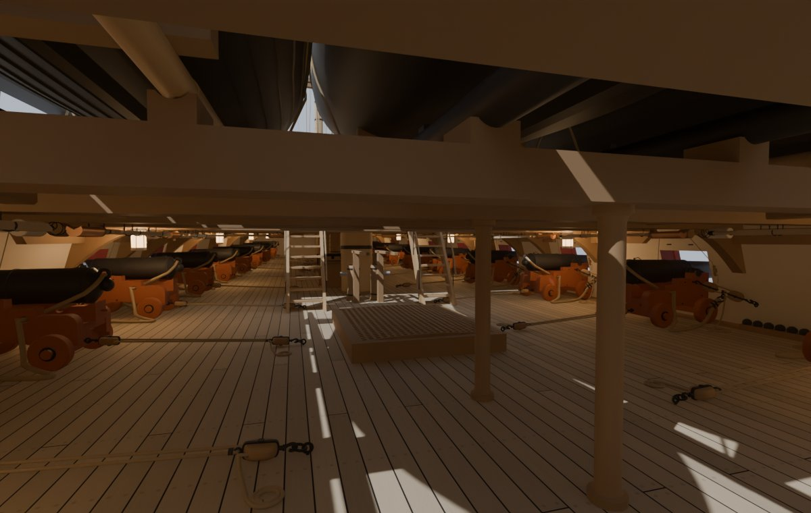
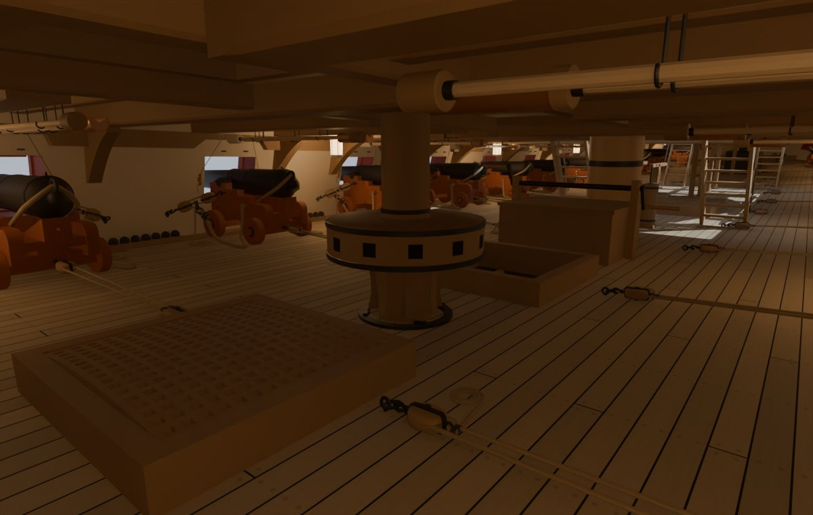
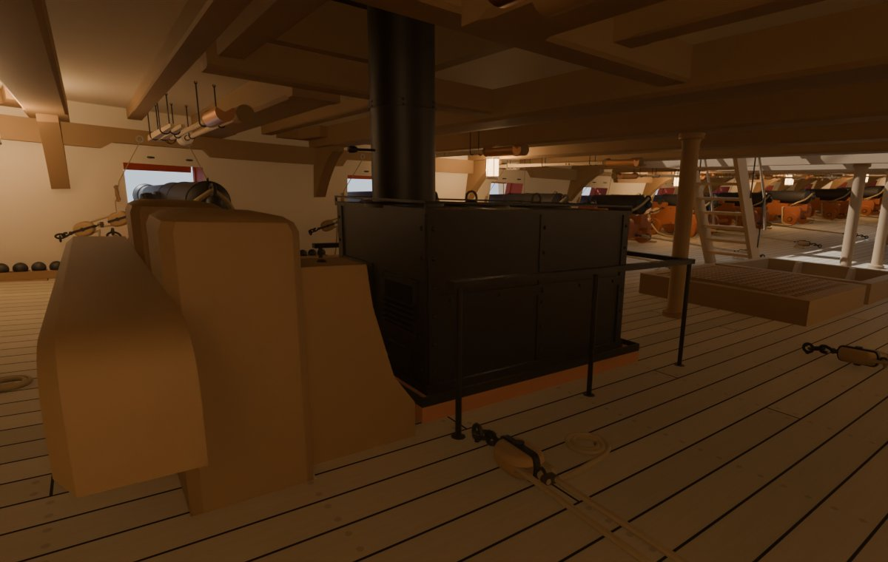
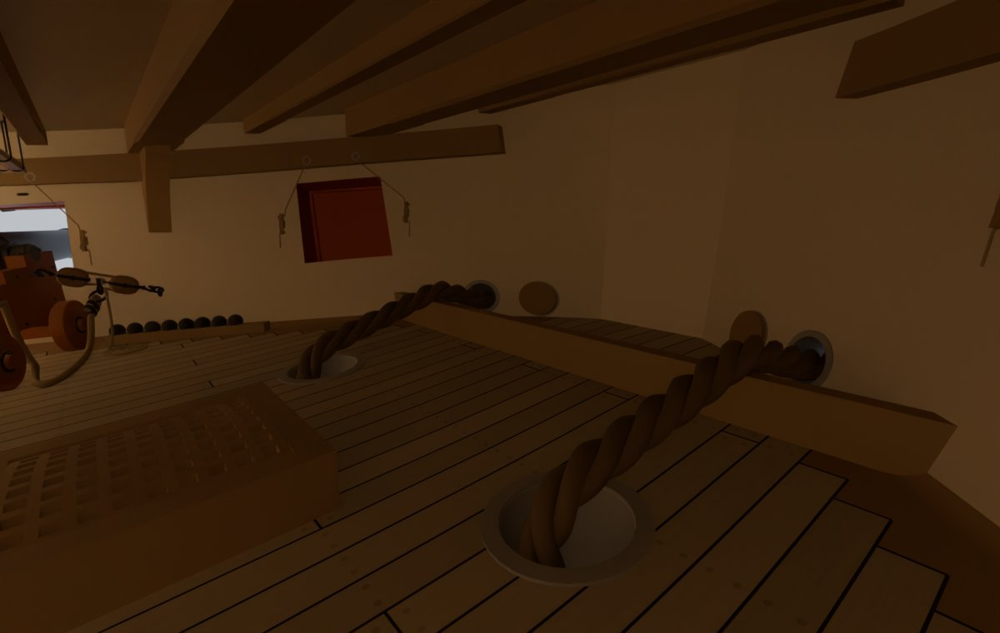
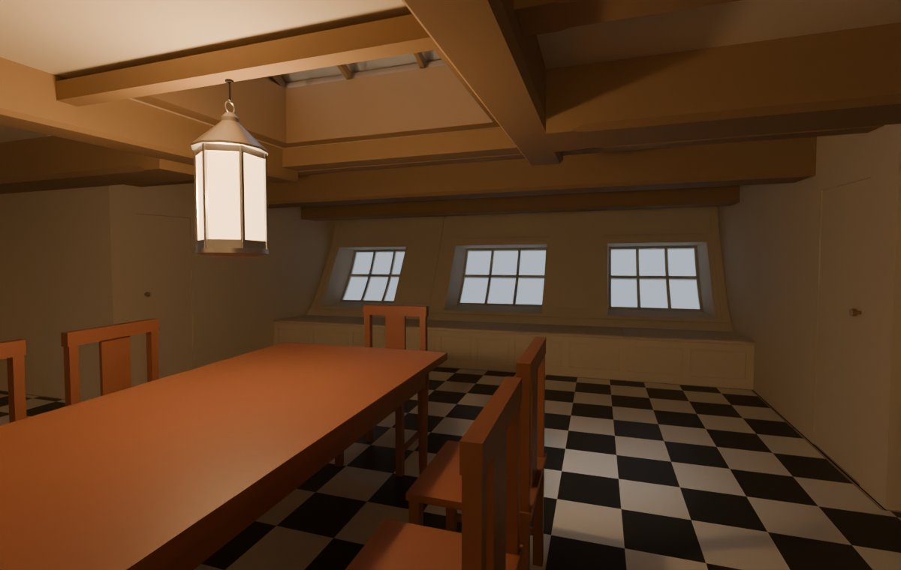
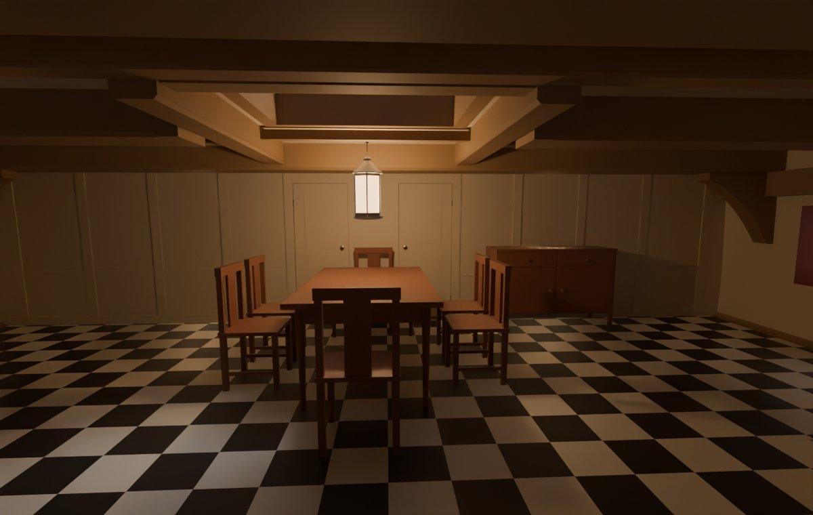
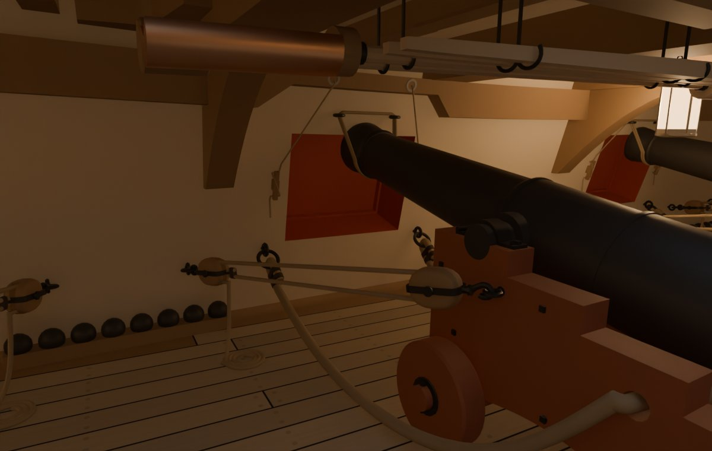
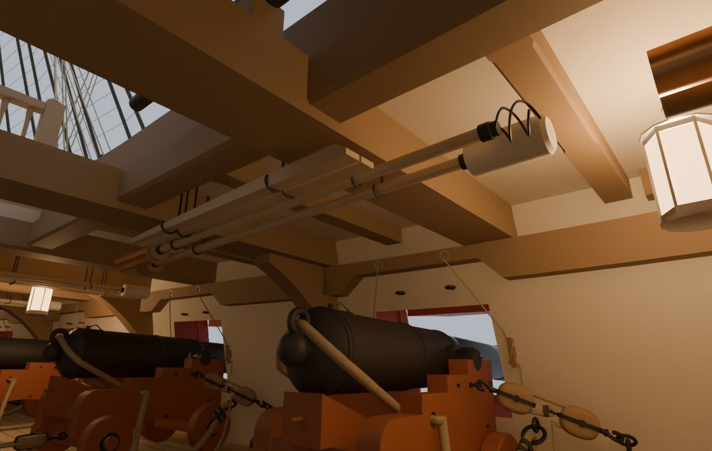
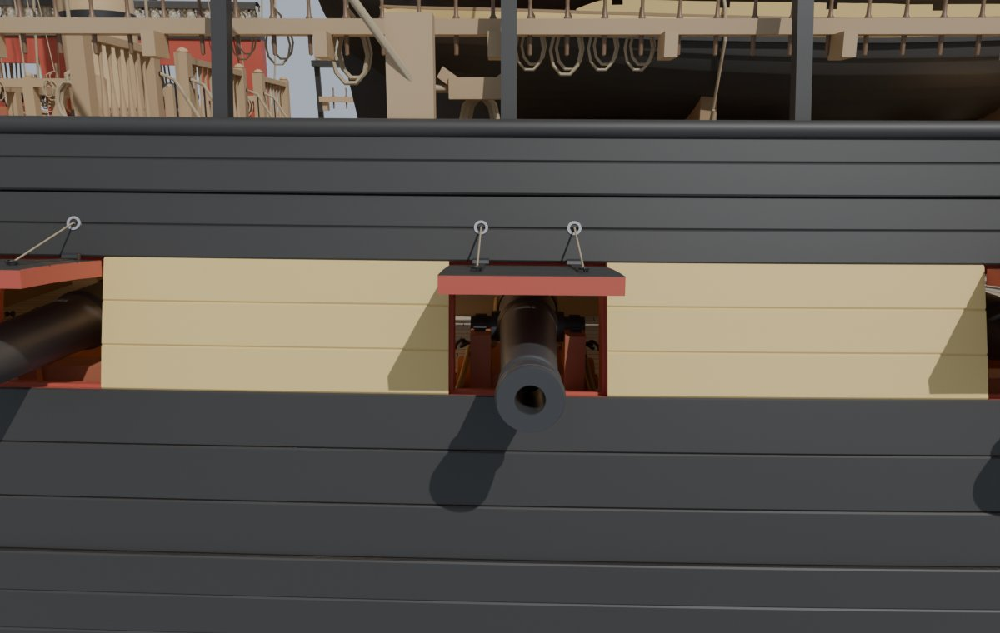
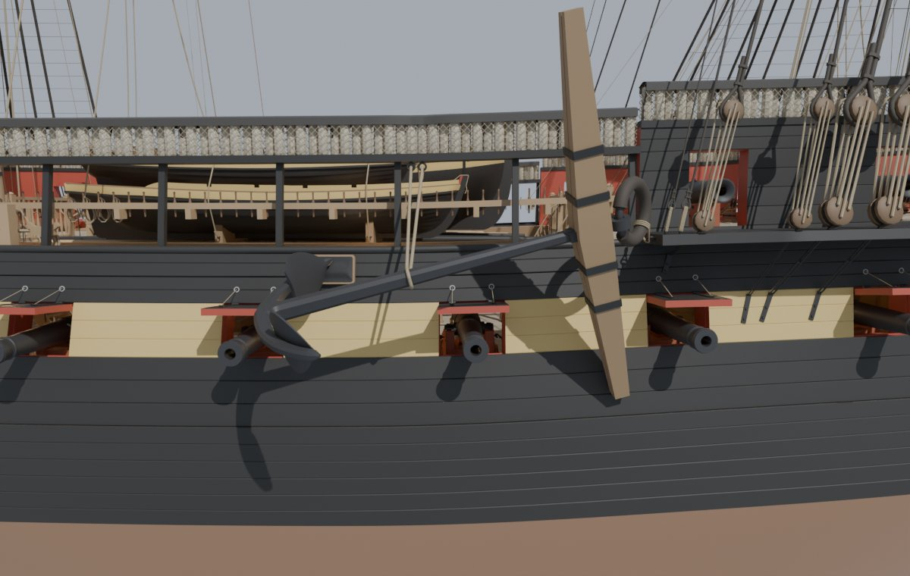

# Shipkit 12: the gun deck

Slice 12 of the frigate *Commonwealth* (plan: <https://claude.ai/artifact/8y6hW8vHjjUPJRovJEuxY7>; slices 0-11 are in
`docs/shipkit-1` to `docs/shipkit-11`). Slice 11 gave her boats. This slice takes her below for the first time: the
gun deck, the deck under the spar deck where her long guns stand. It builds the planked deck under the guns and the
spar deck's framing over it; the hatchways with their coamings, gratings, wells and ladders; the gun deck's capstan,
the pumps, the riding bitts and the galley stove; the manger at the bow, with the bowers' cables led in through the
hawse holes and down the cable scuttles; the captain's great cabin aft, under the stern windows; the lanterns, each a
light in the game data; and the guns' own gear that slice 8 left for here: tompions and lead aprons, sponges,
rammers, ladles, worms and handspikes hung overhead, shot in garlands along the sides, and the lanyards that hold
each port lid open. It also stows the sheet anchor outside, on the starboard fore channel, as Bean chose. It is still
post-slice art: nothing here is imported into Unreal or wired into the game.

Every render on this page is flipped left to right, so it shows her as the game will (docs/shipkit-9 says why).


## What slice 12 builds

### Twenty-eight guns, not thirty

The plan says thirty guns on this deck. She has fifteen ports a side, but the foremost each side is the bridle port at
the bow, a chase port the foremost guns were shifted into and too far forward to house a gun in. Bean chose
twenty-eight long 24-pounders, fourteen a side, with the bridle ports empty and their lids shut (`guns_1797.json`).
Slice 8 built the guns, their carriages and tackles in three poses (housed for sea, run in, run out); this slice
builds the deck under them and their gear about it.

### The deck, from the 1849 plan

Her drawings of 1849, the Navy Yard Boston gun deck plan (NARA 75841364) and spar deck plan (NARA 75841368), place the
deck's fittings: the hatchways with their inside sizes written on them, the pumps either side of the main mast, the
capstan between the after hatchways, the riding bitts and the galley between the fore hatchway and the fore mast, the
scuttle forward of them, the manger, and the bulkhead and cabins aft. The plan is carried to her the way slice 7
carried the spar deck's: by the masts where they pass this deck, each item keeping its share of the way from one mast
to the next (and its distance at the plan's scale aft of the mizzen and forward of the fore mast). The scans are
public domain, measured only, and not in the repository.

* **The deck** is flat across, its top 24 in under the port sills (`specs_1795.json`), and planked in 7 in planks
  4 in thick, their butts staggered over the beams and their bolts plugged (`GunDeck`, drawn by the material from the
  deck's `Planking` and `Margin` UVs, as the spar deck's). Slice 8's known gap is closed: the traced sills left a kink
  where the deck climbed 4 in in 5 m by port 10, and the line under them is now faired between 7 and 12 m
  (`specs_1795.json` `gun_deck_fair_m`).
* **The waterways** along each side, a hollow cove where the deck meets the side, run from the after wall forward
  until the bow narrows, stopping 2 in short of the hawse holes' linings where the bores come in at the deck.
* **The hatchways**: the spirit room hatch, after hatch, main hatch, fore hatch and the hatch forward of it, the
  scuttle and the wardroom's skylight, each at its plan size with a coaming 10 in high and 5 in thick (4 in round the
  skylight, narrowed to clear the second guns' train tackle bolts). The after and fore hatches are ladderways, the rest
  gratings. Under each opening a **well** goes down to where the berth deck will be (slice 13), 7 ft 2 in under this
  deck's top, lined dark, with a ladder down each ladderway. That is the 1926 midship section's spacing, and it puts
  the berth deck 17 ft over the rabbet amidships, where the 1795 section drawn from Humphreys' specifications has it.
* **The ladders**: one down each ladderway, and the companion's from the quarterdeck down to this deck forward of the
  cabin. The spar deck's four ladders at the breaks land on this deck in the waist, and nothing stands within a foot
  of their feet.



### The spar deck's framing overhead

What a man on the gun deck sees over him is the spar deck's framing. Its planks are 3 in thick on beams 14 in sided
and 10 in moulded at every other beam station, with a ledge (6 by 5 in) between each two. Where a beam would cross an
opening above (a hatchway, the companion, a skylight, the chimney, a mast's partners, the capstan) it is cut, and half
beams run from the side to a carling either side of the opening, with head ledges across its ends. In the waist the
gangways' beams run out to a carling under the opening's coaming, and a breast beam stands under each break. The
beams' ends rest on **a clamp** along each side (10 by 5 in), which steps up over each port so its lower edge stands
7.5 in over the port's head, clear of the bolts the housed gun's muzzle is lashed to. **Hanging knees** (7 in sided,
30 in arms) hold each beam end that comes between two ports; one that would foul a lid lanyard's cleat slides along
under its beam. **Stanchions** (6 in, turned) stand on the middle line under the whole beams where the deck is clear
of fittings. The beams' and ledges' lower edges are chamfered (an inch on the beams), the chamfers stopped short of
the side where the knees and the clamp take the ends; the carlings' are chamfered their whole length. **Lodging
knees** lie flat in the angle between a beam's face and the side under the planks, one at each end of each beam
forward of the cabin, on the face toward the ship's middle where that bay is clear of the ports (the bays over the
ports hold the implements and the lids' lanyards): an arm 30 in along the beam's face and one along the side, stopping
short of the next ledge, the throat rounded: fifteen a side.

### Fittings

* **The capstan**: the double capstan's lower head under the spar deck's, on the same axis: its barrel up through the
  gap between the decks to the spar capstan's, eight whelps, a 56 in drumhead with twelve bar holes, and pawls on the
  deck. It is its own object, on a frame on its axis, so the game can turn it. **Its twelve bars** (12 ft, square at
  the inner end for the hole, then round and tapering to the hand) are stowed overhead athwartships, three to a bay
  in the bays nearest it that are clear of the ports and lanterns, each set in two iron stirrups from the planks.
* **The pumps**: the chain pumps aft of the main mast (two chains in one case over the well, a crank across the ship
  with a winch handle at each end) and a pair of common pumps forward of it, their brakes pointing forward.
* **The riding bitts** abaft the fore mast: two posts through the deck, their edges chamfered and their heads rounded
  over, a cross piece on their fore faces with its fore edges chamfered and its ends rounded down, a standard (a knee)
  behind each, and round-headed iron bolts through the cross piece into the posts and down through the standards.
* **The galley**: an iron stove of the period's patent kind (Brodie's) on a brick hearth under the forecastle, with an
  iron kerb round the hearth: cast plates bolted at angle irons up the corners, a band round it at half height and a
  rib up each side, every joint on round bolt heads; a fiddle bar round the top to keep the pots on, and the boilers'
  lids in it; on its fore face the fire's open mouth with its grate, the ash pit's door under it and the oven's door
  on two strap hinges with a latch. A rail runs round it, and its flue goes up into the forecastle's chimney with a
  band and the damper's handle.
* **The masts' wedges**: a ring of wedges round each mast where it passes the deck, 3 in proud. The masts' iron hoops
  stop clear of both decks' partners (`spars_1795.json`).




### The bow

The bowers' cables (slice 10) now come in through the hawse holes, whose bores run through to the side's inner face,
lined with lead all the way and lapped over the inner mouth as over the outer. Each cable lies on the lining at the
inner mouth, runs over **the manger** (a low board across the bow abaft the holes, 10 in high, that keeps the water
coming in with the cables from running aft, a scupper through it), and turns down **a cable scuttle** (20 in, a lead
collar round it) into a short well toward the cable tiers (slice 14). The course is the shortest that clears the
manger, the deck, the collar and the scuttle's lining, each turn no tighter than one and a half times the cable's
thickness. The holes with no cable in them are stopped with **hawse plugs**, oak plugs driven in from inboard.



### The great cabin

The captain's cabin under the quarterdeck, from the 1849 plan's bulkhead and state rooms (the 1797 cabin was the
captain's, on this deck). Since this slice the rudder's head comes up through the window seat and the iron tiller
swings overhead, its ropes led from the wheel under the quarterdeck's beams (`docs/frigate-tiller`):

* **The bulkhead** across the ship abaft the first guns, panelled both faces, with a door either side of the middle
  line (each door its own object, hinged on its outboard post, opening aft into the cabin; 64 in high since the
  tiller went overhead, so they swing clear under it).
* **The after wall**: the stern's inside, raked with her stern, with the stern windows opened through it and each
  window's reveal lined with board. The transom's rows are cut round the windows, so daylight comes in through them.
  Between the state rooms it is panelled on its rake: a sill rail along the seat under the windows, a pilaster on a
  base under a capital between each two windows, a stile at each end, a head moulding and a raised and fielded panel
  over each window, and a cornice under the planks.
* **A state room in each quarter**, its wall stepped round the beams over it and its door opening into the stern cabin.
* **The window seat** across the stern under the windows between the state rooms, the rudder's head boxed inside it:
  a hinge rail let into the after wall, four lids on brass hinges (the piece over the rudder's head is fixed), each
  with its nosing rounded over, and the front framed with raised and fielded panels.
* **The floor cloth**: painted canvas over the cabin's deck in black and white squares a foot across.
* **The furniture**, mahogany: a table 72 by 40 in, six chairs and a sideboard against the bulkhead.
* **The lead bushes** where the tiller ropes' legs passed down through the deck (gone since the tiller went overhead:
  the legs now end in the quarterdeck's planks and lead on under its beams).




### Lanterns and light

A horn lantern hangs between each second pair of guns a side (seven a side): between the spar deck's beams on a hook
in the planks' underside, in the bay nearest the middle between the two ports that stands clear of both (the bays
over the ports hold the guns' implements), 1.15 m in from the side, over the room between the two guns and outboard
of the walk inboard of them, its dish 1.37 to 1.42 m over the deck. One more hangs over the middle of the cabin's
table from an oak bar across between the skylight's carlings. Each has a screw eye and hook, a ring on its cone roof,
a six-sided body of tin posts and horn panes, and its dish.

Each is a light in the game data (`gundeck.json` `lights`), warm (2200 K) and in a zone:

* **The deck's fourteen** (`gun_deck`) are unshadowed and reach 6 m, the aftmost pair only as far as the cabin's
  bulkhead (3.1 m).
* **The cabin's** (`great_cabin`) casts shadows and reaches 4 m.
* In the game a light should light only its own zone's objects (lighting channels; `gundeck.json` `below` gives each
  object's zones), so neither side shines through the bulkhead.
* **180 lumens** is chosen for the game's exposure below decks, not a candle's: a tallow candle gives about 12 lumens
  and horn passes less, so a period lantern lit only a few feet round it.
* **Fifteen lights** in all against the slice's budget of sixteen. The daylight comes in through the open ports, the
  hatchways and the stern windows. No light probes are set below in this slice: that is the PC lighting lane's, if the
  frame allows.

### The guns' gear

* **Housed for sea**, each gun has a wooden tompion in its muzzle and a lead apron over its vent and lock, beaten down
  over them (`Guns_Housed` only: they come out and off when the guns are cast loose).
* **The implements**: over each gun, in the bay between the spar deck's beams over its port, its two staffs (the
  sponge and rammer on one, the worm and ladle on the other, as sea service carried them) and its two handspikes, each
  on two iron hangers with a hook, under the beams so they pass below the carlings. In the waist, where there are no
  beams over a gun, its set hangs fore and aft under the gangway beside it.
* **The shot garlands**: an oak rail on the deck along the waterway forward of each port, cupped for eight 24 lb shot.
* **The lids' lanyards**: two to a lid, from a ring at the end of each hinge strap up the side to a lead-lined hole
  over the port, in through the side and the clamp (bored square through the side, as the port itself is cut), and
  down to a cleat beside it. Outside they lie down the shut lid
  with the guns housed, and run taut to the open lid with them run in or out. The bridle ports' lids stay shut.





### The sheet anchor

Slice 10 planned the sheet anchor (5,400 lb) for the gun deck, but its stock, 17.85 ft long, needs 2.4 m and the gun
deck has 1.8 m under the beams. Bean chose (16 Nov) to stow it outside, abaft the starboard fore chains, as frigates
did (`anchors.py` `sheet`):

* **Its shank** rises forward at 14 degrees, from its crown low on the side over its own billboard to its ring at the
  fore channel's after end, and its stock stands up the side. The bill of its inner fluke rests on the billboard, a
  plank on the side shaped to it.
* **Its ring** is lashed (three turns) to an eyebolt in the channel's after end, the lashing led from the ring's
  nearest point.
* **Its shank painter** comes from the waist rail's cap, its two legs steep enough (44 and 40 degrees) to take the
  anchor's weight with a safety of 3.8 on the rope.
* **Heeled 15 degrees** to starboard, its lowest point stays 0.15 m over the sea, the card's least; the build stops if
  it would dip.
* **Port 10's lid** opens under its shank, and swings clear of it to 175 degrees (its gun needs 80); every lid's sweep
  is checked against it.



### Bracing sharper, for the sailing physics

The square-rig physics (its own thread) needs to know how far each yard braces round and where each set sail first
bears on the rigging. Measuring that for it moved two things in her rig, and showed where a third must wait:

* **The topsail yards' parrels** ease up to 9 in forward as they brace (was 6 in): the main topsail yard braces 37
  degrees (was 35) and the mizzen's 40.5 (was 36).
* **The topsails' roach** is cut to clear the tops and stays with the yards braced, as well as square.
* **The catharpins** could bowse the fore and main lower shrouds in at the futtock staves, as the period's did: "a
  purchase of ropes employed to brace in the shrouds of the lower masts behind their yards" (Encyclopaedia Britannica,
  1797), so the lower yards could be braced sharper. Bowsed in 6 in, the fore yard braces 37 degrees and the main
  39.5, against 33.5 and 36 with the shrouds straight. But the falls from the tops to the forecastle and quarterdeck
  rails (the topsails' clewlines and buntlines, the topgallant sheets and lifts, the fore course's buntlines and the
  fore royal's sheets) come down just inside the foremost lower shrouds at the stave, and from an inch of pull the
  shrouds bear on them; re-placing their bull's eyes under the tops does not clear them. So the catharpins hold the
  shrouds straight against the futtock shrouds' pull, as before (`standing_1797.json` `catharpins_bowse_in`, none),
  and the fore yard braces 33.5 degrees and the main 36. Bowsing in waits for those falls to be led nearer the mast
  (Known gaps); the build bends the shrouds at the stave, and their ladders with them, when the card asks.

The hard limits (the yard itself stops) are in `build.json` `brace`, and the soft ones (a set sail's cloth first bears
on a stay or the lee shrouds, where real ships put chafing gear) in `sails.room.brace_contact`; the physics thread has
both.

## Clearance

The build checks the gun deck's parts and the guns' gear against everything else in the ship (the sails, running
rigging, boats and guns in every state and pose too) and against each other (`gundeck_room`, `build.json`
`gundeck.room`), as slice 11 checks the boats. Nothing meets anything it does not stand on or in by design, no fitting
stands off the deck where the sheer rises under it, and every designed contact still meets. The contacts by design are
in `gundeck_1797.json` `meets`, each with why and how deep it may go: the depth measured when it was set, with a quarter
inch over (rounded up to 0.05 in). The deepest in the final build:

| Designed contact | Parts | Allowed (in) | Deepest (in) |
| --- | --- | ---: | ---: |
| The after wall's edges against the side's inner face | `AfterWall` with `GunWall` | 0.25 | 0.00 |
| The after wall's top under the spar deck's planks | `AfterWall` with `SparDeck` | 0.25 | 0.06 |
| The state rooms' inboard walls run aft to the after wall, their ends let into its rake | `AfterWall` with `StateRooms` | 1.05 | 0.76 |
| Each window's lining fills the after wall's opening for it | `AfterWall` with `WindowReveals` | 0.45 | 0.16 |
| The window seat's top is let into the after wall | `AfterWall` with `WindowSeat` | 0.45 | 0.17 |
| The cabin's bulkhead is scribed round the clamp at the side | `CabinBulkhead` with `Clamps` | 0.30 | 0.04 |
| The cabin's bulkhead stands on the deck, its foot let in where the sheer rises under it | `CabinBulkhead` with `GunDeck` | 0.55 | 0.29 |
| The cabin's bulkhead's ends are scribed to the side's inner face | `CabinBulkhead` with `GunWall` | 0.75 | 0.48 |
| The cabin's bulkhead's ends are scribed down over the waterways | `CabinBulkhead` with `GunWaterways` | 0.55 | 0.28 |
| The cabin's bulkhead's head under the spar deck's planks | `CabinBulkhead` with `SparDeck` | 0.25 | 0.00 |
| The cabin's table, chairs and lockers stand on the floor cloth | `CabinFurniture` with `FloorCloth` | 0.25 | 0.00 |
| Each stirrup's straps go up into the planks over the capstan bars, bolted through them | `CapstanBars` with `SparDeck` | 0.65 | 0.37 |
| The spar deck's beams' ends rest on the clamp, let down into it | `Clamps` with `DeckBeams` | 0.50 | 0.22 |
| The clamp is bolted to the side's inner face, which curves under its back | `Clamps` with `GunWall` | 0.60 | 0.33 |
| Each hanging knee's arm is fayed over the clamp | `Clamps` with `HangingKnees` | 0.75 | 0.50 |
| The lid lanyards' holes are bored through the clamp over each port, lined with their lead bushes | `Clamps` with `LanyardFittings` | 1.30 | 1.04 |
| The state rooms' fore walls are scribed round the clamp at the side | `Clamps` with `StateRooms` | 0.30 | 0.03 |
| The waist's beams' ends rest on the clamp as the deck beams' do | `Clamps` with `WaistFrame` | 0.55 | 0.29 |
| The rammers, sponges, worms and ladles hang on hooks driven into the beams | `DeckBeams` with `GunImplements` | 0.65 | 0.38 |
| Each hanging knee's upper arm is fayed to its beam's side | `DeckBeams` with `HangingKnees` | 0.60 | 0.33 |
| Each lodging knee's arm is fayed to its beam's face | `DeckBeams` with `LodgingKnees` | 0.35 | 0.08 |
| The spar deck's planks are laid on its beams | `DeckBeams` with `SparDeck` | 0.45 | 0.19 |
| Each stanchion's head is under its beam | `DeckBeams` with `Stanchions` | 0.40 | 0.14 |
| The state rooms' walls are stepped round the beams over them | `DeckBeams` with `StateRooms` | 0.25 | 0.00 |
| The tiller rope's legs come down the fore face of the beam under their holes in the spar deck | `DeckBeams` with `TillerRope` | 0.25 | 0.00 |
| The carlings and ledges under the gangways are framed into the waist's beams (deck.py's) | `DeckBeams` with `WaistFrame` | 0.30 | 0.03 |
| The floor cloth is laid on the deck | `FloorCloth` with `GunDeck` | 0.30 | 0.02 |
| The galley's flue goes up into the forecastle's chimney, meeting its plate | `Galley` with `Chimney` | 0.45 | 0.18 |
| The galley's brick hearth is bedded on the deck, let in where the sheer rises under it | `Galley` with `GunDeck` | 0.75 | 0.50 |
| The gun deck capstan's spindle goes up into the spar deck capstan's barrel | `GunCapstan` with `Capstan` | 1.25 | 1.00 |
| The capstan's pawl ring is let into the deck | `GunCapstanPawls` with `GunDeck` | 0.45 | 0.20 |
| The deck's fore end against the bow's inside (skin.py's flat placeholder there) | `GunDeck` with `Bulkheads` | 0.25 | 0.00 |
| The deck's edge runs on under the waterways into the side | `GunDeck` with `GunWall` | 0.75 | 0.46 |
| The waterways lie on the deck's edges | `GunDeck` with `GunWaterways` | 0.55 | 0.26 |
| The ladder down the after hatchway hangs from its coaming, its head against the deck's opening | `GunDeck` with `HatchLadders` | 0.40 | 0.12 |
| The coamings stand in the deck's openings | `GunDeck` with `Hatchways` | 0.25 | 0.00 |
| The ladders up to the spar deck stand on this deck, their feet let in | `GunDeck` with `Ladders` | 0.60 | 0.35 |
| The tiller rope's lead bushes line its holes through the deck, their flanges on it | `GunDeck` with `LeadBushes` | 0.35 | 0.10 |
| The manger stands on the deck, its foot let in, and the cable scuttles' lead collars are let into the deck | `GunDeck` with `Manger` | 0.75 | 0.50 |
| The wedges are driven into the gap between each mast and its partners in the deck | `GunDeck` with `MastWedges` | 1.00 | 0.73 |
| The pumps' chambers go down through the deck | `GunDeck` with `Pumps` | 0.85 | 0.57 |
| The riding bitts go down through the deck | `GunDeck` with `RidingBitts` | 0.50 | 0.25 |
| The shot garlands are bolted down on the deck | `GunDeck` with `ShotGarlands` | 0.55 | 0.29 |
| Each stanchion's foot stands on the deck | `GunDeck` with `Stanchions` | 0.25 | 0.00 |
| The state rooms' walls stand on the deck, their feet let in where the sheer rises under them | `GunDeck` with `StateRooms` | 0.55 | 0.28 |
| The window seat's front board stands on the deck | `GunDeck` with `WindowSeat` | 0.55 | 0.28 |
| The implements' hooks are driven into the spar deck's underside between its beams | `GunImplements` with `SparDeck` | 0.45 | 0.16 |
| The implements' hooks are driven into the waist's beams | `GunImplements` with `WaistFrame` | 0.40 | 0.14 |
| Each waterway's back lies against the side's inner face | `GunWaterways` with `GunWall` | 0.55 | 0.28 |
| The manger's ends are scribed down over the waterways | `GunWaterways` with `Manger` | 1.40 | 1.13 |
| The state rooms' fore walls are scribed down over the waterway | `GunWaterways` with `StateRooms` | 0.55 | 0.27 |
| Each hanging knee's lower arm is fayed to the side's inner face | `HangingKnees` with `GunWall` | 0.60 | 0.33 |
| Each waist beam has its hanging knee at each end, fayed to its side | `HangingKnees` with `WaistFrame` | 0.25 | 0.00 |
| The ladders down stand in their hatchways' wells | `HatchLadders` with `Wells` | 0.25 | 0.00 |
| Each coaming stands on its well | `Hatchways` with `Wells` | 0.25 | 0.00 |
| The lanyards' cleats are let into the side's inner face, and their lead bushes go out through it | `LanyardFittings` with `GunWall` | 0.80 | 0.52 |
| Each lanyard comes in through its lead bush and is belayed round its cleat's horns | `LanyardFittings` with `LidLanyards` | 0.50 | 0.22 |
| Each lanyard runs on out of its lead bush to its shut lid | `LanyardFittings` with `LidLanyards_Shut` | 0.50 | 0.21 |
| The lanyards' lead bushes go out through the planking | `LanyardFittings` with `Skin` | 1.30 | 1.01 |
| The bridle ports have no gun and their lids stay shut: their lanyards are spliced to their rings | `LidLanyards` with `Lid_15_P`, `Lid_15_S` | 0.45 | 0.20 |
| The bridle ports' lanyards come out of their bushes in the planking | `LidLanyards` with `Skin` | 1.05 | 0.80 |
| Each open lid's lanyard comes out of its bush in the planking | `LidLanyards_Open` with `Skin` | 1.05 | 0.80 |
| Each shut lid's lanyards are spliced to its rings | `LidLanyards_Shut` with the lids (`Lid_01_S` to `Lid_14_P`, 28) | 0.50 | 0.21 |
| Each shut lid's lanyard comes out of its bush in the planking | `LidLanyards_Shut` with `Skin` | 1.05 | 0.80 |
| Each lodging knee's arm along the side is fayed to the side's inner face | `LodgingKnees` with `GunWall` | 0.35 | 0.08 |
| The spar deck's planks are laid over the lodging knees as over the beams | `LodgingKnees` with `SparDeck` | 0.25 | 0.00 |
| The waist's beams have their lodging knees as the deck beams do, fayed to their faces | `LodgingKnees` with `WaistFrame` | 0.35 | 0.08 |
| The manger's ends are let into the side's inner face | `Manger` with `GunWall` | 0.45 | 0.16 |
| The cable scuttles' collars and linings sit in their wells | `Manger` with `Wells` | 0.55 | 0.29 |
| The wedges are driven in round each mast where it passes the deck and bear on it (the mast carries no hoop there: spars_1795.json hoops) | `MastWedges` with `Mast_Fore`, `Mast_Main`, `Mast_Mizzen` | 0.45 | 0.16 |
| Each port's stop is let into its lining all round | `PortStops` with `PortLinings` | 0.35 | 0.32 |
| Each waist beam has its stanchion under its middle, as the deck beams have | `Stanchions` with `WaistFrame` | 0.25 | 0.00 |
| The state rooms' fore walls are scribed to the side's inner face | `StateRooms` with `GunWall` | 0.70 | 0.43 |
| The state rooms' walls' heads under the spar deck's planks | `StateRooms` with `SparDeck` | 0.30 | 0.02 |
| The window seat's ends against the state rooms' walls | `StateRooms` with `WindowSeat` | 0.25 | 0.00 |
| Each window's lining ends in its casing's opening | `WindowReveals` with `SternFrame` | 0.25 | 0.00 |
| Each window's lining butts on the glass's back | `WindowReveals` with `SternGlass` | 0.30 | 0.02 |
| Each window's lining butts on the sash's back | `WindowReveals` with `SternSash` | 0.30 | 0.01 |

Where the deepest is 0.00 the two touch and go no further. No piece of either deck or of the guns' gear crosses itself
(`gundeck.folds`, `deck.folds`), and no two of the gun deck's fittings stand closer than 0.15 m in plan
(`gundeck.layout_close`).

## Triangles

| Object | Triangles |
| --- | ---: |
| **The deck** | **84,888** |
| `GunDeck` | 26,012 |
| `GunWaterways` | 10,792 |
| `Hatchways` | 37,032 |
| `Wells` | 492 |
| `HatchLadders` | 512 |
| `MastWedges` | 768 |
| `PortStops` | 9,280 |
| **The spar deck's framing overhead** | **18,616** |
| `DeckBeams` | 7,728 |
| `Clamps` | 4,696 |
| `HangingKnees` | 2,720 |
| `LodgingKnees` | 1,680 |
| `Stanchions` | 1,792 |
| **Fittings** | **16,002** |
| `GunCapstan` | 1,712 |
| `GunCapstanPawls` | 496 |
| `CapstanBars` | 1,776 |
| `Pumps` | 1,656 |
| `RidingBitts` | 960 |
| `Galley` | 8,206 |
| `Manger` | 684 |
| `LeadBushes` | 512 |
| **The great cabin** | **9,443** |
| `CabinBulkhead` | 1,124 |
| `CabinDoor_S` | 320 |
| `CabinDoor_P` | 320 |
| `AfterWall` | 863 |
| `WindowReveals` | 1,584 |
| `StateRooms` | 784 |
| `WindowSeat` | 876 |
| `FloorCloth` | 1,732 |
| `CabinFurniture` | 1,840 |
| **Lanterns** | **8,880** |
| `HornLanterns` | 8,880 |
| **The guns' gear** | **278,304** |
| `GunImplements` | 167,440 |
| `ShotGarlands` | 40,880 |
| `LanyardFittings` | 24,000 |
| `LidLanyards` | 26,448 |
| `LidLanyards_Shut` | 16,128 |
| `LidLanyards_Open` | 3,408 |
| **Copies, with the guns housed** | **261,632** |
| `Gun24_Tompion` (28, each) | 528 |
| `Gun24_Apron` (28, each) | 8,816 |
| **All of it** | **677,765** |

What the game loads below (`below`) is 658,229 triangles: all of the above but the lanyards outside the ship (19,536),
which go with the lids. That is 55% of the plan's 1.2M for the gun deck, a floor and not a cap (Bean, 12 Nov): the build
reports its share (`gundeck.share_of_budget`) and never fails on it. The guns' gear is most of it: the 28 lead aprons
(246,848, each a sheet beaten over its lock, which the light copy thins) and the implements (167,440: each gun's two
staffs with their sponge, rammer, worm and ladle, its two handspikes and their hangers). The ship as drawn with her
sails set is 4,780,110 triangles (slice 11: 4,059,387), the gun deck's parts and the housed guns' copies included.

## For the game

The gun deck is a world of its own inside her, loaded only when the player goes below. `gundeck.json` says what that
is and how it moves, in the ship's frame (metres):

* **`below`**, what loads: the collection `GunDeck` in the .blend (34 meshes: the deck, its framing, fittings, the
  cabin, the lanterns and the guns' gear, and the fifteen lanterns' lights); the long guns, which stay in their pose
  collections (`Guns_Housed` with the lids shut, `LidLanyards_Shut` and the tompions and aprons; `Guns_RunIn` and
  `Guns_RunOut` with the lids open and `LidLanyards_Open`); and, for each object facing into the gun deck, which
  lights' zones it is in, for the lighting channels. The waist and the hatchways look down into it from the spar deck,
  and the open ports and the windows into it from close alongside: the export lane's light copy covers those views.
* **`frames`**, the parts that turn: the capstan's head `GunCapstan` (its origin on its axis at the deck, turning about
  its z) and the cabin doors `CabinDoor_S` and `CabinDoor_P` (origin on the hinge pins' axis at the deck, x across the
  leaf toward the latch, opening 90 degrees aft as `cabin_doors` says). The lids' angles open for their guns to run
  out are in `lid_open_deg` (80 to 175 degrees); each lid's two rings are built into it and turn with it.
* **`lights`**, each lantern's point light (zone, colour, 2200 K, 180 lumens, radius, shadows) within `light_budget`
  (16); `light_zones_note` and `lumens_note` say how to light them and why so bright.
* **`copies`**, each housed gun's tompion and apron: one mesh each, and a 4x4 per gun.
* **`layout`**, **`cables`**, **`planking`**: where each fitting stands and its inside size; the bowers' cables' course
  from the hawse holes over the manger to the scuttles; the deck's planks drawn from its `Planking` and `Margin` UVs as
  the spar deck's are, and the floor cloth's squares from its `Cloth` UV.
* The rest are the builder's records of where its parts fell (the knees, the capstan's bars, the galley, the window
  seat, the after wall and its panelling).

## Sources and estimates

* **NARA 75841364**, the gun deck plan in the Navy Yard Boston set of 1849, public domain: the hatchways and their
  written inside sizes, the pumps, capstan, bitts, galley, scuttle, manger, bulkhead and cabins. Measured only.
* **NARA 75841368**, the spar deck plan of the same set (slice 7): the capstan's head, companion, skylights and
  chimney over this deck.
* **The 1927 lines** (slices 1-2): the gun deck's sheer, the ports and the stern windows.
* **Period practice** for an American or British frigate of the 1790s where neither drawing shows a part, each value
  so marked in `gundeck_1797.json`: the framing's sizes, the pumps, the stove, the cabin's joinery and furniture, the
  lanterns, the guns' implements and the lids' lanyards.

## Checks

```
python Tools/shipkit/frigate/build_frigate.py <out>
```

(Blender's Python, pip `bpy`; about 47 minutes and 7 GB of memory.) The gun deck is built after the anchors and the
spar deck and before the guns' room check, the boats, the sails and the ropes, which all see it. The build fails if:

* a part of the gun deck or a piece of the guns' gear meets anything else in the ship, or another, except where they
  meet by design, or goes deeper than that contact allows, or a fitting stands off the deck as it rises along the
  sheer (`gundeck_room`); a pair of parts is named twice in the meets, or a pattern in them matches nothing;
* a designed contact no longer meets, so a part meant to rest on, be let into or driven into another hangs clear of
  it (`unmet`, for the gun deck's card and the anchors');
* any piece of either deck or of the guns' gear crosses itself (`gundeck.folds`, `deck.folds`);
* two of the gun deck's fittings stand closer than 0.15 m in plan (`gundeck.layout_close`), or something stands within
  a foot of a ladder's foot;
* a lid cannot open, or a gun run out cannot be elevated, or a lid's swing is stopped by an anchor (`guns.room.lids`);
* a cabin door cannot swing to its 90 degrees clear of the deck, the floor cloth, the sill, its jambs and casing and
  the furniture, or comes within 0.1 in of them on the way (`gundeck.door_swings`);
* daylight shows round a shut lid: any ray from inside, square to the side or tilted up to 60 degrees, that reaches the
  slit round it (`gundeck.lid_light`);
* the cable bends tighter than one and a half times its thickness outside the clinch;
* the sheet anchor's stock does not bear on the side, it comes within 0.15 m of the sea with her heeled 15 degrees to
  starboard, or its painter's legs lead so flat that the rope holds it with less than three times its load
  (`anchors.sheet`);
* the lanterns' lights are more than the slice's budget, or a lantern has nothing over it to hang from;
* the clamp is less than 2 in deep over a port, the window seat is too low over the rudder's head, a reveal's lining
  would show past its window's sash, or no course for a cable over the manger and down its scuttle clears them;
* a gun's implements, its garland or its tompion and apron cannot be placed: no bay over its port to hang its set in,
  no room for its garland before the next port, a tompion that does not clear the bore, or a barrel through its apron.

## Review

An independent review measured the first complete build with its own probes and renders, given only the build, the
cards and the code. It found eight defects and six smaller points (the eighth was on the slice's own list too). Each
is fixed, and the final build measured again:

| The review found | Fixed | Measured again |
| --- | --- | --- |
| 1. The great cabin's doors could not open. Hung on the bulkhead's middle line, a leaf turned aft cut the floor cloth from 8 degrees and the deck from 20 (the deck rises aft under its swing, and its foot was a quarter inch over the deck at the hinge), and its hinge edge swept through the jamb from 10. Nothing turned the doors as the lids are turned | each door hangs on two butt hinges whose pins are on the bulkhead's after face at the opening's edge, the leaf set in from that face and clear of its jambs, over a low oak sill, its foot a quarter inch over the sill or over the floor cloth under its swing, whichever is higher; the build turns each door to 90 degrees in 5 degree steps and fails if it meets anything or comes within 0.1 in of it (`door_swings`) | Both swing to 90 degrees clear, 0.118 in from the nearest part at their closest |
| 2. Shut lids let daylight in at 26 of the 30 ports, through slits 2 to 11 mm wide between lid and lining: slice 8's lids, never seen from inside before | a stop round the inside of each port, the period's rabbet: three quarters of an inch into the opening, lapping the shut lid by half an inch, let into the lining (`port_stops`); the build casts rays from inside through the slit round every shut lid, square out and tilted up to 60 degrees eight ways, and fails if one gets through (`lid_light`) | 6,868,752 rays round the 30 shut lids, none through |
| 3. The lids' lanyards ran inside the ship's side, 38 of the 64 runs up to 1.56 in behind its inner face: laid off a plane at the cleat while the face tilts, and hidden by the 1.85 in that the cleats and bushes were allowed into the side | each run lies a tenth of an inch off the side's true inner face, and the clamp's and the waterway's; the bushes and cleats are a part of their own (`LanyardFittings`), and the rope has no contact with the side by design, so any touch fails the build | No lanyard touches the side's inner face, the clamp or the waterway; each meets only its bush and cleat (0.22 in), its ring on the lid (0.21 in) and the planking where its bush goes through (0.80 in) |
| 4. The seven waist beams floated 46 to 55 mm over the clamp with no knees, their tops 2.35 in into the gangways' planks and their ends short of the side, hidden by a 3.5 in allowance | each beam's top at the spar deck's underside and its underside on the clamp, its ends cut to the side as it leans; a hanging knee and lodging knees at each end and a stanchion under it, each meeting it by design; 0.55 in allowed into the planks | Each rests on the clamp (0.29 in into it at most) with its knees and stanchion; its top 0.28 in into the gangways' planks |
| 5. The sheet anchor could not stay where it was stowed, and dipped in the sea: the painter's two legs ran only 15 degrees below level, from eyes 1.5 m in from the shank, so each took about twice the anchor's weight, near the rope's breaking strain; the stock's foot was in the sea at 8 degrees of heel | stowed abaft the fore chains, its shank rising forward at 14 degrees to its ring, lashed to the channel's after end, its bill on a billboard, the painter's legs led steeply from the waist rail's cap; the build fails if the painter cannot hold it with a margin or if it comes within 0.15 m of the sea heeled 15 degrees | Legs at 43.8 and 39.6 degrees, safety 3.81; heeled 15 degrees, 0.15 m over the sea |
| 6. The cabin's lantern hung over the end chair, 0.91 m forward of the table's middle, at a seated man's head | it hangs from an oak bar across between the skylight's carlings, over the table's middle | Over the table's middle, its dish 0.52 m over the table |
| 7. The game data did not say what loads when below | `gundeck.json` `below`: the collection `GunDeck` (its meshes and the lanterns' lights), the guns' pose collections with the lanyards that go with each, and the lights' zones each object is in | 34 objects and the 15 lights in `GunDeck` |
| 8. Notes said the bowers' cables go to the riding bitts; they go over the manger and down the cable scuttles | the notes say so | |
| 9. The deck's lanterns hung at eye height in the walks beside the guns, one 0.22 m from the chain pump's crank | each hangs between the beams from the planks' underside, its dish 1.37 to 1.42 m over the deck | Dishes 1.37 to 1.42 m over the deck, 1.15 m in from the side; none meets anything (room check) |
| 10. 180 lumens had no source, and the unshadowed 6 m lights shone through the cabin's bulkhead both ways | the card says why so bright (the game's exposure below decks; a candle behind horn gives about 12 lumens); each light is in a zone, the deck's stop short of the bulkhead and the cabin's casts shadows, and `below` gives each object's zones for the game's lighting channels | |
| 11. The triangles were half the floor and badly spent: the lead aprons took 39%, while what is seen first was coarse (the riding bitts 152 triangles, the galley 1,494, the deck's beams 2,280, the window seat 28, the after wall 491 and one-sided) | detail where it is seen: chamfered beams, ledges and carlings; the bitts' rounded heads, chamfers and bolts; the stove's plates, angle irons, bands, doors and fiddle; the after wall panelled; the window seat's lids, hinges and panels. The aprons keep their grid: each is a sheet beaten over the lock and takes its shape (the light copy thins them) | Riding bitts 960, galley 8,206, the deck's beams 7,728, window seat 876, after wall 863 (both faces); the aprons 37% of the 658,229 below |
| 12. No lodging knees and no capstan bars | lodging knees at the ends of the beams forward of the cabin where the bay is clear of the ports, and the capstan's twelve bars stowed overhead in stirrups | Fifteen lodging knees a side; the twelve bars three a side in two bays |
| 13. The card said half beams under the gangways where the code built ledges | the card says ledges, from the side to a carling under the opening's coaming | |
| 14. The tool that makes this page's renders drew the deck empty, every lid shut | it shows the guns' pose collections and opens the lids | the renders here |

Fixing them turned up one more thing: the room check read a carling's corner 6.55 in deep in a ladle. The corner lay
square behind the face round the scoop's thin rim, but outside the scoop. The check now counts such a depth only if
the point is inside the other part's piece by parity, where that piece is closed (as slice 11's boats are checked).
That contact now reads 0.38 in, and no other depth in the ship changed.

The final build then failed three checks, all on this slice's own changes (the build stops at the first failure, so
they came out over two builds):

* **The falls from the tops met the lower shrouds** where the catharpins bowsed them in 6 in: 22 falls, by up to
  14 mm, and the mizzen topsail braces on the main's aftmost shroud. Less pull did not clear them (even 1 in), nor did
  re-placing their bull's eyes under the tops, so the catharpins hold the shrouds straight again and the lower yards
  brace as before (Bracing sharper).
* **At the foremost ports, a lid's after lanyard crossed the housed gun's muzzle lashing** by the lashing's after
  bolt. Its hole through the side was bored athwartships. Toward the bow, where the side curves in to the stem, the
  port is cut square through the side, so its inner face stands aft of the outside's, and the hole came in forward of
  the port's middle, between the housing bolts. Each hole is now bored as the port is cut: its inner end is up to
  13 in aft of its outer end at the foremost ports (and about an inch forward of it at the aftmost), outside the bolts.
  The nearest of the guns' gear to a lanyard is now gun 14's irons, 0.63 in off, and its housed lashing 1.28 in.
* **The sheet anchor's painter crossed itself** at its forward eyebolt, along the splice. The tucked end was laid
  against the standing part, its centre exactly a rope's width from the standing part's, so the one tube touched
  itself (the bowers' shank painters, laid the same way, missed by a rounding). Each end now lies 0.05 in clear of its
  standing part (`tail_gap_in`, as slice 11's gripes are laid).

## Known gaps

* **The lower yards brace no sharper than before.** Catharpins bowsed in 6 in would take the fore yard from 33.5 to
  37 degrees and the main from 36 to 39.5, but first the falls from the tops must be led clear of the bowsed shrouds,
  nearer the mast (Bracing sharper). Slice 13 does: the falls led to the fife rails near the mast, the shrouds
  bowsed in 4 in, the fore yard to 36 degrees and the main to 38.5 (docs/shipkit-13, Bracing sharper).
* **The berth deck is not built.** The wells under the hatchways go down to where it will be, and the ladders land
  on their floors; slice 13 builds it (to the interface `berth_deck.json` handed to the orlop's slice, 14), and
  with it the wells give way and the ladders land on its planks (docs/shipkit-13).
* **The state rooms are shut.** Their doors are drawn shut in their walls and there is nothing inside them (no cot,
  desk or washstand).
* **No arms racks, fire buckets or scuttlebutt.** A frigate's gun deck had muskets and pikes racked round the masts
  and hatchways, fire buckets, and a cask of drinking water; none are drawn.
* **The lanterns are brighter than candles.** 180 lumens each is for the game's exposure (Lanterns and light), and no
  light probes are set below: that is the PC lighting lane's.
* **The deck is laid out from 1849.** The plan of her gun deck in 1849 places the fittings; the 1797 frigate's would
  have differed in ways no drawing shows (Sources).
* **Nothing turns yet.** The capstan, the cabin doors and the lids are on frames of their own for the game, but
  nothing in this slice moves them, and none of it is in the game yet.
* **Estimates throughout** (Sources).

## Files

| File | What it does |
| --- | --- |
| `Tools/shipkit/frigate/gundeck.py` | the gun deck (`GunDeck`): the planked deck and waterways, the spar deck's framing over it (beams, ledges, carlings, the clamp, hanging and lodging knees, stanchions), the hatchways, wells and ladders, the capstan and its bars, pumps, riding bitts, galley and wedges, the manger, cable scuttles and the cables' course, the great cabin and its doors, the lanterns and their lights, the port stops; its own layout and fold checks and the frames, layout and `below` list for `gundeck.json` |
| `Tools/shipkit/frigate/gundeck_1797.json` | the gun deck's card: every size and place, with its source or marked an estimate; the meets by design with their allowances |
| `Tools/shipkit/frigate/gungear.py` | the guns' own gear: tompions and aprons, implements and their hangers, shot garlands, the lids' lanyards and their fittings, and each lid's two rings, built into it |
| `Tools/shipkit/frigate/build_frigate.py` | builds the gun deck and the guns' gear after the anchors and the spar deck, checks their room (`gundeck_room`), folds, the doors' swings (`door_swings`), the shut lids' light (`lid_light`) and the lights' budget, files the parts in the `GunDeck` collection, and writes `gundeck.json` and the gun deck's records in `build.json` |
| `Tools/shipkit/frigate/deck.py`, `deck_1797.json` | the waist's beams rest on the gun deck's clamp; the room check confirms a depth by parity where the other piece is closed |
| `Tools/shipkit/frigate/anchors.py`, `anchors_1797.json` | the hawse holes bored through to the side's inner face and lined to it; the cables led in over the manger and down the scuttles; the sheet anchor stowed outside on the fore channel, and its checks |
| `Tools/shipkit/frigate/skin.py`, `specs_1795.json` | the gun deck's line faired under the sills; the spar deck's placeholder slab made its 3 in planks, with the beams framed under them; the great cabin's side lights cut through the side as ports |
| `Tools/shipkit/frigate/standing_1797.json`, `rigging.py`, `running.py`, `sails.py` | the catharpins can bowse the lower shrouds in at the stave, the shrouds' ladders bending with them (none on the card: Bracing sharper); the topsail yards' parrels ease further; the topsails' roach clears the braced rig |
| `Tools/shipkit/frigate/stern.py`, `decor_1797.json` | the stern windows' and side lights' glass made clear; the cabin's side light fills its port |
| `Tools/shipkit/frigate/guns.py`, `spars.py`, `spars_1795.json`, `boats.py` | the carronades' fighting bolts end inside the 3 in planks; the masts' hoops stop clear of both decks' partners; the boats rest on the waist's beams as they now stand |
| `docs/shipkit-12/baseline/` | `build.json`, `gundeck.json` and renders |
