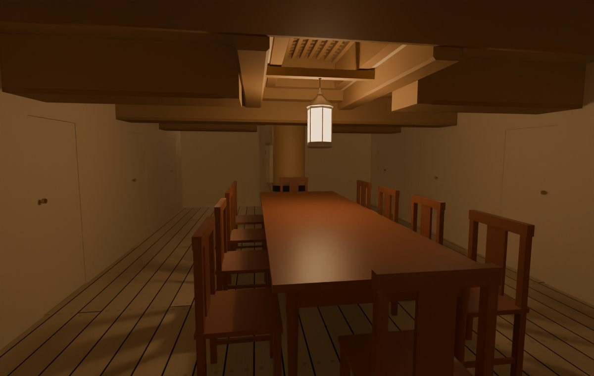
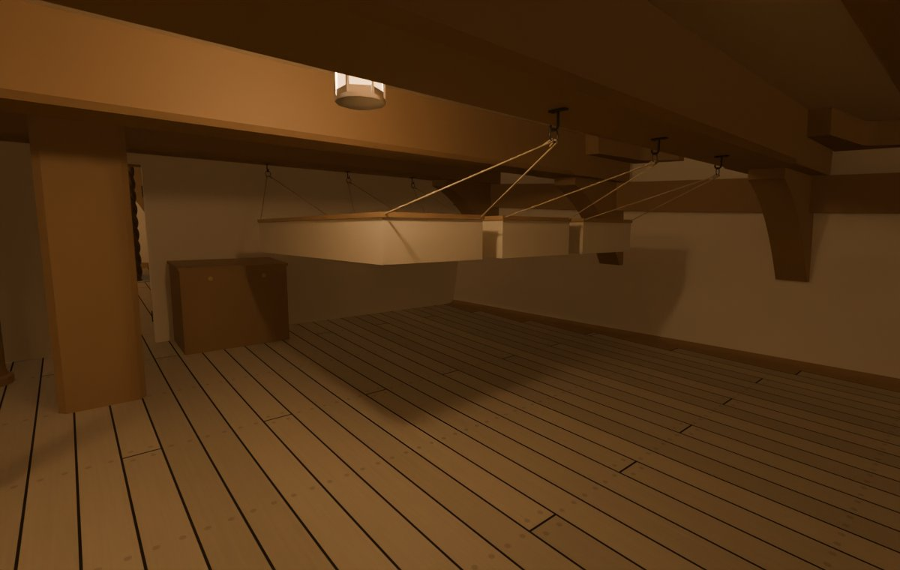

# Shipkit 13: the berth deck

Slice 13 of the frigate *Commonwealth* (plan: <https://claude.ai/artifact/8y6hW8vHjjUPJRovJEuxY7>; slices 0-12 are in
`docs/shipkit-1` to `docs/shipkit-12`). Slice 12 built the gun deck. This slice goes one deck further down, to the
berth deck, where her people lived: the planked deck 7 ft 2 in under the gun deck, the side's inside between the two,
the gun deck's framing over it, the openings on down to the orlop with their ladders, and everything that comes down
through it (the capstan's spindle, the riding bitts, the pumps, the masts and the cables). It builds the rooms the 1849
plan shows on this deck: the wardroom aft with its state rooms, the steerage and the officers' rooms forward of it,
and the sick bay forward. In between is the crew's deck, with the crew's hammocks slung by night and their messes laid
by day, and horn lanterns hang along it, each a light in the game data. It is still post-slice art: nothing here is
imported into Unreal or wired into the game. With it, the catharpins now bowse the fore and main lower
shrouds in, so the lower yards brace sharper (Bracing sharper, below).

Every render on this page is flipped left to right, so it shows her as the game will (docs/shipkit-9 says why).


## What slice 13 builds

### The deck

* **The planks**: the deck's top is the gun deck's less 7 ft 2 in all along (the 1926 midship section's spacing), so
  it keeps her sheer, flat across. Its planks are yellow pine 3 1/2 in thick and 7 in wide (the 1795 midship section
  drawn from Humphreys' specifications), laid as the gun deck's: butts staggered over the beams, their bolts plugged,
  drawn by the material from the deck's `Planking` and `Margin` UVs. The deck runs aft and forward until the side's
  inside closes in to the middle line, round the run aft and into the bow.
* **The waterways** along each side, a cove where the deck meets the side, as the gun deck's.
* **The side's inside**: the ceiling (the inner planking over the frames) from the waterway up into the gun deck's
  planks, along the whole deck and round the run and the bow to the middle line. Aft of the wardroom, the stern's
  knuckle steps the side out: the run below closes in to the sternpost while the counter above stands out to the full
  breadth. The ceiling follows it: a flat across between the two, the wing transom's top ceiled over. The rudder's
  head rises abaft the deck's after end at this height, so there is no helm port on this deck. Where the gun deck's
  beams cross that shelf, an oak chock under each bears it on the transom.
* **What is under the planks is the next slice's.** The berth deck's own beams, ledges, deck transom and deck hook
  are the orlop slice's (14), built to the hand-over this slice's build writes for it (`berth_deck.json`, For the
  orlop slice below).

### The gun deck's framing overhead

What a man on the berth deck sees over him is the gun deck's framing, heavier than the spar deck's because it carries
the long guns: its planks 4 in thick on beams 18 in sided and 15 in moulded (the 1795 section's "15 x 18") at every
other beam station, 0.83 m apart, so the stanchions on all three decks stand over one another. A ledge (6 by 5 in) runs
between each two. There is no waist on this deck, so they run the whole length. Where a member would cross an opening
in the gun deck (a hatchway, the wardroom's skylight, the scuttle, a mast, the capstan's barrel, the riding bitts'
posts, the cable scuttles) it is cut: half beams run from the side to a carling either side (8 by 8 in), with head
ledges across the opening's ends.

* **The clamp** (12 by 6 in) along each side carries the beams' ends. Aft, where the side steps out over the knuckle,
  it stands on the shelf, and it stops where that leaves it less than an inch deep; abaft that the beams lie on the
  wing transom on their chocks.
* **Hanging knees** (9 in sided, arms 36 in) under each beam end where the side under it is fair: 56 of them.
  None aft, where the knee's upright arm would have no side to lie on. Each arm follows its beam's underside, which
  rises with her sheer across the knee's siding (by as much as an inch at the bow), let 2 mm up into it.
* **Lodging knees** in the angle between a beam's face and the side under the planks, forward of the wardroom.
* **Stanchions** (7 in, turned) on the middle line under the whole beams, wherever nothing stands within 0.2 m.
* The beams', ledges' and carlings' lower edges are chamfered, as the gun deck's.

### The openings and what comes down through the deck

* **Four openings** go on down to the orlop. The spirit room's hatch and the main hatch run under the gun deck's
  and are gratings. The fore hatch's forward part runs on down under the gun deck's, a ladderway going forward. The
  berth deck's own after ladderway stands to starboard of the gun deck's after ladder's foot and leads aft into the
  orlop's cockpit. Each has a coaming 6 in high and 3 in thick, and each grating's edges sit in a rabbet half an inch
  into its coaming. A ladder goes down each ladderway, 62 degrees as the gun deck's, hung from the inside face of the
  coaming, its foot on the line the orlop's deck will have, 6 ft 4 in under this one's. The gun deck's after and fore
  hatches stop here, their ladders landing on these planks, and so do its wardroom skylight and the fore scuttle.
* **The capstan's spindle** (17 in) comes down from the gun deck capstan's barrel to its step on these planks: an oak
  block 36 by 30 in, let into the planks and bolted through, with iron hoops at the spindle's foot and head.
* **The riding bitts' posts** come down through the gun deck to these planks and are let into them.
* **The pumps**: the chain pumps' four square pipes and the brake pumps' two bored trees come straight down through
  holes in the planks; below the planks they are the orlop slice's.
* **The masts** pass through holes half an inch round them, wedged as at the gun deck. The masts' heels now stand on
  the orlop slice's keelson, which rides up over the deadwood in the ends. Their mastheads stay where the sail plan
  puts them, so each lower mast is shorter below the orlop than its card's length: the fore by 0.69 m, the main
  0.31 m and the mizzen 1.5 m (`spars_1795.json` `step.keelson_top_m`). Their iron hoops keep their places along
  the mast (only those under the higher heel go: moved with the heel, one came under the spanker boom's jaws), and
  they stop clear of this deck's wedges as of the decks above.
* **The cables** come down through scuttles straight under the gun deck's, 20 in round with lead collars, toward
  the cable tiers below.
* **The wells** under the openings, lined dark down to where the orlop will be, are stand-ins the orlop slice
  replaces with its own deck and hatches.

### The rooms

The Navy Yard Boston inboard profile of 1849 (NARA 75841356) draws the berth deck's bulkheads: the wardroom with its
state rooms aft, the steerage forward of it, rooms forward of that, and the sick bay forward. Each bulkhead stands
between the gun deck's members over it, its doors hooked back. The joinery is painted deal.

* **The tiller room**, abaft the wardroom over the stern's shelf. The iron tiller is not built: see Known gaps.
* **The wardroom**, the officers' mess, from 21.4 m to 13.8 m abaft midships. Four state rooms a side, each 6 ft 2 in
  long, with their inboard walls 2.3 m out from the middle line and a door into the wardroom. The mizzen comes down
  through it. A mahogany table 10 ft by 3 ft 6 in stands under the skylight on six turned legs, with four chairs a side
  and one at each end, and a lantern hangs over it from a bar between the skylight's carlings.
* **The steerage**, the midshipmen's and mates' berth, forward of the wardroom, with the spirit room's hatch in it,
  closed forward by a bulkhead with a door either side of the middle line.
* **The officers' rooms**: three along each side forward of the steerage, six in all (the surgeon's, the purser's
  and the master's, and three store rooms, by estimate), their inboard walls 3.5 m out, each with a door. The middle of the deck is
  open between them, for the after ladderway, the gun deck's after ladder's foot, the capstan's step and the chain
  pumps.
* **The sick bay**, forward under the forecastle where the air was best, from 15.1 m to 20.35 m forward of
  midships, the riding bitts' posts through it. Three hanging cots a side, each a canvas bed in a wooden frame slung
  from hooks under the beams, and the surgeon's dispensary chest against the fore bulkhead.




### The crew's deck: hammocks by night, messes by day

Between the officers' rooms and the sick bay is the crew's deck, about 20 m of it. The ship's people slept and ate
here, so it is built twice, in two pose collections the game shows one at a time:

* **By night (`BerthDeck_Hammocks`)**: 112 hammocks slung fore and aft, 14 in a man across (the US Navy's
  allowance), their heads and tails staggered, port's rows a beam along from starboard's. The innermost rows hang
  0.74 m out from the middle line, leaving the walk along it clear past the stanchions. Each hangs between two hooks under the gun deck's beams two beams apart
  (2.96 m), each hook on a plate beside its beam's hanging knee, so the outer rows hang out under the knees' arms.
  The rows that pass inboard of the officers' rooms run aft between them to the steerage. Each hammock clears the
  stanchions, the masts, the pumps, the ladders and the lanterns, and hangs with its lowest point 1.085 m over the
  deck. The hammock is the stores kit's (`stores.py`, the below-decks kit every deck draws on): Falconer's six feet by three, its bed in
  it, the nettles from grommets along each end to an iron ring, and a lanyard from the ring to the hook. Two beams
  apart is closer than the kit's 11 ft, so its clews are made shorter to suit (22 in rather than 27 in), and it
  hangs as high. The berth deck slings about 110 this way. The rest of a crew of about 450 slung theirs on the gun deck
  between the guns, which this slice does not model.
* **By day (`BerthDeck_Messes`)**: the hammocks were lashed up and stowed in the nettings on deck. A mess table hangs
  at the side under every other beam along the crew's deck: hinged to a cleat on the side and slung from two eyebolts
  under the beam over it. There are 12 tables, with a bench either side, a mess kid on each table and 10 sea
  chests against the side between the messes. At eight men a mess that seats 96.
* **The hooks** stay by day as by night (in `BerthDeck`), as do the sick bay's cots.

Every hammock, hook and piece of mess gear is a linked copy of one of the stores kit's six meshes (`BerthHammock`,
`HammockHook`, `BerthMessTable`, `MessBench`, `MessKid`, `SeaChest`), each placed by a 4x4 in `berthdeck.json`.


### Lanterns and light

Twelve horn lanterns. Eleven hang on hooks in the gun deck planks' underside, each in a bay clear of the carlings, the
head ledges and the openings above. They are smaller than the gun deck's (7 in across, 9 in high) on short hooks, so
each dish hangs level with the beams' underside: a man who clears the beams walking the deck clears the lanterns too.
They hang four over the middle line of the crew's deck, where the beams
are cut for the hatchways above and no hammocks hang (a lantern among the hammocks was a fire risk), two either side of
the fore hatchways, one in the steerage, one in the tiller room, two in the sick bay, one at the bow and the
wardroom's, of the gun deck's size, over its table. Each is a light in the game data (`berthdeck.json` `lights`) in its zone: `berth_deck`,
`wardroom` or `sick_bay`. The sick bay's two, the steerage's, the two forward ones and the wardroom's cast
shadows, so they stop at the bulkheads; the rest reach no further than the bulkheads between zones.

## Bracing sharper: the lower shrouds bowsed in

Slice 12 left the catharpins holding the fore and main lower shrouds straight: bowsed in, the shrouds bore on the
falls from the tops, which came down just inside the foremost of them at the futtock staves (docs/shipkit-12, Known
gaps). This slice leads those falls clear and bowses the shrouds in:

* The fore and main fife rails' arms run further aft, and the falls from the tops belay to them near the mast, the
  fore's in a new order along its rail, with their bull's eyes under the tops re-placed (`running_1797.json`,
  `running_places_1797.json`).
* The catharpins bowse every fore and main lower shroud 4 in toward the middle line at the futtock stave
  (`standing_1797.json` `catharpins_bowse_in`). Every fall clears the bowsed shrouds, and the closest any running
  line now comes to anything is 0.16 in (the main topgallant sheets, furled, past the main yard), over the build's 0.1 in.
* So the lower yards brace sharper close-hauled: the fore yard to 36 degrees (it was 33.5) and the main to 38.5 (it
  was 36), in `build.json` `brace`. The sailing physics has these limits, and she sails close-hauled and tacks on
  them.

## Clearance

The build checks the berth deck's parts and its copies against everything else in the ship (the sails, running
rigging, boats, guns and the gun deck in every state and pose too) and against each other (`berthdeck_room`,
`build.json` `berthdeck.room`), as the gun deck's are checked; the hammocks and the messes, never shown together,
are not checked against each other. Nothing meets anything it does not stand on or in by design, no fitting stands
off the deck, and every designed contact still meets, copy by copy. The contacts by design are in
`berthdeck_1797.json` `meets`, each with why and how deep it may go: the depth measured when it was set, with a
quarter inch over (rounded up to 0.05 in). The deepest in the final build:

| Designed contact | Parts | Allowed (in) | Deepest (in) |
| --- | --- | ---: | ---: |
| The riding bitts' posts come down through the gun deck onto these planks, let into them | `BerthBittPosts` with `BerthDeck` | 0.75 | 0.50 |
| Under the gun deck the posts are the riding bitts' own (slice 12's above it), carried on down | `BerthBittPosts` with `RidingBitts` | 0.25 | 0.00 |
| Each cable scuttle's lead collar is let into the planks round its hole | `BerthCableScuttles` with `BerthDeck` | 0.55 | 0.29 |
| Each scuttle's collar sits on its short well down to the tier | `BerthCableScuttles` with `BerthWells` | 0.55 | 0.29 |
| Each chock under a beam aft of the clamp goes an inch into the counter's face over the wing transom | `BerthCeiling` with `BerthChocks` | 1.30 | 1.02 |
| The clamp lies over the side's ceiling, bolted through it | `BerthCeiling` with `BerthClamps` | 0.75 | 0.47 |
| The ceiling comes down into the deck's edge, under the waterway | `BerthCeiling` with `BerthDeck` | 1.05 | 0.78 |
| Each hanging knee's upright arm is fayed to the ceiling under the clamp | `BerthCeiling` with `BerthHangingKnees` | 0.40 | 0.13 |
| Each lodging knee's arm along the side lies on the ceiling | `BerthCeiling` with `BerthLodgingKnees` | 0.40 | 0.12 |
| The partitions are let a quarter inch into the side's ceiling | `BerthCeiling` with `BerthRooms` | 0.55 | 0.28 |
| The ceiling comes down behind the waterway's cove | `BerthCeiling` with `BerthWaterways` | 0.75 | 0.49 |
| The ceiling runs up into the gun deck's planks (side top_into_gun_planks_in) | `BerthCeiling` with `GunDeck` | 1.25 | 1.00 |
| The chock under the beam the clamp's aft end reaches stops against that end | `BerthChocks` with `BerthClamps` | 0.30 | 0.02 |
| Each beam aft of the clamp bears on the wing transom through its chock | `BerthChocks` with `BerthOverhead` | 0.30 | 0.02 |
| Each hanging knee's upright arm is fayed to the clamp's face and its bottom | `BerthClamps` with `BerthHangingKnees` | 0.35 | 0.09 |
| The gun deck's beams' ends lie on the clamp | `BerthClamps` with `BerthOverhead` | 0.80 | 0.53 |
| The partitions are let a quarter inch into the clamp | `BerthClamps` with `BerthRooms` | 0.35 | 0.10 |
| Each cot's hook is screwed into the beam over it | `BerthCotHook_*` (12) with `BerthOverhead` | 0.40 | 0.11 |
| Each cot's clews are made fast to an iron ring hung on its hook | `BerthCotHook_*` (12) with `BerthSickBay` | 0.30 | 0.04 |
| Each coaming stands on the deck round its opening | `BerthDeck` with `BerthHatchways` | 0.25 | 0.00 |
| The wedges are driven into the gap between each mast and its partners in the deck | `BerthDeck` with `BerthMastWedges` | 1.00 | 0.71 |
| The partitions stand a quarter inch into the deck | `BerthDeck` with `BerthRooms` | 0.50 | 0.25 |
| The dispensary chest and the sick bay's fittings stand on the deck | `BerthDeck` with `BerthSickBay` | 0.25 | 0.00 |
| The capstan's spindle stands in its step on the planks | `BerthDeck` with `BerthSpindle` | 1.30 | 1.03 |
| The stanchions stand on the deck | `BerthDeck` with `BerthStanchions` | 0.25 | 0.00 |
| The wardroom's table, chairs and lockers stand on the deck | `BerthDeck` with `BerthWardroom` | 0.25 | 0.00 |
| The waterway lies along the deck's edge, let into it | `BerthDeck` with `BerthWaterways` | 0.55 | 0.27 |
| The gun deck's ladders land on these planks | `BerthDeck` with `HatchLadders` | 0.45 | 0.16 |
| The mess benches stand on the deck | `BerthDeck` with `MessBench_*` (24) | 0.30 | 0.02 |
| The sea chests stand on the deck | `BerthDeck` with `SeaChest_*` (10) | 0.30 | 0.04 |
| Each hanging knee's arm is fayed to its beam's underside | `BerthHangingKnees` with `BerthOverhead` | 0.35 | 0.10 |
| Each coaming stands on its well | `BerthHatchways` with `BerthWells` | 0.25 | 0.00 |
| The wardroom's lantern's screw eye is screwed up into its bar between the skylight's carlings | `BerthLanterns` with `BerthOverhead` | 1.00 | 0.75 |
| Each lantern's screw eye is screwed up into the gun deck's planks over it | `BerthLanterns` with `GunDeck` | 1.00 | 0.75 |
| The ladders down stand in their wells | `BerthLadders` with `BerthWells` | 0.45 | 0.17 |
| Each lodging knee is fayed to its beam's side | `BerthLodgingKnees` with `BerthOverhead` | 0.35 | 0.08 |
| The lodging knees lie up under the gun deck's planks | `BerthLodgingKnees` with `GunDeck` | 0.25 | 0.00 |
| The wedges bear on each mast where it passes the deck (the mast carries no hoop there: spars_1795.json hoops) | `BerthMastWedges` with `Mast_Fore`, `Mast_Main`, `Mast_Mizzen` | 0.35 | 0.09 |
| The partitions' heads stand up under the beams, carlings and head ledges | `BerthOverhead` with `BerthRooms` | 0.30 | 0.01 |
| Each stanchion's head is under its beam, its top following the beam's underside | `BerthOverhead` with `BerthStanchions` | 0.40 | 0.11 |
| The gun deck's planks lie on its beams, ledges and carlings | `BerthOverhead` with `GunDeck` | 0.50 | 0.25 |
| Each hammock hook's plate is screwed to its beam | `BerthOverhead` with `HammockHook_*` (224) | 0.35 | 0.06 |
| The tiller rope's lead bush down through the gun deck's planks (slice 12's) bears on the beam under them; where the tiller ropes lead waits on the tiller's place | `BerthOverhead` with `LeadBushes` | 0.30 | 0.04 |
| Each mess table's slings' eyebolts are driven up into the beam over it | `BerthOverhead` with `MessTable_*` (12) | 1.90 | 1.61 |
| The pumps' tubes come down through the gun deck's planks | `BerthPumpTubes` with `GunDeck` | 0.80 | 0.55 |
| The partitions are scribed a quarter inch into the waterway's cove | `BerthRooms` with `BerthWaterways` | 0.50 | 0.25 |
| The partitions' heads stand up under the gun deck's planks | `BerthRooms` with `GunDeck` | 0.25 | 0.00 |
| The spindle runs up into the gun deck capstan's barrel | `BerthSpindle` with `GunCapstan` | 1.25 | 1.00 |
| Each hammock's lanyards hang on its hooks, an eye round the hook's bar | `HammockHook_*` (224) with `Hammock_*` (112) | 0.30 | 0.03 |
| Each mess kid stands on its table | `MessKid_*` (12) with `MessTable_*` (12) | 0.30 | 0.02 |

## Triangles

What the game loads below on this deck (`below`) is 485,836 triangles: the berth deck's parts, the hooks, and
the larger of its two poses (the hammocks by night; the messes by day are lighter). That is 49% of the plan's
1.0M for the berth deck, a floor and not a cap: the build reports its share (`berthdeck.share_of_budget`)
and never fails on it. The hammocks are most of it: 112 copies of one 2,632-triangle mesh. The ship as drawn with her sails set is
5,021,282 triangles (slice 12: 4,780,110), the berth deck's parts and the hooks included.

| Object | Triangles |
| --- | ---: |
| **The deck and the side** | **82,364** |
| `BerthDeck` | 25,020 |
| `BerthWaterways` | 9,568 |
| `BerthCeiling` | 22,460 |
| `BerthHatchways` | 23,960 |
| `BerthWells` | 284 |
| `BerthLadders` | 304 |
| `BerthMastWedges` | 768 |
| **The gun deck's framing overhead** | **20,668** |
| `BerthOverhead` | 8,124 |
| `BerthClamps` | 3,016 |
| `BerthChocks` | 552 |
| `BerthHangingKnees` | 3,808 |
| `BerthLodgingKnees` | 2,352 |
| `BerthStanchions` | 2,816 |
| **What comes down through the deck** | **1,960** |
| `BerthSpindle` | 816 |
| `BerthBittPosts` | 56 |
| `BerthPumpTubes` | 448 |
| `BerthCableScuttles` | 640 |
| **The rooms** | **14,476** |
| `BerthRooms` | 6,476 |
| `BerthWardroom` | 2,144 |
| `BerthSickBay` | 5,856 |
| **Lanterns** | **7,392** |
| `BerthLanterns` | 7,392 |
| **The hooks and the cots' hooks, always shown (`BerthDeck`): 236 copies** | **64,192** |
| **The hammocks, by night (`BerthDeck_Hammocks`): 112 copies** | **294,784** |
| **The messes, by day (`BerthDeck_Messes`): 58 copies** | **37,144** |

| Copied mesh | Triangles, each |
| --- | ---: |
| `HammockHook` | 272 |
| `BerthHammock` | 2,632 |
| `BerthMessTable` | 1,584 |
| `MessBench` | 80 |
| `MessKid` | 928 |
| `SeaChest` | 508 |

## For the game

The berth deck, like the gun deck, is loaded only when the player goes below. `berthdeck.json` says what that is, in
the ship's frame (metres):

* **`below`**, what loads: the collection `BerthDeck` in the .blend (21 meshes: the deck and the side,
  the gun deck's framing overhead, what comes down through the deck, the rooms, the sick bay and the lanterns, with the
  twelve lanterns' lights), and in it the hammocks' and the cots' hooks as copies, shown day and night; the two pose
  collections, of which the game shows one at a time: `BerthDeck_Hammocks` by night (hidden as built) and
  `BerthDeck_Messes` by day; and, for each object facing into the berth deck, which lights' zones it is in, for the
  lighting channels. The gun deck's hatchways and ladders look down onto it.
* **`lights`**, each lantern's point light (zone `berth_deck`, `wardroom` or `sick_bay`, colour, 2200 K, 180 lumens,
  radius, shadows) within `light_budget` (16). `light_zones_note` says to light only each zone's objects with its
  lights: unshadowed, a light would shine through the planks onto the gun deck's guns and through the side onto the sea.
* **`copies`**, every linked copy of the stores kit's six meshes: its name, its mesh, a 4x4 and its collection
  (236 hooks in `BerthDeck`, 112 hammocks in `BerthDeck_Hammocks` and 58 pieces of mess gear in `BerthDeck_Messes`).
* **`room_x`**, where each bulkhead stands along the ship, and **`planking`**, the deck's planks drawn from its
  `Planking` and `Margin` UVs as the gun deck's are.
* The rest are the builder's records of where its parts fell: `berthing` (the hammocks' rows across the ship, their
  span and the lowest one's height over the deck), `messes` (the tables' places), `sick_bay` (the cots), the hanging
  and lodging knees, and so on.

Nothing on this deck turns yet: the bulkheads' doors are hooked back, the rooms' doors are shut, and the tiller,
which would turn, is not built.

## For the orlop slice

The build also writes `berth_deck.json`, the hand-over to the orlop slice (14), from the deck as built: the deck's
line every 0.25 m, its ends and the side's inside at its top; its own beams' and ledges' stations and sizes, which
the orlop slice builds under its planks; the openings through it, the ladders down to the orlop with the room to keep
clear round their feet, and the gun deck's ladders that land on it; the masts, the pumps' tubes and the cable scuttles
where they pass it; the gun deck's beams over it, the headroom, and who builds what at the planks' underside. Its notes
are `berthdeck_1797.json`'s `handover`. It matches the copy the orlop slice has worked from to within
3 mm, save the gun deck's fore hatch ladder's landing, 9 mm further aft as built.

## Sources and estimates

* **NARA 75841356**, the inboard profile in the Navy Yard Boston set of 1849, public domain: the berth deck's
  bulkheads aft of the main mast (the wardroom with its state rooms either side, the steerage forward of it, the rooms
  forward of that) and the sick bay forward. Read for the arrangement; the 1797 rooms are placed between this ship's
  own beams. Measured only.
* **NARA 75841360**, the midship section drawn from Humphreys' specifications, and the 1926 midship section (the
  orlop slice's reading): the deck 7 ft 2 in under the gun deck, its planks 3 1/2 in yellow pine, the gun deck's
  beams 15 by 18 in over it.
* **The USS Constitution Museum's description of the ship in 1812**: an iron tiller on the berth deck aft of the
  wardroom; the crew slept in hammocks on the berth deck, 14 in apart, and messed there.
* **Falconer's Marine Dictionary** (the stores kit): the hammock, six feet by three, and 14 to 20 in of the beam's
  length a man.
* **Period practice** for an American or British frigate of the 1790s where neither drawing shows a part, each value
  so marked in `berthdeck_1797.json`: the framing's sizes, the ceiling, the rooms' joinery and furniture, the cots,
  the mess tables and the lanterns.

## Checks

```
python Tools/shipkit/frigate/build_frigate.py <out>
```

(Blender's Python, pip `bpy`; about 56 minutes.) The berth deck is built with the gun deck and its objects are
made after every other check, which see the ship as slice 12 left it. The build fails if:

* a part of the berth deck, a hammock, a hook or a piece of the messes' gear meets anything else in the ship or
  another, except where they meet by design (`berthdeck_1797.json` `meets`, each with the depth it may go), or goes
  deeper than that, or a piece standing on the deck floats over it (`berthdeck_room`); hammocks and messes, never shown
  together, are not checked against each other;
* a designed contact no longer meets (`unmet`);
* any piece of the berth deck or of its copies' meshes crosses itself (`berthdeck.folds`); corners in the same place
  count as one, so a turned piece's doubled seam, which the export welds, is not read as a fold;
* the rooms, hatchways, ladders, hammocks, messes, cots or lanterns cannot be placed as the card asks (no bay for a
  bulkhead, a door past its room's end, a lantern with nothing over it to hang from, a hammock that cannot clear what
  it must);
* the lights are more than the slice's budget;
* a hung lantern's dish hangs more than half an inch under the gun deck's beams' underside;
* a mast's heel on the orlop's keelson (`spars_1795.json` `step.keelson_top_m`) stands below the card's step or not
  under the lowest deck it passes through.

Every earlier slice's checks run as before (hull, rig, decks, guns, boats, sails, ropes, brace limits, the gun
deck's), on the bowsed rig.

## Review

An independent review measured the first complete build with its own probes, given only the build, the cards and
the code. It found one defect that had to be fixed, eight that should be and eight smaller points. Each is fixed (the
eleventh is now a known gap: the rooms it reaches are shut), and the final build measured again:

| The review found | Fixed | Measured again |
| --- | --- | --- |
| 1. The hammocks' lanyards did not go round their hooks: the hook's attach point was its lanyard over the bar while the hammock took it as the lanyard under it, so on all 216 hooks the eye lay on top of the bar, 0.01 in clear of it, the bar not inside it. The cots' clews ended inside their hooks' iron with no ring or eye | the hook's attach point is the lanyard's centreline under the bar, so each eye passes round it (the stores kit's slung hammock too); each cot's clews are made fast with an eye round an iron ring (the hammock's clew ring) hung on its hook's bar | 112 hammocks on 224 hooks, every one meeting both its hooks (checked hammock by hammock: item 4); the lowest 1.085 m over the deck. The 12 cot hooks each carry a ring, 0.04 in into it as the ring's iron rests on the bar |
| 2. The stanchions' heads were cut level under beams that slope with her sheer: forward, a head went 0.59 in into its beam at one edge and left a 15 mm wedge open under it at the other, hidden by a 0.85 in allowance | each head is sheared to its beam's underside along the beam's siding, as its foot is draped to the deck's sheer (the gun deck's stanchions too, built by the same code) | Into their beams 0.11 in at most on this deck (allowed 0.4) and 0.08 in on the gun deck (allowed 0.35), with no gap under them |
| 3. Every lantern hung 0.3 in clear of what it hung from, on this deck and the gun deck, and nothing checked it | each lantern's screw eye has a shank 0.75 in up into the planks or its bar, through an iron rose against their underside; each lantern meets what it hangs from by design (here and on the gun deck), so one hanging from nothing fails the build | Each shank 0.75 in into what it hangs from; the gun deck's 0.75 in |
| 4. A designed contact between copies passed if any one copy met: 107 of 108 hammocks could hang clear of their hooks, a kid float over its table or a bench stand off the deck, and the build would still pass | every object a pattern names must meet the other side (`unmet`, which names the ones that don't) | Every hammock, hook, mess table, kid, bench, sea chest and cot hook meets what holds it |
| 5. The chocks under the beams aft shared the clamp's part, which let the clamp 1.3 in into the side (it goes 0.47) and hid a chock 0.45 in into the clamp's aft end | the chocks are a part of their own (`BerthChocks`) with their own designed contacts, and the one under the beam the clamp's aft end reaches stops against that end | Clamp 0.47 in into the ceiling (allowed 0.75), the chocks 1.02 in into the counter's face; the chock and the clamp's end 0.02 in |
| 6. Bulkheads and partitions moved as far as they had to to stand in a bay overhead, unrecorded: the officers' rooms' by up to 0.50 m, a state room's by 0.10 m | the card gives each its place as built, and the build fails if one has to move more than 0.15 m (`bay_max_shift_m`) | Each stands where the card gives it, to the millimetre |
| 7. The hand-over to the orlop slice was neither written nor checked; the copy the orlop slice worked from was hand-written, and already 3 to 9 mm off the build at four ladder feet | the build writes `berth_deck.json` from the deck as built (For the orlop slice) | Matches the orlop slice's copy within 3 mm, but for the gun deck's fore hatch ladder's landing (9 mm) |
| 8. The crew's lanterns hung in the walk along the middle line, their dishes 1.45 m over the deck: the only walk at night | smaller lanterns on this deck (7 in across, 9 in high) on a short hook, so each hangs about level with the gun deck's beams; the build fails if a dish hangs more than half an inch under them. The wardroom's, over its table, is the gun deck's size | Every dish 1.70 m over the deck, at most 0.28 in under the beams' underside |
| 9. The card's spacing of the cots from the side was never read: the outer cots hang inboard of the knees' heads | the card says so | |
| 10. Lanterns stood up to 1.25 m from the card's places, and a note on the steerage light's reach was out of date | the card gives each lantern's place as built, the build fails past half a station (0.45 m), and the note is right | Each lantern hangs where the card gives it, to the millimetre |
| 11. The first crew lantern's unshadowed light reaches the forward officers' rooms, in its own zone, through their walls | a known gap: unseen while their doors are shut | |
| 12. The mess benches were never checked against what stands round them | each bench is checked as the tables and chests are | All 24 benches stand clear; no mess left out |
| 13. The innermost hammock rows could never hang (they always crossed the middle line's stanchions, lanterns or cut beams), and port's and starboard's shared beams | the rows start clear of the middle line's openings, and port's hang a beam along from starboard's | Innermost rows 0.74 m out; 112 hammocks (108 before) |
| 14. The officers' rooms' walls ended in the last partition's face, a strip of faces lying on each other | each wall ends a quarter inch inside it, as the state rooms' do | |
| 15. Notes and the page did not match the build: about 450 men here, "three rooms" naming four, a helm port that is not built, keys never read | the notes and this page say what is built; the unread keys are gone | |
| 16. The masts' heel check allowed a heel anywhere under the gun deck | bounded by the lowest deck each mast passes through | |
| 17. Three of the build's checks were asserts, which `python -O` drops | each stops the build as the rest do | |

Fixing them turned up two more things. The shorter hook alone could not lift a gun deck lantern clear of the walk:
its body and roof are 19 in against the beams' 15 in, so this deck's are smaller. And the hand-over found the gun
deck's fore hatch ladder landing 9 mm further aft than the copy the orlop slice had, which the build's own file now
gives.

The first full build with the bowsed rig then failed one check, at the bow. The bower's cable, 2.2 m longer now that
it goes on down through the berth deck's scuttle, brought a strand of its lay into the ring's pudden at the clinch, by
a hair. The clinch had lain exactly on the pudden, so whether a strand met it depended on where the lay's turn fell
there, which the cable's length inboard sets. The clinch now stands 0.1 in off the pudden (`anchors_1797.json`
`clinch_gap_in`), clear at every turn of the lay.

Last, a probe of my own measured that build's parts under a beam against the beam, at both faces of its siding. Her
beams rise with the sheer along their siding, by as much as an inch across a knee's 9 in at the bow, and three kinds
of part under them had been cut level, so each went into its beam at one face and stood off it at the other: the
hanging knees' arms (up to half an inch each way at the bow on this deck, a third on the gun deck), the waist's two
forward beams under the gangways (0.28 and 0.15 in, at the planks over them and the clamp under them) and the
stanchions' heads under those beams (0.18 in). Each now follows its beam: the knees' arms its underside, the waist's
beams her sheer along their siding as the deck beams do, the stanchions' heads the waist's beams. The spare spars'
saddles stand on those beams, so to keep each saddle 2 in thick the spars, and the boats on them, sit 0.28 in higher.
The next build stopped on the waist's knees and stanchions: lying exactly on their beams, they no longer read as
touching them. So each knee's arm and each stanchion's head is let 2 mm up into its beam, as the lodging knees are
into the beams' faces. Measured again on the final build, each bears on its beam across its whole face, 0.06 to 0.11
in into it.

## Known gaps

* **No tiller.** The 1812 description puts an iron tiller on the berth deck aft of the wardroom, but this ship's
  counter closes round the rudder's head only at the gun deck's height, so the berth deck does not reach it. Where the
  tiller goes (hung under the quarterdeck's beams in the great cabin, the lower stern reshaped so it sits here as on
  Constitution, or none) is Bean's choice, still open; the card keeps its sizes for whichever.
* **Hammocks for about 110 of a crew of about 450.** The 1812 description has the crew sleeping on the berth deck.
  The room between this deck's fittings, at 14 in a man, takes about 110 as the card spaces and clears them. Where the
  rest slung theirs (between the guns on the gun deck, by estimate, or closer together here) is not modelled.
* **The first crew lantern's light reaches into the forward officers' rooms.** It is unshadowed, 6 m round, and the
  rooms 4.7 to 5.9 m away are in its own zone, so it would light their insides through their walls. That is unseen
  while their doors stay shut; if they ever open, its radius goes down to about 3 m or it casts shadows.
* **The state rooms and officers' rooms are shut.** Their doors are drawn in their walls and there is nothing inside
  them.
* **The wells and cable scuttles' wells under the planks are stand-ins** until the orlop slice's deck replaces them.
* **The rooms are laid out from 1849.** The 1797 frigate's would have differed in ways no drawing shows.
* **The lanterns are brighter than candles**, as on the gun deck, for the game's exposure below decks.
* **Estimates throughout** (Sources).

## Files

| File | What it does |
| --- | --- |
| `Tools/shipkit/frigate/berthdeck.py` | the berth deck (`BerthDeck`): the planked deck and waterways, the side's ceiling and the stern's shelf, the gun deck's framing over it (beams, ledges, carlings, clamp, hanging and lodging knees, chocks, stanchions), the openings, wells and ladders, the spindle, bitts, pump tubes, mast wedges and cable scuttles, the rooms and their furniture, the sick bay's cots, the hammocks and hooks, the messes, the lanterns and their lights and zones |
| `Tools/shipkit/frigate/berthdeck_1797.json` | the berth deck's card: every size and place, with its source or marked an estimate; the meets by design with their allowances |
| `Tools/shipkit/frigate/gundeck.py`, `gundeck_1797.json` | the gun deck built over the berth deck: its wells end on the berth deck's planks and its ladders land on them; a lantern can take other sizes (the berth deck's smaller ones); each hanging knee's arm follows its beam's underside along the beam's siding (the beams rise with her sheer), and it and each stanchion's head are let 2 mm up into the beam, so the build sees them meet; the allowances re-measured where this slice changed what meets |
| `Tools/shipkit/frigate/deck.py` | the waist's two beams follow her sheer along their siding, as the deck beams do, so each lies on the gangways' planks and the clamp across its whole face (laid level, the forward one stood 0.28 in off both at one face) |
| `Tools/shipkit/frigate/boats.py` | the spare spars' saddles stand on the waist's beams at both faces; to keep each saddle 2 in thick the spars, and the boats stowed on them, sit 0.28 in higher |
| `Tools/shipkit/frigate/stores.py`, `stores_1797.json` | the slung hammock's clews made shorter where its hooks are too close for the card's; the mess table's slings |
| `Tools/shipkit/frigate/anchors.py`, `anchors_1797.json` | the bower's cable's clinch stands 0.1 in off the ring's pudden, clear at every turn of the lay (the cable is 2.2 m longer down through the berth deck) |
| `Tools/shipkit/frigate/spars.py`, `spars_1795.json` | the lower masts' heels on the orlop slice's keelson, their mastheads where they were; the hoops clear of every deck's partners |
| `Tools/shipkit/frigate/build_frigate.py` | builds the berth deck with the gun deck, makes its objects in `BerthDeck` and the two pose collections after every other check, checks its room, folds and designed contacts, and writes `berthdeck.json`, the orlop slice's `berth_deck.json` and the berth deck's records in `build.json` |
| `Tools/shipkit/frigate/standing_1797.json`, `running.py`, `running_1797.json`, `running_places_1797.json` | the catharpins bowse the fore and main lower shrouds in 4 in; the falls from the tops led to the fife rails' longer arms near the mast, the fore's in a new order, their bull's eyes under the tops re-placed |
| `Tools/shipkit/frigate/textures_1797.json` | `BerthDeckPlanks`, the berth deck's one new material, in `below_decks`, so the textures' coverage check passes with the berth deck built until slice 15 dresses it |
| `docs/shipkit-13/baseline/` | `build.json`, `berthdeck.json`, `berth_deck.json` and renders |
