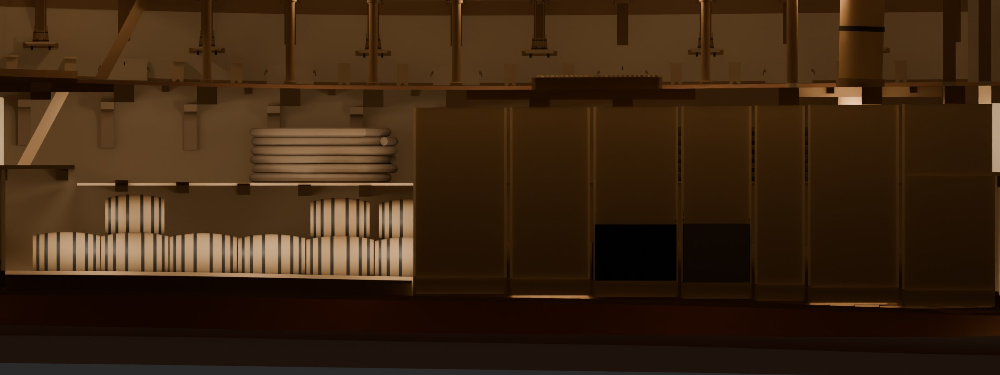
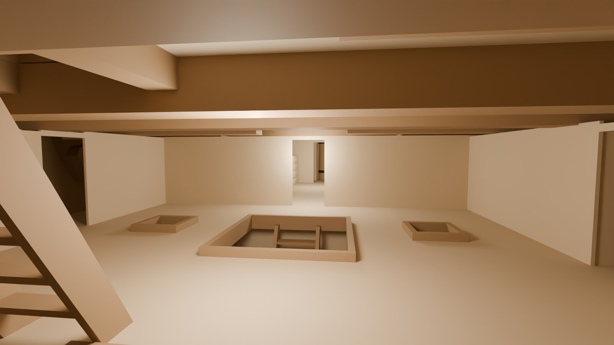
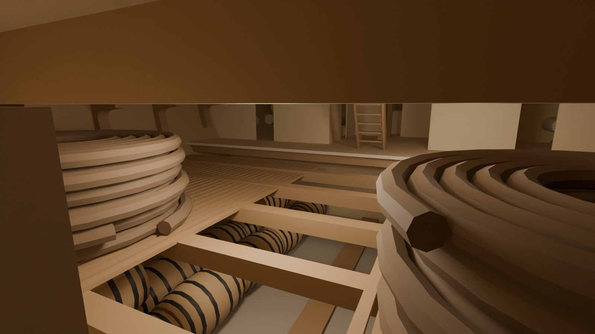
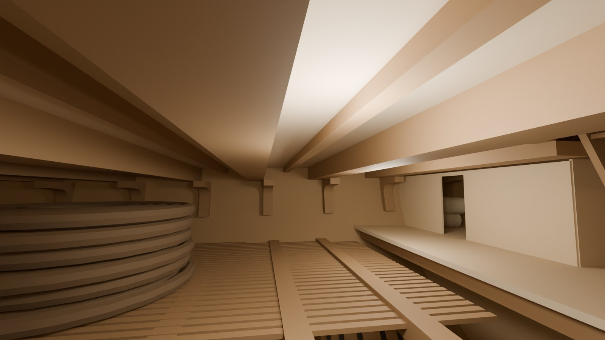
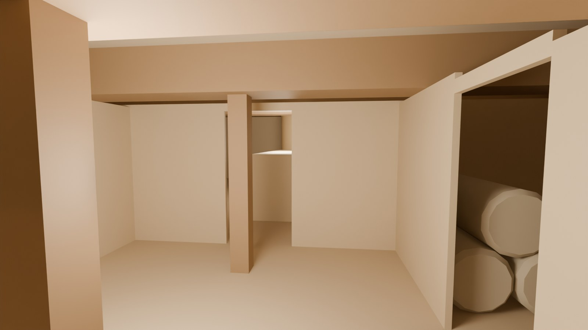

# Shipkit 14: the frigate's orlop and hold

Slice 14 of the frigate *Commonwealth* (plan: <https://claude.ai/artifact/8y6hW8vHjjUPJRovJEuxY7>; slices 0-13 are in
`docs/shipkit-1` to `docs/shipkit-13`). Slice 12 built the gun deck and slice 13 the berth deck. This slice builds what
lies under the berth deck's planks: its beams, ledges, carlings and knees overhead, the orlop's two platforms with their
rooms, the cable tiers between them, and the hold under it all: the ceiling, the keelson and the masts' steps, the
limber boards, the ballast, the bulkheads, the magazines with their powder, the spirit room, and the casks stowed in their
tiers. Like the slices before it, this is post-slice art: nothing here is in the game yet.

Every render on this page is flipped left to right, so it shows her as the game will (docs/shipkit-9 says why).












The renders are lit by work lamps for the review; in the game only the lanterns light these decks.

## What slice 14 builds

### Heights

The 1926 midship section (NARA 75841385) gives the heights below the gun deck: the berth deck's top 7 ft 2 in under
the gun deck's, the orlop's 6 ft 4 in under the berth deck's, the ceiling beside the keelson (the limber strake's top)
33 in over the rabbet and the keelson's top 4 ft over it. Scaled by its 22 ft 3 in half breadth, the section's gun deck
stands 7.25 m over the rabbet against our lines' 7.37 m, so its heights carry across within 2%. Slice 13 checked the
berth deck's line against the 1795 section drawn from Humphreys' specs (NARA 75841360) and hands it over from the deck
as built (`BerthDeck.handover()`, written out as `berth_deck.json`).

The depth of hold, the berth deck's top amidships over the ceiling beside the keelson, comes out 14.25 ft. Humphreys'
proportions give 13 ft 6 in and the 1926 section 13 ft 10 in; `build.json` reports ours beside them.

The floors rise over the deadwood toward the ends, so the hold's floor is not a straight line: at each station it is the
higher of the section's 33 in over the rabbet and the height where the ceiling's inside is wide enough for the keelson,
the limber passages and a strake beside them. The hold runs from where the orlop stands more than 3 ft over that floor,
about 22.6 m aft of amidships to 23.7 m forward.

### The berth deck's overhead

Slice 13's hand-over gives the berth deck's line, its 3.5 in planks, 31 beams (16 in sided, 14 in moulded) at the spar
and gun decks' stations, a ledge between each pair, the openings that go down through it and the pumps' tubes. Under its
planks this slice builds the beams with their ends let into the ceiling, the ledges, and 8 by 8 in carlings along each
opening's sides from the beam the coaming sits on to the next. The masts are framed the same way. Beams, ledges and
carlings follow her sheer across their siding, so the planks bear on them all along. A hanging knee stands at each end
of each beam on its fore face (its aft face where a partition across the ship stands there), its arm down the ceiling
and its other arm under the beam, stopped short of the partitions. Where the pumps' tubes pass down, a beam, ledge or
carling is scored round them. At the deck's ends the deck transom crosses the run aft and the deck hook, a flat knee,
crosses the bow (sizes estimated). Over the platforms, a pillar stands on the middle line under each beam wherever no
opening, room, partition or ladder is in the way.

The pumps' tubes come on down from slice 13's: the two brake pumps' round trees to the keelson's top and the chain
pumps' four square pipes to the limber boards, inside the pump well.

### The orlop

The orlop is drawn from the 1849 orlop plan (NARA 75841362), registered to the ship by the masts as the gun deck's plan
is. Its after and fore platforms are planked flat across to the side on their own beams, each laid level fore and aft at
the orlop's height (6 ft 4 in under the berth deck) at its middle: an estimate, since no drawing here shows the orlop in
profile. Slice 13's ladders down land on them (`Orlop.platform_levels`). The plan's rooms stand on them,
each with 1.5 in deal partitions up to the beams and a doorway in each wall over 4 ft. Aft are the light room, filling
room and passage, the bread rooms, the cockpit with the spirit room and after hatches, the state rooms, the slop room,
the captain's store room and the dispensary. Forward are the sail rooms, the boatswain's general store room with its
counter, the master's store room and the marine clothing room.

Between the platforms lie the cable tiers: the plan's four beams across, with battens where the cables lie. Each of
the four hemp cables (22 in) is flaked down in flat spirals as deep as the headroom allows. On the middle line, from
the hold up to the berth deck's beams, stand the pump well round the pumps and the main mast (its after end 6 cm abaft
the plan's, with the after platform's end and the rooms against it, so the chain pumps' pipes over it come down inside
the well; the main hold's after bulkhead closes it aft), the shot lockers (24 pdr
shot close packed) and the cable lockers.

The rooms are furnished from the stores kit's sizes (`stores.json`): bread bags stacked in the bread rooms, sails
rolled in bolts in the sail rooms, shelves of boxes and kegs in the store rooms, cots and sea chests in the state rooms,
and the filling bench. Each item stands a clear inch off the walls and the side, with an aisle down the room to its
door, and clear of the hatches, the pillars and slice 13's ladders' landings. Warm lanterns light the light room and
the cockpit (`orlop.json` lights).

### The hold

The ceiling (4 in oak) lines the side from the limber strake up to the berth deck's planks, and goes on past the hold's
ends up the side under the berth deck to the deck transom and the deck hook. The keelson (18 by 18 in)
runs the hold's length on the floors, with a step on it for each lower mast: two chocks and two cheeks round the heel's
tenon, longer and wider than the heel, chocked down onto the limber boards beside the keelson. Each mast's heel stands
on the keelson's top (`mast_heels` in `orlop.json`; the rig's heels stand on these points since slice 13).

The hold plan (NARA 75841358) places the bulkheads. From aft they are the passage, which the mizzen passes through to
its step, the after magazine, the spirit room, the provision room, the main hold, and the fore magazine with its passage. Each
bulkhead is scribed to the ceiling and notched over the limber boards and keelson. Under a platform it closes up to the
orlop's planks; in the tiers it stops at the beams. Each magazine has a raised floor on floor timbers 3 ft apart, cut
round a mast step, and its powder lies in two tiers.

The ballast is shingle levelled 12 in over the ceiling beside the keelson, laid over iron pigs that are not drawn. On it
the casks lie fore and aft, bung up. The ground tier lies bilge to bilge in rows out from the middle line. Each
second-tier cask lies in the cantline between two ground casks at the same station, so its bilge bears on theirs. Water
(leaguers and butts) fills the main hold either side of the pump well and lockers; the spirit room and the provision room
hold hogsheads, puncheons and barrels. Each cask fits inside the side, clears the orlop's beams by an inch and keeps
clear of the hold ladders. The ladders down the spirit room and after hatches stand on chocks on the shingle beside the
keelson.

### For the game

Each part is one object in the ship's frame, gathered in two Blender collections, `Orlop` and `Hold`, so the game can
load each deck below as it loads the gun deck. `orlop.json` lists both, the lanterns, the masts' heels and the heights.

## Clearance

`orlop_room` checks every part against everything else in the ship and each other (`deck.room`). The only contacts
allowed are the card's designed ones (`orlop_1797.json` meets), each no deeper than allowed: the deepest measured,
plus a quarter inch. Every designed contact must still meet, or the build fails (a part would hang clear of what holds
it). Pairs between an orlop part and the berth deck's are this check's too: the berth deck's own check skips them.

| Parts | By design | Allowed (in) |
| --- | --- | --- |
| BerthBeams / Ceiling | the berth deck's beams' ends let 2 in into the ceiling (on the clamp, slice 13) | 5.2 |
| BerthBeams / MiddleLine | the pump well's and lockers' boards stand up under the berth deck's beams | 0.35 |
| BerthBeams / Partitions | the orlop's partitions stand up under the berth deck's beams | 0.9 |
| Ceiling / HoldBulkheads | the hold's bulkheads' edges against the ceiling, their feet on the limber strake | 0.65 |
| Ceiling / LimberBoards | the limber boards' outer ends rest on the limber strake | 1.25 |
| Ceiling / OrlopBeams | the orlop's beams' ends let 2 in into the ceiling | 3.35 |
| Ceiling / OrlopDeck | the orlop's planks run out to the ceiling | 2.3 |
| Ceiling / Partitions | the orlop's partitions scribed to the ceiling, the fore platform's end at the ceiling's end | 0.6 |
| Ceiling / Shingle | the shingle ballast lies out to the ceiling | 2.15 |
| HoldBulkheads / Keelson, LimberBoards, MastSteps | the hold's bulkheads stand over the keelson, the limber boards and the mizzen's step | 1.25 |
| HoldBulkheads / OrlopBeams, OrlopDeck | the hold's bulkheads stand up to the orlop's planks under a platform, between and against its beams (under its beams in the cable tiers) | 2.95 |
| Keelson / MastSteps | the mast steps bolted down on the keelson | 5.3 |
| Keelson / MiddleLine | the pump well's and lockers' boards stand on the keelson | 1.55 |
| Keelson / ShotPiles | the shot lockers' floors on the keelson | 0.75 |
| MiddleLine / Shingle | the pump well and the lockers stand down through the ballast to the keelson | 0.25 |
| MiddleLine / ShotPiles | the shot fills the lockers to their boards | 1 |
| OrlopBeams / OrlopDeck | the orlop's planks on its beams | 0.25 |
| OrlopBeams / TierBattens | the cable tiers' battens on the orlop's beams | 3.4 |
| OrlopCoamings / OrlopDeck | the coamings stand in the orlop's openings | 0.25 |
| OrlopDeck / Partitions | the partitions stand on the orlop's planks | 0.25 |
| Shingle / WaterCasks | the ground tier's casks bedded in the shingle | 0.65 |
| Keelson / Shingle | the keelson stands 3 in proud of the shingle laid either side of it | 5.25 |
| BreadBags, RoomFittings / OrlopDeck | the bread bags and the rooms' racks, cots, bench and counter stand on the orlop's planks | 0.25 |
| RoomFittings / Stores | the boxes, kegs and sea chests stand on the shelves and the planks | 0.25 |
| OrlopDeck / Stores | the sail bolts and sea chests lie on the orlop's planks | 0.35 |
| BerthKnees / Ceiling | each hanging knee's arm down the side is scribed to the ceiling and bolted through it | 1.1 |
| BerthKnees / BerthBeams | each hanging knee is bolted flat against its beam's face | 0.25 |
| Keelson, LimberBoards, MastSteps / Mast_Fore | the fore mast's heel stands on the keelson in its step, its tenon in the mortise (slice 12's heel, deeper until slice 13 moves it onto the keelson: mast_heels.json) | 1 |
| Keelson, LimberBoards, MastSteps / Mast_Main | the main mast's heel stands on the keelson in its step, its tenon in the mortise (slice 12's heel, deeper until slice 13 moves it onto the keelson: mast_heels.json) | 1 |
| Keelson, LimberBoards, MastSteps / Mast_Mizzen | the mizzen mast's heel stands on the keelson in its step, its tenon in the mortise (slice 12's heel, deeper until slice 13 moves it onto the keelson: mast_heels.json) | 2.05 |
| MastSteps / LimberBoards | each step is chocked down onto the limber boards past the keelson's sides | 1.6 |
| MagazineFloors / Ceiling, Keelson, LimberBoards | the magazines' floor timbers are scribed to the ceiling and notched over the keelson and the limber boards | 1.25 |
| MagazineFloors / HoldBulkheads | the magazines' floors run to their bulkheads | 0.25 |
| PowderBarrels / MagazineFloors | the powder barrels lie on the magazines' floors | 0.35 |
| HoldLadders / Shingle | a hold ladder's chocks stand on the shingle where it is laid | 0.45 |
| LimberBoards / MiddleLine | the middle line's boxes come down onto the limber boards beside the keelson | 0.5 |
| Pillars / OrlopDeck | each pillar's heel is let into the orlop's planks | 0.5 |
| Pillars / BerthBeams | each pillar's head is let into its beam | 0.35 |
| PumpTubes / Keelson | the brake pumps' tubes are footed on the keelson's top | 0.45 |
| PumpTubes / LimberBoards | the chain pump's tubes are footed on the limber boards in the well | 0.6 |
| HoldBulkheads / MiddleLine | the main hold's after bulkhead closes the pump well aft: the well's sides bedded on its fore face (orlop.after_platform_note) | 0.35 |
| MiddleLine / OrlopDeck | the pump well's sides stand up under the after platform's end, against its planks | 0.25 |
| BerthBeams / BerthDeck | the berth deck's planks (slice 13) lie on its beams, ledges, carlings, transom and hook | 0.4 |
| BerthBeams / BerthCableScuttles | the cable scuttles' lead linings come down through the planks and on under them beside the berth deck's beams | 0.3 |
| BerthBeams / BerthHatchways | the berth deck's coamings (slice 13) are let down onto the carlings and beams round each opening | 0.65 |
| BerthBeams / BerthMastWedges | the wedges round each mast in the berth deck's partners go down between the beams and carlings | 0.5 |
| Ceiling / BerthDeck | the berth deck's planks' ends lie over the ceiling's top strake at the side | 0.3 |
| OrlopDeck / BerthLadders | the berth deck's ladders (slice 13) stand on the orlop's platforms | 0.25 |
| PumpTubes / BerthPumpTubes | the pumps' tubes carry on up through the berth deck's planks as slice 13's | 0.35 |

## Triangles

The final build's orlop and hold come to 550,660 triangles, 69% of the plan's 800,000 for
the deck below (a starting figure, not a cap). The powder barrels are almost half of it: each is drawn whole, so the
light copy can draw them as copies of one barrel, or the magazines can stay closed until a player goes in.

| Part | Triangles |
| --- | --- |
| PowderBarrels | 241,080 |
| Ceiling | 74,688 |
| WaterCasks | 71,040 |
| ShotPiles | 46,912 |
| Cables | 46,464 |
| Stores | 18,156 |
| BreadBags | 9,984 |
| Partitions | 9,916 |
| OrlopDeck | 9,292 |
| MagazineFloors | 4,556 |
| BerthKnees | 3,480 |
| LimberBoards | 2,944 |
| Shingle | 2,608 |
| BerthBeams | 1,840 |
| HoldBulkheads | 1,248 |
| RoomFittings | 1,168 |
| MiddleLine | 1,104 |
| TierBattens | 960 |
| Keelson | 956 |
| OrlopBeams | 864 |
| OrlopCoamings | 448 |
| HoldLadders | 416 |
| MastSteps | 288 |
| PumpTubes | 216 |
| Pillars | 32 |

## Sources and estimates

* **NARA 75841362**, 'Orlop Decks of the U.S. Frigate Constitution' (Boston, 1849), a public domain scan on Wikimedia
  Commons: the platforms, rooms, hatches, the middle line's boxes and the cable tiers. Measured only: the scan is not in
  the repository.
* **NARA 75841358**, 'Magazines and Hold' (the same set): the hold's bulkheads, the magazines, the spirit room, the pump
  well.
* **NARA 75841385**, the 1926 midship section: the decks' heights, the ceiling, the keelson.
* **Slice 13's hand-over** (`BerthDeck.handover()`): the berth deck's line, planks, beams, ledges, carlings,
  openings, masts, pumps and ladders.
* **The stores kit** (`stores.json`): the casks', bread bags', sea chests' and filling bench's sizes. Its meshes replace
  the stand-ins when they land.
* **Period practice**, by eye where no drawing gives it, each value marked "estimate" in `orlop_1797.json`: the
  scantlings of the platforms, partitions, knees, pillars and magazine floors; the stowage; the cable's flaking.

The 1849 plan shows the ship after half a century's changes. A few of its rooms are steam-era: its coal and sand room
is left out, where slice 13's fore ladder now lands. Its iron water tanks are drawn as the 1797 casks.

## Checks

```
python Tools/shipkit/frigate/build_frigate.py <out>
```

(Blender's Python, pip `bpy`; about 57 minutes and over 11 GB of memory, so nothing else large should run beside it.)
The build fails if:

* an orlop or hold part meets anything else, or another, except where they meet by design, or deeper than that contact
  allows (`orlop.room`);
* a designed contact no longer meets;
* any piece of an orlop or hold part crosses itself (`orlop.folds`);
* an orlop part's name is already taken in the scene.

Pairs with an orlop part belong to `orlop_room` alone; the decor's, anchors', boats', gun deck's and berth deck's checks
skip them. `orlop_room` runs once the berth deck is in the scene.

## Review

An independent review read the first build's code and card and found nineteen issues. Each is fixed:

| The review found | Fixed |
| --- | --- |
| Rooms outside the platforms (light room, filling room, passage, sand room) were silently dropped | the platforms reach over them; a room left off a platform is reported in `orlop.json` |
| The second tier of casks drifted off the cantlines, up to 2.8 in into the ground tier, and outer casks floated | each second-tier cask lies in the cantline over two ground casks at the same station |
| The shot's top layer sat over the bottom layer's balls, which sank into their floor | close packed: the top layer in the hollows, 2r √(2/3) up, the floor under the bottom layer |
| Two scuttles stood under partitions | the light room's moved outboard, the block room's into the boatswain's store room |
| Ladders, the magazines' floors and the powder floated; the middle line's walls stood in air beside the keelson | ladders on chocks, floors on floor timbers, powder bedded, the walls down onto the limber boards; each has a designed contact the build requires |
| A designed contact for several parts passed if any one of them met | the masts' contacts are split per mast |
| The gun deck's check saw the orlop's parts against its own card | every pair with an orlop part is the orlop's check's alone |
| An `assert` guarded part names (off under `-O`) | the build stops on a taken name |
| Card and code disagreed (keelson height, floor height, depth of hold, the ceiling's top, registration) | the code reads the card; notes match what is built |
| The beams were cut for openings that stop at the berth deck | only openings that go down through it, from slice 13's hand-over |
| Mast steps narrower than the heels | at least 9 in past the heel each way, as wide as the limber passages allow |
| The magazine bulkheads left a gap up to the planks | under a platform every hold bulkhead closes up to the planks |
| One tier of powder; the cable a fraction of its length; light knees | two tiers; each cable flaked to the headroom (about 102 fathoms); knees 10 in sided |

A second independent review read the build after the rebase onto slices 12 and 13 and found seven more:

| The review found | Fixed |
| --- | --- |
| The deck hook lay over the foremost berth beam, and ledges ran through the carlings | beams and ledges are left out where the deck transom and hook span them (`orlop.json` lists them); ledges stop at the carlings |
| The brake pumps' trees hung half off the keelson's side | each stands on the keelson's top with an oak step under the overhang, down to the limber boards |
| Slice 13's cable scuttles ended open at the planks once its stand-in wells went | their lining comes down 3 ft again, toward the tiers |
| The berth deck's ladders were landed on levels nobody checked against the orlop | the build passes the orlop's platform levels to slice 13 and stops if the built platforms differ by over 1 mm |
| Notes on both cards still described the stand-in wells and old ladder landings | rewritten to what is built |
| The paint room was dropped without a word | the card says why it is left out, and `orlop.json` reports it |
| The middle line's boxes have no guard against a later change to the pump well | not fixed: their designed contacts (keelson, limber boards, berth beams) fail the build if they move |

## Known gaps

* **No cable leads.** The cables come down slice 13's scuttles forward, but the run from there to the tiers is not
  drawn. Each cable flakes about 102 fathoms of its 120 before the headroom runs out.
* **Bulkheads in the tiers** stop at the orlop's beams; between the beams there is a gap up to where planks would be.
* **The paint room** lies past the hold's forward end on the plan's registration and is left out.
* **The tin and copper linings** of the bread rooms, filling room and magazines are each wall's look, not sheet.
* **Stand-in stores** until the stores kit's meshes land.

## Files

* `Tools/shipkit/frigate/orlop.py`: the orlop, its overhead and the hold.
* `Tools/shipkit/frigate/orlop_1797.json`: the card: heights, rooms, hatches, bulkheads, casks, stowage, meets.
* `Tools/shipkit/frigate/berthdeck_handover.json`: a copy of the berth deck's hand-over, read only when the orlop is
  built without the berth deck (development); the build passes `BerthDeck.handover()`.
* `Tools/shipkit/frigate/build_frigate.py`: builds it, files the parts in the Orlop and Hold collections, checks it.
* `Tools/shipkit/frigate/berthdeck.py`, `berthdeck_1797.json` (slice 13's): its stand-in wells under the openings go
  (the orlop shows there now), its ladders land on the orlop's platforms (the build stops if the levels it was given
  are not the orlop's), and the cable scuttles keep their lining down toward the tiers.
