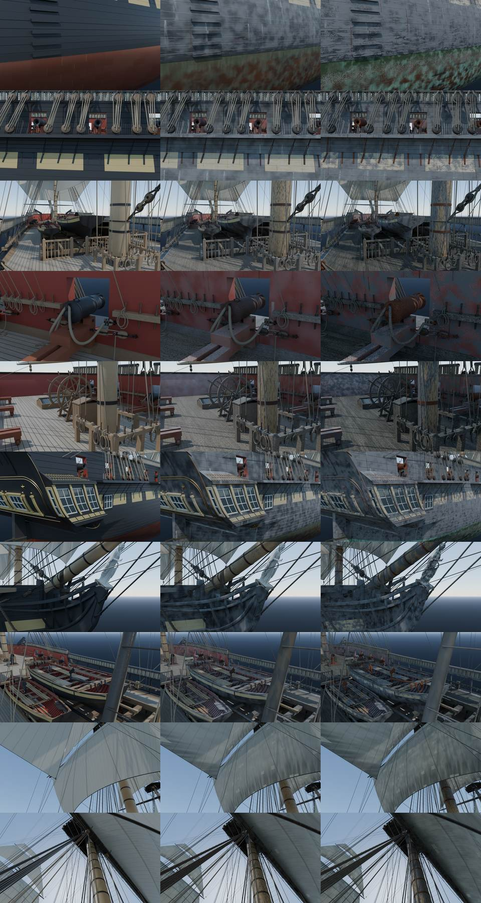
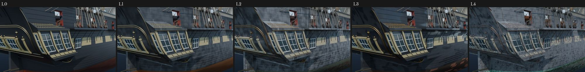
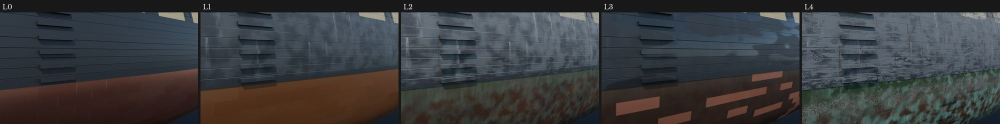
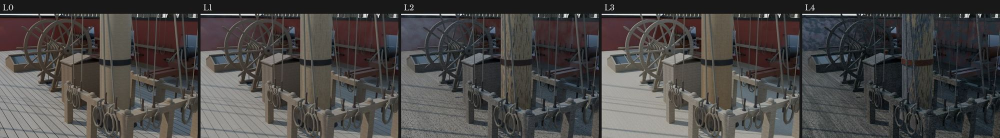
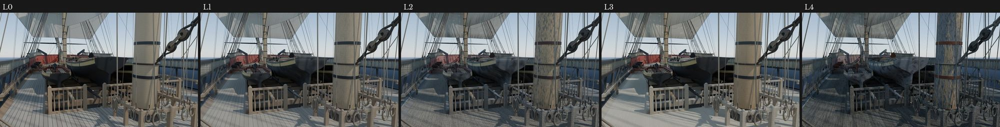
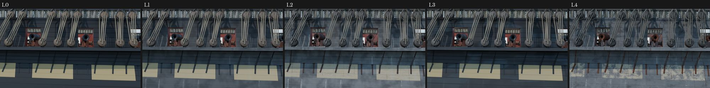
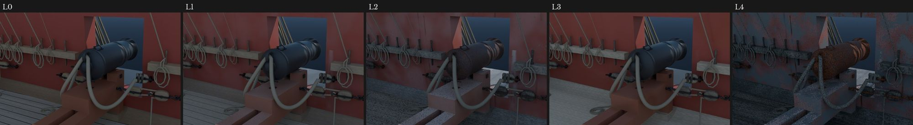
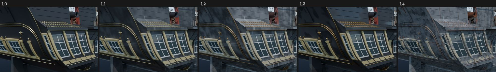

# Shipkit 15: the frigate Commonwealth's textures and wear

Slice 15 of *Commonwealth*, our own 36-gun frigate of 1797 (the plan: <https://claude.ai/artifact/8y6hW8vHjjUPJRovJEuxY7>;
her hull, rig, sails, guns and decks are slices 1 to 14, [docs/shipkit-1](../shipkit-1/README.md) onward). Until now
every one of her materials was a flat colour. This slice dresses her outside in the texture loop's five wear levels
([docs/texture-loop](../texture-loop/README.md)), from new off the ways in the autumn of 1797 to twenty years laid up as
a hulk: the black, ochre and red oil paint chalking, salted, weeping rust and tar and flaking to grey oak; the copper
browning, darkening, going green and lifting under weed and barnacles; the oak silvering or scrubbed pale; the pine deck
holystoned white or black and green with its pitch failing; the tarred rigging dulling, browning and rotting grey; the
hemp greying and hairy; the flax sails dingy, grimed at the foot and patched; the tarpaulin perishing; the blacked iron
blooming rust; the gilt dulling and chipping off its red bole; the bronze patinating. One close-up map of her own
(oak, which the pine deck shares) joins the boats' and the J-Class's libraries. Like slices 1 to 14 it is tools and docs
only: nothing is imported into Unreal yet (the export is slice 17, the PC's import after it).

The sheet shows ten views, each in a row of three: new (L0), six years half kept (L2) and twenty years neglected (L4).
The views (`render_wear.py` VIEWS, all in her own frame and flipped to read as the game shows her) are the side at the
waterline from a boat alongside, the main chains, the spar deck forward from the quarterdeck, a carronade at a
crewman's eye, the wheel and capstan, the starboard quarter gallery, the head from the bow, the boats over the waist,
the rigging from the deck, and the main course's foot. All five levels of each surface are in its ladder below.

## The five levels

| Level | Age, care | On Commonwealth |
| --- | --- | --- |
| L0 | new | launched, autumn 1797: new paint glossy in linseed oil, bright salmon copper, yellow new pine and oak, the rigging fresh-tarred black, new buff canvas |
| L1 | 0.3 years, 0.9 | her first cruise: the paint's gloss softer and salt dried white under the ports, the copper browned, the deck holystoned paler, the tar dulled, the canvas a shade greyer |
| L2 | 6 years, 0.5 | six years in commission, half kept: faded chalky paint with rust and tar runs, the copper dark brown going green, a grey deck, the rigging brown and rope-worn, sails dingy and patched |
| L3 | 30 years, 0.9 | thirty years on, kept by a proud navy yard: repainted, the deck holystoned white, the rigging re-tarred, the copper renewed; the oak's grain worn proud, the gilt renewed |
| L4 | 20 years, 0.1 | twenty years laid up and neglected: paint chalked and flaking to grey oak, rust and tar bleeding down the side, the copper green with weed and barnacles at the waterline, a black and green deck, the rigging grey and rotten, mildewed sails |

## What slice 15 builds

### The cards

`Tools/shipkit/frigate/textures_1797.json` has one card per surface: which of her materials it covers (by kind), the
pattern's real size, the detail maps it draws, its CC0 colour targets and what each level looks like on her. Every
material the build makes is in a card, in `unweathered` (glass, the compass card, the clay reference hull) or in
`below_decks` (the gun deck's and lower decks' own materials, dressed as slices 12 to 14 merge); `weathering.dress()`
stops otherwise.

| Surface | Her materials (by kind) | Detail maps | Colour targets (CC0 scans, measured only) |
| --- | --- | --- | --- |
| Paint | black: HullBlack; ochre: HullOchre; red: HullRed, Carriage; white: FigurePaint | WoodVarnish (shared) | Poly Haven black_painted_planks (L4) |
| Copper | sheathing: Copper | Metal (shared) | ambientCG Metal035 (L1); Poly Haven green_metal_rust (L4) |
| Wood | oak: Oak, Rail; blocks: Block, Deadeye, Sheave, Pin; spar: Spar | Oak (hers) | Poly Haven wood_planks_grey (L2), weathered_planks (L4) |
| Deck | deck: DeckPlanks | Oak (hers) | Poly Haven brown_planks_09, plank_flooring_03 (L1), weathered_planks (L4) |
| Rope | tarred: Tarred, Cable; hemp: Hemp, Netting | Manila (J-Class) | ambientCG Rope001 (L0), Rope003 (L2) |
| Canvas | sail: Sailcloth, SailclothFA; canvas: Canvas; tarpaulin: Tarpaulin | Cotton (J-Class) | none: every CC0 canvas is dyed or bleached |
| Iron | blacked: Blacking; iron: Iron; lead: Lead | CastBronze (J-Class), Metal (shared) | Poly Haven rust_coarse_01, rusty_painted_metal (L4); ambientCG Rust009 (rust) |
| Bright | gilt: Gilt; bronze: Bronze | CastBronze (J-Class) | none: no CC0 scan of water gilding |

The scans live in the git-ignored `Data/Reference/raw/textures/Commonwealth` (`wear_check.py --fetch`); none is shipped.

### The wear

`Tools/shipkit/frigate/weathering.py` follows the J-Class's (`Tools/shipkit/jclass/weathering.py`, loaded by path):
`amounts()` turns age and care into each surface's wear terms from the loop's time and dirt numbers, and the dressers
put them on her in Blender's nodes. What neglect alone does (rust through the paint, flaking, rot, weed, mildew) starts
past a dirt threshold a kept ship hardly reaches (the paint's rust is 0.03 at L3); a first season's marks grow as the square root of dirt; a kept ship's
routine (paint touched up, the deck holystoned each morning, the rigging re-tarred each refit, the copper renewed
every few years, a newer suit of sails bent) undoes them again. Most of her parts have no UVs, so the wear is placed in
her frame (by height over the waterline, which way a face looks, the crevices) and the paint's runs by a side
projection along her length.

- **Paint.** The oil's gloss goes; chalk greys and lifts each colour (the black to a dusty grey, the ochre and red
  paler), most high up and on what faces the sky, washed down the side in long streaks; white lead yellows. Salt dries
  white in runs under the ports and along the wales. Rust weeps from the fastenings, a row at every frame; tar drips in
  long thin runs from the rigging. Boats and cables scrape the wales; old paint alligators and lifts in whole cells,
  in ragged groups, to grey oak. A kept old side has its salt washed off and is touched up in glossier, deeper
  patches where it chafes.
- **Copper.** Salmon new, each sheet its own shade; browned within weeks, darker year by year; renewed on a kept ship
  sheet by sheet, so thirty years kept leave a patchwork of dark old sheets and brighter new ones. Verdigris comes late, where she dries and wets about the waterline and at the laps; neglected, the
  sheets lift at the laps over black felt, with slime, weed and barnacles in a band about the waterline.
- **Oak.** Silvers within a season; a kept ship's is scrubbed pale with the grain proud. Grime and algae darken it,
  green where water lies, with black iron stains round the bolts and checks opening. Blocks are tarry and handled;
  spars are oiled amber, dulled, tar-run, and grey where the oil has failed.
- **Deck.** Holystoned pale, whiter each year a kept ship scrubs it; grey where the crew walk and haul; tar drips under
  the rigging; neglected, dark and green with the seams' pitch cracking and lifting.
- **Rope.** The tar's gloss goes within weeks, then it browns, bleaches grey on top and wears through to the fibre;
  re-tarred each refit on a kept ship, near black after thirty years of it; neglected, grey, furred and mildewed. Hemp greys, hairs and mildews.
- **Canvas.** Dingy, grimy at the foot and under the yard, yellowing (a kept ship's old suit buff and patched); patches a cloth wide square to the cloths, thin
  rust-brown stains from the head, mildew specks. The tarpaulin dulls, cracks and perishes to a brown-grey.
- **Iron.** The blacking browns at the edges, rust blooms through, then flakes orange-brown; re-blacked each refit on
  a kept ship. Lead dulls and oxidises white.
- **Bright.** The gilt dulls and gathers dirt, chips to the red bole and wears to grey wood; re-gilt on a kept ship, a deeper gold.
  Bronze patinates, darkens and goes green in the recesses.

Each term is a value node `wear:<term>` that `apply_level()` sets, so one build renders every level. `render_wear.py`
dresses a built `frigate.blend` and renders each view lit, as albedo and as material ids; `--save` keeps the dressed
.blend for the export. The game's twin of the wear (the same terms in HLSL by Age and Care) comes with the import.

### Her own detail map

`Tools/shipkit/frigate/textures.py` makes `T_Frigate_Oak_N` and `_M` with numpy (no photos), 2048 x 1024 over 400 x
200 mm (5.1 px a mm), tileable, in `Inputs/frigate-detail` as plain PNGs (the folder's `.gitattributes` keeps them out
of Git LFS, which the cloud cannot push): growth rings 4 mm apart wandering along the board, ring-porous earlywood
pores, medullary-ray flecks 2 to 12 mm long and checks 30 to 200 mm long. The mask holds the grain's tone, the checks
and the height. The deck's pine draws from it too. Everything else reuses the shared boat library (Metal, WoodVarnish)
and the J-Class's (Manila, CastBronze, Cotton), which are already in the game's memory.

| Tier | Budget | Her maps |
| --- | --- | --- |
| High and Ultra | 12 MB | 4.0 MB (Oak, BC5 normal and BC1 mask with mips) |
| Medium | 6 MB | 4.0 MB |

## Checks

`wear_check.py` measures the renders (`render_wear.py` on main's build, 960 by 540 px, 32 samples):

| Check | What passes | Result |
| --- | --- | --- |
| The ladder, 19 kinds | each level's mean colour (CIELAB, per material in the albedo shots, averaged by pixels) at least 8 from new at L4 and 4 at L2, L1 no further than L2 and L2 no further than L4, and the kept L3 at least 6 from the neglected L4 | all pass but the lead, in no view: outside it is only the hawse holes' linings, and its ladder is checked with the gun deck's textures (the aprons) |
| Colour targets, 12 | each within 6 in colour (a, b) of the CC0 scans' mean albedo | all pass |
| Her map | tiling, no big repeat, 4 px a mm or more, the pattern the card's size | pass (tiling 0.77, repeat 0.11, 5.1 px a mm) |
| Budget | High 12 MB, Medium 6 MB | 4.0 MB: pass |
| Blind ladder | three or more fresh reviewers, each putting all five levels right or swapping only two neighbours, on every surface | pass, round 5: every surface, all three reviewers (21 of 24 all five right, 3 one neighbouring swap) |

The ladder (each level's colour distance from new, and the kept L3's from the neglected L4):

| Kind | L1 | L2 | L3 | L4 | L3 to L4 |
| --- | --- | --- | --- | --- | --- |
| paint.black | 11.5 | 22.0 | 2.7 | 25.5 | 22.8 |
| paint.ochre | 4.5 | 12.2 | 2.6 | 23.6 | 21.0 |
| paint.red | 10.1 | 21.7 | 3.7 | 33.3 | 29.7 |
| paint.white | 0.8 | 4.2 | 4.4 | 22.0 | 19.2 |
| copper.sheathing | 25.9 | 44.2 | 35.1 | 46.6 | 24.9 |
| wood.oak | 4.7 | 14.6 | 14.2 | 23.7 | 31.7 |
| wood.blocks | 5.2 | 18.9 | 10.7 | 24.4 | 17.5 |
| wood.spar | 1.6 | 6.8 | 5.9 | 19.4 | 18.4 |
| deck.deck | 1.9 | 13.8 | 13.6 | 29.9 | 43.3 |
| rope.tarred | 3.4 | 9.4 | 3.9 | 16.4 | 15.2 |
| rope.hemp | 1.9 | 6.7 | 3.6 | 16.1 | 12.7 |
| canvas.sail | 2.6 | 10.8 | 7.3 | 15.4 | 10.3 |
| canvas.canvas | 1.3 | 7.3 | 6.8 | 11.1 | 8.4 |
| canvas.tarpaulin | 1.0 | 8.5 | 3.5 | 11.6 | 8.1 |
| iron.blacked | 0.7 | 15.1 | 0.3 | 33.6 | 33.3 |
| iron.iron | 0.7 | 13.0 | 0.3 | 31.4 | 31.1 |
| bright.gilt | 8.9 | 25.8 | 19.8 | 41.4 | 36.5 |
| bright.bronze | 13.8 | 20.1 | 7.8 | 31.1 | 23.7 |

The colour targets (distance in a and b; the lightness, d_L, is reported, not held: a scan's lighting is not hers):

| Target | Scans | d_ab | d_L |
| --- | --- | --- | --- |
| paint.black at L4 | black_painted_planks | 5.2 | 33.7 |
| copper.sheathing at L1 | Metal035 | 5.9 | -9.5 |
| copper.sheathing at L4 | green_metal_rust | 4.9 | 13.5 |
| wood.oak at L2 | wood_planks_grey | 5.3 | 21.6 |
| wood.oak at L4 | weathered_planks | 4.5 | 8.4 |
| deck.deck at L1 | brown_planks_09, plank_flooring_03 | 4.9 | 13.8 |
| deck.deck at L4 | weathered_planks | 4.5 | 5.7 |
| rope.hemp at L0 | Rope001 | 2.2 | 12.3 |
| rope.hemp at L2 | Rope003 | 5.0 | 34.0 |
| iron.iron at L4 | rust_coarse_01 | 3.4 | 2.4 |
| the rust colour | Rust009 | 4.3 | -6.4 |
| iron.blacked at L4 | rusty_painted_metal | 5.6 | -0.3 |

The kept L3 sits close to new on the paint, the iron and the bright work (a kept ship is repainted, re-blacked and
re-gilt): what the ladder holds there is its distance from the neglected L4. On the sheets it is told apart by what
thirty years leave that a refit does not: the touched-up patches on the side, the copper's renewed sheets among the
old, the white deck and the scrubbed oak, the re-tarred rigging, the sails' patches, the re-gilding's deeper gold.

Two of the first scans were the wrong thing and were replaced: a yellow-green painted plank stood for the black (now
Poly Haven's black painted planks), and a varnished deck stood for the holystoned pine (now two raw softwood
floors). Metal035, a lightly oxidised copper sheet, stands for L1 (browned within weeks), not L2.

## The ladders

## The blind ladder

Each round three fresh reviewers saw only the eight blind sheets ([blind/](blind/) has round 5's, byte for byte, each
surface's five levels in a shuffled order under the letters A to E; the order is in [blind/key.json](blind/key.json), which they never saw) and
the cards' level descriptions, put each sheet in order and named the least convincing thing on it. Their answers are
in `Tools/shipkit/frigate/reviews_1797.json` with each sheet's SHA-256; `wear_check.py` scores them against the
key, and fails them on sheets other than those they saw (a new render needs a new round, `--seed` for a new shuffle;
rounds 1 to 5 kept seed 11, with fresh reviewers each time).

| Round | Passed | Failed, and what changed after |
| --- | --- | --- |
| 1 | paint, rope | copper, canvas, bright, wood, deck, iron: the first cruise taken for thirty years kept. Each level's cues made stronger |
| 2 | paint, deck, rope, canvas, iron | copper, wood, bright: the same swap. The kept copper became a patchwork of renewed sheets, the regilt deeper, the oak scrubbed pale only on a kept ship |
| 3 | wood, deck, iron | paint, copper, rope, canvas, bright. The kept side touched up in glossier patches with its salt washed off, the kept rope re-tarred near black, the kept sails buff and patched |
| 4 | deck, rope, canvas, iron | paint, copper, bright; wood missed by one reviewer. The cards' first-cruise copper ("a few sheets brighter") described the kept ship's renewed sheets: the first cruise is now an even brown and the kept bottom the patchwork. New copper pinker, the first cruise's salt stronger, its gilt dirtier in the hollows |
| 5 | all eight | none (copper twice and bright once by one neighbouring swap, new and first cruise) |

What the round 5 reviewers still found least convincing, for the next pass: the tarred rigging reads pale grey in
the light from the sky rather than glossy black; the iron's first bloom of rust at L1 does not show at this distance;
new pine is not much yellower than the first cruise's scrubbed deck; the sails' first greying is slight.

## Running it

    python -I Tools/shipkit/frigate/textures.py --check                 # rebuilds her oak map (Inputs/frigate-detail) and checks it
    python -I Tools/shipkit/frigate/render_wear.py <build>/frigate.blend <renders> [--views a,b] [--save dressed.blend]
    python -I Tools/shipkit/frigate/wear_check.py <renders> --fetch --sheets <renders>/sheets

with bpy 5.3 in a Python 3.13 venv (numpy, scipy, pillow); the ten views take about 100 minutes on four cores
(`--levels L1` renders one level). `wear_check.py` reads `reviews_1797.json` for the blind check; `--pending-blind`
reports it pending before a round.

## Still to do

- The decks below (slices 12 to 14): their materials are in `below_decks` and get cards as each deck merges.
- The game's own material instances (MI_Frigate_*) from these terms, with the import (slice 17's export writes
  `Frigate_materials.json`: each slot's surface, kind and wear terms at each level).
