# Shipkit 16: the frigate Commonwealth's light copy

Slice 16 of *Commonwealth*, our own 36-gun frigate of 1797 (the plan: <https://claude.ai/artifact/8y6hW8vHjjUPJRovJEuxY7>;
her hull, rig, sails, guns and decks are slices 1 to 14, [docs/shipkit-1](../shipkit-1/README.md) onward, her textures
and wear slice 15, [docs/shipkit-15](../shipkit-15/README.md)). Until now she had one model: the detailed one, 4.4 to
4.8 million triangles seen from outside depending on her state (under sail with the guns housed, cleared for action,
courses clewed up, at anchor). The plan's boat triangle cap is 3 million and her budget at a distance a million. This
slice gives every part seen from outside a light twin, the way the J-Class got hers in slice 12
([docs/jclass-12](../jclass-12/README.md)): **under a million triangles in every state** (940,727 at anchor to 982,638
cleared for action, a fifth to a quarter of the detailed ship), and seen from 50 m on a 4K screen its surface is nowhere
further than a pixel from the detailed one's, its paint lines where the detailed ship has them. Like slices 1 to 15 it
is tools and docs only: slice 17 exports her with the twins as each part's LOD, and the Mac's and PC's frame-rate gates
run once she is in the game.

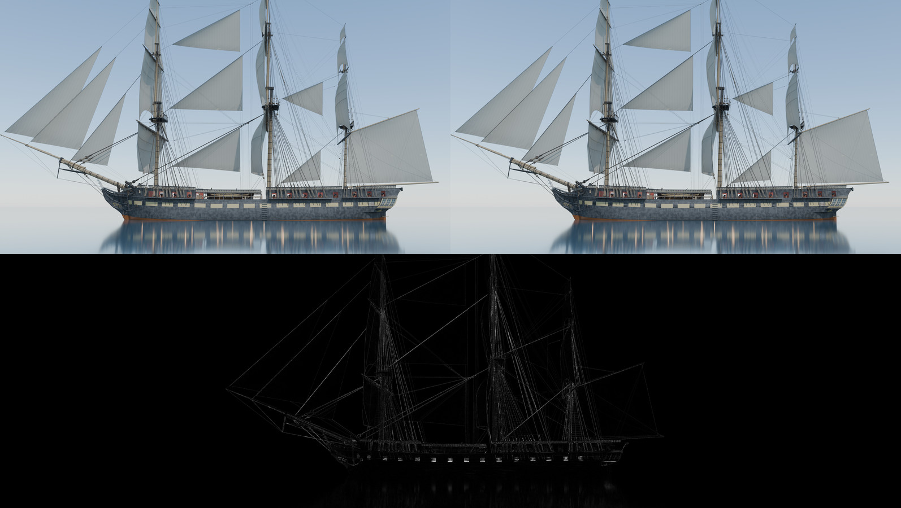

## How light, and why

**The tolerance is a pixel at 50 m, as the J-Class's.** The narrowest view the game has is 60 degrees across; on a 4K
screen a pixel at 50 m is 2 x 50 x tan 30 / 3840 = **15 mm**. Every twin is held to that: its surface within 15 mm of
the detailed part's both ways, its paint lines (where two materials meet) within it, its drawn paint (the deck's
planking, a sail's cloths, from the UVs) within it over 99% of its area, every seam the collapse cut sewn shut, no face
turned over wider than it. The game switches each part to its twin by its own screen size (Unreal's LOD screen size,
`light.json`'s `ue_screen_size`, set for the bounding sphere's nearest point in the widest view), at the size where
the twin's error is one pixel: the worst part's error is a pixel from 50 m on 4K at 60 degrees and 14.4 m at 1080p in
the chase camera's 90 degrees; the median part switches at a screen size of 0.16 (nearer still).

**Why the first run was over budget, and what changed.** On the gun deck build the first full run came out at 1.25 to
1.45 million per state with every part passing the pixel rule. Two causes, neither a loosening:

- The berth deck's hammocks (112 copies, 263,000 triangles) and mess tables were counted as outside parts: `light.py`
  left out the collections `BerthDeck`, `Orlop` and `Hold` but not their sub-collections (`BerthDeck_Hammocks`,
  `BerthDeck_Messes`). Below the gun deck is drawn only when the player walks down, close to, where a twin would never
  show; the gun deck itself is seen through the open waist and every port and keeps its twins.
- A gun's tackles run out (blocks, hooks, falls and the breeching: 88 loose pieces) collapsed no further than 40% of its
  triangles: Blender's collapse takes one share for the whole part, and one piece that needed 40% set it for all, 9,900
  triangles a gun on average, 277,000 for the 28 guns cleared for action. `piecewise_collapse` collapses each loose piece apart to
  the larger of the share asked for and its own smallest share that keeps the piece within the tolerance, then the
  whole part is sewn, painted and measured as before. A twin is made both ways and the lighter of the two that pass is
  kept: 3,400 to 6,300 a gun, 4,300 on average, 120,000 for the 28. The carriages (51 pieces) gain the same way; on the pin rails' or deadeyes' hundreds of small
  identical pieces the whole part's collapse does better, so `piecewise` lists only the gun gear and carriages.

Cleared for action is 17,362 triangles under the budget (it was 456 until the review found the stern gallery held
whole by a crack check miscounting its pinched edges: step 2 below). The margin belongs to the model threads (a heavier
gun deck fitting would eat it), and the next saving if one is needed is the hull's skin, whose 108,675 twin triangles
stand 4.7 mm from the detailed skin where 15 are allowed (the guard below is what stopped it).

| state | shown | detailed | light | share |
| --- | --- | ---: | ---: | ---: |
| underway | sails set, guns housed, carronades run out | 4,793,086 | 959,776 | 0.200 |
| cleared for action | sails set, guns and carronades run out | 4,395,006 | 982,638 | 0.224 |
| courses clewed up | guns housed | 4,799,902 | 969,137 | 0.202 |
| at anchor | sails furled, guns housed | 4,742,050 | 940,727 | 0.198 |

Cleared for action, by kind of part:

| kind | detailed | light | share |
| --- | ---: | ---: | ---: |
| guns and carronades (28 long guns run out, 22 carronades) | 1,808,488 | 253,240 | 0.14 |
| spars and standing rigging | 597,595 | 220,927 | 0.37 |
| deck and fittings | 888,670 | 136,840 | 0.15 |
| hull | 348,044 | 117,731 | 0.34 |
| gun deck (seen through the waist and ports) | 396,465 | 121,649 | 0.31 |
| sails | 155,876 | 81,357 | 0.52 |
| running rigging and blocks | 199,868 | 50,894 | 0.25 |

The heaviest twins: the skin 108,675 (of 267,740, guarded, 4.7 mm off); the 84 long-gun barrels 1,026 each (of 7,808);
the 84 carriages 708 (of 2,992, piece by piece); the pin rails 39,692 (of 96,064, 325 pins built again as tubes); the
hammock nettings 36,601 (of 66,552); the 44 carronade barrels 804 each; the gun deck's implements 27,252 (of 167,440);
the hatchways 24,070; the main and fore deadeyes 23,056 and 21,484. 29 of the 497 unique meshes could not collapse
their solids at all under the rule (the spar deck's planking, the furled sails: every triangle already a pixel's
worth), 19 of them keeping every triangle and the other ten losing only specks and tubes; 818 specks (a pin, a rivet head under a pixel across: 384 triangles) are left out;
6,407 round ropes, rods and pins are built again as tubes of 4 to 16 sides (most 4 to 6).

## How a twin is made

`Tools/shipkit/frigate/light.py` is the J-Class's `Tools/shipkit/jclass/light.py` loaded with this ship's settings
(`light_1797.json`: the screen, 50 m, the ratios, the tubes, her states by collection) and five of its functions
replaced where the frigate broke them (the nearest distance, the collapse, the open and own edges, the states). The steps are the J-Class's (specks, tubes, solids collapsed at their seams and sewn,
paint carried from the detailed part, normals carried): [docs/jclass-12](../jclass-12/README.md#how-a-twin-is-made).
What is new:

1. **The exact distance** (`fast_nearest`). A twin is measured from about a million points over the detailed surface.
   Blender's BVH `find_nearest` and its range search both miss long slivers (the stays came back 0.8 m off, the backbone
   24 mm, both false fails), so every point the tree puts past half the tolerance is measured exactly against the
   triangles whose centres lie within reach, the triangles grouped by size in k-d trees (a box test against every
   triangle took hours on the skin). `light.py --check-nearest <part>` measures both ways: the largest difference is
   0.0000 mm on the backbone, the stays and the skin. Past four tolerances the exact distance decides nothing (the
   candidate fails either way), so the search stops there.
2. **Warped quads** (`split_warped`). The collapse triangulates the faces it keeps its own way: a quad warped 33 mm (the
   counter's, where the tuck meets the stern) cut on its other diagonal stood 46 mm off the part at every share, so the
   skin never collapsed. Each face warped by more than a tenth of the tolerance is cut first along the diagonal the part
   is drawn with, and each pinched edge (more than two faces: sheets touching) is split and counted as the part's own
   open edge, once per face, in the crack check's allowance and in the edges the twin's open edges may lie on.
   Without the allowance a closed part with a pinched edge can never collapse, the split's new edges counting as a
   crack: the stern gallery's carving (37 m of pinched edges, no open ones) kept all 18,080 triangles until the review
   caught it; it is 1,174 now, 11.7 mm off. Four other parts the crack check had held (the skin, the pin rails, two
   topsails) were re-run and came out the same: theirs were real cracks.
3. **The guard** (`guarded_collapse`, the skin). Blender's collapse is global: one tight spot (the hawse holes, the
   stern's tuck) strayed five centimetres at every share while the rest was within a millimetre, so the search kept all
   267,740 triangles. Each pass finds where the collapsed skin strays past half the tolerance, either way, or opens an
   edge off the skin's own, and holds the detailed vertices within 25 cm of those spots out of the next collapse; it
   gives up a share when more than 2% of the points stray or holding would keep more than a fifth of the vertices.
   The skin comes out at 40% of its triangles, 4.7 mm off.
4. **Piece by piece** (`piecewise_collapse`, above): the gun gear and carriages.

The report `light.json` holds each twin's share asked for and reached, errors both ways, paint slide, seams sewn, open
edges, tubes and specks, whether it was guarded or made piece by piece (and what the other way cost), and its switch
size; and per state the triangles shown.

## Seen against the detailed ship

`render_light.py` renders the detailed ship and the light copy alike (the same seed, one crop) at a 4K screen's pixels
with the 60-degree view, under sail with the guns housed, dressed at slice 15's L1 (her first cruise), from an eye 3 m
over the water on her port side, abeam and 40 degrees off the bow, at 50, 100 and 300 m from a point 15 m up her
mainmast; the J-Class's `light_compare.py` measures each pair over her outline (the id shots' pixels grown by two, so
an outline moved by a pixel counts): the mean and 99th percentile of each pixel's difference (0 to 255), the share of
her pixels differing by more than 16 (a step most people see side by side), and the share showing another material or
none. The renderer's own noise (the detailed ship twice, two seeds) is measured alike: no copy can beat it.

| view | pixels | mean | p99 | over 16 | other material | outline moved |
| --- | ---: | ---: | ---: | ---: | ---: | ---: |
| 50 m abeam | 8,006,211 | 1.99 | 30 | 2.9% | 1.7% | 0.7% |
| 50 m bow | 7,334,293 | 1.62 | 25 | 2.2% | 1.2% | 0.4% |
| 100 m abeam | 5,493,898 | 1.00 | 18 | 1.1% | 1.6% | 0.8% |
| 100 m bow | 5,084,808 | 0.88 | 15 | 0.9% | 0.9% | 0.4% |
| 300 m abeam | 790,926 | 0.65 | 10 | 0.4% | 1.6% | 0.9% |
| 300 m bow | 686,434 | 0.52 | 7 | 0.1% | 0.8% | 0.3% |
| the renderer's own noise, 100 m abeam | 5,492,336 | 0.99 | 12 | 0.5% | 0 | 0 |

From 100 m out the light copy differs from the detailed ship about as much as the renderer differs from itself (a mean
of 1.0 against 0.99 of 255; 1.1% of her pixels over the step against 0.5%, mostly the rigging's lines and the hammock
nettings' mesh, which the crops show). At 50 m, the edge of the rule, the differences are twice that and still under a
2% share where the eye would look for them: the nettings, the ratlines, the blocks. The share of pixels showing another
material (0.8 to 1.7%) is the paint lines and the outlines of a thousand ropes against the sky, each moved by under a
pixel; it does not fall with distance because the ropes stay a pixel wide at every distance.

The images: each pair side by side over its difference (amplified four times, black where they agree) and a crop at the
screen's own pixels where they differ most.

| 50 m abeam | 50 m bow |
| --- | --- |
| 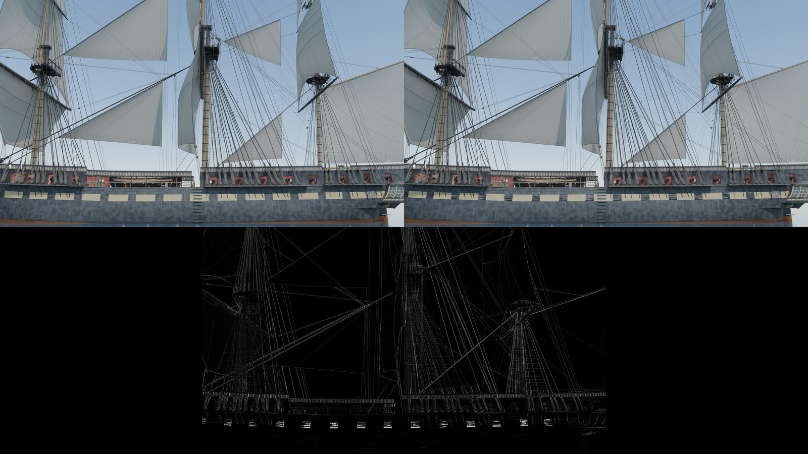 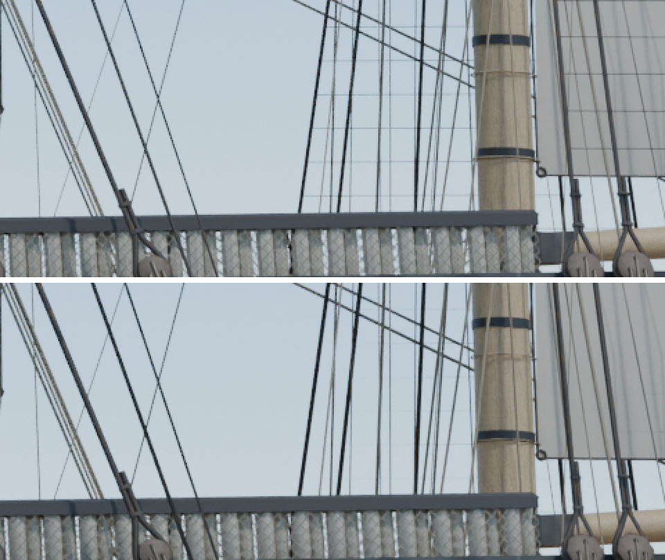 | 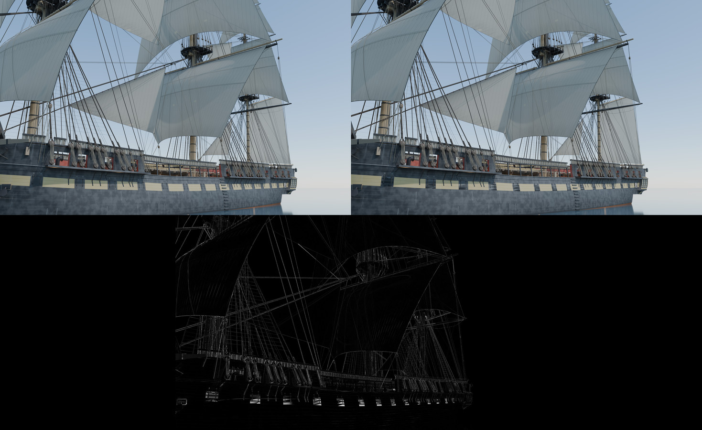 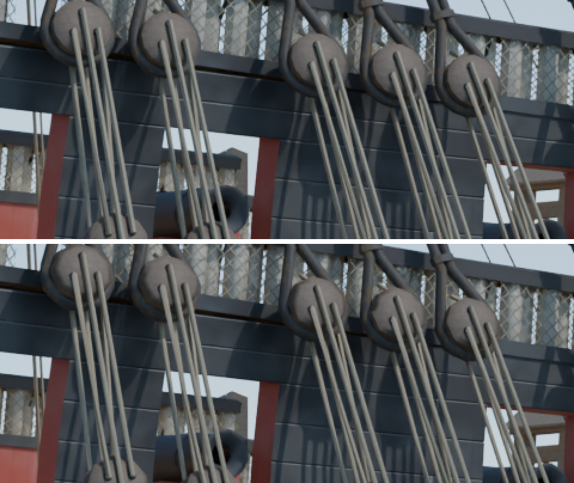 |

| 100 m abeam | 100 m bow |
| --- | --- |
|  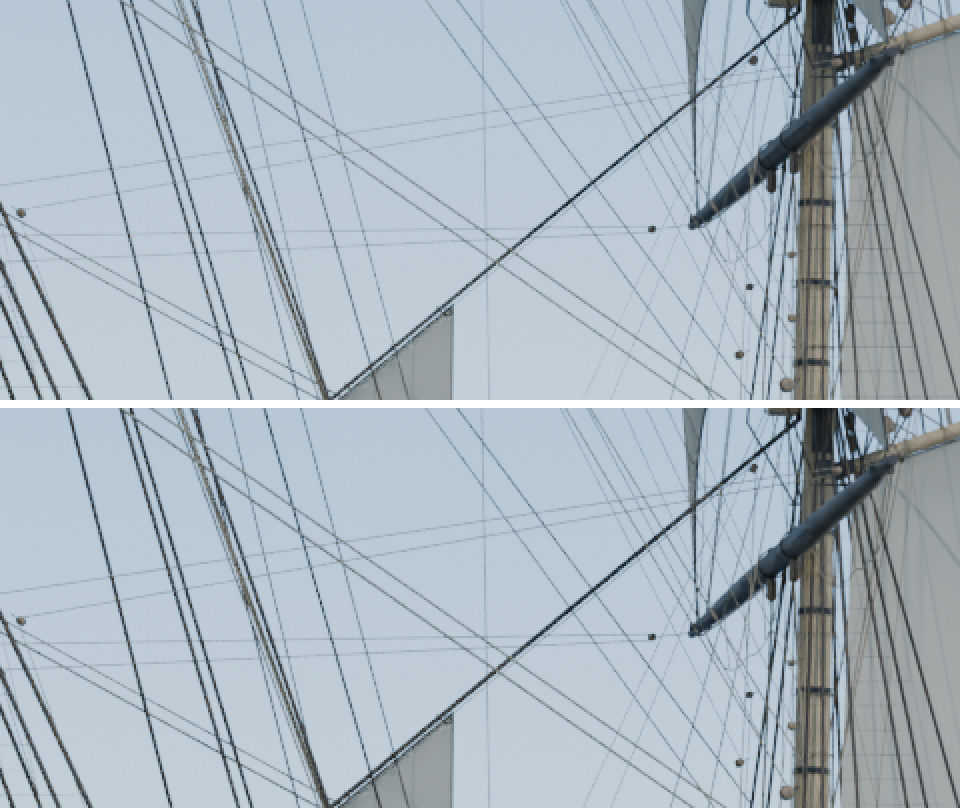 | 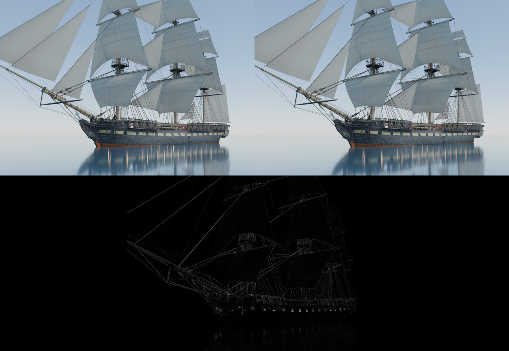 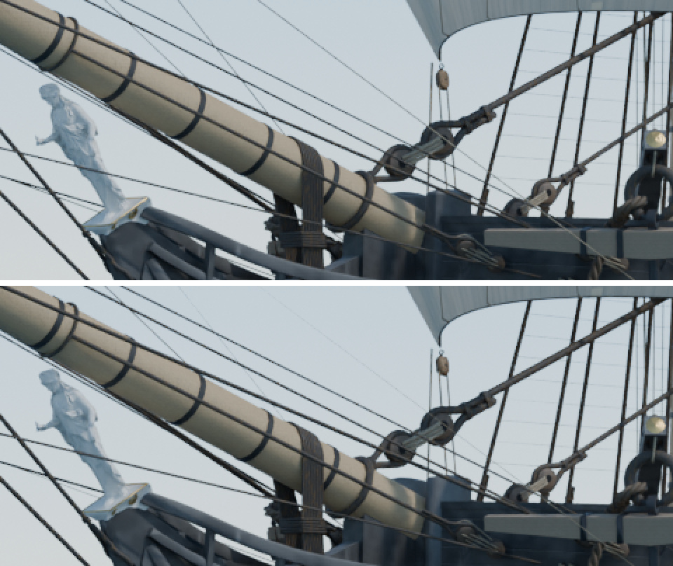 |

| 300 m abeam | 300 m bow |
| --- | --- |
| 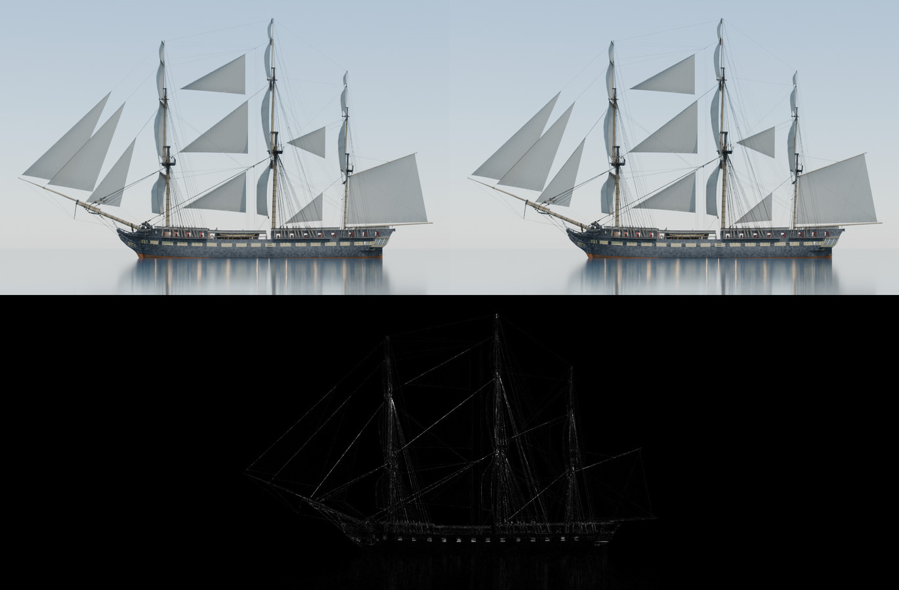 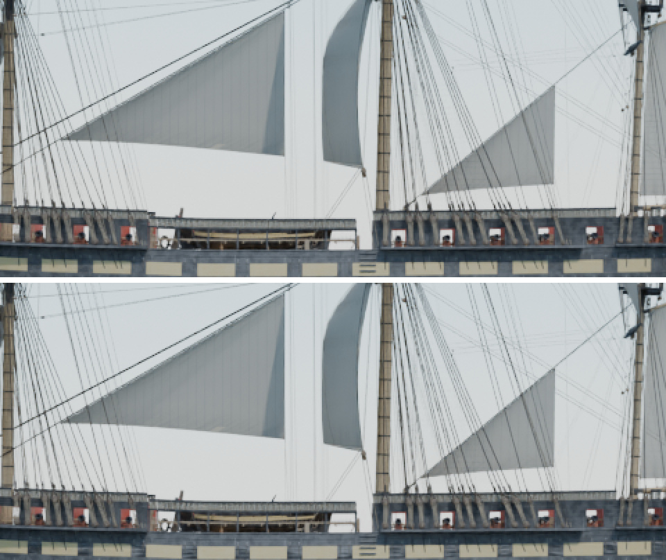 | 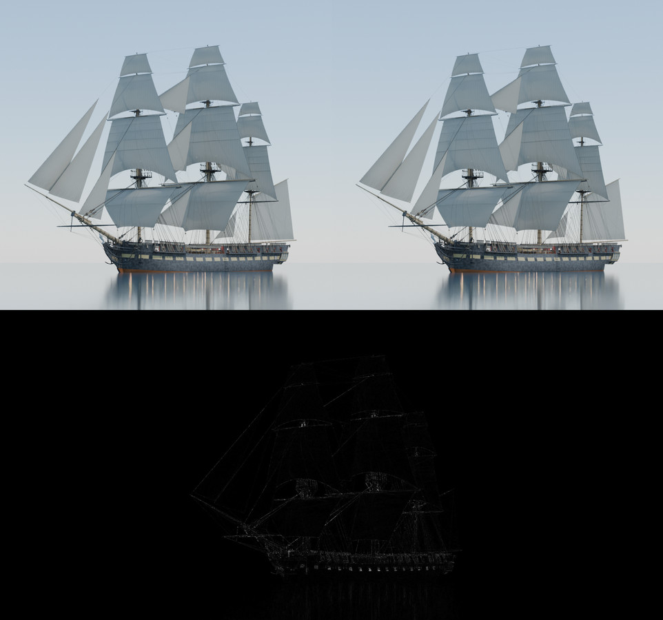 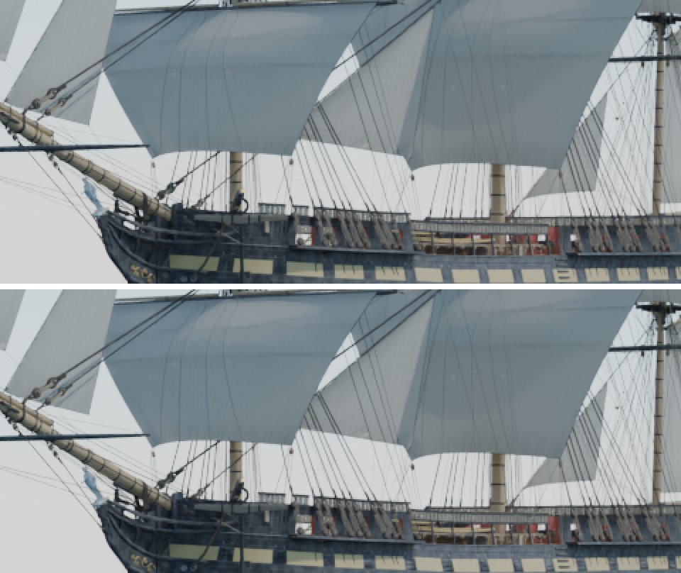 |

Close to, the triangles, detailed (left) and light (right): the head, the side at a port's eyebolts and ringbolts (the
guns housed), the stern gallery.

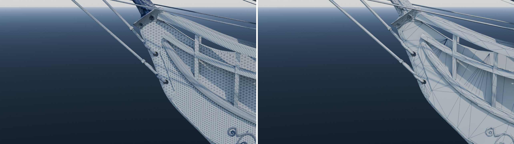

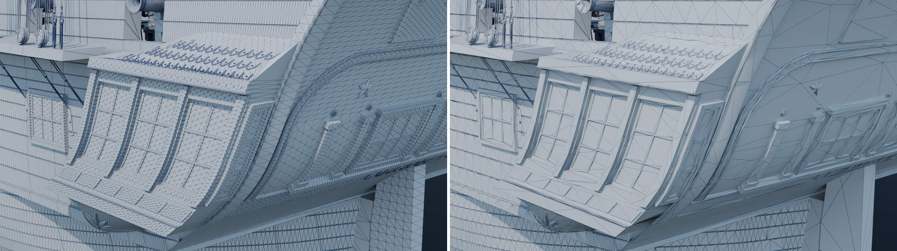

**Seen on the way: her black side at L2 reads grey from 100 m.** Slice 15's six-years-half-kept level chalks the black
paint to a mid grey (its colour alone, without light, about 120 of 255 where the new coat is near black), which the blind reviewers read rightly close to, with
its runs and streaks, but from 100 m it is a grey ship. That is slice 15's look, not the twin's (both renders agree),
and a question for Bean: whether a frigate six years out and half kept should read that grey at a distance, or the
chalk should come in later and lighter. The doc renders use L1 meanwhile.

## Running it

    python -I Tools/shipkit/frigate/light.py <build>/frigate.blend <out>/frigate_light.blend --shard i/8 --report <out>/s<i>.json
    python -I Tools/shipkit/frigate/light.py <build>/frigate.blend <out>/frigate_light.blend --merge s0.blend,...,s7.blend --reports s0.json,...,s7.json --report <out>/light.json
    python -I Tools/shipkit/frigate/light.py <build>/frigate.blend --check-nearest Skin
    python -I Tools/shipkit/frigate/render_light.py <out>/frigate_light.blend <renders> [--dists 50,100,300] [--bearings abeam,bow] [--only pairs|wire] [--level L1] [--docs docs/shipkit-16]

with bpy 5.3 in a Python 3.13 venv (numpy, scipy, pillow). The eight shards take 35 to 45 minutes each (three at a time
on four cores: under two hours), the merge two minutes; a shard's `--only <part>` remakes one twin. Give `--merge` a
destination: without one it saves into the source build. The renders take about an hour and a half (`--samples 24`).

## Files

| file | what |
| --- | --- |
| `Tools/shipkit/frigate/light.py` | new: the J-Class's light.py with the exact distance, warped quads, the guard and piece-by-piece collapse; shards and merge |
| `Tools/shipkit/frigate/light_1797.json` | new: the screen, 50 m, the budget, the ratios, tubes, her states by collection, what is inside, guarded and piecewise |
| `Tools/shipkit/frigate/render_light.py` | new: the pairs and wireframes above, then light_compare.py |
| `docs/shipkit-16/` | this page, `light.json` (the report less each part's list of shares tried, 1.4 MB with it), `compare.json`, the pairs and crops |

## Still to do

- Slice 17 exports each part with its twin as LOD 1 and writes the switch sizes; the frame-rate gates on the Mac and PC
  then decide whether a million is right (the plan's fallback is a coarser second level from 300 m, which the J-Class
  did not need).
- The orlop and hold (slice 14) add no outside parts; a change to the gun deck's fittings or the guns is re-run through
  the budget (`light.json`'s states), with 456 triangles to spare cleared for action.
- The L2 grey above, if Bean wants the chalk later.
