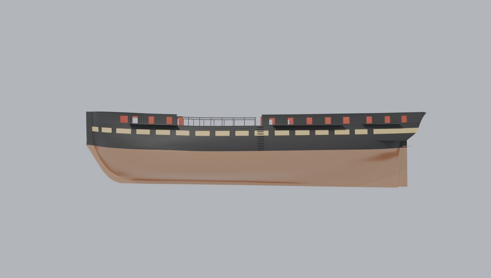

# Shipkit 2: the frigate's planking, gunports and bulwarks

Slice 2 of the frigate *Commonwealth* (plan: <https://claude.ai/artifact/8y6hW8vHjjUPJRovJEuxY7>; slices 0-1 are in
`docs/shipkit-1`). Slice 1 lofted the moulded hull, the outside of the frames as the 1927 lines plan draws it. This
slice planks it and gives her a side: copper, wales, strakes, gunports with their lids, bulwarks and rail, the
channels, the entry steps and the rudder, painted the way she looked in 1797. It is still post-slice art: nothing here
is imported into Unreal or wired into the game.



## What slice 2 builds

Outside, from the keel up (sizes from the specification, below):

* **Copper** from the keel to the bottom of the main wale. Under it the planking thickens from the bottom's 4 in to
  6 in at the wale over the last four strakes, with no steps (the copper hides the seams).
* **The main wales:** six strakes, 10 in broad and 7 in thick. With them the extreme breadth is 44 ft 7 in (the
  moulded 43 ft 5 in plus two wales).
* **Black strakes** from the wale to the gun port sills, "mitred down" 5 1/2, 5 and 4 1/2 in thick; the **port band**
  (three 4 in strakes) between the gun ports' sills and heads; the **string plank** (two 4 in strakes); the
  **channel wale** (two 5 in strakes) up to the plankshear.
* **The bulwarks** on the quarterdeck and forecastle (4 in planking: one strake to the spar port sills, four to their
  heads, two more to the rail), the **rail cap** (14 x 4 1/2 in) on top, the half-round **moulding** along the
  plankshear.
* **The waist is open** above the gangways: the rail runs on square stanchions about 6 ft apart from the entry to the
  forecastle (see "The 1797 look").
* **Gunports:** 14 a side on the gun deck plus the bridle port forward, each with a 4 in lid hinged along its head
  (two iron straps and knuckles); 8 spar deck ports on the quarterdeck and 4 on the forecastle, open, with no lids.
  The ports are lined (red) from the skin to the inside.
* **Channels** for the fore, main and mizzen shrouds (3, 3 and 2 1/4 ft out, 6 in thick), their tops at the
  heights traced on the 1927 plan but never above the spar port sills (`baseline/skin.md`). The fore channel starts
  at the forecastle's break: the 1927 plan runs it about 6 ft further aft, along what was a solid waist by then, and
  the 1817 draught starts it at the break. The **entry steps** (11) amidships.
* **The rudder,** as thick as the sternpost at its fore edge (22 in) thinning to 13 in aft, coppered, with five
  bronze pintle straps and the gudgeons' arms on the hull, and the pendant band's arm the 1927 drawing shows.
* **Seams:** a small V at every plank seam (0.35 in deep), so the strakes read up close.

Inside, as placeholders for the deck slices (7, 12-14): the gun deck's side (16 in in from the frames), the bulwark's
inside (8 in), a gun deck, the spar deck's quarterdeck, forecastle and gangways with the waist open between them, and
plain bulkheads where the inner faces stop at the bow and stern.

Every gun port lid is its own object, with its origin on the hinge axis (midway between its two hinge knuckles, X
along the axis through them, Z out of the side), so on both sides a positive turn about the lid's own X opens it
outward. The port lids are the starboard ones mirrored; their X points aft, which keeps the frame right-handed and the
turn the same.

| Object | Triangles | Object | Triangles |
| --- | ---: | --- | ---: |
| Skin (both sides) | 260,266 | Moulding | 34,520 |
| Spar deck (placeholder) | 28,832 | Gun deck (placeholder) | 19,456 |
| Lids (30) | 18,680 | Bulwark inside | 12,650 |
| Gun deck side | 12,006 | Rail cap and waist rail | 10,984 |
| Transom (slice 1) | 6,912 | Channels | 4,504 |
| Port linings | 3,608 | Bulwark top | 2,744 |
| Rudder irons | 2,376 | Backbone | 1,500 |
| Rudder | 1,460 | Entry steps | 1,144 |
| Bulkheads | 704 | Transom top | 672 |
| **Model** | **423,018** | Moulded hull (hidden reference) | 564,748 |

The outside's budget is 3.9M triangles (Bean: a floor, not a cap), so there is plenty of room for the head, stern,
rig and fittings still to come. The moulded hull stays in the .blend as `Hull`, hidden from renders: the lines check
and the shape tools measure it, because the drawing's lines are the frames' outside, not the planking.

## Sources

* **Heights and sizes:** the US Navy's midship section of *Constitution* ("Midship Section Starboard Side Looking
  Forward", National Archives 75841360, a restoration drawing of 1919-1940; public domain). It gives its heights "as
  per Mr. Joshua Humphreys' specifications for 44 gun frigates" (1795): lower port sill to the top of the main wale
  3 ft 3 1/2 in, the wale 5 ft deep, the ports 2 ft 11 in, upper sill to the plankshear 2 ft 7 1/2 in, and every
  strake's thickness. `Tools/shipkit/frigate/specs_1795.json` holds them, each with where it came from.
* **Where things are along the side:** the 1927 lines plan's sheer plan (the same scan as slice 1), traced into the
  `skin` block of `offsets.json`: the ports, the plankshear, the rail on the quarterdeck and forecastle, the breaks
  (quarterdeck end, entry, forecastle start), the channels, the rudder's straps and the entry steps.
* **The 1797 look:** the 1817 draught (National Archives 102278445), the oldest drawing of her side.
* The drawings stay out of the repo, as in slice 1.

## The 1797 look

* **Paint:** a black side with an ochre band along the gun ports (the 1817 draught's light band), black lids on it
  (the chequer of the period), copper to the main wale, red inside the bulwarks and the port linings. On the draught
  the quarterdeck's bulwark is washed only a shade lighter than the black below it (about 108 against 98 on the scan's
  grey scale, where the port band is 135), so it stays black here. The colours are plain for now: textures and wear
  are the texture loop's. `baseline/compare_1817.jpg` sets the draught's side over the model's.
* **The open waist.** The 1927 lines draw a solid bulwark along the waist: that is the ship as rebuilt later. The
  1817 draught shows the waist above the gangways open, a rail on stanchions (with the hammock netting along it), and
  that is how this slice builds it. The netting itself is slice 8's.
* **No air ports.** The 1927 sheer plan draws a row of small round air ports along the berth deck. They were added
  long after 1797, so they are left out.
* **Ports as drawn.** The ports' heights come from the 1927 plan (2 ft 7.7 in, where the specification says 2 ft
  11 in), because that is the drawing the ports' places come from. The plankshear sits 2 ft 8.2 in over the port
  heads on that plan, as the specification gives it.
* **The copper's top** is the main wale's bottom, rising toward both ends with the sheer, the way she is painted today.
  The specification's load line is 1 ft 4 in above the wale's bottom; the 1927 plan puts the wale's bottom on its load
  line at midships, so the two load lines differ by about that much (`specs_1795.json`, `lwl_note`).

## How the skin is made

`Tools/shipkit/frigate/skin.py` (plain numpy and scipy; the module's opening comment has the detail) works in the
drawing's pixels on top of `loft.py`'s moulded surface:

* The side is laid out as **rows**, each a curve z(x) along the ship: the bottom's rows up to waterline F, the
  copper's rows up to the wale, and a row at every plank edge above, following the gun port sill line the way the
  planks do. Neighbouring rows are zipped into faces; every row has a vertex at a common set of x columns (closer at
  the ends of the ship, and through every port edge and break), so the ports' sides are straight and the seams line up.
* **A vertex** is the moulded point moved out along the surface's normal by the planking's thickness there. Where two
  strakes of different thickness meet, the edge has two rows and a small step between them. Toward the stem, the
  sternpost and the stern the thick strakes ease to the bottom's 4 in over the last 2 ft, and the planking lands in the
  backbone (widened by 4 in a side to take it).
* **At the wing transom** the side has a knuckle (slice 1): the rows are laid once on each side of it and joined by
  the transom's flat underside.
* **The ports** are cut where a face's middle falls inside a port; the linings join the opening's edge to the inner
  face. The lids are the port band's own planking over the opening (seams and all), a quarter inch smaller all round.

## Checks

```
python Tools/shipkit/frigate/build_frigate.py <out>
python Tools/shipkit/lines_check.py <out>/frigate.obj Tools/shipkit/frigate/drawing_1927.json \
    Data/Reference/raw/ships/Commonwealth/USS_Constitution-_Sheer_Plan_-_Body_Plan_-_Lines_-_NARA_-_75841374.jpg <out>/check
python Tools/shipkit/frigate/skin_check.py \
    Data/Reference/raw/ships/Commonwealth/USS_Constitution-_Sheer_Plan_-_Body_Plan_-_Lines_-_NARA_-_75841374.jpg <out>/skincheck
python Tools/shapeloop/fairness.py <out>/frigate.blend <out> --object Hull
python Tools/shapeloop/render_set.py <out>/frigate.blend Tools/shipkit/frigate/sections_frigate.json <out>/renders
```

(Blender's Python, pip `bpy`, for the build and the shape tools; `skin.py` and `skin_check.py` need only numpy, scipy
and Pillow.)

* **Slice 1's hull is unchanged** where slice 1 checked it: the lines check still has median 0 px and 93.9% of 11,966
  samples within 2 px (`baseline/lines.md`), and the fairness check still finds 13 inflections and 15 kinks.
  `frigate.obj` now holds only the moulded surfaces (hull, transom, backbone) for it.
* **The side against the 1927 sheer plan** (`baseline/overlay_side*.jpg`): the gun ports, spar ports, channels,
  rail, rudder and straps as built, drawn back onto the scan. The ports' sill line is faired through the ports' sills,
  0.8 px RMS from each port's own reading, and their height is a straight line along the ship, 0.9 px RMS (1 px is
  about an inch). The rail on the quarterdeck and forecastle is a gentle curve within 3.3 px of every traced point.
* **The rail against the half-breadth plan's RAIL line** (`baseline/skin.md`): the planked side at the rail is 2-11 px
  outboard of the line from the stern to station 1, because the body plan's sections (which slice 1 follows, and the
  lines check scores) are that much wider at the top than the half-breadth plan's RAIL line. The two views of the same
  drawing disagree there by up to about 10 in.

### The bow top refit

Forward of station 1 the body plan has no sections, so slice 1 guessed the bow's flare above the waterline, and the
side at the rail came out 8-13 px (up to about a foot) inside the RAIL line. That was a known gap, left for this slice.
`offsets.json` now adds more flare there (`topsides.bow.flare_2295`, and a wider row at x = 2340 px), so the planked
side is 2-5 px outboard of the line from x = 2296 to 2340, as it is aft of station 1. The flare is added after the
stations' fit, not put into it, eased in from station 1; since the shape is only sampled on the rows, it lands in full
on the x = 2295.5 row and as a trace on the 2205 row. The level lines are splines through every row, so they carry a
little of the change aft of station 1: up to 2 px (2 in) narrower near the sheer between x = 2100 and station 1
(x = 2196), under half a pixel aft of 2100, and nothing aft of 1800. The levels came out fairer for it (the 235 px
level near the bow went from 6 inflections to 2), nothing below the load waterline moves, and the lines check and
fairness are the same as before.

## Known gaps

* **Placeholders:** the decks and the inside faces (slices 7 and 12-14), the bulkheads at the bow and stern and the
  transom's top (slice 9's stern and head). The stem stands bare above the forecastle: the knightheads, the head and
  its rails are slice 9's.
* **Channel widths** are not on the drawings: 3 ft (fore and main) and 2 1/4 ft (mizzen) are sized so the deadeyes of
  slice 4 clear the rail and the tumblehome; check them against the shrouds there.
* **The waist's stanchions** (4 in square, about 6 ft apart) are sized by eye from the 1817 draught.
* **One small seam:** where a strake edge with a step crosses the wing transom's height, just forward of the stern's
  join, one edge is shared by four faces (a 1 1/2 in step). It doesn't show, and the Unreal import takes it.
* The stern's corners where the rail cap meets the stern face are rough; slice 9 builds the taffrail and quarter
  pieces over them.

## Files

| File | What it does |
| --- | --- |
| `Tools/shipkit/frigate/skin.py` | the planked side, ports, lids, rails, channels, rudder and placeholders |
| `Tools/shipkit/frigate/specs_1795.json` | sizes from the midship section (Humphreys' specification) |
| `Tools/shipkit/frigate/offsets.json` | slice 1's readings, plus the `skin` block and the bow refit |
| `Tools/shipkit/frigate/loft.py` | slice 1's loft, with the bow flare and the backbone's stem head |
| `Tools/shipkit/frigate/build_frigate.py` | the Blender build: `frigate.blend`, `frigate.obj`, `build.json` |
| `Tools/shipkit/frigate/skin_check.py` | the side's overlay on the sheer plan and the rail table |
| `Tools/shipkit/frigate/sections_frigate.json` | the shape loop's sections (the moulded hull is in none, so renders hide it) |
| `docs/shipkit-2/baseline/` | build.json, lines.md, skin.md, fairness.json, overlays, paint and clay renders |
