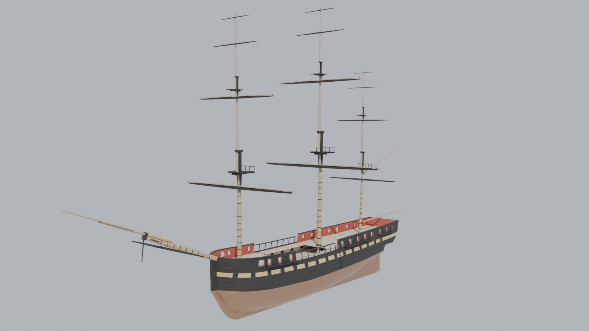
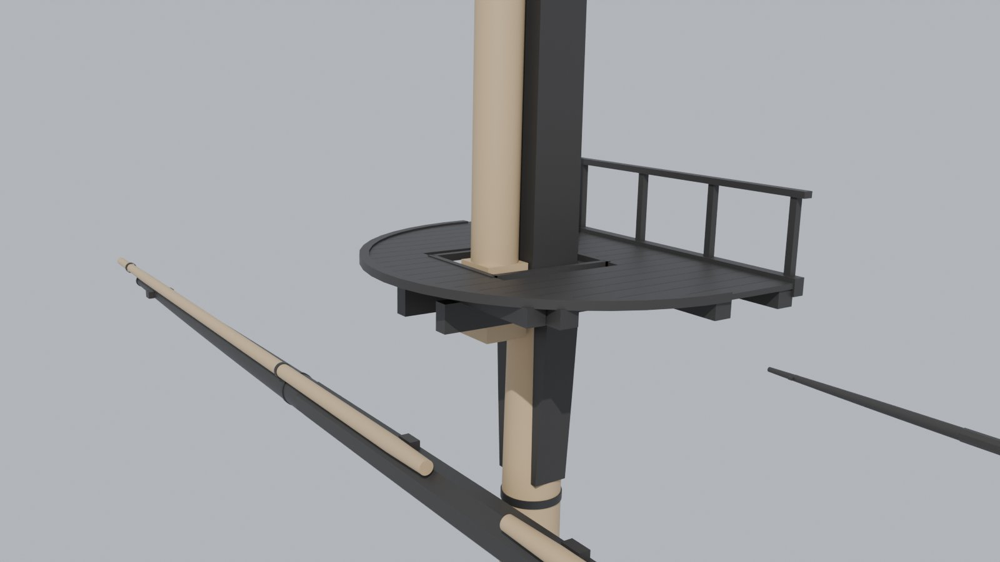
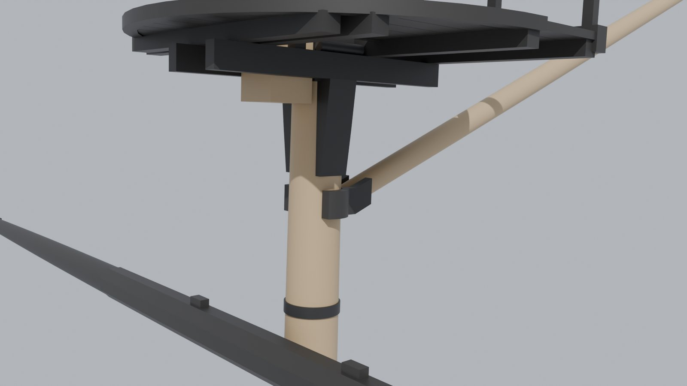
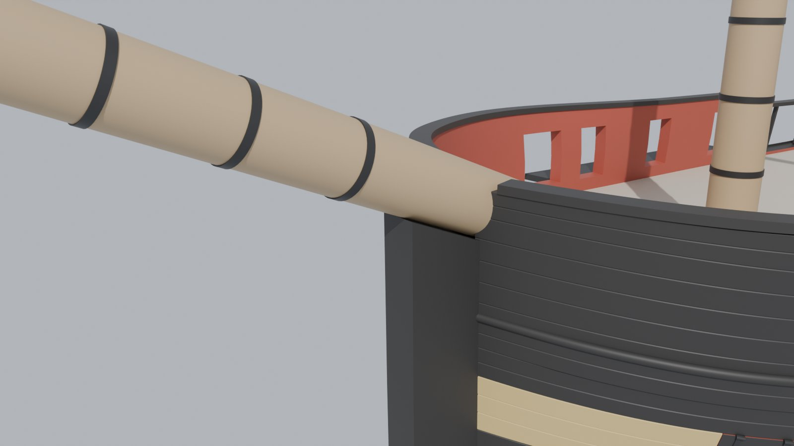
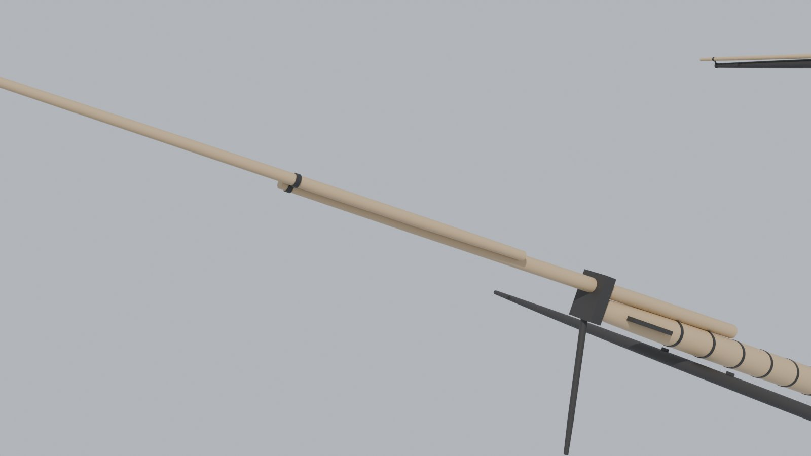
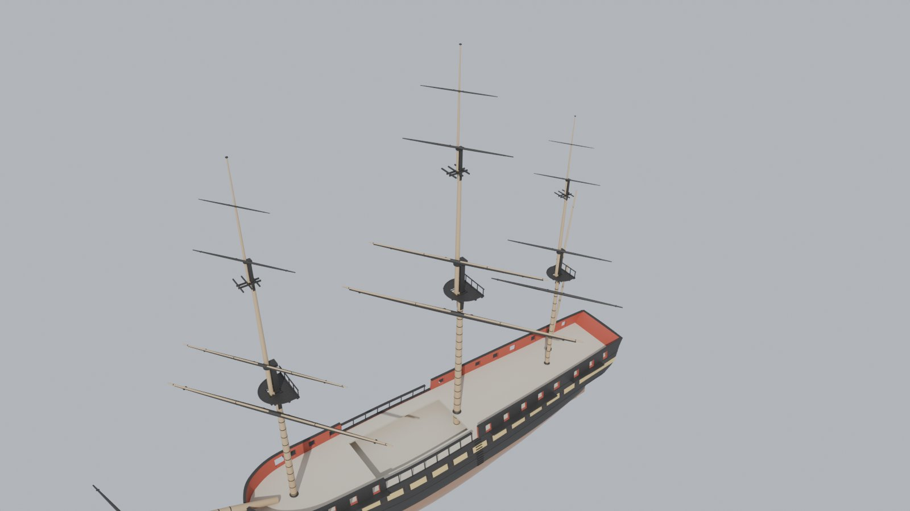
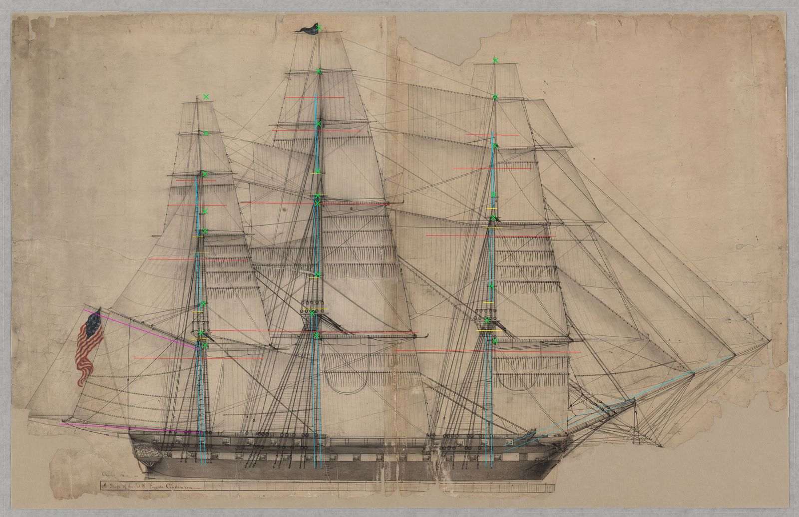

# Shipkit 3: the frigate's masts and yards

Slice 3 of the frigate *Commonwealth* (plan: <https://claude.ai/artifact/8y6hW8vHjjUPJRovJEuxY7>; slices 0-2 are in
`docs/shipkit-1` and `docs/shipkit-2`). Slice 2 gave her a planked, painted side. This slice masts her: the three
lower masts with their tops and caps, the topmasts, topgallant masts and royal poles, every yard, the spanker boom and
gaff, and the bowsprit with its jibbooms. The standing and running rigging is slices 4 and 5. It is still post-slice
art: nothing here is imported into Unreal or wired into the game.



## What slice 3 builds

* **Lower masts** stepped on the keelson (3 ft over the rabbet), round and tapering by the period's quarters from the
  spar deck to the hounds, with a square black head, the cheeks under the trestletrees, iron hoops every 4 ft (they are
  "made" masts, built up from several trees) and a canvas mast coat at the deck.
* **Tops:** trestletrees, four crosstrees, the bolsters, the topmast's iron fid, a planked platform with the lubber's
  hole round the masthead, a rim, and the rail with its stanchions across the top's aft edge. The **lower cap** on the
  masthead, with its iron band.
* **Topmasts:** a square heel on the fid, a round body, a square head with short cheeks, their own trestletrees and
  three crosstrees, the topgallant fid and the **topmast cap**.
* **Topgallant masts** with the royal pole above the stop and the truck on top.
* **Twelve square yards** (fore, main and crossjack; a topsail, topgallant and royal yard on each mast). The lower and
  topsail yards are octagonal in their middle third; every yard has sling cleats and stop cleats at the yardarms. The
  fore and main lower and topsail yards carry their studding-sail booms on top, one on each half of the yard: the heel
  lashed beside the slings, through an iron a third of the way out and another at the yardarm, the end a little past
  it. Yards are black, the booms bright.
* **The spanker boom and gaff** on the mizzen, each with its jaws: a horn each side, bolted to the spar's heel and
  spreading round the mast.
* **The bowsprit,** its heel on the forecastle deck, steeved up 22.2 deg over the stem head, with iron hoops, the bees,
  the cap, the jibboom on its back, the flying jibboom beside it (to starboard and up, through an iron at the
  jibboom's end), the dolphin striker under the cap and the spritsail yard slung under it. The stem head, which slice 2
  carried up to the forecastle rail, is now cut down to bed the bowsprit (`skin.py`, from `spars.Rig.stem_bed`).

| The main top and its yard | The gaff's jaws under the mizzen's short cheeks |
| --- | --- |
|  |  |
| **The bowsprit bedded on the stem head** | **The jibboom and flying jibboom** |
|  |  |

### Yards that move

A square-rigger steers its sails by swinging the yards (bracing) and sets or furls them by hoisting and lowering the
upper yards. Every yard, the spanker boom and gaff and the spritsail yard is its own object whose origin is on the
axis it turns about (its mast's axis, which rakes aft with the mast), with local Z up that axis. To brace one, turn it
about its own Z; to lower one, move it along its own Z. `rig.json` (written next to `frigate.blend`) lists for each
part its origin and axis, the object it rides on (`parent`: a topsail yard travels with its topmast), how far it
lowers (`hoist_m`, negative is down), its brace limits, and `port_tack_sign`: the sign of the turn that trims it for
the wind on the port side. A positive turn swings a yard's starboard arm aft but the boom and gaff to port, so the
yards take +1 and the boom and gaff -1, and one trim angle times each part's sign sets them all to the same wind.

| Part | Lowers | Braces | Lowered to |
| --- | --- | --- | --- |
| Lower yards and crossjack | slung, no | +-35 deg | |
| Topsail yards | 7.1-10.2 m | +-35 deg | just above the lower cap |
| Topgallant yards | 4.3-5.8 m | +-35 deg | just above the topmast cap |
| Royal yards | 3.1-4.3 m | +-35 deg | just above the topgallant mast's stop |
| Spanker boom and gaff | no | +-40 deg | |
| Spritsail yard | no | +-25 deg | |



The model hangs every yard hoisted and squared. `baseline/swing_*.jpg` (above) show every yard braced 35 deg and
lowered and the boom and gaff at 40 deg. A clearance test (every moving part at both limits, half way and square,
hoisted and lowered, against every mast, top, cap, crosstree and the hull) finds nothing touching. The closest are the
boom's and gaff's jaws, 5 mm off the mast; every yard keeps the 3 in it hangs forward of its mast, and a lowered yard
stops 0.4 ft above the cap it comes down to. Thirty-five degrees is about as sharp as a frigate's lower yards would
brace before the yardarms met the shrouds and backstays; the boom and gaff stop at 40 deg, about where the after
mizzen shrouds would stop them. Slice 4 will hold both to the rigging.

### Triangles

| Part | Triangles | Part | Triangles |
| --- | ---: | --- | ---: |
| Lower masts (3) | 29,328 | Yards (12) | 27,456 |
| Bowsprit, cap and jibbooms | 6,656 | Tops, caps and crosstrees (3) | 4,200 |
| Topmasts (3) | 2,704 | Spanker boom and gaff | 2,272 |
| Topgallant masts (3) | 2,032 | Spritsail yard | 1,504 |
| **Rig** | **76,152** | **Model** | **499,154** |

The slice's own budget was about 300k, so the rig has room for the blocks, sheaves and fittings that come with the
rigging slices.

## Sources

Every number in `Tools/shipkit/frigate/spars_1795.json` says where it came from:

* **list:** the War Office's statement of 31 March 1795 of the lengths of masts and yards for the 44-gun frigates,
  "according to Mr. Steel's method" (Papers of the War Department, document 78108). It gives the main mast
  (109 ft 2 in), main topmast (65 1/2 ft), the bowsprit (65 1/2 ft) and the yards through the topgallants.
* **1801:** the Navy's orders of December 1801 for the 44s (fore 95 ft x 32 in, main 105 x 35, mizzen 92 x 24,
  bowsprit 64 x 34), quoted in Tyrone Martin's "Constitution Close Up" (USS Constitution Museum). Kept as the
  cross-check; the diameters follow its ratios.
* **36s:** the War Office's 1794 list for the 36-gun frigates, scaled, where the 1795 list is silent (the fore and
  mizzen topmasts and the topgallant masts: that list says its topmasts and topgallant masts "will answer for both").
* **rule:** a proportion of the period (David Steel's "Elements and Practice of Rigging and Seamanship", 1794, as
  modelling references quote it; the book itself was not checked): 1 in of diameter a yard of length for masts, 5/7 in
  for yards, mastheads 5 in a yard, the tapers by quarters, royals 2/3 of the topgallant yards.
* **draught:** read off the 1817 sail plan, "A Draft of the U.S. Frigate Constitution" (National Archives 102278445):
  where the masts stand and how they rake, how far each lower yard hangs under its top, the tops' fore-and-aft size,
  the boom and gaff, the bowsprit's steeve and the jibbooms' reach.
* **1849:** the Navy's spar deck plan (National Archives 75841368), which puts the bowsprit's heel on the forecastle
  deck (the gun deck plan has none). It draws a later bowsprit's heel 10 ft inside the stem; here the heel goes where
  the 1795 bowsprit's cap lands on the 1817 draught's cap, about 16 ft inside it.
* **by eye:** where nothing says (the fittings' proportions, the boom's diameter, the paint).

The drawings stay out of the repo, as before.

## Against the 1817 draught

`Tools/shipkit/frigate/rig_check.py` draws the rig back onto the 1817 sail plan (`baseline/overlay_rig*.jpg`: cyan
spars, yellow tops, caps and crosstrees, red yards at full length, magenta boom and gaff, green crosses where the
draught's heights were read) and tables the heights (`baseline/rig.md`, `baseline/rig_check.json`). The draught is
registered on the model by its gun ports, at 10.31 px/ft both ways (its deadeyes are round); its hull is drawn about
16% deeper than the 1927 lines, so the rig is measured from its load line.

The draught is from 1817, twenty years after her launch, and her rig had changed by then. Against the 1795 list:

* **The 1817 rig carries skysails:** a yard above each royal (draught y 307, 153 and 487 on the fore, main and mizzen)
  on a pole up to the truck. The 1795 list stops at the topgallants, so the model has a royal on a pole above each
  topgallant mast and no skysail; the table's trucks compare a royal pole's truck with a skysail pole's (31-38 ft).
* **The main mast** matches to within 2 ft from the top to the topmast cap and the topsail yard, and 3 ft at the
  topgallant yard. The royal is 12 ft low: the draught's topgallant mast and pole are longer.
* **The fore mast** is 5-8 ft low in the lower and middle rig, 11 ft at the topgallant yard and 18 ft at the royal.
  The model's foremast is 8/9 of the main (the rule, and the 1801 orders' 95 against 105 ft); the draught's stands
  nearly as tall as its main.
* **The mizzen** is within 3-4 ft at the top and cap, 9-12 ft low at the topmast, 15 ft at the topgallant yard and
  22 ft at the royal: the draught's mizzen topmast and topgallant are much taller than a 1790s mizzen's.
* **The bowsprit's cap** lands on the draught's (it places the heel; 0.5 ft high), and the jibboom's and flying
  jibboom's ends where the draught draws them. The boom and gaff are within a few feet.

Choices made here:

* **The crossjack hangs 9.1 ft under the mizzen top** (the main's proportion), not the draught's 5.8 ft: there the
  gaff's jaws (4.8 ft under the top) would sit on it.
* **Mastheads are the rule's 5 in a yard.** The draught's are about a fifth longer (its main topmast head 9.9 ft
  against 9.1), but the list's masts are sized by the rule.
* **The tops' breadth** is 4/3 of their fore-and-aft length (rule) on the draught's lengths; the rule's breadth of a
  third of the topmast (21.8 ft for the main) is much wider than any top the draught draws.
* **Cheeks:** the lower mast's stop 0.4 ft above the lower yard (at most 0.55 of the head; the mizzen's also clear the
  gaff's jaws, so they are short), the topmast's are 0.35 of its head, and the topsail yard hoists to 0.4 ft under
  them, so a braced or hoisted yard always clears them.



## The 1797 look

Masts, topmasts, booms and the bowsprit bright (oiled pine); mastheads, cheeks, tops, caps, crosstrees and every yard
black; the ironwork black. This is the period's usual scheme, not a record of this ship; the texture loop will add the
wood and wear.

## Checks

```
python Tools/shipkit/frigate/build_frigate.py <out>
python Tools/shipkit/frigate/rig_check.py \
    Data/Reference/raw/ships/Commonwealth/A_Draft_of_the_U.S._Frigate_Constitution_-_NARA_-_102278445.jpg <out>/rigcheck
```

(Blender's Python, pip `bpy`, for the build; `spars.py` and `rig_check.py` need only numpy, scipy and Pillow.) The
slice 2 checks (`docs/shipkit-2`) are unchanged: the lines check and the skin's tables are the same, byte for byte,
and the fairness check finds the same 13 inflections and 15 kinks. The only change to slice 2's model is the stem
head, cut down from 22.4 ft to the bowsprit's bed (21.2 ft at its fore face, 19.8 ft at the rabbet).

The rig was reviewed by a separate pass that built it and tested it in Blender: the clearance test above, closed and
outward-facing parts, and the draught readings. What it found is fixed here: the iron bands were inside out, the
studding-sail booms crossed at the slings, the gaff's jaws met the mizzen's cheeks, the boom and gaff were steeved in
the mast's raked frame (2.5 deg too low), the bowsprit passed through the stem head, the flying jibboom lay under the
jibboom, and two of the mizzen's draught readings were the royal and skysail yards.

## Known gaps

* **No rigging yet:** shrouds, stays, ratlines, deadeyes, blocks and the sails are slices 4-6. The yards hang in
  space until their slings, lifts and braces come with them.
* **The bow:** the bowsprit passes through the bulwark that slice 2 closes over the stem. Slice 9 builds the
  knightheads either side of it and opens the bulwark there. Its heel is let about an inch into the placeholder
  deck (slice 7 builds the real one, with the bowsprit's step).
* **The 1817 differences** (the fore and mizzen's height, the long poles) are documented, not built: the model is
  the 1795 list.
* **Brace limits** are a flat +-35 deg until the rigging gives the real ones.
* **Tops and crosstrees** are proportions by eye from period drawings; the mast coat and hoops' sizes too.

## Files

| File | What it does |
| --- | --- |
| `Tools/shipkit/frigate/spars.py` | builds the masts, tops, caps, yards, boom, gaff and bowsprit; the parts' frames and `rig.json` |
| `Tools/shipkit/frigate/spars_1795.json` | the spar table, each number with its source; the draught's registration and readings |
| `Tools/shipkit/frigate/rig_check.py` | the rig drawn back onto the 1817 draught, and the heights table |
| `Tools/shipkit/frigate/build_frigate.py` | the Blender build, now with the rig, `rig.json` and the rig's heights in `build.json` |
| `Tools/shipkit/frigate/skin.py` | the stem head cut down to the bowsprit's bed |
| `Tools/shipkit/frigate/sections_frigate.json` | adds the `rig` section for the shape loop (it borders the backbone) |
| `docs/shipkit-3/baseline/` | build.json, rig.json (the moving parts), rig.md and rig_check.json (the draught check), the draught overlays, renders hoisted (`rig_*.jpg`) and braced and lowered (`swing_*.jpg`) |
