# Shipkit 4: the frigate's standing rigging

Slice 4 of the frigate *Commonwealth* (plan: <https://claude.ai/artifact/8y6hW8vHjjUPJRovJEuxY7>; slices 0-3 are in
`docs/shipkit-1` to `docs/shipkit-3`). Slice 3 masted her. This slice stays the masts: the ropes that hold them up and
never move. The shrouds hold each mast from the sides, the stays from forward and the backstays from aft. The ratlines
are the rope rungs the crew climbs. The deadeyes are the round wooden blocks, three holes each, whose lanyards set the
shrouds up taut. All of it is baked as fixed meshes. The running rigging (the ropes that move the yards and sails) is
slice 5. Nothing here is imported into Unreal or wired into the game yet.

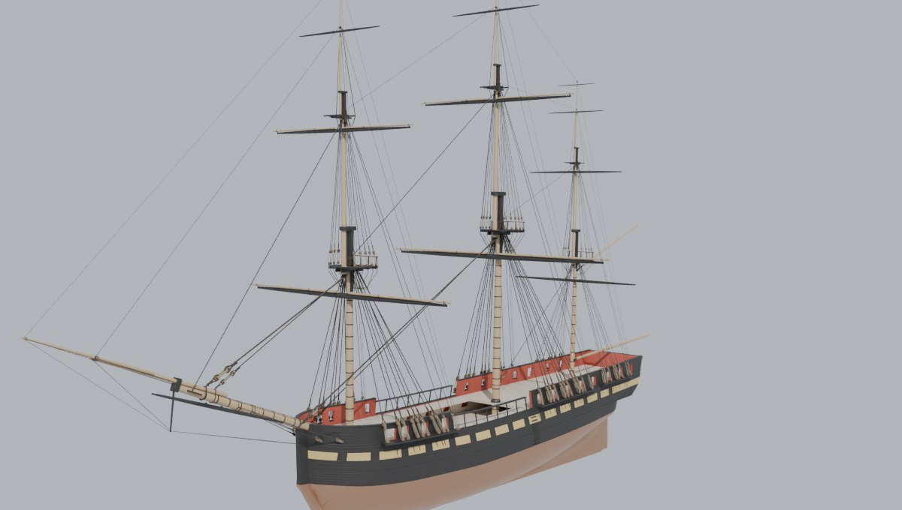

## What slice 4 builds

* **Lower shrouds:** 8 a side on the fore, 9 on the main and 6 on the mizzen, the count the 1817 draught draws on her
  channels. They are 10 1/2 in rope (circumference, as rope was measured), the mizzen's 6 in. Each pair of shrouds is one
  rope with an eye seized in its middle. The eyes go over the masthead onto the bolsters, foremost pair first,
  starboard then port, so the two sides' eyes stack alternately. Each leg comes down over the bolster and the
  trestletree's edge as a taut rope would. At its foot it is turned in round an upper deadeye at the rail's top, and a
  lanyard rove through the three holes sets it up to the lower deadeye on the channel. The lower deadeye's iron strop
  runs down the side as the chain: two long links and a preventer plate bolted below the channel, over the wale where
  it lands on one.
* **Topmast shrouds:** 5 a side (the mizzen 4) to deadeyes on the top's rim. Futtock plates carry the lower deadeyes
  down through the top, and futtock shrouds run from them to the futtock stave seized across the lower shrouds 7 to 7.8
  ft under the top (the draught's 7.8 ft on the main). Catharpins brace the stave in under the top.
* **Topgallant shrouds:** 3 a side (the mizzen 2), over the ends of the after topmast crosstree and down to the topmast
  shrouds as their own futtock shrouds.
* **Ratlines** on every set: 15 in apart on the lower and topmast shrouds, 13 in on the topgallants. They are seized
  outside the shrouds, and every fifth one carries on to the aftermost shroud.
* **Backstays:** two topmast backstays a side to deadeyes on the channel abaft the shrouds (where the draught has them).
  The topgallant and royal backstays end in a thimble with a short lanyard to an eyebolt on the channel, since the
  draught draws no deadeyes for them.
* **Stays:** each comes down its masthead's fore face in front of the shrouds' eyes and turns forward under the next
  mast's heel.
  * The fore stay and its preventer go to collars round the bowsprit and set up with **hearts** (a heart is an open
    wooden block, one big hole, for a stay's lanyard).
  * The main stay and its preventer pass the foremast either side and set up with hearts on the forecastle over the
    bowsprit's heel.
  * The mizzen stay goes to a collar round the main mast at the rail.
  * Each topmast, topgallant and royal stay leads to the next mast forward: the fore topmast stay through the bees at
    the bowsprit's end, the fore topgallant and royal stays to the jibboom and flying jibboom ends.
* **The bowsprit's rigging:** two shrouds a side from collars on the bowsprit to deadeyes on the bow, the martingale
  stays and back ropes on the dolphin striker, and the guys from the jibboom and flying jibboom ends to the bow. A
  collar where the jibboom lies on the bowsprit, or the flying jibboom beside the jibboom, goes round both.

The standing rigging is tarred (near black-brown), lanyards are untarred hemp, deadeyes and hearts dark wood, and the
ironwork black.

| The main channel: deadeyes, lanyards and chains | The fore channel |
| --- | --- |
| 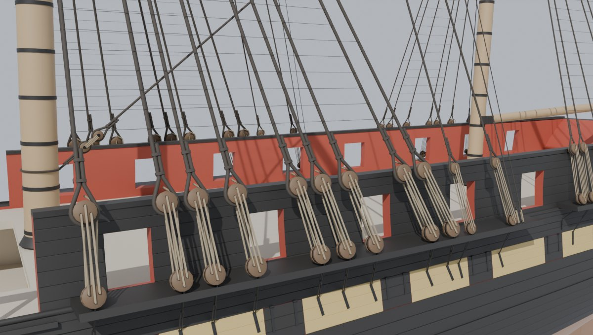 | 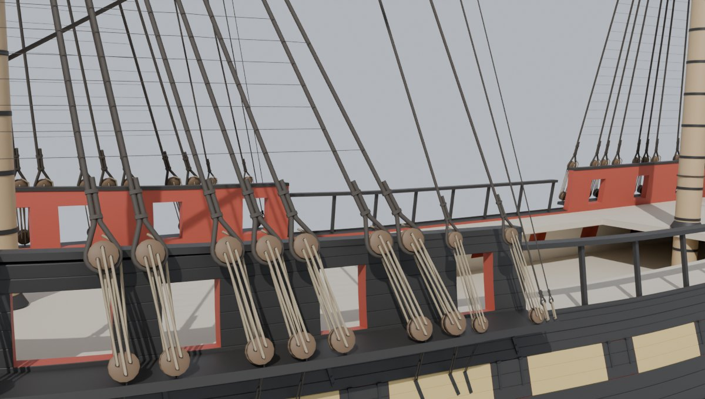 |
| **The main top: topmast shrouds' deadeyes on the rim** | **Under the main top: futtock shrouds and stave** |
| 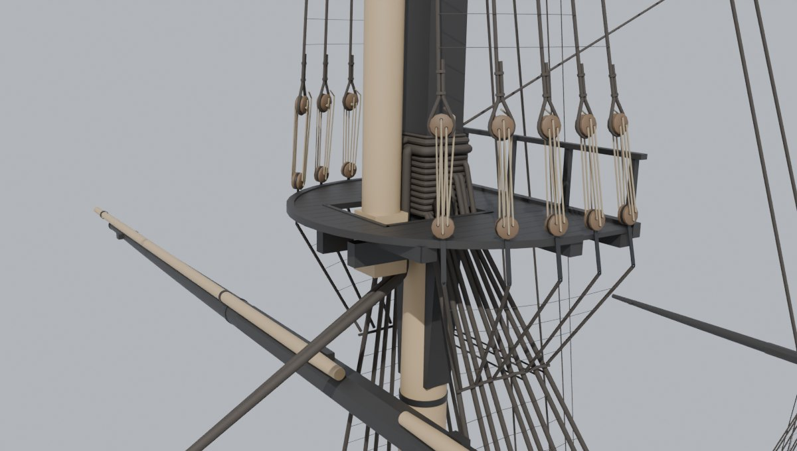 | 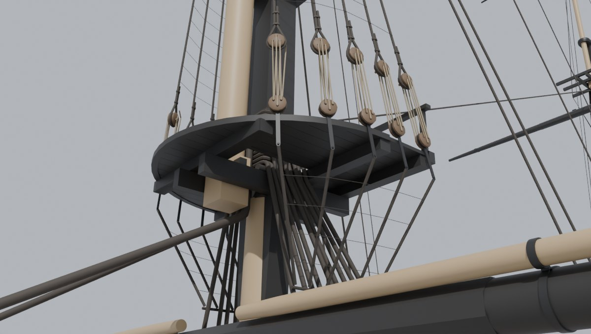 |
| **The fore stay's hearts on the bowsprit** | **The main stay's hearts, its collar before the stem** |
| 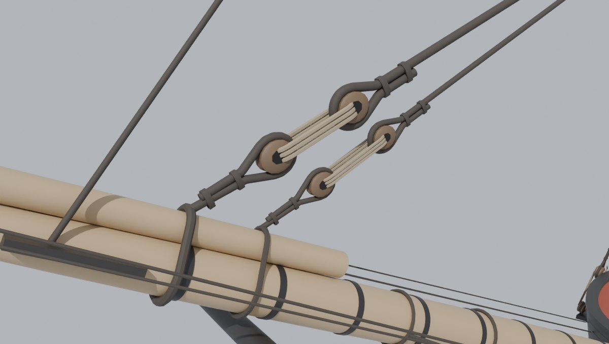 | 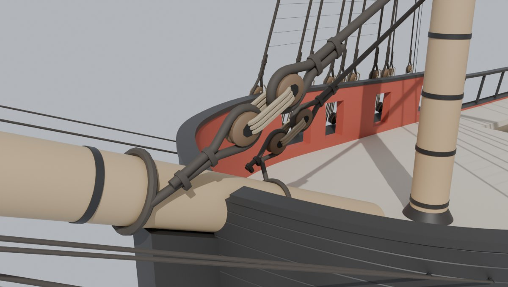 |
| **The ratlines** | **The fore shrouds' legs coming down under the fore top** |
| 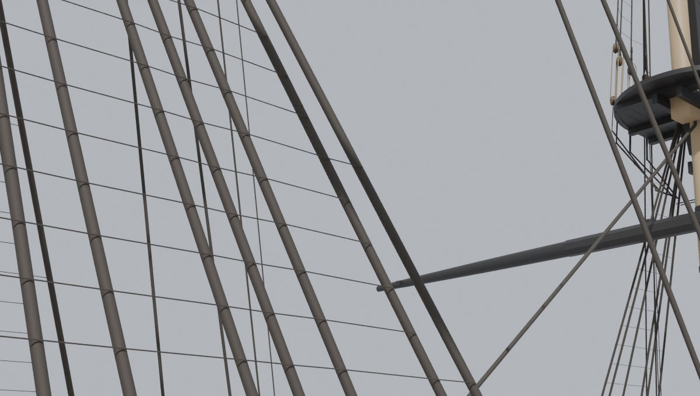 | 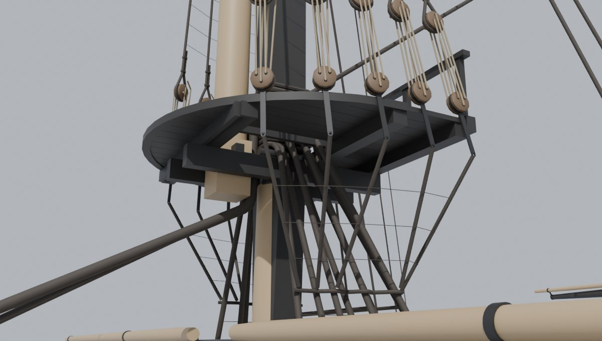 |

More views in `baseline/`: `rig4_profile`, `rig4_stern34`, `rig4_bowsprit`, `rig4_jibbooms`, `rig4_tg_heads` and
`rig4_mizzen_top`.

## Yards that brace against the rigging

Slice 3 gave every yard a flat +-35 deg until the rigging could give the real limits. Now `build_frigate.py` measures
them. Each yard, the spanker boom and gaff and the spritsail yard is turned about its own axis in half-degree steps,
each way, lowered, a quarter, half and three quarters up and hoisted, against the standing rigging, the masts, tops
and caps and the hull. The limit is the last clear angle less one degree.

A real yard does not just pivot. The lower yard hangs on an iron truss and the topsail yard on a parrel, and both let
the yard come forward as it braces round. The measurement does the same: at each step, a lower or topsail yard that
would touch is eased forward an inch at a time (up to 3 ft for the lower yards and 6 in for the topsail yards, both by
eye) until it clears. The ease each angle needs then goes into `rig.json` with the limits. A last pass tries the angles
between the steps with that ease and cuts a limit back where it fails.

| Part | Hoisted | Lowered | Half way | Eases forward | Stopped by |
| --- | --- | --- | --- | --- | --- |
| Fore | +-34 | (slung) |  | 36 in | fore rigging |
| ForeTopsail | -30 / +30 | +-6 | -13 / +14 | 4 in | stays |
| ForeTopgallant | -36 / +37 | +-36 | -44 / +44 |  | stays |
| ForeRoyal | -38 / +40 | +-60 | +-60 |  | stays |
| Main | +-36 | (slung) |  | 36 in | main rigging |
| MainTopsail | +-35 | +-6 | +-14 | 6 in | main rigging |
| MainTopgallant | +-58 | -37 / +38 | -44 / +45 |  | stays |
| MainRoyal | +-60 | +-60 | +-60 |  | nothing by 60 |
| Crossjack | +-38 | (slung) |  | 36 in | mizzen rigging |
| MizzenTopsail | +-36 | +-9 | +-19 | 6 in | mizzen rigging |
| MizzenTopgallant | +-60 | +-38 | -46 / +46 |  | nothing by 60 |
| MizzenRoyal | +-60 | +-60 | +-60 |  | nothing by 60 |
| SpankerBoom | +-39 |  |  |  | mizzen rigging |
| SpankerGaff | +-42 |  |  |  | mizzen rigging |
| Spritsail | +-60 |  |  |  | nothing by 60 |

"Stopped by" is what each part meets at its hoisted limit: a mast's rigging (its shrouds, backstays and their
fittings) or the stays. How to read it, and what it means for sailing her:

* **The lower yards** brace 34-38 deg (they are slung, so they never lower), stopped by the foremost lower shrouds,
  after easing forward 3 ft on their trusses. Slice 3's guess of 35 deg was about right.
* **Topsail yards** brace 30-36 deg hoisted, but only 6-9 deg lowered on the cap: down there the yard sits among the
  topmast shrouds' futtocks. A topsail is set and braced hoisted, so this is the sailing limit that matters.
* **The fore topsail and topgallant yards** are stopped hoisted by their own stays, not the shrouds (30 and 36 deg):
  the fore topmast and topgallant stays lead steeply down to the bowsprit, close in front of the hoisted yard.
* **Royals** brace 60 deg (the test's cap) except the fore royal hoisted (38-40 deg, at its stay). A royal yard lowered
  now rests on the topgallant rigging's eyes, not on the bare stop (its `hoist_m` moved up to match).
* **The spanker boom and gaff** stop at 39 and 42 deg on the mizzen's backstays, about slice 3's 40.

`rig.json` keeps the old keys and adds three: `brace_deg` is now the hoisted part's measured limit,
`brace_deg_by_hoist` lists `[hoist, lo, hi]` from lowered (0) to hoisted (1) (between two, take the smaller), and
`ease_m` is `[[deg, m], ...]`: move the part's origin along its own +X by the table's value at the brace angle
(interpolated), then turn it.

| Braced to the limits, hoisted | Braced, from above |
| --- | --- |
| 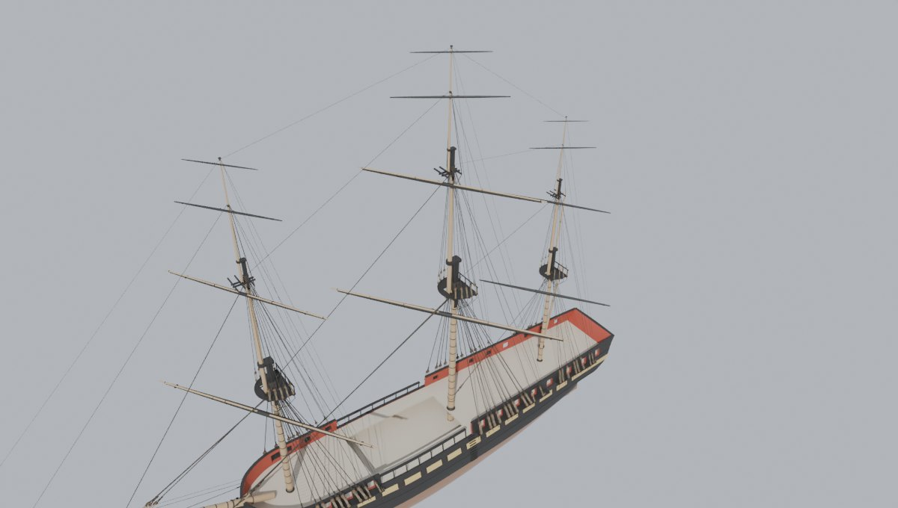 | 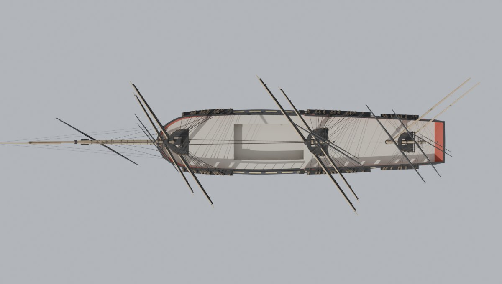 |

`baseline/swing_lowered.jpg` shows the yards lowered and braced to their lowered limits.

## Fitting the rigging round the spars and the hull

The shrouds and the yards share very little room at the mastheads, and a few things had to give way. `rigging.py`
reports each one (`Standing.report`, in `baseline/rigging.md`):

* **The lower yards hang among their shrouds.** A squared lower yard needs 1 1/2 in of room from its foremost
  shrouds, so the legs' slots on the masthead move aft until it has it: the fore's foremost leg leaves its masthead
  10.0 in before the mast's axis, the mizzen's 3.1 in. The fore's legs then pack at 0.86 of their width, so the rope
  of adjoining legs overlaps by about a third of an inch where they lie together on the bolster.
* **The legs come down the head in a bundle.** Below the trestletrees each leg leads off toward its deadeye, but on a
  crowded head a leg that would run into the after crosstree, or into the leg beside it, is held in the bundle down to
  under the crosstrees before it leads off. There the legs lie in two rows: the fore leg of each eye outside its
  after leg and the leg before it (on the fore 7 of the 8 legs a side are held; the outer row stands up to 3 ft 4 in
  out from the mast's axis; the main holds 5, the mizzen 2). They pass down through the lubber holes 0.8 to 1 in
  clear of the coaming.
* **The topmast shrouds' deadeyes** end 0.74-0.77 of the top's length from its after edge (the draught's 0.78) so the
  topsail yard clears them as it lowers onto the cap.
* **The topgallant shrouds** all pass through the after crosstree's ends: the other two topmast crosstrees stand
  before the topgallant mast, where the topgallant yard hangs, and a shroud led from them down to the topmast
  shrouds would cross the topsail yard.
* **The royal rigging's eyes** go over the pole 7 in under the truck, so the royal stay leads over the hoisted royal
  yard.
* **The tops' lubber holes** are wider than slice 3's (their sides stand 11, 10 1/2 and 6 in off the trestletrees, not
  4.2 in), so the lower shrouds' legs pass down through them.
* **The topmast backstays** dip under the after topmast crosstree's end where it would cut through them.
* **The masthead gaps** between each masthead's fore face and the next mast's heel are set for a shroud's eye and a
  stay across (10 in on the fore and main lower masts) and the bolsters run the length of the legs.
* **The fore and mizzen channels stand out further** than slice 2 had them: 3.25 ft and 2.4 ft (were 3.0 and 2.25;
  the main's stays 3.0), so the deadeyes and their lanyards clear the rail cap where the side tumbles home.
* **The main stay's collar** goes round the bowsprit just before the stem head, where the draught's heart would put it
  through the stem. Its hearts move 0.7 ft forward and up onto the line to it (see the draught tables below).
* **The chains** stand off the planking: a preventer plate lies over the thickest strake under it (a wale stands
  proud of the planking), and its top stands off as far as the links need to hang clear of the side up to the
  channel.

Then every free run of rope (176 of them, less 0.3 m at each end) is sampled every 2 cm against everything that is not
rigging. None of these free runs passes through anything. The closest are the main stay passing the foremast
(0.5 in), the main preventer stay (0.7 in), the martingale back ropes by the bow (0.8 in) and two mizzen shrouds
(1.0 in).

## Against the 1817 draught

`Tools/shipkit/frigate/standing_check.py` draws the rigging back onto the 1817 sail plan, starboard side only
(`baseline/overlay_standing.jpg`, with zooms of each channel, each mast's heads and the bow). Cyan is the shrouds, yellow
the backstays, magenta the stays and bowsprit rigging, red the model's deadeyes and hearts and green the draught's. It
tables where each deadeye and heart is against the draught (`baseline/rigging.md`, `baseline/standing_check.json`).

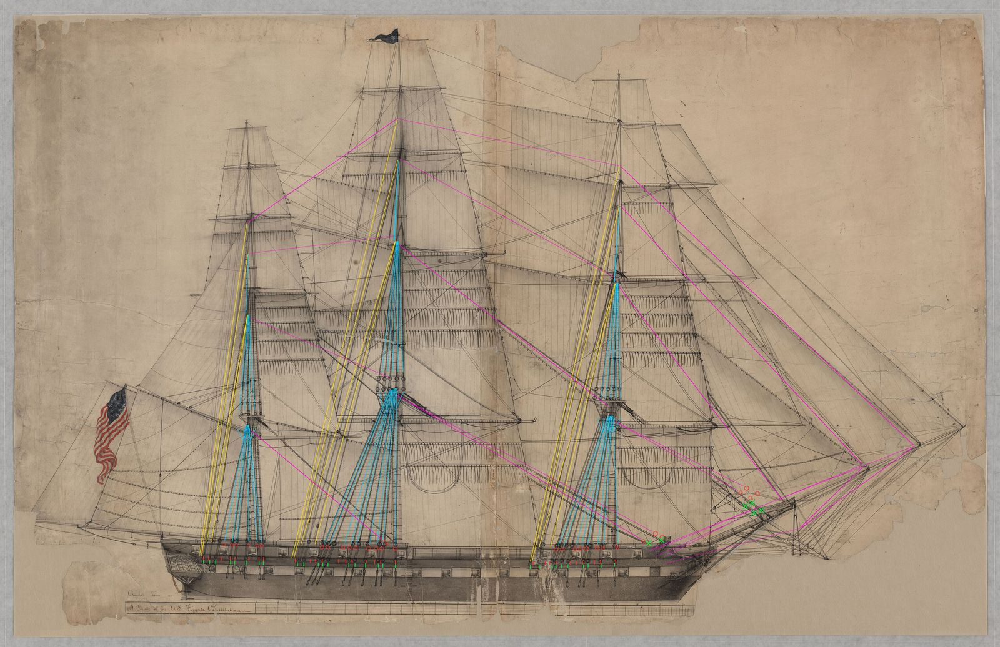

* **Deadeyes on the channels** keep the draught's count and order. The model's spar deck ports are the 1927 plan's,
  not the draught's, so `rigging.py` places each deadeye as near the draught's as it can with 2 1/2 in between
  neighbours, none standing in front of a port and as little of a lanyard as it can crossing a port's edge. Two
  thirds of them move 13 in or less. The largest moves, all forward, are the main's third shroud from aft (47 in),
  the fore's third and fourth (37-38 in) and sixth (28 in), the fore and main's forward topmast backstays (29-30 in)
  and the mizzen's aftermost shroud (25 in). Five fore lanyards still cross a port's edge (by 0.3 to 11 in,
  listed in `rigging.md`): the fore channel is too short for its ten deadeyes between the 1927 ports.
* **The channels** are now as long as the draught's: each runs forward to the draught's fore end, so its foremost
  deadeye stands abreast the mast as the draught's do. The fore channel ends 0.3 ft past the draught's, because the
  model's foremost spar deck port leaves no room for the foremost deadeye otherwise. The channel table in slice 2's
  `skin.md` changes to match (fore 2,191 px on the 1927 sheet, main 1,282, mizzen 737).
* **The main stay's lower heart** is 1.0 ft above the draught's and 0.3 ft forward of it (its collar is before the
  stem head, above). The main preventer's is within half a foot.
* **The fore stay's hearts** are 5 to 6 ft higher than the draught's. They follow the model's bowsprit, which
  slice 3 placed so its cap lands on the draught's cap; the bowsprit then rises more steeply than the draught's, and at
  the hearts' collar it is 5.7 ft higher than the draught's. The hearts sit where the draught has them along the
  bowsprit.

## Triangles

| Object | Triangles |
| --- | ---: |
| Rigging_Fore | 43,948 |
| Deadeyes_Fore | 40,200 |
| Ratlines_Fore | 17,520 |
| Rigging_Main | 46,124 |
| Deadeyes_Main | 42,912 |
| Ratlines_Main | 18,630 |
| Rigging_Mizzen | 29,328 |
| Deadeyes_Mizzen | 31,872 |
| Ratlines_Mizzen | 7,340 |
| Stays | 23,324 |
| Rigging_Bowsprit | 10,012 |
| **Standing rigging** | **311,210** |

The slice's budget was 400k. Most of it is the deadeyes and their lanyards (180 deadeyes and 10 hearts, each a
turned block with three holes, or one for a heart, and a lanyard rove through them). The ropes are tubes of 12 sides
for the stays down to 6 for the smallest lines, and 5 for the ratlines. The whole model is now 811,180 triangles:
499,970 for the hull, its fittings and the rig (slices 1-3; the masts and yards are 76,184 of them) and the standing
rigging's 311,210.

## Sources

Every number in `Tools/shipkit/frigate/standing_1797.json` says where it came from:

* **draught:** the 1817 sail plan, "A Draft of the U.S. Frigate Constitution" (National Archives 102278445): how many
  shrouds and backstays each mast has, where their deadeyes stand on the channels and the tops, the lower deadeyes'
  size (about 17 in), where the stays set up, and the main futtock stave's height.
* **1799:** the main shrouds' 10 1/2 in, from Tyrone Martin's "Constitution Close Up" (USS Constitution Museum).
* **rule:** period proportions (stays 5/3 of their shrouds, topmast rigging 4/7 of the lower, lanyards half the rope
  they set up, deadeyes 1.6 times their shroud, ratlines 13 to 16 in apart).
* **by eye:** where nothing says: the truss and parrel's ease, the bowsprit shrouds' collars, the thimbles, the
  futtock stave's size and the fore and mizzen staves' heights, the channels' width.

The War Department's 1797 rigging list for the 44s (Papers of the War Department, document 78269) would check most of
the rule's sizes, but its site is blocked from the cloud sessions that built this. The drawings stay out of the repo,
as before.

## Checks

```
python Tools/shipkit/frigate/build_frigate.py <out>
python Tools/shipkit/frigate/standing_check.py \
    Data/Reference/raw/ships/Commonwealth/A_Draft_of_the_U.S._Frigate_Constitution_-_NARA_-_102278445.jpg <out>/standcheck
python Tools/shipkit/frigate/rig_check.py \
    Data/Reference/raw/ships/Commonwealth/A_Draft_of_the_U.S._Frigate_Constitution_-_NARA_-_102278445.jpg <out>/rigcheck
```

(Blender's Python, pip `bpy`, for the build; `rigging.py` and the two checks need only numpy, scipy and Pillow.) The
build fails if any yard touches anything when squared, and writes the brace limits and the rope's clearance
(`span_room`) to `build.json`.

The earlier slices' checks: the lines check is the same, byte for byte (93.9% of the samples within 2 px). Slice 2's
skin tables change only in the channels' fore ends (above); the fore and mizzen channels also stand further out,
which the tables do not list. Slice 3's rig heights move by at most 0.03 ft (the masthead gaps), and `rig.md` no
longer lists brace limits: they are measured here.

## Review

A separate review pass built the rigging and tested it in Blender. What it found is fixed here: collars that ignored
what lay on their spar, deadeyes standing too close together on the channels, the main stay's hearts close enough for
their turn-ins to meet, legs and eyes stacked through each other at the mastheads, the topgallant shrouds' seized ends
through the ratlines, the martingale stays crossing, and fittings in the hull (deadeyes and lanyards in the rail cap,
chain plates in the wales, the main stay's collar in the stem head). Then three checks over the finished rigging:

* **Rope against rope:** every one of the 1,159 tubes (5.2 km of rope) against every other. No rope passes through
  another, except where it is meant to bear: the topgallant and royal backstays seat up to 0.3 in into their
  thimbles' grooves, as a rope turned in round a thimble does.
* **Fittings against the ship:** every deadeye, heart, lanyard, chain, plate, collar and eye against the hull, the
  spars and the tops. The deepest is 0.17 in, where a fore chain passes the channel's outer edge (a real channel is
  notched for it); the eyes bear on their mastheads by up to 0.1 in, as a rope drawn tight round a mast does.
* **The legs through the tops:** 0.8 to 1 in clear of the lubber holes' coamings.

## Known gaps

* **Gammoning and bobstays** come with the knee of the head (slice 9). Until then nothing below the bowsprit stops the
  spritsail yard within 60 deg.
* **The truss and parrel's ease** (3 ft and 6 in) is by eye. With less ease the lower yards would brace less.
* **The fore stay's hearts** follow the model's bowsprit, 5 to 6 ft above the draught's (above).
* **The deadeyes on the channels** move up to 4 ft from the draught's, and five fore lanyards still cross a port's
  edge, because the model's spar deck ports are the 1927 plan's (above).
* **The fore's lower shroud legs** pack at 0.86 of their width on the masthead, and the bundle under the fore top is
  wide (above).
* **The channels aren't notched** for their chains: a link passes the edge 0.17 in into it.
* **Sizes by rule:** the 1797 rigging list is unchecked (above). Rope sizes are rule-of-thumb proportions of the
  1799 main shrouds.
* **One side drawn on the draught check:** the overlay is the starboard side, as the draught.
* **The running rigging** (lifts, braces, halyards, sheets, blocks) is slice 5, the sails slice 6.

## Files

| File | What it does |
| --- | --- |
| `Tools/shipkit/frigate/rigging.py` | builds the standing rigging (`Standing`): shrouds, deadeyes, lanyards, chains, ratlines, futtocks, backstays, stays and hearts, the bowsprit's rigging |
| `Tools/shipkit/frigate/standing_1797.json` | the rigging's sizes and counts, each with its source; the draught's readings; the brace measurement's settings |
| `Tools/shipkit/frigate/standing_check.py` | the rigging drawn back onto the 1817 draught, and the deadeye and heart tables |
| `Tools/shipkit/frigate/build_frigate.py` | builds the rigging objects, measures the brace limits and the rope's clearance; `rig.json` and `build.json` |
| `Tools/shipkit/frigate/spars.py`, `spars_1795.json` | masthead gaps, bolsters and lubber holes sized for the rigging |
| `Tools/shipkit/frigate/skin.py`, `specs_1795.json` | the channels run forward to the draught's fore ends; the fore and mizzen channels stand out further |
| `Tools/shipkit/frigate/rig_check.py` | no longer prints slice 3's flat brace limits |
| `docs/shipkit-4/baseline/` | build.json, rig.json, rigging.md and standing_check.json, the draught overlays, renders (`rig4_*.jpg`) and the yards braced (`swing_*.jpg`) |
