# Shipkit 5: the frigate's sails

Slice 5 of the frigate *Commonwealth* (plan: <https://claude.ai/artifact/8y6hW8vHjjUPJRovJEuxY7>; slices 0-4 are in
`docs/shipkit-1` to `docs/shipkit-4`). Slice 4 stayed her masts. This slice bends on her sails: twenty sails of plain
sail, each in three states (set, clewed up or hauled down, and furled). The running rigging and blocks that would work
them (halyards, sheets, clewlines, buntlines, braces) are slice 6. It is still post-slice art: nothing here is
imported into Unreal or wired into the game.

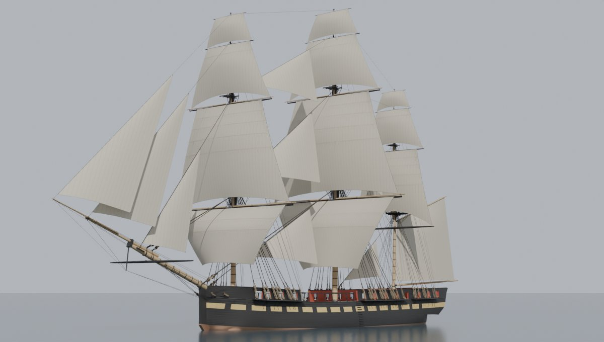

The plan's Milestone A comes next: she should read right from 200 m with her sails set (above), and Bean reviews her
before slice 6.

## What slice 5 builds

Twenty sails, the plain sail a frigate of 1797 carried (the 1817 draught's skysails, studding sails, royal staysails,
ringtail and spritsail are later or extra, and not built):

* **Eleven square sails**, hung from the yards: a course (the lowest sail), a topsail, a topgallant and a royal on the
  fore and main masts, and a topsail, topgallant and royal on the mizzen. The mizzen's lowest yard, the crossjack,
  carries no sail, as the draught draws it: it spreads the foot of the mizzen topsail. Each square sail's head is bent
  (tied) along the fore side of its yard with robands, one in the middle of each 24 in cloth, its head earings lashed
  round the yardarms just outside the stop cleats, and its clews (lower corners) sit at the sheaves in the arms of the
  yard below. A course is cut as the draught draws it, its foot wider than its head and its clews 5 ft over the rail;
  set, its clews are hauled in to the ship's side by the tacks and sheets, and the slack of its foot goes into its
  belly. The courses carry two reef bands, the topsails four and the topgallants one, at the draught's heights, each
  with a reef point in the middle of every cloth.
* **Three headsails** out front, hanked to the stays slice 4 led out over the bowsprit: the fore topmast staysail, the
  jib and the flying jib.
* **Five staysails** between the masts, on the main preventer, main topmast, main topgallant, mizzen and mizzen
  topmast stays.
  As the draught draws them, each hangs its after edge (the leech) nearly plumb from its head, and its foot runs aft
  from the tack.
* **The spanker** at the stern (the driver), its luff laced to the mizzen mast, its head laced along the gaff and its
  foot loose along the boom.


| Sail | Head ft | Foot ft | Depth ft | Area sq ft | Reef bands | Belly ft | Roach ft (table's) | Roach clears |
| --- | ---: | ---: | ---: | ---: | ---: | ---: | --- | --- |
| Fore course | 78.9 | 89.2 | 35.5 | 2,925 | 2 | 8.4 | 0.89 | |
| Fore topsail | 47.7 | 82.4 | 52.5 | 3,182 | 4 | 6.5 | 4.28 (2.88) | the fore stay |
| Fore topgallant | 31.1 | 58.5 | 30.5 | 1,187 | 1 | 4.5 | 4.63 (1.75) | the fore top |
| Fore royal | 20.8 | 33.7 | 15.1 | 389 | 0 | 2.7 | 1.01 | |
| Main course | 88.2 | 99.7 | 45.2 | 4,181 | 2 | 9.4 | 1.0 | |
| Main topsail | 54.5 | 92.2 | 58.2 | 4,014 | 4 | 7.3 | 4.13 (3.23) | the main stay |
| Main topgallant | 34.9 | 66.9 | 32.8 | 1,448 | 1 | 5.1 | 5.0 (2.01) | the main top |
| Main royal | 23.4 | 37.9 | 15.1 | 435 | 0 | 3.1 | 1.14 | |
| Mizzen topsail | 36.4 | 57.5 | 45.8 | 1,787 | 4 | 4.7 | 9.41 (2.01) | the mizzen top |
| Mizzen topgallant | 23.5 | 44.6 | 24.9 | 718 | 1 | 3.4 | 4.4 (1.34) | the mizzen top |
| Mizzen royal | 15.7 | 25.4 | 11.1 | 201 | 0 | 2.1 | 1.66 (0.76) | the mizzen topgallant stay |

Head and foot are as cut, between the earings and between the clews. Depth is from the yard to the middle of the foot,
less the roach. The belly is how deep the set sail's cloth stands forward of the flat between its yard and clews (a
tenth of its mean width). Set, the courses' clews come in to 37 ft apart (the fore) and 40 ft (the main), at the
ship's side 6 to 7 ft above where they are cut, and the main course's foot bellies forward with the slack.

| Sail | Stay | Luff ft | Foot ft | Leech ft | Area sq ft |
| --- | --- | ---: | ---: | ---: | ---: |
| Fore topmast staysail | fore topmast stay | 61.8 | 25.4 | 54.3 | 687 |
| Jib | fore topgallant stay | 86.3 | 34.2 | 73.3 | 1,240 |
| Flying jib | fore royal stay | 93.2 | 35.4 | 78.7 | 1,396 |
| Main staysail | main preventer stay | 55.5 | 48.1 | 32.0 | 767 |
| Main topmast staysail | main topmast stay | 65.4 | 52.0 | 40.7 | 1,059 |
| Main topgallant staysail | main topgallant stay | 56.3 | 49.6 | 30.9 | 766 |
| Mizzen staysail | mizzen stay | 37.2 | 28.8 | 21.6 | 309 |
| Mizzen topmast staysail | mizzen topmast stay | 31.8 | 31.6 | 24.6 | 358 |
| Spanker (head 53.0 ft on the gaff) | the mizzen mast | 35.6 | 61.2 | 52.4 | 2,433 |

That is 29,482 sq ft of plain sail: 20,467 square, 3,323 in the headsails, 3,259 in the staysails and 2,433 in the
spanker. The main staysail is hanked to the main preventer stay, the lower of the pair: the main stay passes the
foremast to starboard and the preventer to port, so a staysail on the stay would lie on the preventer on the starboard
tack (which stay carried it varied from ship to ship; this is an estimate).

The canvas is 24 in cloths with 1 1/2 in seams (Steel's), so the Blender material draws a seam every 22 1/2 in: up and
down a square sail, laid out from its middle as a sailmaker did (a seam on the centre line, the two halves alike and
the cloths at the leeches cut to fit), and parallel to the leech on the fore-and-aft sails. Each sail has a bolt rope round its edges,
heavier on the leeches and foot than the head, and cringles (rope eyes) at its corners and reef earings, moved in from
the corner until they clear the stay or spar there.

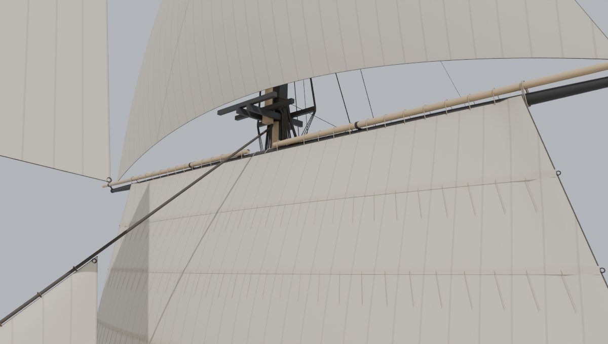
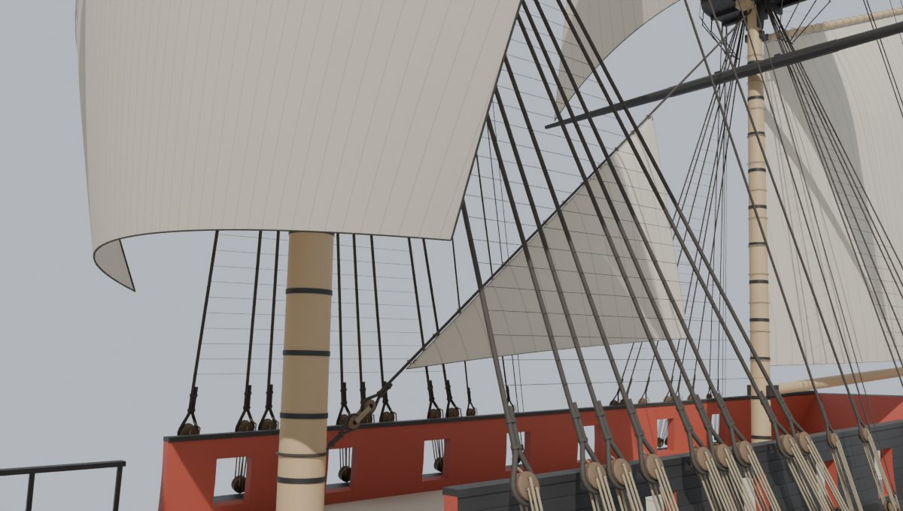
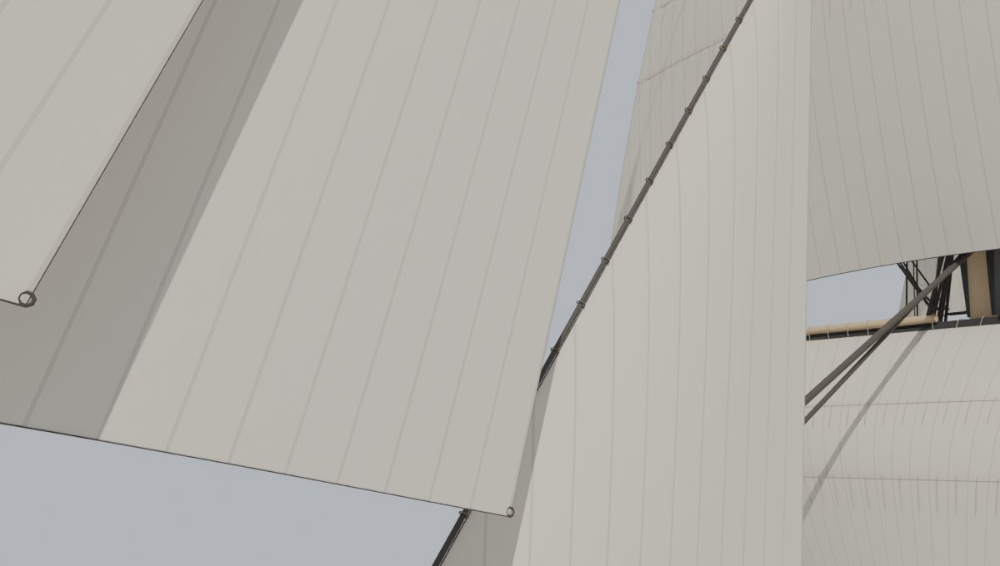
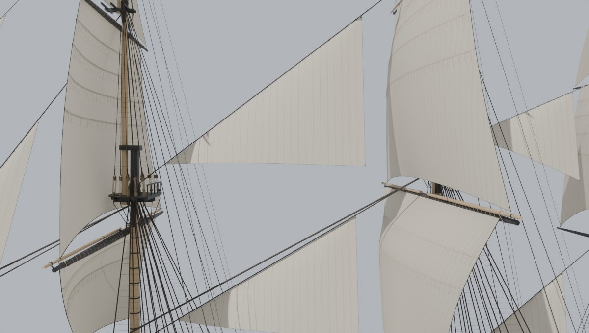
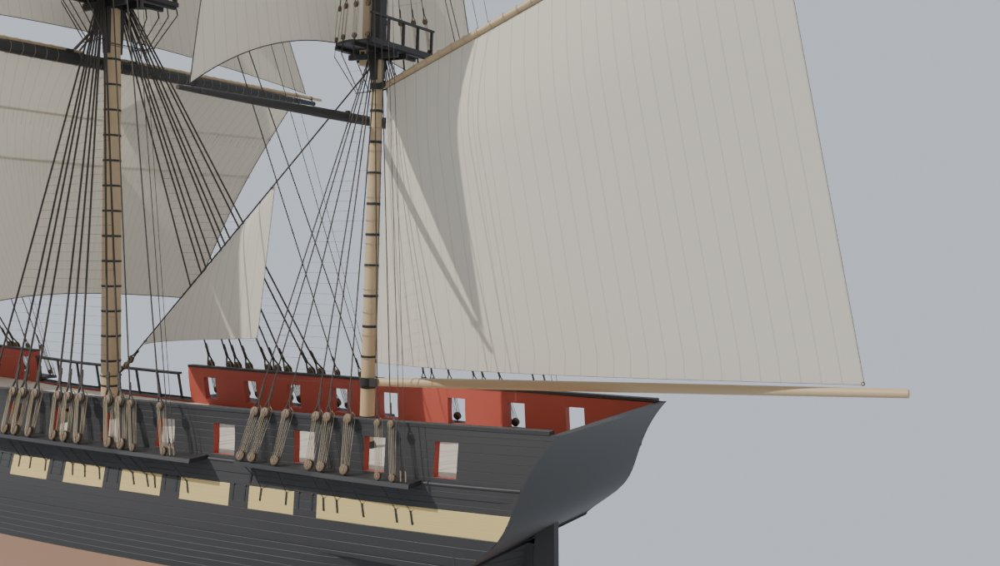

## Three states

Each sail is built three times, where it hangs in each state, so the game can show one and hide the others:

* **Set:** full of wind. The square sails have their yards square across the ship and the wind aft (the cloth bellies
  forward). The fore-and-aft sails are on the port tack, clew and belly to starboard: the starboard tack is their
  mirror about the upright plane through their stay (the spanker's, through the gaff), which `sails.json` gives each
  of them as `starboard_tack_mirror`, and the build checks the mirrored sails too.
* **Clewed:** a square sail **clewed up**: its clews hauled up under the yard to the clew blocks and its foot hauled up
  by the buntlines, the cloth hanging between in bags. This is how a ship takes in a square sail before furling it, or
  holds it ready to set again. A headsail or staysail is **hauled down** into a loose heap along its boom or the foot of
  its stay, and the spanker is **brailed** in to the gaff and the mast.
* **Furled:** rolled up and lashed with gaskets: the square sails on top of their yards, the bunt (the middle, where
  most of the cloth gathers) bigger and riding up against the mast; the headsails along the jibboom, the staysails
  along their stays, the spanker along its gaff and down the mast. Every roll and heap rests on what carries it: each
  section of it is moved out from its spar or stay until it clears the convex hull of that spar or stay and whatever
  is beside it there (a yard's cleats, irons and studding sail booms; the jibboom on the bowsprit; a guy), and the
  gaskets go round all of it.

A square sail and the spanker also have a **Head** object (the head rope and robands, the spanker's lacing), which
shows in every state.

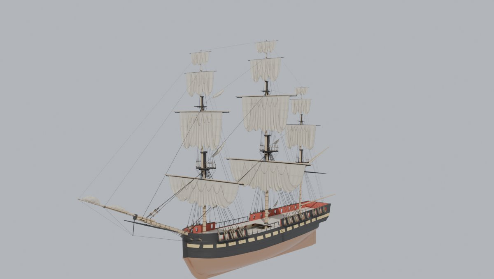

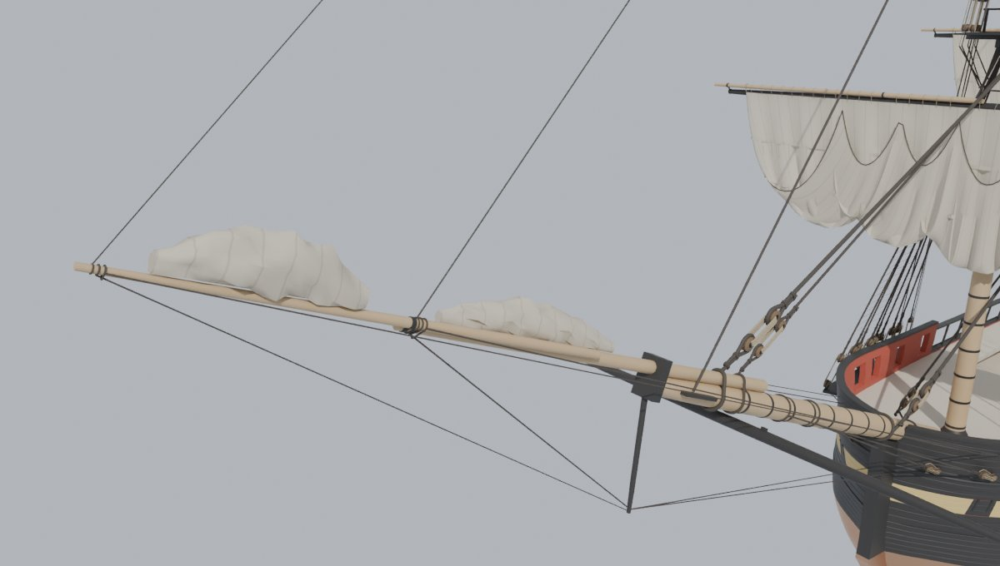
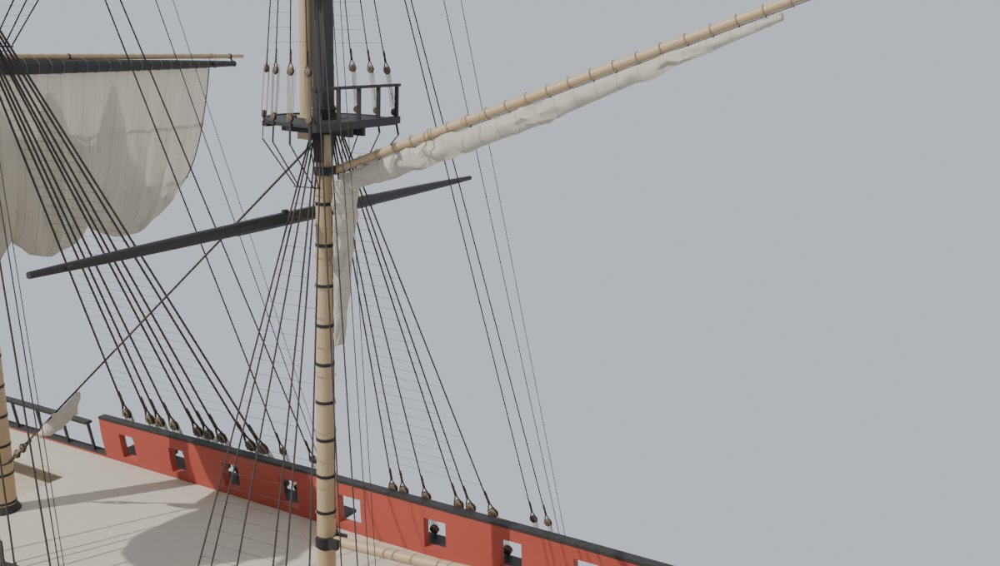
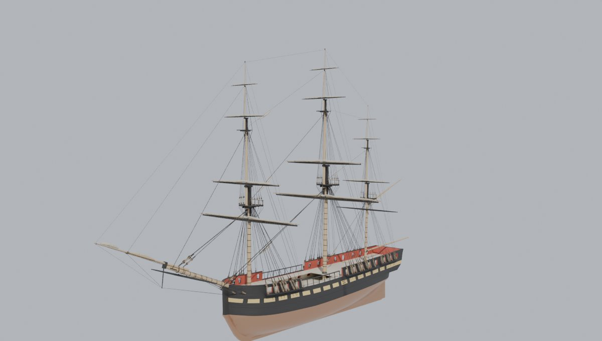
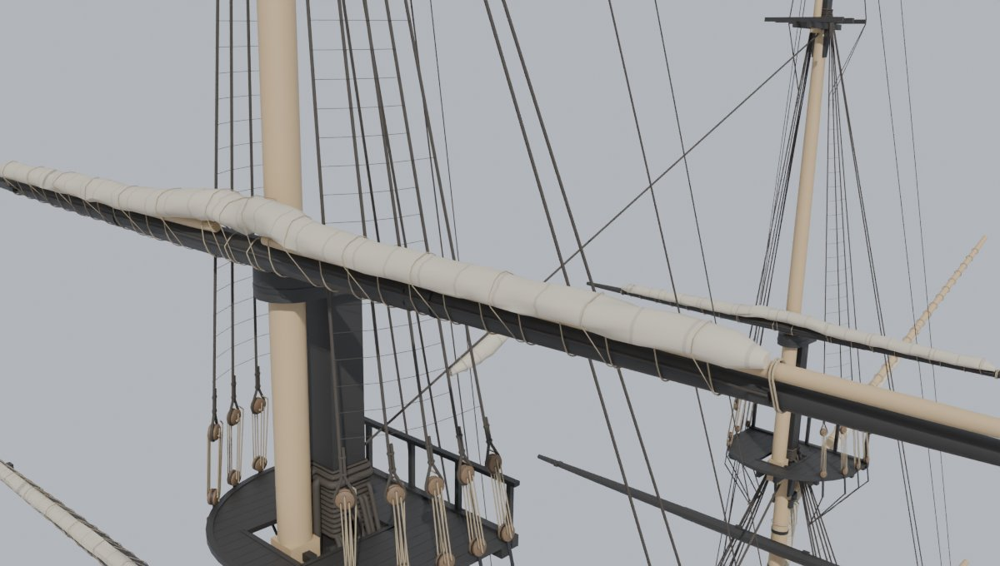
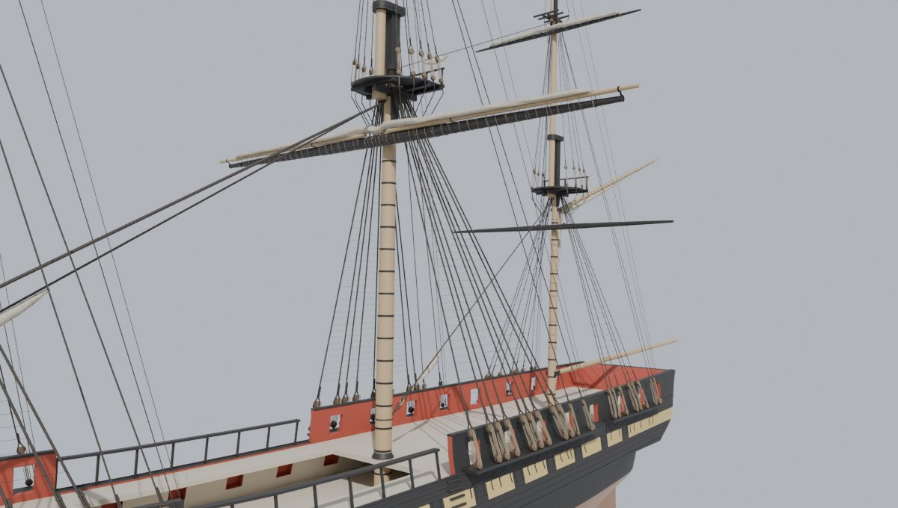
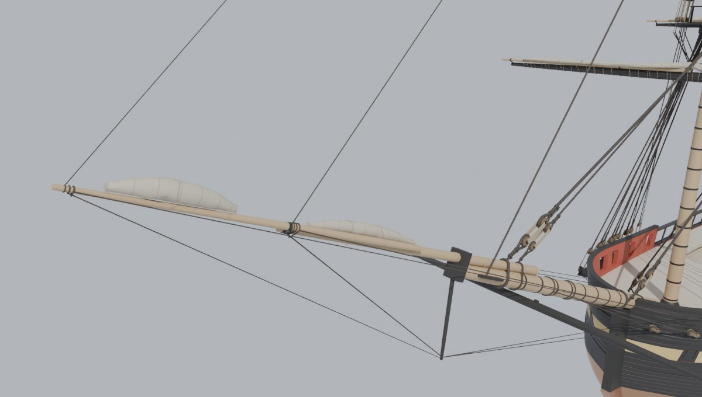
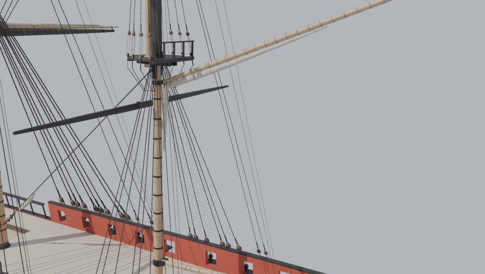

## The roach: cutting the foot clear of the stays and tops

A square sail's foot is cut up in a curve, the roach, so the set sail clears what is behind and below it. With the
yards square and the sails full, a topsail's foot bellies down past the stay from the masthead forward and past the
top of the mast below it. `sails.py` starts from the least roach (a few per cent of the foot: the draught's flat plan
doesn't show it), then looks at the stays and at the tops, crosstrees and caps under each sail. Anything that comes
within 6 in of the set cloth goes under the foot, and the roach is cut deeper until it does. The table above gives the
roach that came out, the table's least in brackets, and what decided it. The mizzen topsail's is deepest: its foot
sits over the mizzen top, and the top is wide for so small a sail. Each roach stays under 17% of its foot.

## Over the yards' fittings

A yard is not a bare pole. It has two sling cleats on top in the middle and a stop cleat fore and aft at each yardarm
(they stop the head earings sliding in), and the lower and topsail yards carry their studding sail booms on top, in an
iron at the yardarm and another a third of the way in. `spars.py` now records each of these as it builds it (boxes and
cylinders in the yard's frame, in `yard_geom`'s `solids`; the yards themselves are unchanged), and the sails go over
them:

* The head rope runs straight from one cloth's column to the next along the yard's fore side, and each column's point
  stands as far off the yard as the cleats, irons and booms between it and its neighbours need, so the rope clears
  them by 0.3 in. Over a stop cleat it stands off by about the cleat's height; elsewhere it lies on the yard.
* The robands go round the yard, the head rope and the boom where it lies there, one in the middle of each cloth and
  none at a cleat or an iron. The earings are two turns round the yardarm (and its boom) just outside the stop cleat.
* A leech rope starts where it comes clear of the yard and its cleat, a few inches down from the head earing.
* A furled roll rests on top of the yard and its booms (above).

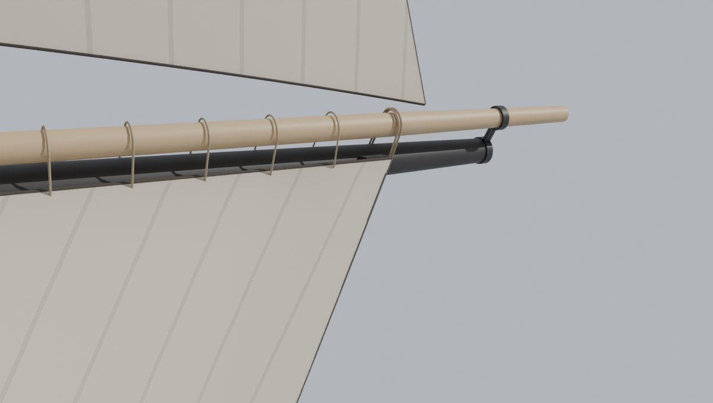

## Furled with the upper yards lowered

A ship in harbour lowers her topsail, topgallant and royal yards onto the caps, and furls their sails there. The model
does the same, and it has a reason to: with a topsail yard hoisted, the stay from the masthead forward runs through
the place its bunt would be. So a topsail, topgallant or royal is furled with its yard at `rig.json`'s lowered height
(`hoist_m[0]`). Even there a stay or the masthead below comes close, so the roll is packed tighter, station by station
along the yard, where they would be in it, and still clears them by 3 in. The courses' yards don't hoist; they are
furled where they hang.

## Bracing with the sails set

Slice 4 measured how far each yard braces round (turns about its mast) before the yard meets the rigging, easing a
lower yard forward on its truss (up to 3 ft) and a topsail yard on its parrel (up to 6 in) as it goes. With a set sail
on it, the sail can meet something first. The build turns each square sail with its yard a degree at a time, easing
the yard forward an inch at a time where the sail needs it, then tries every quarter degree with that ease, until the
cloth, bolt ropes or head (head rope, robands, earings) touch the masts, tops, hull or standing rigging. Like slice 4's,
a limit is the last clear angle less 1 degree.

| Sail | Yard braces to (deg) | Sail clear to (deg) | Then meets |
| --- | --- | --- | --- |
| Fore course | 33.5 | 42.75 / 44 | the fore rigging |
| Fore topsail | 30 / 30.5 | 27 / 28.75 | the fore topmast stay |
| Fore topgallant | 36 / 37 | 28.25 / 29.25 | the fore topgallant stay |
| Fore royal | 38.5 / 39.5 | 35.5 / 36.25 | the fore royal stay |
| Main course | 36 | 38.25 | the main rigging |
| Main topsail | 35 | 39.25 | the main top's deadeyes, the main rigging |
| Main topgallant | 58.5 | 58 | the main topgallant stay |
| Main royal | 60 | 60 | nothing within 60 |
| Mizzen topsail | 36 | 22.5 | the mizzen top's deadeyes |
| Mizzen topgallant | 60 | 59.75 | the mizzen rigging |
| Mizzen royal | 60 | 60 | nothing within 60 |

Two numbers are one each way (port / starboard). The sails themselves are mirror images (set and head within a third
of an inch); the rigging they meet is not quite. `sails.json` gives each square sail the smaller of its own limit and
its yard's (`brace_deg`) and the ease that goes with it (`ease_m`, as `rig.json`'s: a little more than the bare yard
needs, since the robands and head rope stand off the yard's after side, 2 1/2 in from the main shrouds at the main
course's middle).

The courses and the main topsail go as far as their yards. The fore topsail, topgallant and royal stop 2 to 8 degrees
short of theirs, where the braced cloth swings into the stay leading forward from the masthead above. A real ship's
sails press against the stays and lee rigging when braced sharp up, and canvas gives, so meeting them near 30 deg is
ordinary. The mizzen topsail stops soonest: its clews sheet to the crossjack yard just under the mizzen top, and at
23 deg its foot meets the deadeyes on the top's rim. The game's cloth (the Mac check) will have to bend over them, or
the mizzen yards brace less.

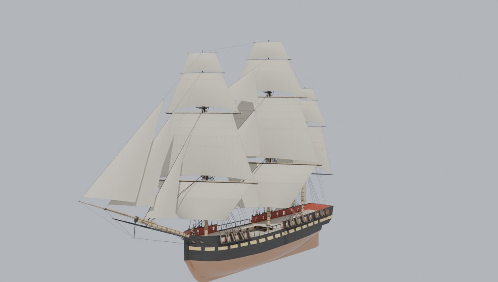
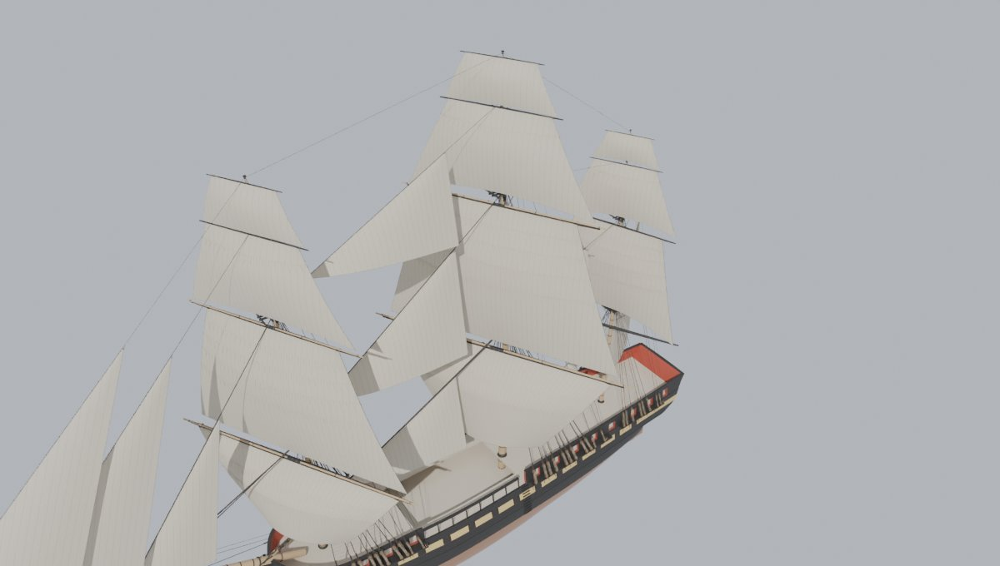

## Against the 1817 draught

`sails_check.py` draws the sails back onto the draught as a sail plan draws them: the square sails face on about their
masts (red, reef bands orange), the headsails and staysails in blue and the spanker in green.

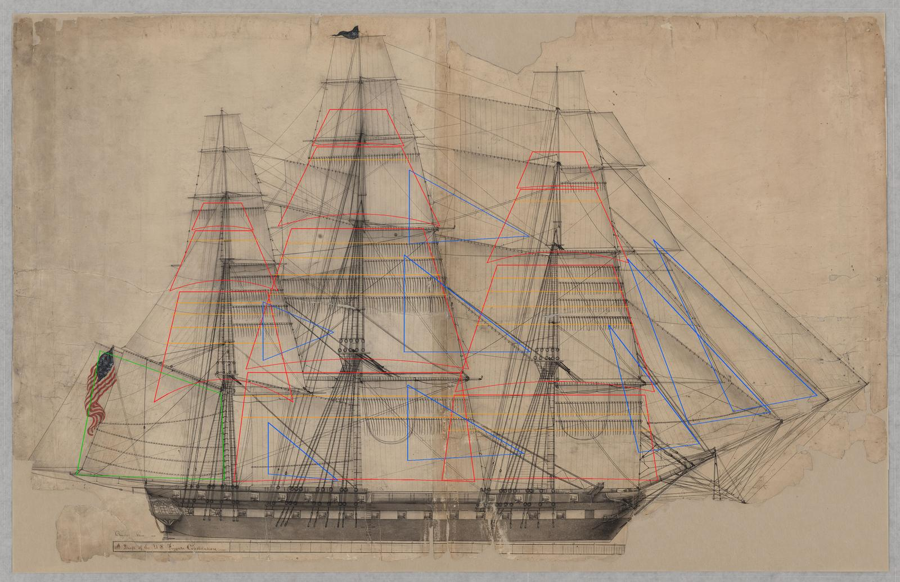

The square sails sit on the draught's: heads, feet and reef bands. The main course, where the draught is clearest:

| Main course, feet | Draught | Model |
| --- | ---: | ---: |
| Clews above the load line | 26.8 | 25.1 |
| Half the foot | 51.6 | 49.8 |
| Half the head | 45.6 | 44.1 |

These are the sail as cut, as the draught draws it. The model's main yard is a little shorter than the draught's (its
length is the 1795 spar list's, slice 3), and its rail a little lower, so its clews are 1.7 ft lower than the
draught's but still 5 ft over the rail (the draught's are 4.4). Set, they are hauled in to the ship's side (above). The headsails are smaller than the
draught's and their tacks further in, because the model's jibbooms are shorter and its stays lower (slices 3 and 4).
The staysails stand 18 to 25 ft further forward than the draught's, to clear the square sails' bellies (the draught's
sails are flat).

Zooms: [fore](baseline/overlay_sails_fore.jpg), [main](baseline/overlay_sails_main.jpg),
[mizzen](baseline/overlay_sails_mizzen.jpg), [headsails](baseline/overlay_sails_bow.jpg).

## For the game: objects, frames and UVs

The objects are `Sail_<Name>_<State>` (for example `Sail_MainTopsail_Set`, `Sail_Jib_Furled`), in four collections:
`Sails_Set`, `Sails_Clewed`, `Sails_Furled` and `Sails_Head`. In the .blend the Clewed and Furled collections are
hidden.

* A square sail's objects are parented to their yard, and the spanker's to its gaff, with the spar's own origin and
  axes. They brace and hoist with it.
* The headsails and staysails are in the ship's frame, since stays don't move.

`sails.json` lists each sail's objects by state, its parent, and its sizes and corners (metres, in the ship's frame or,
for `*_local_m`, the yard's). It also gives:

* `brace_deg` and `ease_m` (square sails): how far the yard braces with this sail set, and how far forward its truss
  or parrel lets it come as it does (above). Use them in place of `rig.json`'s while the sail is set.
* `clew_cut_local_m` beside `clew_local_m` (square sails): the clew as the sail is cut and the draught draws it, and
  where it is set. They differ for the courses, whose set clews are hauled in to the ship's side. Braced, the Set
  turns rigidly with its yard, so its clews part from the yard below by up to 28 in at 30 deg: the game's cloth must
  draw the foot to the yard below.
* `starboard_tack_mirror` (headsails, staysails, spanker): the plane (a point and a normal, ship's frame) to mirror
  the Set about for the starboard tack.
* The note that topsails, topgallants and royals are furled with their yards lowered (`hoist_m[0]`).

The cloth carries `FSailCloth`'s three UV layers (Source/SailingSim/Public/SailCloth.h): UV0 in metres along the chord
from the luff and up from the foot, UV1 the normalized planform, UV2.x metres from the leech. The cloths of a square
sail run up and down it (a seam is a line of constant UV0.x), and its UV0.x counts from a whole number of cloths to
port of its middle, so a seam falls on the centre line and the port clew is a part cloth in from 0; a fore-and-aft sail's run parallel to its leech
(constant UV2.x, which here is measured square to the leech, not along the row as `FSailCloth` measures it, so the
cloths come out their true width). `M_SailCloth` has no layout for that yet: its seams run across a sail, square to the leech, as a
modern crosscut sail's do. Canvas sails need a new layout (seams at constant UV0.x on a square sail, UV2.x on the
others), which comes with the import and the Mac cloth check. In this slice the sails wear a Blender material:
unbleached canvas, the seams 18% darker, a quarter translucent.

## Triangles

| | Triangles |
| --- | ---: |
| Set | 94,984 |
| Clewed | 94,448 |
| Furled | 46,720 |
| Head (shown in every state) | 60,892 |
| **All the sails' objects** | **297,044** |

The slice's budget was 300k for all three states. One state of each sail shows at a time, so the ship as drawn with
every sail set is 967,008 triangles: 811,132 from slices 1-4 (48 fewer than slice 4's, the mizzen catharpins) and the
Set objects and the Heads (155,876). Clewed is about the same (155,340 with the Heads) and furled less (107,612). The
square sails' cloths are grids of up to 64 across by 40 down (fewer on the small sails), the bolt ropes tubes of 6 or 8
sides, and the robands, gaskets and reef points of 3 or 4. The Heads are a fifth of it: the head rope follows the
cleats, irons and booms closely, and the robands and earings go round all of them.

## Sources

Every number in `Tools/shipkit/frigate/sails_1797.json` says where it came from:

* **draught:** the 1817 sail plan, "A Draft of the U.S. Frigate Constitution" (National Archives 102278445): the reef
  bands (the main topsail's four at 63, 130, 207 and 296 px under its yard, the courses' two, the topgallants' one),
  the main course's clews 4.4 ft over the rail, its foot against its head (51.6 to 45.6 ft from the mast), the
  headsails' and staysails' layout, the spanker between boom and gaff with its clew near the boom's end.
* **Steel:** David Steel's *Elements and Practice of Rigging and Seamanship* (1794) for the period's sailmaking: 24 in
  cloths, 1 1/2 in seams, reef bands and points on the fore side. Its sail tables were not read for this slice: they
  would replace the estimates.
* **estimate:** what a flat sail plan can't give: the least roach, the belly and how the set sail's cloth stands, the
  clewed-up and furled shapes, the bolt ropes' sizes, the headsails' and staysails' corners where the model's spars
  differ from the draught's.

The drawings stay out of the repo, as before.

## Checks

```
python Tools/shipkit/frigate/build_frigate.py <out>
python Tools/shipkit/frigate/sails_check.py \
    Data/Reference/raw/ships/Commonwealth/A_Draft_of_the_U.S._Frigate_Constitution_-_NARA_-_102278445.jpg <out>/sailcheck
```

(Blender's Python, pip `bpy`, for the build; `sails.py` and the check need only numpy, scipy and Pillow.) The build
fails if any sail passes through anything or two set sails meet, and writes its findings to `build.json`
(`sails.room`):

* **Every state against the ship:** every object of every sail in every state (cloth, bolt ropes, cringles, robands,
  reef points, hanks, gaskets, lacing) against the hull's fittings, the masts, tops, spars and yards, every rope of the
  standing rigging, and each stay as a rope of its own. Nothing is excused, not even a sail's own yard, stay, boom or
  gaff: a sail lies on them, it doesn't pass through them. The furled topsails, topgallants and royals are checked
  with every yard lowered, the clewed-up sails hanging from their hoisted yards, and the headsails, staysails and
  spanker set on the starboard tack as well (mirrored about their `starboard_tack_mirror`). Nothing passes through
  anything.
* **Set sails against each other,** on either tack: no two meet.
* **Bracing with the sails set:** the table above.

The earlier slices' outputs are unchanged: `rig.json` is the same, the brace limits are the same, and the hull mesh
(`frigate.obj`) is the same file. Slice 4's rope clearance (`span_room`) finds 174 spans where it found 176 (the
mizzen's two catharpins are gone, below), none through anything, and the closest still the main stay at 0.5 in.

## Review

A separate review went over the first build with its own scripts, measuring the .blend rather than reading this
page. What it found, and what changed:

* **The courses' clews were 28 ft outside the hull** (the one serious finding). A sail plan draws a course flat, its
  clews well out; set, they are hauled in to the ship's side. The Set courses now have their clews at the side, 37 and
  40 ft apart, with the slack in the belly. The sail as cut, as the draught draws it, is `clew_cut_local_m`.
* **The starboard tack:** four stays lead off the centre line, so a sail mirrored about the centre line missed its
  stay by up to 33 in. Each fore-and-aft sail now has its own mirror plane, through its stay, and the build checks
  the mirrored sails.
* **The checks didn't see everything.** They skipped a sail's own yard, stay, boom and gaff, two materials and most of
  each stay's length, and missed: the main topsail's foot through a studding sail boom, a staysail's heap through a
  jibboom guy, head ropes and earings through the yards' cleats and irons, robands into the yards, reef points through
  the clewed bags, the spanker's lacing into the mast and gaff, and cringles across their stays. Now nothing is
  excused, the stays are checked along their whole length, and the build fails on any hit. Each of those was fixed:
  the yards' fittings are recorded for the sails (above), heaps and rolls rest on what carries them, the reef points
  hang along the cloth, and the cringles move in until they clear.
* **The reef bands had no UVs;** they take the cloth's now.
* **The braced limits** were only in `build.json`, with no margin. They are in `sails.json` now, less 1 degree, with
  the ease that goes with them. A braced Set still turns rigidly with its yard, so its clews leave the yard below:
  noted for the game (above).
* **Smaller things:** reef points and robands now sit in the middle of each cloth, and the cloths are laid out from
  the sail's middle so both halves match (the main topsail had braced 7 deg less to port than to starboard). Also fixed:
  a doubled bunt gasket, 32 zero-area triangles in the spanker's heaps, the fore-and-aft sails' seams (spaced along the
  row, up to 7% too close: now square to the leech), the furled sails' source note, the clewed sails' need for hoisted
  yards (now what the check tries), unused code, and a slow yard radius (half the sails' build time).

## Known gaps

* **The mizzen topsail braces 22.5 deg** before its foot meets the deadeyes on the mizzen top's rim (above), though its
  roach is already the deepest. The game's cloth can bend over them, or the mizzen yards brace less: slice 6, which
  puts the braces on, decides.
* **Rigid bracing:** a braced Set turns with its yard as one piece, so its clews leave the yard below (up to 28 in at
  30 deg on a topsail). The game's cloth must draw the foot to the yard below; the brace limits are near, not exact.
* **No mizzen catharpins:** slice 4's two catharpins under the mizzen top crossed the spanker's throat under the gaff,
  where its luff is laced to the mast. They are gone (`standing_1797.json`).
* **The headsails are smaller than the draught's,** on the model's shorter jibbooms and lower stays.
* **The main staysail on the preventer stay** is an estimate (above).
* **Four reef bands** on each topsail follow the 1817 draught; a 1797 topsail may have had three.
* **Deep roaches on the small sails:** the mizzen topsail's 9.4 ft, the topgallants' 4 to 5 ft, to clear the tops.
  The draught draws these feet straight.
* **The furled rolls' UVs** wrap round from 0.94 to 0 across one strip of faces (no seam column): nothing the Blender
  material shows, but the game's material should not draw along a roll's girth.
* **Steel's tables unread:** the roach, the belly, the clewed and furled shapes and the bolt ropes are estimates.
* **Not built:** studding sails, skysails, royal staysails and the spritsail. The spanker's brails, and every line
  that works a sail (halyards, sheets, tacks, clewlines, buntlines, leechlines, bowlines, reef tackles), are slice 6.
* **Canvas seams in the game:** `M_SailCloth` has no layout yet for cloths running up and down a square sail or along
  a fore-and-aft sail's leech (above). The Blender material stands in.
* **Rigid sails:** every state is a fixed mesh, the set sails filled for the wind aft. The cloth that fills, flogs and
  trims with the wind is the game's (`FSailCloth`), when she is imported.

## Files

| File | What it does |
| --- | --- |
| `Tools/shipkit/frigate/sails.py` | builds the sails (`Sails`): every sail in each state, its roach, reef gear, bolt ropes, robands, gaskets and UVs |
| `Tools/shipkit/frigate/sails_1797.json` | the sails' sizes and shapes, each with its source |
| `Tools/shipkit/frigate/sails_check.py` | the sails drawn back onto the 1817 draught, and the size tables |
| `Tools/shipkit/frigate/build_frigate.py` | builds the sail objects and their materials and collections, checks their room in every state (and the starboard tack), the set sails against each other, and bracing with the sails set (with the ease each needs); `sails.json`, `build.json` |
| `Tools/shipkit/frigate/spars.py` | keeps each yard's shape (centre line, taper, yardarms) and the spanker boom's and gaff's for the sails, and records each yard's cleats, irons and studding sail booms as it builds them (`yard_geom`'s `solids`); the spars are unchanged |
| `Tools/shipkit/frigate/standing_1797.json` | no catharpins on the mizzen |
| `docs/shipkit-5/baseline/` | build.json, rig.json, sails.json, sails.md and sails_check.json, the draught overlays, and renders of each state (`sails_*.jpg` set, `clewed_*.jpg`, `furled_*.jpg`, `braced_*.jpg`) |
