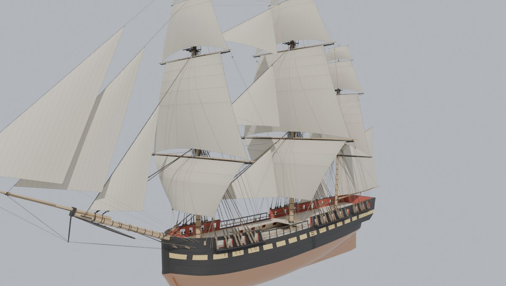
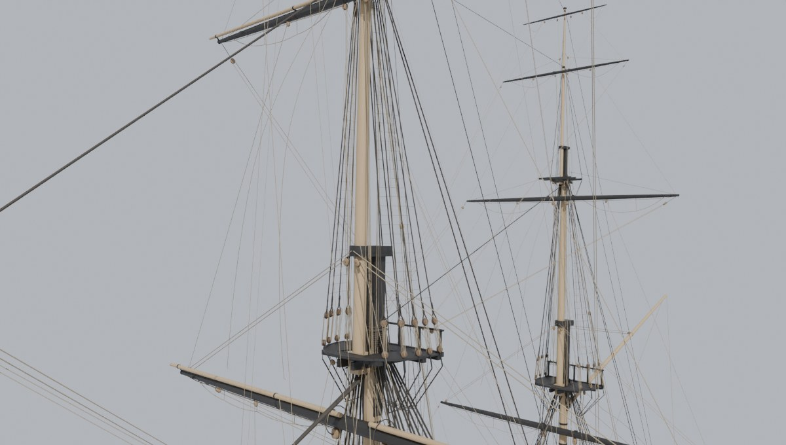
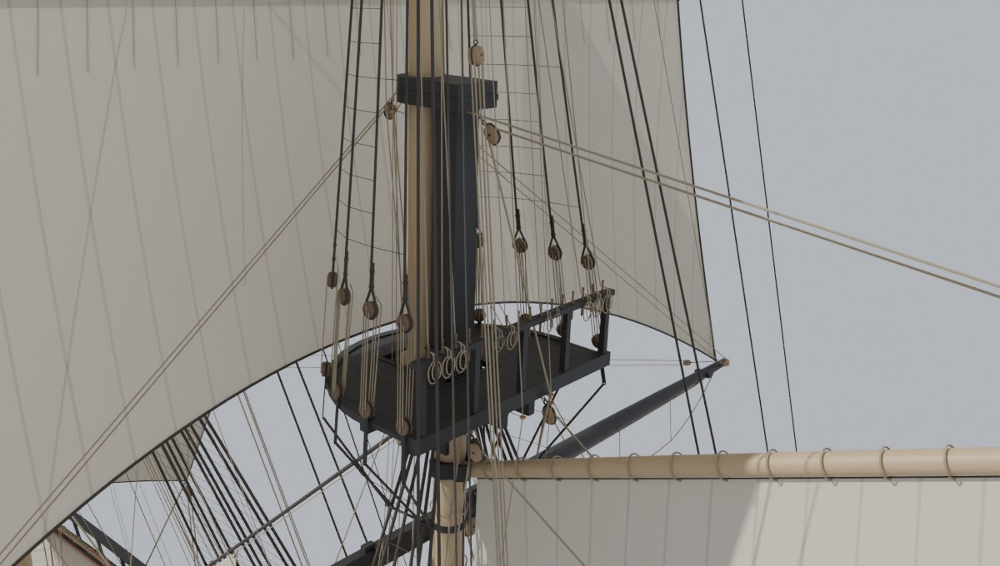
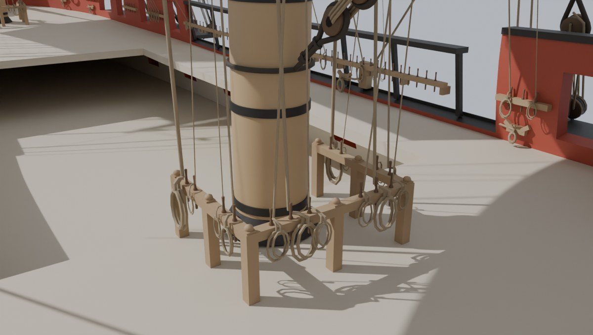
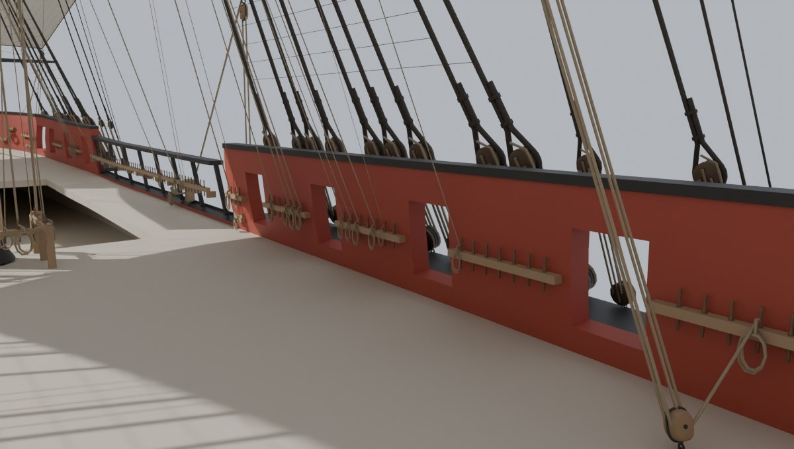
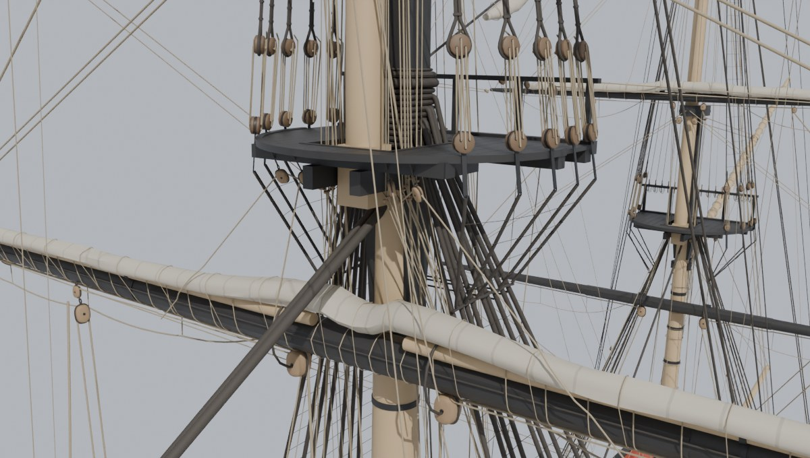
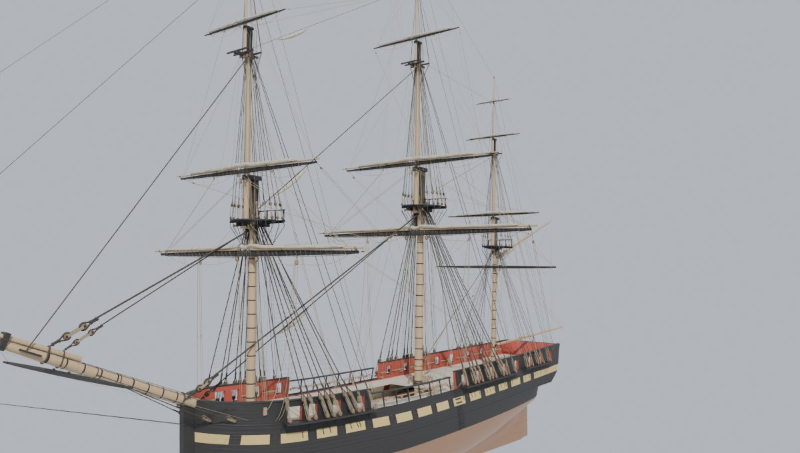
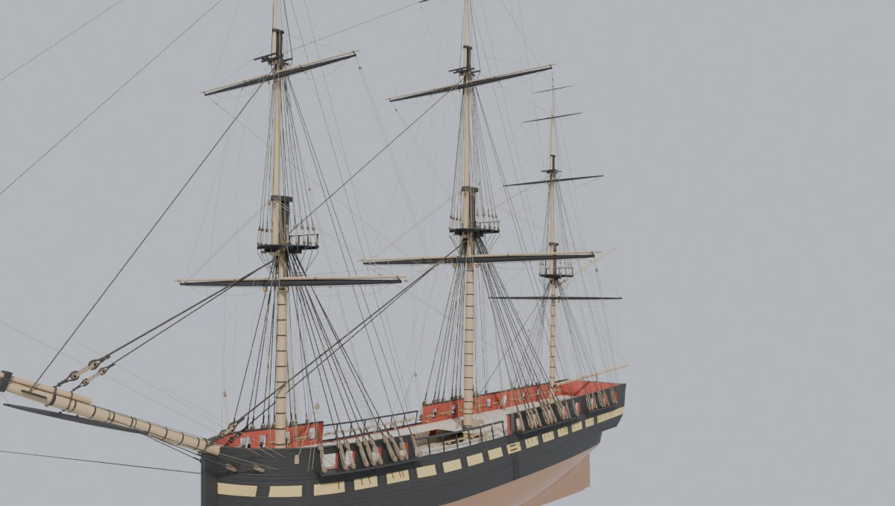

# Shipkit 6: the frigate's running rigging and blocks

Slice 6 of the frigate *Commonwealth* (plan: <https://claude.ai/artifact/8y6hW8vHjjUPJRovJEuxY7>; slices 0-5 are in
`docs/shipkit-1` to `docs/shipkit-5`). Slice 4 stayed her masts and slice 5 bent on her sails. This slice reeves her
running rigging: the ropes the crew haul on to hoist the yards, swing them round, and set and take in the sails, with
the blocks (pulleys) they run through and the pins they are made fast to. It is still post-slice art: nothing here is
imported into Unreal or wired into the game.



## What slice 6 builds

144 working lines and 60 footropes and stirrups, rove in each of the three sail states slice 5 made (set, clewed up,
furled):

* **On each square-rigged mast** (fore, main and mizzen), for every yard:
  * **Lifts** hold the yardarms (the yard's ends) up. A lower yard's is a double lift from the cap; a topsail yard's
    comes in over the topmast shrouds' heads to a thimble abaft the topmast head; a topgallant yard's runs through a
    block on a strop round the topgallant masthead. The royals are set flying (hoisted without lifts), so they have
    none.
  * **Halyards** hoist the upper yards. A topsail yard has a **tye** from its slings up through a sheave in the topmast
    and down to a fly block, and a four-fold **halyard** tackle from there to a block hooked in the deck at the side.
    The topgallant and royal halyards come up the mast's fore side, over a sheave in the masthead and down abaft the
    top to the fife rail.
  * **Sheets** haul a square sail's lower corners (the clews) down to the yard below: from the clew through a sheave in
    the yardarm, in along the yard's underside to a quarter block under its middle, then down. The courses' (the lowest
    sails') sheets go aft to the ship's side instead, and their **tacks** forward to the chesstrees (a fairlead on the
    topside).
  * **Clewlines** (on the courses, **clew garnets**) haul the clews up to the yard when the sail is taken in.
  * **Buntlines** haul the foot up the fore side of the sail: two a side on each course and topsail.
  * **Braces** swing the yard round: a pendant from each yardarm with a block on its end, the brace from a block on
    the next mast's rigging (the main yard's from the quarter) out through it and back, and down to the rails (below).
    The royals' braces are single ropes.
  * **Footropes** (horses) and their **stirrups**: the ropes under each yard the topmen stand on to work the sail.
* **The spanker** (the fore-and-aft sail on the mizzen): throat and peak halyards, a vang each side from the gaff's end
  to the quarter, topping lifts from the boom's end, and the boom sheet's tackle over the taffrail.
* **The headsails and staysails:** each set sail's lee sheet, and the mizzen staysail's halyard.
* **The spritsail yard** under the bowsprit (it carries no sail here): its slings, lifts and braces.

| | Fore | Main | Mizzen | Headsails, staysails, spanker, spritsail yard | All |
| --- | ---: | ---: | ---: | ---: | ---: |
| Working lines | 44 | 44 | 34 | 22 | 144 |
| Footropes and stirrups | 20 | 20 | 20 | | 60 |

The mizzen has fewer working lines because its lowest yard, the crossjack, carries no sail: only its lifts and
braces.

With them come 143 blocks (120 single, 23 double; their shells in 10 lengths from 5 to 18 in, 15 kinds counting the
sheaves) and 27 sheaves let into the masts and yards, 89 bull's eyes and 30 thimbles (wooden and iron rings a rope is
led through, each on a strop to what holds it), 11 sheaves in the ship's side and 4 chesstrees. The rails carry 304
belaying pins (124 with a rope on them), and 13 kevels (big oak cleats inside the bulwark) take the heaviest ropes.
Every rope made fast on deck ends in a coil hung on its pin or kevel.




### Sizes

A rope is sized by its circumference in inches, as the period measured rope. These are the main mast's (the fore's
are 0.92 of them and the mizzen's 0.75, each rounded to half an inch):

| Main mast (circumference, in) | Course | Topsail | Topgallant | Royal |
| --- | ---: | ---: | ---: | ---: |
| Lift | 4.5 | 3 | 2 | |
| Tye / halyard | | 7 / 3.5 | 3 | 2 |
| Brace | 4.5 | 3.5 | 2 | 1.5 |
| Sheet | 5 | 6 | 3.5 | 2 |
| Tack | 6.5 | | | |
| Clew garnet / clewline | 3.5 | 3 | 2 | 1.5 |
| Buntline | 3 | 2.5 | | |
| Footrope / stirrup | 4 / 3 | 3.5 / 2.5 | 2.5 / 2 | 2 |

A topsail's sheet is the heaviest of its sail's gear because it holds the whole foot of the biggest sail aloft. The
period's rigging tables (Steel's of 1794, Lees's) could not be read here (see Sources), so every size is an estimate,
scaled from the main course's tack, sheet and braces at a third to a quarter of the main stay's 17 1/2 in (slice 4's
table). `running_1797.json` says so beside each value.

A block's shell is about three times its rope's circumference long (5 in at least), with a rope strop round it. A
**free** block (on a brace pendant, a lift, a shroud) hangs from its strop along the pull of its rope; a **fixed** one
(a quarter block lashed under a yard, a sheave in a mast) stays where it is put. A block made fast to a spar (the
quarter blocks, the spanker boom's sheet block, the gaff's peak block) is held by its strop taken round the spar.

## Where they lead and belay

Every rope comes down to one of the ship's belaying places, the ropes of a mast together round it and along the side
near it, each where its pull comes down without crossing the others:

| Mast | Fife rail round the mast | Along the side | Elsewhere |
| --- | --- | --- | --- |
| Fore | lifts, topgallant and royal halyards, the clew garnets, topsail and royal clewlines, topsail and topgallant sheets | forecastle rails: buntlines, royal sheets, the topsail halyard; gangway rails: the braces, the topgallant clewlines | kevels: the course's sheets and tacks |
| Main | the course's and topsail's lifts, topgallant and royal halyards, royal clewlines, topsail sheets | quarterdeck rails: the topgallant lifts, clew garnets, clewlines, buntlines, topgallant and royal sheets, the braces (the royal's to the mizzen fife rail), the topsail halyard; gangway rails: the main staysails' sheets | kevels: the course's sheets and tacks |
| Mizzen | the crossjack's lifts, topgallant and royal halyards, the mizzen staysail's halyard, the spanker's halyards and topping lifts | quarterdeck rails: sheets, clewlines, the crossjack's and royal braces, the topsail halyard, the mizzen staysails' sheets, the spanker's vangs and sheet; main fife rail: the topsail and topgallant braces | the mizzen top's after rail: the topsail and topgallant lifts, topsail buntlines, royal clewlines |

The main yard's braces come in through a sheave in the quarter and belay to a pin beside it. The braces lead to the
next mast:

* the fore's aft to the main stay (port side: the preventer stay), its topgallant and royal braces to the main
  topgallant stay;
* the main's aft to a block on the mizzen's foremost shroud, the fall coming in between two shrouds (clear of the
  ratlines) to the rails;
* the crossjack's (the mizzen's lowest yard) forward to a block on the main's aftermost shroud, its fall down abaft that
  shroud to the quarterdeck rail;
* the mizzen's upper braces forward to the main top's after rail and down to the main fife rail (the royal's to the
  quarterdeck rail).

The courses' sheets and tacks and the headsails' sheets are the heaviest ropes; they come in through sheaves in the
side (the tacks through the chesstrees) to kevels. The mizzen top's after rail takes the mizzen's upper gear because
the mizzen is small and its fife rail crowded.

Which pin each fall takes is worked out, not drawn by hand: first the set of pins that makes all the falls shortest,
then swaps where two falls would pass too close, then a move for any fall still passing too close to something (to a
free pin, or trading with a fall that is clear elsewhere). The plan is symmetric: a port rope belays on the mirror
image of its starboard twin's pin and runs through the mirror images of its bull's eyes, and the moves are made in
pairs. Last, the falls lead fair: where two coming down to one side's rails would cross within 3 m above them (seen
from inboard, where a fall hauled on would chafe the other), one of them moves to a free pin or trades pins with
another fall, if it stays as clear as it was.

Each fall's coil hangs on a bight round its pin, inboard against the rail's face (outside a fife rail, abaft a top's
rail), as deep as its rope's size and the deck allow. Where it would touch something it moves a little along the
rail, hangs over its neighbour's coil, or is made narrower, so that it stands clear of the ship, every rope in every
state and the other coils.




## How a rope is laid

A rope is described by its **stations**: where it is made fast, each sheave it goes round, each bull's eye, thimble or
sheave hole it goes through, and the pin it belays to. Between them it runs straight and taut, except where it must
lie on something:

* along a yard's underside (a sheet or clewline in to its quarter block, under the robands that tie the sail on),
* over the fore side of a clewed or furled sail (a slack sheet, a buntline), and over the yard taut: the shortest way
  round the yard's section (the yard, the sail's head bent to it, a studding sail boom on it) on the side its straight
  line passes,
* round a sheave, from where it comes on to where it goes off, and
* slack where it would be (a course's sheet and tack when the sail is clewed up or furled).

The blocks then hang where their ropes pull them, and the ropes are laid again over the blocks until both settle. A
block whose ropes all run to one other block (a topsail halyard's tackle, 20 m long) takes that block's pin, so the
two pins are parallel, and the rope goes round both blocks' sheaves the same way, as a belt round two pulleys.

A bull's eye or thimble that leads a fall down from aloft has a box it must sit in (under a trestletree, abaft the
topmast head, beside the cap), and it is put where its rope stands clearest of everything else, the eye itself clear
of the ship and the other ropes too. Then it is stropped to what can hold it: the nearest mast, top, cap, trestletree,
shroud or stay seen from the eye or from round its rim, or else the nearest one a straight strop from the eye meets
within a metre, taking the shortest strop that stands clear of the ship and every rope in every state. The strop is
seized at one point for all three states, so the eye turns on it as its rope leads, and a port eye's strop is the
mirror image of its starboard twin's.

## Three states, the yards square

The running rigging is laid in each of slice 5's states, with the yards square across the ship:

* **Set:** sails set, sheets home, the clewlines and buntlines let up to the sail.
* **Clewed:** the clewlines and buntlines hauled up, the sheets slack in bights over the bags of cloth.
* **Furled:** the topsail, topgallant and royal yards lowered onto the caps, the clews two-blocked (hauled right up to
  their blocks, where the clewline or clew garnet ends).

A headsail's or staysail's sheet is drawn only when its sail is set (on the port tack, so the lee sheet goes to
starboard); hauled down, a sheet is stopped in on the heap. Braced, the gear on a yard must be laid again between its
stations: that is the game's drawing code, a later pass (`running.json` gives it what it needs, below).





## Clearance

The build checks every rope, in every state, against everything it could touch: the hull and its fittings, the
masts, tops, yards and spars, every rope of the standing rigging, the ratlines, the sails, every other rope, every
bull's eye and thimble (at its size as drawn) and every block, and against itself (a tackle's parts must clear each
other). It checks each block against all of those and against the other blocks; each bull's eye and thimble against
the ship and the other ropes, and its strop against both; and each coil against the ship, every rope in every state and
the other coils. A rope may touch only what holds it:

* within 6 in of each place it is made fast or runs through;
* along a yardarm for 1 m in from its sheave, where a sheet lies in the yardarm's score and under the robands that
  lace the sail's head to the yard;
* in a mast's sheave hole (0.35 m and four of its radii either side of the sheave) and along a hole through the
  ship's side.

And besides:

* clewed up, a clewline's or clew garnet's block and a buntline's end sit in the cloth gathered round them (within
  0.3 m), and a clewline or clew garnet lying along its yard may press into the cloth bunched under the yard by 1 cm,
  and never more than half its radius;
* a brace's fall may come in between two shrouds (but not through their ratlines).

The aim is every rope's surface at least 1/4 in from everything else, and the build fails if anything comes within
1/10 in. In this build nothing comes within 1/10 in, and only the topsail halyards' own parts come within 1/4 in: the
fore's 5.1 mm and the main's 5.8 to 5.9 mm apart at mid-height (Known gaps). The next closest are the fore course's
sheets, 6.9 mm off the rail cap. No two falls to one side's rails cross within 3 m above them (the build lists any
that do in `running.room.crossings`, without failing).

## Triangles

| | Ropes | Blocks and fittings | Pin rails, pins, kevels and coils | Total |
| --- | ---: | ---: | ---: | ---: |
| Set | 37,332 | 162,428 | 94,008 | 293,768 |
| Clewed | 45,476 | 162,068 | 94,008 | 301,552 |
| Furled | 35,376 | 161,972 | 94,008 | 291,356 |

One state shows at a time, so the running rigging as drawn is 291k to 302k triangles, about the plan's 300k (the
clewed state is 1,552 over it; the plan's budgets are a floor, and the strops and fitted coils the review asked for
are most of the growth since the first build). All three states' objects together are 698,660. The ship as drawn with
every sail set is now 1,260,776 triangles: slice 5's 967,008 and the Set running rigging. More than half of it is the
blocks and their fittings, 143 copies of 15 kinds, which the game can draw as instances. A rope is a tube of 6 sides
(8 from about 4 in circumference, 10 on the 7-in topsail tyes), thinned to the points that keep it within a third of
its radius of the true line.

## For the game: objects and `running.json`

In the .blend each state's ropes are `Running_<Group>_<State>` and its blocks, pendants, bull's eyes, thimbles and
side sheaves `Blocks_<Group>_<State>`, in the collections `Running_Set`, `Running_Clewed` and `Running_Furled` (the
last two hidden, like the sails'). The groups are `Fore`, `Main`, `Mizzen`, `Headsails`, `Staysails`, `Spanker` and
`Spritsail`. `PinRails` (the rails, pins, kevels, eyebolts and coils) never moves and shows in every state. All of it
is in the ship's frame, laid with the yards square.

`running.json` is what the game's drawing code needs to lay it again as the yards brace and hoist:

* `lines`: each line's group, size and radius and, for each state it is rove in, its centre line (`points`) and its
  stations in order (`end`, `sheave`, `thru`, `pin`, `kevel`). A station's point is in its own frame: a spar's (as
  `rig.json`'s, so it goes with the yard) or the ship's. A `thru` station with a bull's eye or thimble has its
  `strop`: `from` the eye's rim `to` the point it is seized to, and what `holds` it.
* `blocks`: each block's sheaves and length, how it is held in each state (`held`: `hangs_from` a frame and point on
  `pendant_m`, or `fixed` to a frame), and its pose in each state (centre and axes). `drawn: false` marks a sheave let
  into a spar.
* `pins` and `kevels`: where each is and which line belays there.
* `coils`: the coil on each pin or kevel (`on`) and its line, as fitted: moved `shift_m` along the rail, its `width`
  (1, or the share it was narrowed to) and `off_rail_m`, how much further off the rail it hangs where it lies over
  its neighbour's (0 otherwise).



## Sources

The arrangement is the general practice of an American or British frigate of the 1790s, as David Steel's *Elements
and Practice of Rigging and Seamanship* (1794) and James Lees's *The Masting and Rigging of English Ships of War
1625-1860* lay it out. Neither could be read for this slice: the hosts that carry them, and the other references
tried, are blocked from this machine. So the leads follow what is generally known of that practice, and every size,
lead height and rail is marked an estimate in `running_1797.json`. To check them against the sources, these hosts would
need to be allowed in the cloud environment's network settings: archive.org, en.wikisource.org, the Wellcome
Collection's API, history.navy.mil, ussconstitutionmuseum.org, wardepartmentpapers.org, legacy.maritime.org,
bruzelius.info, sobco.com, whalesite.org, modelshipbuilder.com, modelshipworld.com, jimclifford.ca and
cdn.shopify.com.

What is not an estimate: the sizes start from the main stay's 17 1/2 in in slice 4's 1797 table (from *Constitution*'s
rigging list), and everything is laid on the masts, yards, standing rigging and sails of slices 3 to 5.

## Checks

```
python Tools/shipkit/frigate/build_frigate.py <out>
python Tools/shipkit/frigate/build_frigate.py <out> --place-running
```

(Blender's Python, pip `bpy`.) A build starts from the bull's eyes' places and the pins kept in
`running_places_1797.json`; a placement that still fits everywhere is taken as it is, so a build is the same each
time (about 7 minutes). `--place-running` places them all afresh (about half an hour) and rewrites that file; a
fresh placement passes the same checks. The build fails if a rope, block, bull's eye, strop or coil comes within
1/10 in of anything it doesn't touch (a rope of itself too), and writes the check to `build.json` (`running.room`: the
passes under 1/10 in for lines, blocks, fittings and coils, those under 1/4 in, the ten closest, and the falls that
cross just above a side rail).

The earlier slices' outputs are unchanged: `rig.json` and `sails.json` are the same, and so are the sails' and the
standing rigging's checks.

## Review

An independent review measured a first build (every rope, block, fitting and coil). It found the problems below,
and all are fixed in this build unless marked:

* **Ropes through themselves.** The build had no test of a rope against itself, and three kinds of rope failed it:
  * The topsail halyards' four-part tackles had a quarter turn in them. Each block took its pin from its own ropes,
    and those run nearly parallel to the other block 20 m away, so the direction came out at random. Now a block
    whose ropes all run to one other block takes that block's pin (the two pins parallel), and the rope goes round
    both blocks' sheaves the same way, as a belt round two pulleys.
  * Clewed up, a course's sheet doubled back on itself. Its two parts now lie one before the other over the cloth.
  * A topsail buntline kinked where it went over its yard. A buntline is now laid taut over the yard: the shortest way
    round the yard's section (the yard, the sail's head bent to it, the studding sail boom on it), on the side its
    straight line passes.

  The check now tests every rope against itself (the build fails on it like any other contact), and it measures line
  against line exactly instead of every 3 cm.
* **Furled clews in two places.** Furled, each clew was drawn in the roll and again at its block, and the blocks'
  axes were not square. Now the clew is two-blocked (hauled up to its block, as a furled sail's clew is), the
  clewline or clew garnet ends there, and the block's axes are square.
* **Coils into the bulwark.** Coils hung outboard of their pins, into the bulwark, and under the deck at some kevels.
  Each coil now hangs inboard against the rail's face (outside a fife rail, abaft a top's rail) on a bight round its
  pin, no deeper than the deck allows. Where it would touch something, it moves a little along the rail, hangs over
  its neighbour's coil, or is made narrower, so it stands clear of the ship, the ropes in every state and the other
  coils. The build checks them.
* **Bull's eyes not seated.** Most bull's eyes and thimbles hung in the air, and some sat in the tops or shrouds. Now
  each is placed clear of everything: its own clearance is part of where it goes, and the topsail buntlines' eyes
  beside the topmast heads moved forward clear of the cheeks. Each hangs on a strop to a mast, top, cap, trestletree,
  shroud or stay. The strop is seized at one point for every state, so the eye turns on it as its rope leads. It is
  the shortest strop that stands clear of the ship and every rope (the longest is 0.36 m), and a port eye's strop is
  the mirror image of its starboard twin's. The build checks the eyes against the ship and the ropes, and their
  strops.
* **Port and starboard differed.** Eight pairs of ropes belayed on different rails, and some falls crossed just above
  the rails. The plan is now symmetric: each port rope's bull's eyes and pin are the mirror image of its starboard
  twin's. The mizzen royal braces and the main royal sheets traded pins, so no falls cross above the rails now: by
  hand in this build's placement, and a fresh placement now makes such trades itself (above).
* **The soft cloth rule could not fail** for ropes thinner than about 2 1/2 in. A rope may now press into gathered
  cloth by its stated give (1 cm), and never more than half its radius.
* **Smaller:**
  * The quarter blocks' and the spanker boom block's eyes sat inside their spars. Each is now lashed by a strop round
    the spar.
  * The spanker's peak block pendant went through the gaff. It now hangs from a strop round it.
  * The spritsail yard's slings cut a chord through the bowsprit. They now go round it, over the iron hoop there.
  * Inverted block shells and left-handed boxes are turned right.
  * The blocks' meshes carried unused vertices and the pins zero-area faces. Both are gone.
  * `running.json` now gives each block's hang in each state.
* **Not changed:**
  * The topsail halyards' parts pass 5 to 6 mm apart at mid-height. The tackle's two blocks are rove as a belt, so the
    part from the standing block's becket crosses the part from its lower sheave.
  * The headsail sheets' ends pass into their kevel. They belay with turns round its horns, which are not drawn.

## Known gaps

* **Not rove yet:** leechlines, bowlines, reef tackles, the topgallants' buntlines, the headsails' halyards and
  downhauls, the main staysails' halyards, the spanker's brails, outhaul and tack lashing, and the lower yards'
  trusses. Their sizes are already in `running_1797.json` for the pass that adds them. The headsails' halyards would
  lead to the fore top's crowded throat, and the main staysails' falls would come down through the main course and
  topsail when they are set.
* **The yards square:** braced, every line on a yard must be laid again (the game's drawing code). The brace limits
  are slice 4's and 5's; nothing here checks the running rigging braced.
* **Sheets on one tack:** a headsail's or staysail's sheet is drawn only set, on the port tack; hauled down it is not
  drawn.
* **The spritsail yard** has single-rope lifts and braces, no pendant blocks, and no sail.
* **The mizzen's upper gear belays in its top,** where a period ship may have led more of it to the deck.
* **Footropes stop short of the slings.** In the period a lower yard's two footropes crossed at the slings and were
  made fast on the far side; here each stops clear of the quarter blocks and the slings, and a topsail yard's starts
  outside the topmast shrouds the yard comes down to when lowered.
* **Clewed cloth:** the clewed sails were shaped before the ropes. The clewlines along a yard press up to 1 cm into the
  cloth bunched under it, and the buntlines' ends sit in the bunt.
* **Furled in Blender:** furled, the topsail, topgallant and royal yards come down onto the caps, and the Furled ropes
  and blocks are laid on the lowered yards. The .blend's yards (slice 3's) and furled sails (slice 5's) hang hoisted,
  so shown in Blender the Furled gear sits up to 10 m below its yards. The renders here lower the yards; the
  game will pose them.
* **The topsail halyards' parts** pass 5 to 6 mm apart at mid-height, under the 1/4-in aim (over the 1/10-in gate):
  rove as a belt, the part from the standing block's becket crosses the part from its lower sheave. The main topsail
  halyard's standing block is at the main channel's after end, abaft the backstays and 11.6 m abaft the mast, so its
  tackle is 26 m long; a period ship may have led it nearer the mast.
* **Kevels and pins:** a heavy rope belays to a kevel with turns round its horns, which are not drawn; the rope
  ends a radius off the kevel's face, and a headsail sheet's last part, coming in from the hole beside it, passes into
  the kevel's end. The mizzen top's after rail is part of the top's mesh, so its pins pass through it, as pins pass
  through any rail.
* **Taut and rigid:** the ropes run straight between their stations except where they lie on something or hang slack
  as stated; nothing sways.
* **Estimates throughout** (Sources), and nothing is in the game yet.

## Files

| File | What it does |
| --- | --- |
| `Tools/shipkit/frigate/running.py` | the running rigging (`Running`): every line, block, bull's eye, thimble, pin and kevel; laying the lines in each state, hanging the blocks, placing the bull's eyes and giving out the pins; the clearance check; the meshes and `running.json` |
| `Tools/shipkit/frigate/running_1797.json` | sizes, blocks, pins and rails, leads and the check's settings, each with its source |
| `Tools/shipkit/frigate/running_places_1797.json` | where the bull's eyes went and which pin each fall took, so a build starts from them |
| `Tools/shipkit/frigate/build_frigate.py` | builds the running rigging's objects, materials and collections, checks its room, writes `running.json` and its counts in `build.json` |
| `docs/shipkit-6/baseline/` | build.json, `running_excerpt.json` (a few of each kind of entry in running.json), and renders |
