# Shipkit 7: the frigate's spar deck

Slice 7 of the frigate *Commonwealth* (plan: <https://claude.ai/artifact/8y6hW8vHjjUPJRovJEuxY7>; slices 0-6 are in
`docs/shipkit-1` to `docs/shipkit-6`). Slice 6 rove her running rigging. This slice builds the deck the crew walk on,
the open spar deck: the planked quarterdeck, gangways and forecastle round the open waist, and what stands on them.
That is the double wheel and its binnacle, the capstan's head, the hatchways and their gratings, the companion and
skylights, the belfry, the galley's chimney, the bowsprit's step, the mast coats, the rails and ladders at the breaks,
and the hammock nettings along the rails. It is still post-slice art: nothing here is imported into Unreal or wired
into the game.

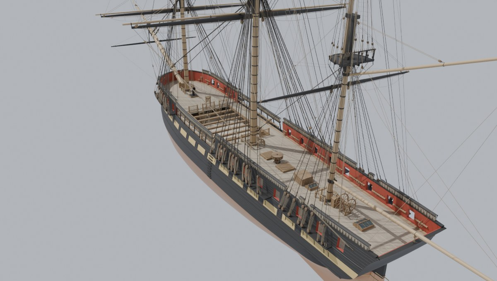

## What slice 7 builds

The spar deck of a 44 is three decks joined by gangways. The **quarterdeck** runs from the taffrail to 5 ft forward of
the main mast, and the **forecastle** from 31 ft abaft the fore mast to the bow. Between them, over the **waist**, the
deck is open to the gun deck below, with a **gangway** along each side. These are the parts, each its own object:

* **The deck** (`SparDeck`): its top, planked (below), and its underside, with the openings through it: the waist,
  the three masts' partners, the capstan's barrel, the hatchways, companion, skylights and chimney.
* **Waterways** (`Waterways`): an oak waterway 12 in wide along each side where the deck meets the bulwark, 4 in up the
  bulwark's foot, its face hollowed so the water runs to the scuppers. In the waist, where the side above is the open
  rail on stanchions, it stops just under the plankshear's top.
* **The waist** (`WaistFrame`): the coamings along the gangways' inner edges, and seven beams across the opening, every
  other beam of the deck, carried on under the gangways to the ship's side. The spare spars and the boats will be
  stowed on them (slice 11).
* **Breast rails** (`BreastRails`) across each break, 42 in high on turned balusters, with a gap at each ladder; in the
  forecastle's the belfry's posts stand in the rail.
* **Ladders** (`Ladders`): two at each break, either side of the middle line, down to the gun deck, with hand rails.
* **Hatchways** (`Hatches`): two on the quarterdeck between the main and the mizzen, 5 ft 0 in by 5 ft 2 in inside,
  each with a 9-in coaming and a grating on ledges, cambered 2 in.
* **The companion** (`Companion`): 4 ft 4 in square inside, under a hood with two doors facing forward.
* **Skylights** (`Skylights`): two pitched glazed skylights, each two lids of three panes with bars over the glass: the
  1849 plan's forward of the mizzen, and a larger one over the after cabin.
* **The capstan's head** (`Capstan`, `CapstanPawls`): the drumhead of the main capstan, 5 ft across with twelve bar
  holes, on its barrel's eight whelps, and the iron pawl ring on the deck. Its own frame turns it: the barrel runs
  down to the gun deck (slice 12).
* **The double wheel** (`Wheel`, `WheelStandards`, `TillerRope`): two 5 ft 6 in wheels of ten spokes on one
  fore-and-aft axle, the tiller rope wound round the barrel between them and led down through iron plates in the deck,
  in standards that carry the axle. Its own frame turns it.
* **The binnacle** (`Binnacle`) forward of the wheel: a cabinet with a compass either side of a lamp, glazed toward
  the helmsmen, under a pitched roof with the lamp's vent.
* **The belfry** (`Belfry`) at the forecastle's break: two posts and a headstock under a roof, braced forward, with
  the ship's bell (17 in across the mouth), its clapper and lanyard.
* **The galley's chimney** (`Chimney`) on the forecastle: a coaming, an iron plate over it, and the funnel with its
  cowl turned aft.
* **The bowsprit's step** (`BowspritStep`): a chock across the deck abaft the bowsprit's heel, between two bitts.
* **Mast coats** (`MastCoats`): a tarred canvas coat round each mast where it goes through the deck.
* **Hammock nettings** (`Nettings`) along the rails of the quarterdeck, the gangways and the forecastle, built round
  the rigging (below).

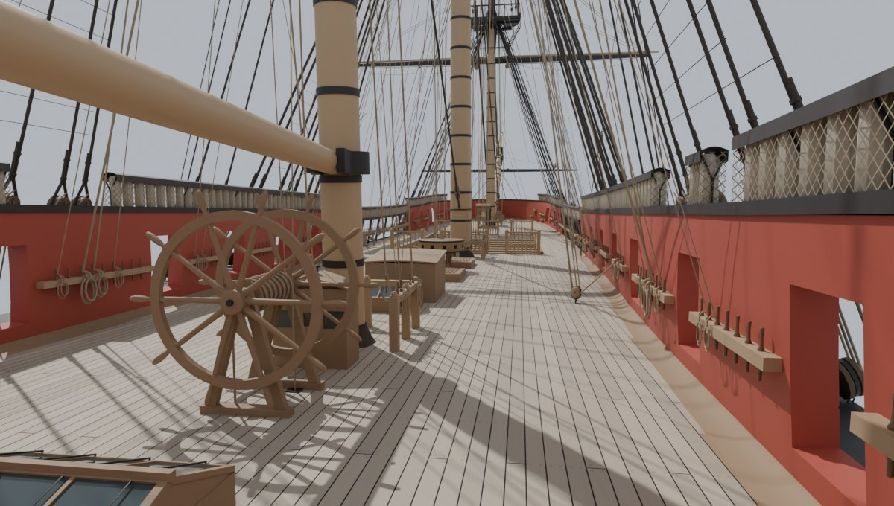
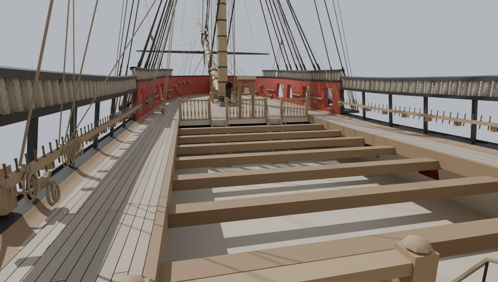
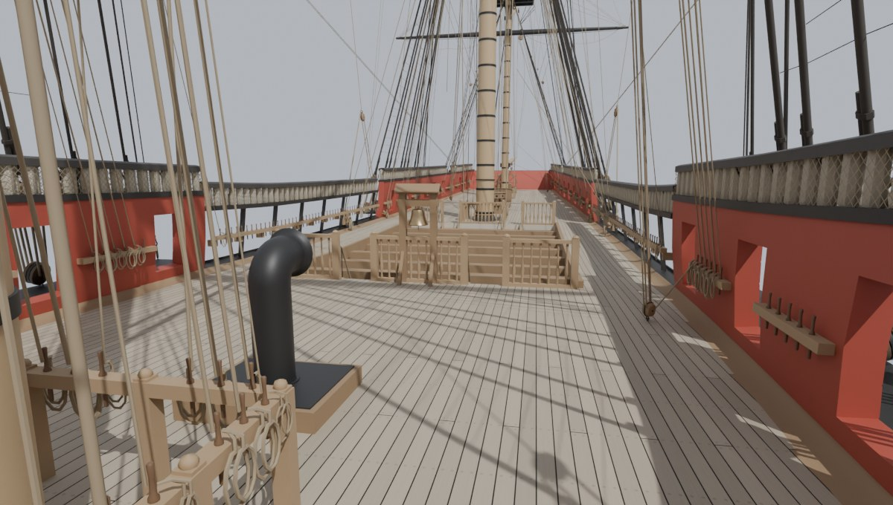

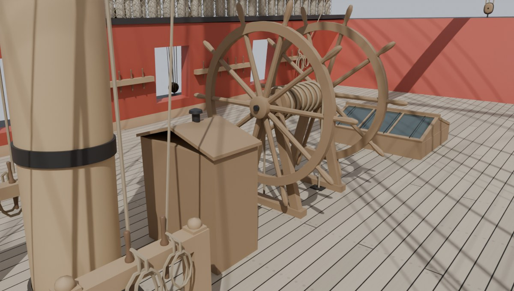
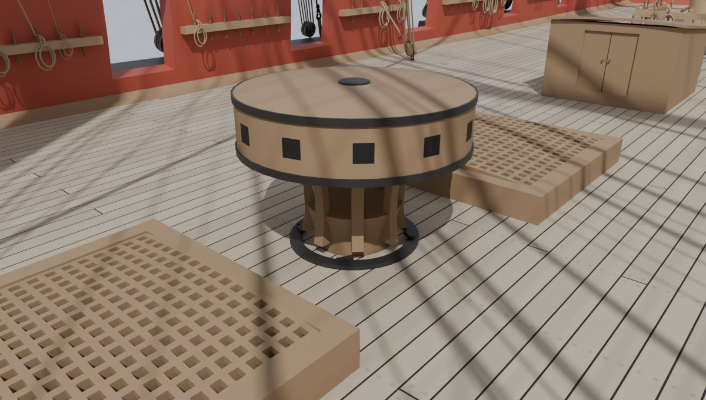
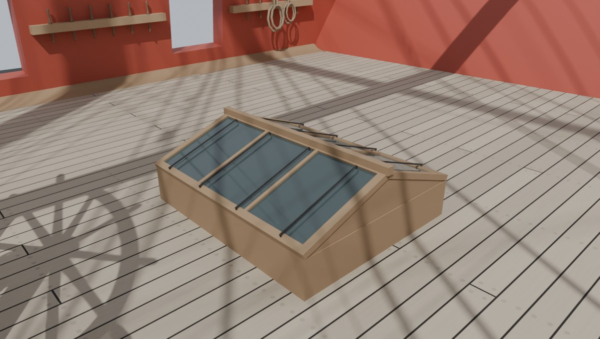
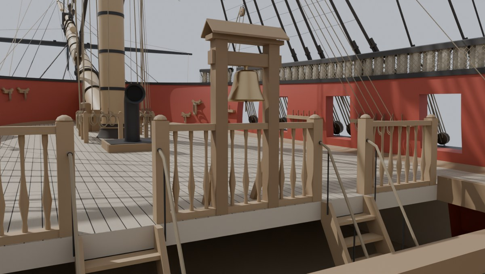
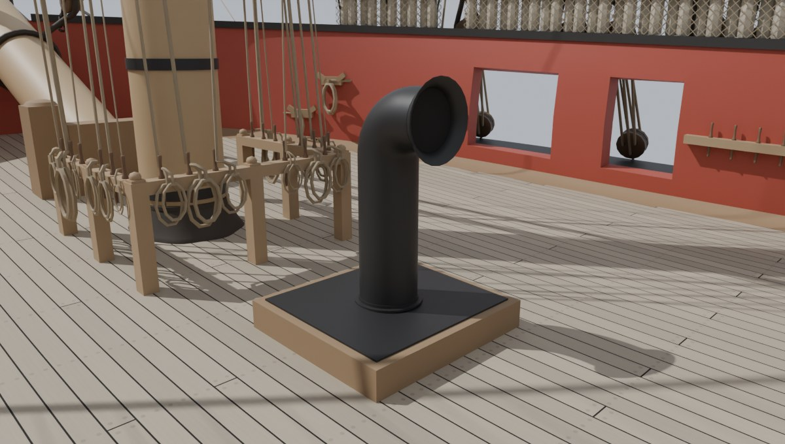
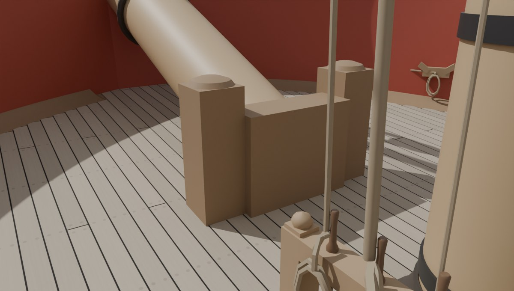

## Where it all stands

The only plan of a Constitution-class spar deck is the Boston Navy Yard's of 1849 (NARA 75841368; Sources). It draws the
hatchways, companion, skylights and galley chimney, each with its inside size written on it. Each item's place is
measured on the plan's scan and carried to our ship by the masts. Between two masts an item keeps its share of the way
from one to the other: the 1849 masts stand 10% closer between the mizzen and the main than ours, which came from the
1817 draught in slice 3. Aft of the mizzen and forward of the fore mast, an item keeps its distance from the nearest
mast at the plan's own scale. The scale, 19.2 px a foot, comes from the sizes written on the plan.

| On the quarterdeck, aft to forward | Centre (m from midships) | Inside | From |
| --- | ---: | --- | --- |
| Skylight over the after cabin | -24.95 | 3 ft 6 in x 4 ft 6 in | estimate (below) |
| Double wheel (its axle's middle) | -22.25 | wheels 5 ft 6 in across | estimate |
| Binnacle | -20.80 | 20 x 38 in, 40 in high | estimate |
| *Mizzen mast* | -19.63 | | slice 3 |
| Skylight forward of the mizzen | -16.64 | 2 ft 4 in x 3 ft 2 in | 1849 plan |
| Companion | -15.05 | 4 ft 4 in square | 1849 plan |
| After hatchway | -11.30 | 5 ft 0 in x 5 ft 2 in | 1849 plan |
| Capstan's head | -9.41 | drumhead 5 ft across | estimate: between the hatchways |
| Fore hatchway | -7.53 | 5 ft 0 in x 5 ft 2 in | 1849 plan |
| *Main mast* | -3.32 | | slice 3 |
| Quarterdeck's breast rail and ladders | -1.78 | | estimate |

| Over the waist and on the forecastle | Centre (m from midships) | Inside | From |
| --- | ---: | --- | --- |
| The open waist (seven beams across) | -1.78 to 11.52 | 7.12 m between the gangways' coamings | 1817 draught; estimate |
| Forecastle's breast rail, ladders and belfry | 11.52 | | estimate |
| Galley chimney | 18.04 | 3 ft 5 in x 4 ft 0 in | 1849 plan |
| *Fore mast* | 21.00 | | slice 3 |
| Bowsprit's step (its foot 22.62 to 23.29 on the deck), between its bitts (22.88) | 22.96 | | estimate |

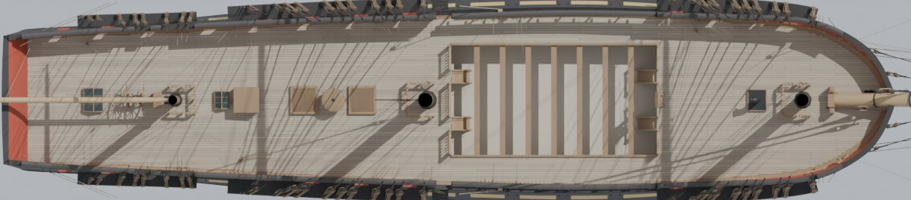

What the plan does not draw comes from the period's practice for an American or British frigate of the 1790s (each
value is marked an estimate in `deck_1797.json`):

* the double wheel abaft the mizzen, over the tiller's end, with the binnacle forward of it;
* the capstan's head between the quarterdeck's two hatchways, over the same gap on the gun deck below;
* the belfry at the forecastle's break, on the middle line, rung from the waist;
* the breast rails across the breaks and the two ladders at each break;
* the hammock nettings on the rails.

By 1849 the waist had been decked over nearly flush, so the plan has no waist to copy. Ours is as the 1797 ship had it,
open between gangways at least 6 ft 6 in wide, its sides straight fore and aft.

## The deck and its planks

The deck's top is where slices 2 to 6 laid it, at the bulwark's foot, and flat across: a 44's beams were rounded up
about 6 in at the middle, but slice 6's fife rails, bitts and coils stand on the flat deck, so the camber is left out
(Known gaps). Its underside stays 8 in below, a placeholder until slice 12 frames the gun deck's ceiling, and the
openings are open: looking down a hatchway or the waist shows the gun deck's placeholder.

The **quarterdeck's break** (its breast beam) is at the entry's fore post, 1.5 m forward of the main mast. The
bulwark's drift (where the side steps down to the waist's rail, slice 2) stays at the entry's after post, 0.58 m
forward of the mast's axis; a breast beam there would have left the mast's partners only 4 in of deck forward of the
mast. The **forecastle's break** is at the forecastle's drift.

The planks are pine, 3 in thick and 6 in wide, laid straight fore and aft with a plank on the middle line. Each is
8 beams long (21 ft 10 in, so each butt lands on a beam), the butts shifted 4, 2 and 6 beams across four strakes. The
seams are caulked with oakum and paid with pitch, 0.4 in wide, and two wooden plugs over the spikes mark each plank at
every beam (either side of a butt, 2 in off it). The deck's beams are every 32.7 in, the waist's length over 16. Where
the deck narrows toward the bow and the stern, each plank runs on until 0.4 of its width is left inside the
waterway's edge, and there it is **nibbed** into the waterway, cut square across, so no plank ends in a feather edge.

The planks are drawn, not modelled. The deck's top carries two UV maps, `Planking` (x, y in metres) and `Margin` (how
far inside the waterway's edge a point is, and how fast that edge moves inboard along the ship), and the material draws
every seam, butt, plug and nib from them (`deck.planking_terms`, which the game's material can copy). The colour of
each plank varies a little, and its grain runs along it. The seams fade from 25 m and are gone at 90 m, where they
would only shimmer.

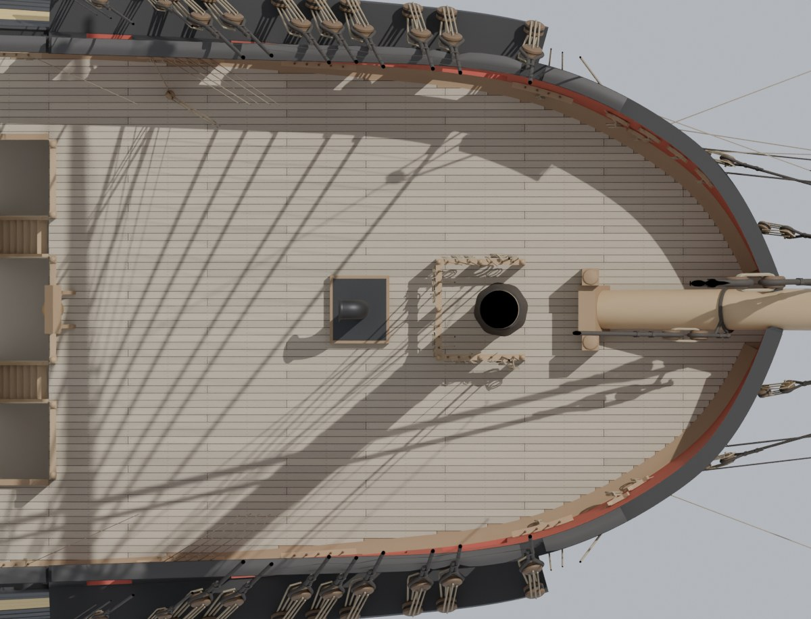
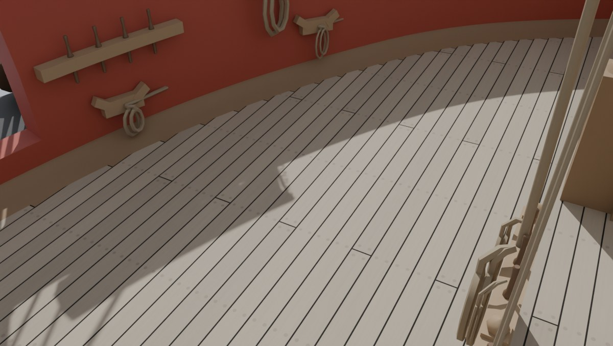

## Hammock nettings

A frigate's crew stowed their hammocks, rolled, in nettings along the rails by day, where in action they stopped
musket balls and splinters. The 1817 draught draws the netting along the waist's rail (slice 2 left it for this
slice). Here the nettings run along the rail caps of the quarterdeck (from 29.6 m abaft midships to the entry), the
waist's rail over both gangways, and the forecastle (to 23.6 m forward of midships). Each is iron cranes every 4 ft
holding a rail each side, rope netting between them in a 3-in diamond mesh, the hammocks inside, rolled and stowed on
end, and a tarred canvas hammock cloth over the top: 22 in high and 12 in wide.

They stand where the shrouds come down to the side, so they have to make room. The build lays them last, round
everything already there: every running rope in every sail state, every other part of the ship near the rails (the
shrouds and backstays, deadeyes and lanyards, blocks, bull's eyes, pins and coils, each sampled every 2 cm over its
surface), and the spanker boom swung through its brace limits. Wherever any of it comes within 1 in of where a
netting or its cloth would be, the netting narrows from that side, easing back by 3 in across for every 10 in along.
Where less than 8 in would be left it stops, with 6 in to spare either side, and starts again past it. Then the build
measures each run as built against the same points, and fails if anything is within 1 in of it.

Both sides are laid the same: each narrows and stops wherever either side's gear needs it, so a small difference
between the sides (in the rigging, or in where its surfaces are sampled) can't make one side's netting differ from the
other's. In this build (`build.json` `deck.nettings`):

| Rail | Runs (m from midships) | Narrowed | Least width | Stops for | Nearest as built |
| --- | --- | --- | ---: | --- | --- |
| Quarterdeck | -29.60 to -22.30, -21.25 to -20.60, -18.40 to -2.80 | -23.20 to -22.60, -22.40 to -21.15, -20.75 to -18.30 | 8.4 in | the mizzen's shrouds and their deadeyes, twice (1.05 m and 2.2 m) | 1.63 in, the spanker boom swung |
| Waist | -1.71 to 11.46 | | 12 in | | over 1.75 in |
| Forecastle | 11.58 to 21.42, 21.92 to 23.57 | 19.23 to 19.58, 19.73 to 20.33, 21.22 to 22.02 | 8.4 in | a fore deadeye, once (0.5 m) | over 1.75 in |

The waist's nettings run their full width from the entry to the forecastle. On the quarterdeck the mizzen's shrouds
come down over the rail's outer edge, their deadeyes just outboard of it (slice 4's channels), so the nettings narrow
there and stop twice for the deadeyes, leaving a short length of netting between two of them. On the forecastle the
fore shrouds narrow them abaft the mast, and forward of it they stop once, where a deadeye stands over the rail's
middle at the netting's height.

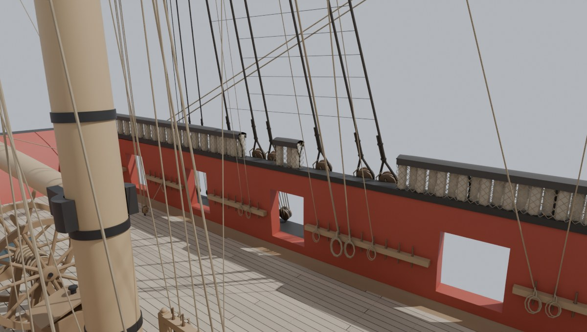
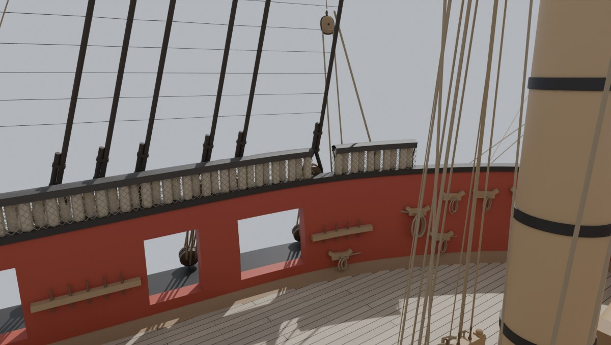

## Clearance

The build checks every deck part against everything else in the ship, the sails and ropes in every state, and
against the deck's other parts (`build.json` `deck.room`). Nothing meets anything it doesn't stand on or in by design,
and no designed contact goes deeper than it allows. A contact's depth is measured at every vertex of either part near
where they meet, behind the other's nearest face, so a piece buried whole (an eyebolt's shank in the deck) counts. A
part that passes through another with no vertex inside it (the wheel's axle through its bearings) reads 0:

| Designed contact (`deck.MEETS`) | Allowed | Deepest |
| --- | ---: | ---: |
| The waterway let into the bulwark's face | 0.5 in | 0.39 in |
| The waterway let into the deck | 0.55 in | 0.51 in |
| The nettings' cranes and cloth on the rail cap | 0.5 in | 0.33 in |
| The ladders' feet on the gun deck | 0.5 in | 0.41 in |
| The fife rails' posts and the eyebolts in the deck | 8 in | 1.6 in |
| The deck's edges against the bulwark's foot, the gun deck's side and the placeholder bulkheads | 0.1 in | 0.0 in |
| The gangways' coamings in the deck's edge, and the waist's beams under the gangways' planks, inside the deck's placeholder thickness | 3.5 in | 3.27 in |
| The coamings of the hatchways, companion, skylights and chimney in the deck's openings | 0.1 in | 0.0 in |
| Let into the deck: the mast coats' skirts | 0.35 in | 0.31 in |
| Let into the deck: the breast rails' posts and foot rails, the belfry's posts and braces, the bowsprit's step and bitts, the capstan's pawl ring, the wheel's standards and plates | 0.25 in | 0.2 in |
| Let into the deck: the binnacle | 0.15 in | 0.1 in |
| The tiller rope's legs down into the deck | 2.5 in | 2.37 in |
| The tiller rope's legs through the plates' holes (each a dark box the rope passes through) | 0.5 in | 0.44 in |
| The wheel's axle in the standards' bearings | 1.3 in | 0.0 in |
| The forecastle's breast rail into the belfry's posts | 0.55 in | 0.5 in |
| The ladders' hand ropes' eye plates in the breast rails' posts | 0.15 in | 0.1 in |

Every fitting that reaches the deck stands on it: none of its faces looking down hangs between 0.1 in and 2.5 in over
the deck's top, where the deck rises along the sheer, and nothing comes within 2.5 in of the deck without touching
something (`deck.room` `floats`: none). So the flat-bottomed fittings (the binnacle, the belfry, the bowsprit's step
and bitts, the wheel's standards and plates, the breast rails, the capstan's pawl ring) are laid on the sheer under
them, the mast coats' skirts follow it round the mast, and the waterway's inner edge, which stands further aft than
its foot where the side turns in at the bow, is laid on the deck where it stands.

Everything built after the deck must clear it with its own checks, and it does: the brace limits, the span room and
the sails' room are the same as slice 6's (`build.json` `brace`, `span_room`, `sails`), and so are `rig.json`,
`sails.json` and `running.json`. The running rigging's check now includes the deck's parts and passes as before, with
every rope, block and coil where slice 6 put it.

Slice 3's masts change in two ways. Their canvas coats at the deck are gone (the deck's `MastCoats` replace them), and
no iron hoop stands at the deck's partners any more (`spars_1795.json` `hoops.clear_of_partners_in`): one of the
mizzen's did, inside the deck.

## Triangles

| Part | Triangles |
| --- | ---: |
| `SparDeck` | 16,195 |
| `Waterways` | 14,388 |
| `WaistFrame` | 760 |
| `BreastRails` | 8,128 |
| `Ladders` | 2,176 |
| `Hatches` | 13,656 |
| `Companion` | 368 |
| `Skylights` | 1,592 |
| `Capstan`, `CapstanPawls` | 1,544 + 496 |
| `Wheel`, `WheelStandards`, `TillerRope` | 4,488 + 304 + 2,768 |
| `Binnacle` | 708 |
| `Belfry` | 1,024 |
| `Chimney` | 1,474 |
| `BowspritStep` | 188 |
| `MastCoats` | 5,184 |
| `Nettings` | 67,020 |
| **The deck** | **142,461** |

The plan gave the deck 500k. It uses 142k, nearly half of that in the nettings: the planks are drawn by the material,
so the deck's top needs few faces. The ship as drawn with her sails set is now 1,372,869 triangles (slice 6:
1,260,776): the deck's 142,461, less slice 2's placeholder spar deck (28,832) and 1,536 from the masts (slice 3's coats
and the mizzen's hoop).

## For the game: objects and `deck.json`

In the .blend the deck's parts are the objects named above, in the ship's frame, in the scene's main collection like
the hull's parts. Two turn, so each is built on its own frame (its vertices are in that frame and the object is placed by it):

* `Capstan`: the drumhead and the barrel's head with its whelps; origin on its axis at the deck, local +Z up. A turn
  about +Z heaves (either way). `CapstanPawls`, the iron ring on the deck, stays.
* `Wheel`: the two wheels, the axle and the barrel between them; origin on the axle midway between the wheels, local
  +X forward along it. A positive turn about +X takes the top of the wheels to port, and the ship's head to port, as
  the period's tiller ropes were led. `WheelStandards` (the frames the axle turns in, and the iron plates in the deck)
  and `TillerRope` (its turns round the barrel and its two legs down through the plates) stay: the barrel turns
  under the rope's turns, which look the same however far it turns.

`deck.json` is what the game needs beside the meshes:

* `frames`: the capstan's and the wheel's origin, axes and how each turns (and the wheel's spokes);
* `layout`: where each fitting stands (x of its centre) and its inside size;
* `waist`: the open waist's ends, half-width and the deck's beam pitch; `beams_x_m`, the waist's beams;
* `ladders`: each ladder's top and foot;
* `nettings`: each rail's runs, where they narrow, the least width left and the nearest thing to them as built, and
  any gaps (and what made them);
* `planking`: the pattern's sizes for the material.

The planks are drawn by the material, not modelled (above), from the deck's two UV maps. The nettings' mesh is drawn
the same way from their UV map `Netting` (along the netting and up it, in metres): diamonds 3 in on a side, cords
0.35 in thick, the rest cut away by the alpha. The game's materials do the same sums: `deck.planking_terms` writes the
planking's once for Blender's nodes and once for numpy, and `deck.netting_material` the netting's.

## Sources

* **The 1849 spar deck plan:** National Archives 75841368, *Spar Deck of the U.S. Frigate Constitution*, Navy Yard
  Boston, May 1849, four feet to the inch (public domain; on Wikimedia Commons, listed in
  `Tools/shipkit/frigate/refs.json`). The places of the hatchways, companion, forward skylight and galley chimney, and
  the inside sizes written on it. Read on the 3,840 px copy in `Data/Reference` (not in git).
* **The 1849 gun deck plan:** National Archives 75841364, the gun deck in the same set. The pumps, the capstans' lower
  ends and the galley are on that deck, none on the spar deck, so they are slice 12's.
* **The 1817 draught:** National Archives 102278445 (slice 1's). The open waist's rail on stanchions, the drifts at the
  breaks and the entry, which slice 2 built and this slice keeps.
* **Period practice** for an American or British frigate of the 1790s, for everything neither drawing shows: the wheel,
  binnacle, capstan's head, belfry, breast rails, ladders, gratings, mast coats and hammock nettings, and the heights
  and thicknesses of coamings, waterways and planks. Each such value is marked an estimate in `deck_1797.json`.
  The books that would pin them down (Marquardt's *The 44-Gun Frigate USS Constitution*, Lavery's *The Arming and
  Fitting of English Ships of War*) were not available here, and the hosts listed in `docs/shipkit-6` (Sources) are
  still blocked from this machine.

## Checks

```
python Tools/shipkit/frigate/build_frigate.py <out>
```

(Blender's Python, pip `bpy`; about 8 minutes.) The deck is built after the standing rigging and before the brace
limits, the sails and the running rigging, so all of them must clear it with their own checks and gaps, and the
nettings are laid last, round everything. The build fails if any deck part meets anything, another deck part too,
that it doesn't stand on or in by design (`deck.MEETS`), or goes deeper than that contact allows; if a fitting stands
off the deck; or if anything comes within 1 in of a netting as built. It writes the checks to `build.json`
(`deck.room`: what meets, each designed contact with its deepest point, and what stands off the deck; `deck.nettings`:
each run's least width and clearance) with the deck's layout and triangles.

## Review

An independent review measured the first full build from its .blend: overlaps, signed distances, rays cast down onto
the deck, the turning parts swept through a full turn, and close-up renders. What it found, and what was done:

* **The bell's clapper** hung 10.5 in out of the bell and into the breast rail's cap: its rod was turned downward from
  the ball. It now runs from the ball, just inside the mouth, up into the crown.
* **The binnacle's compass bowls** stood through its glass: each compartment was 3 in deep for a bowl 7.7 in across.
  Each is now 10 in deep, the bowl (or the lamp) midway between the glass and the back.
* **The tiller rope** was wound the wrong way round the barrel, so it doubled back where it met each leg. It is now
  wound the right way, and its turns are their own still object (`TillerRope`), so turning the wheel in the game
  can't pull them apart from the legs.
* **Flat bottoms on a sloping deck:** the bowsprit's step stood 1.9 in off the deck at its after edge, the fore mast's
  coat 1.1 in off on one side and 1.8 in sunk on the other, and the bitts, the capstan's pawl ring, the wheel's
  standards and plates and the binnacle each took the deck's height at one point. Each now follows the sheer under it.
  So do the breast rails, the belfry and the waterway, which the new check below found 0.96 in over the deck at the
  bow, where the side turns in and its inner edge stands further aft than its foot.
* **The ladders' hand ropes** ended 2 in inside the breast rails' posts. Each now ends on an iron eye plate on the
  post's face.
* **The clearance check** never compared the deck's parts with each other, measured only the corners of triangles
  that cross (an eyebolt's shank buried 1.6 in read 0.96 in), and nothing checked that a fitting reached the deck at
  all. It now does all three (Clearance). Its first run found two more: the wheel's barrel ran 0.3 in into its
  standards' bearings (it is now shorter, 0.2 in clear), and the rope's turns touched the barrel (now a hair off it all
  round).
* **The nettings** came 0.92 in from the fore deadeyes: the mesh kept only every fifth station, missing the narrowest,
  and the narrowing test stopped short of the cloth's crown and of its 0.6 in overhang. All three are fixed, and the
  build now measures each run as built and fails under 1 in.
* **The capstan's pawls** never reach the whelps, though the code said they bore on them. They lie back clear on
  purpose, so the head can turn (Known gaps).
* **Tidying that didn't show:** zero-area triangles in the bowsprit heel's pocket, the binnacle's and belfry's roofs
  each built as two solids sharing a face (now one each), and the chimney's flange flush with the funnel (now a collar
  standing proud of it). The gratings' T-junctions are left: they don't show.
* **This page:** the bowsprit step's centre is 22.96, not 23.1, and the 1849 masts stand 10% closer, not 11%.

It confirmed the triangle counts, materials and UV maps, every place and size against the 1849 plan, the turning
parts' frames (the wheel clears the deck by 2.4 in through a full turn, the capstan its hole by 0.41 in), that the two
sides' nettings are the same, and that slice 6's outputs were unchanged but for the two coils.

## Known gaps

* **Flat across:** the deck has no camber (its beams' round up, about 6 in at the middle on a 44), because slice 6's
  fife rails, bitts and coils stand on the flat deck. The planks' seams and the waterway follow the flat deck.
* **Below the deck is placeholder:** the deck's underside, the gun deck and the bulkheads are slice 2's placeholders
  until slices 9 to 14. Looking down the hatchways, the companion or the waist shows them, and the ladders land on the
  placeholder gun deck. The capstan's barrel stops 6 in under the deck, and the tiller rope's legs end inside the deck's
  thickness.
* **Not on this deck:** the guns and their carriages (slice 8), carving (9), anchors and their gear (10), and the boats
  stowed on the waist's beams (11). The pumps, the capstans' lower ends and the galley stove are on the gun deck in the
  1849 plans, so they are slice 12's.
* **The 1849 plan's round skylight** (3 ft 3 in across, 13.8 ft abaft the mizzen) would stand where the helmsmen
  stand at our wheel: the skylight over the after cabin here is square and further aft, an estimate in size and place.
  The plan's scuttle forward of the fore mast falls under our longer bowsprit's heel and is left out.
* **The capstan's bars** are not shipped: the bar holes are empty, as they were except when heaving.
* **Hammocks:** the rolls are plain canvas cylinders under the cloth; the netting's mesh is the material's (a flat
  face with the cords drawn and the rest cut away), so it has no thickness close up.
* **The capstan's pawls** lie back on their ring, clear of the whelps by about an inch, so the head can turn through
  them in the game. A real capstan's pawls dropped against the whelps' feet to hold it while heaving.
* **Estimates throughout** for what the 1849 plan does not draw (Sources), and nothing is in the game yet.

## Files

| File | What it does |
| --- | --- |
| `Tools/shipkit/frigate/deck.py` | the spar deck (`Deck`): the layout from the 1849 plan, the deck and its openings, waterways, the waist's beams and coaming, the fittings, the nettings built round the rigging and measured as built, the planking's pattern for the material, `deck.json`, and the deck's clearance check (`room`, `MEETS`) |
| `Tools/shipkit/frigate/deck_1797.json` | every size and place, each with its source |
| `Tools/shipkit/frigate/build_frigate.py` | builds the deck's objects and materials before the brace limits, the sails and the ropes (all of which must clear it), the nettings after the ropes, checks the deck's room, writes `deck.json` and the deck's counts in `build.json` |
| `Tools/shipkit/frigate/running.py` | the running rigging's checks now include the deck's parts |
| `Tools/shipkit/frigate/skin.py` | the old placeholder spar deck is gone (the gun deck and bulkheads stay placeholders for slices 9 to 14) |
| `Tools/shipkit/frigate/spars.py`, `spars_1795.json` | slice 3's mast coats are gone (the deck's own replace them), and no hoop stands at the deck's partners |
| `Tools/shipkit/frigate/sections_frigate.json` | the shape loop's sections: `spar_deck` and `deck_fittings` |
| `docs/shipkit-7/baseline/` | build.json, `deck.json`, and renders |
