# Shipkit 8: the frigate's guns

Slice 8 of the frigate *Commonwealth* (plan: <https://claude.ai/artifact/8y6hW8vHjjUPJRovJEuxY7>; slices 0-7 are in
`docs/shipkit-1` to `docs/shipkit-7`). Slice 7 laid her spar deck. This slice arms her: a long 24-pounder on its truck
carriage at each gun deck port, and a 32-pounder carronade on its slide at each port of the quarterdeck and forecastle,
with their breechings, tackles and ringbolts. That is fifty guns. The barrels, carriages, beds and slides are two unique
models placed as copies; each gun's gear (its ringbolts, ropes, blocks and coils) is its own, fitted to its own port. It
is still post-slice art: nothing here is imported into Unreal or wired into the game. Slice 17 adds the firing effect
(the flash and smoke only, no shot).

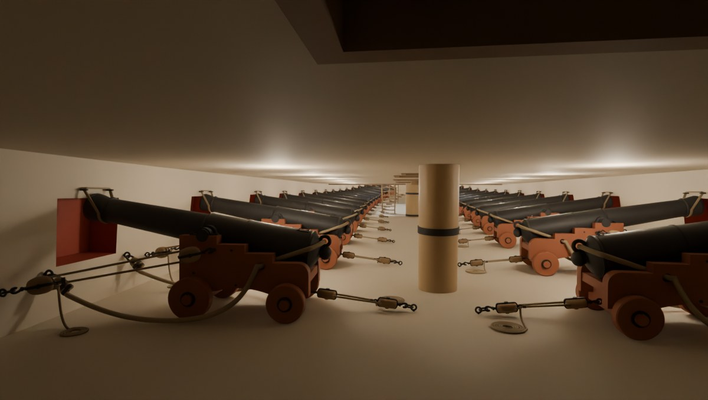

## What slice 8 builds

### The long 24-pounder

The gun deck of an American 44 carried long 24-pounders. Ours are cast to the British Blomefield pattern of the 1790s,
as the American founders of 1794-97 copied it: 9 ft 6 in from the muzzle's face to the base ring, a 5.82 in bore, about
50 cwt (Constitution's are 5,600 lb). Each part is its own piece of the model:

* **The barrel** (`Gun24_Barrel`), turned from its profile in 48 sides and blacked, as iron guns were: the cascabel's
  button and neck, the base ring and its ogee, the first reinforce to two sevenths of the length and its ring, the
  second reinforce with the trunnions and its ring, the chase, the muzzle's astragal and fillets, the swell of the
  muzzle and its lip, and the bore drawn 14 in deep. The trunnions are a calibre across and a calibre long on their
  rimbases, three sevenths of the length from the base ring and a tenth of a calibre below the bore's axis. Blomefield's
  breeching loop is cast on the cascabel. The vent is in a raised patch, with a flintlock on the gun's right: its pan at
  the vent's mouth with a priming channel between them, the steel standing over the pan, the cock behind it (the US Navy
  fitted locks from 1797; slice 17's flash starts at the pan).
* **The truck carriage** (`Gun24_Carriage`): two brackets 5.5 in thick, their tops in three steps down from the
  trunnions (the handspikes' purchase), arched underneath. Their inner faces stand a tenth of an inch off the rimbases
  at the trunnions and splay to 2 ft apart at the back, clear of the breech. Across them are the transom at the front,
  the two axletrees let into their undersides, and the bed on its stool. Iron cap squares hold the trunnions down.
  Square bolt heads show where the bolts come through the brackets. Each bracket has an eyebolt for its side tackle and
  a hole for the breeching, and the hind axletree has an eyebolt for the train tackle.
* **The quoin** (`Gun24_Quoin`): the wedge on the bed under the breech, its handle sticking out behind. The base ring
  bears on its sloping face: pushed home it lifts the breech (the muzzle drops to -1.4 deg), drawn back the breech comes
  down (8.1 deg on its thin end), and drawn right out the breech lies on the bed at 10.5 deg, the most the gun elevates.
  `guns.json` gives its place for every half degree.
* **The trucks** (`Gun24_TruckFore`, `Gun24_TruckHind`): solid wooden wheels 5 in thick, 19 in across at the fore
  axletree and 17 in at the hind, on the axletrees' arms with iron washers and linch pins. Each axletree's arms stand at
  their own trucks' radius, so the carriage stands level on a level deck.
* **The gear**, each gun's own (`Gun24_<gun>_Gear<pose>`, `Gun24_<gun>_Irons`): the **breeching**, a 7-in rope clinched
  to a ring in a ringbolt each side of the port, rove through the brackets' holes and round the breech through the loop;
  two **side tackles**, hooked to rings in ringbolts further out along the side and to the carriage's eyebolts; the
  **train tackle** from the hind axletree's eyebolt to a ringbolt in the deck inboard; each fall coiled down on the deck
  in a Flemish coil; two **housing bolts** over the port and the **muzzle lashing** of a gun housed for sea. Each tackle
  is a gun tackle purchase of two single blocks 9 in long, rove with 3-in rope. The blocks are iron-bound: the strap
  runs round the shell over the crown and down both cheeks with the sheave's pin through it, and crosses under the tail
  between the rope's two parts; the rope runs into the shell through the swallow, the open end of the mortise the sheave
  turns in; a swivel on the strap's crown takes the hook, and the standing part is clinched to a becket forged under the
  strap's tail and seized.

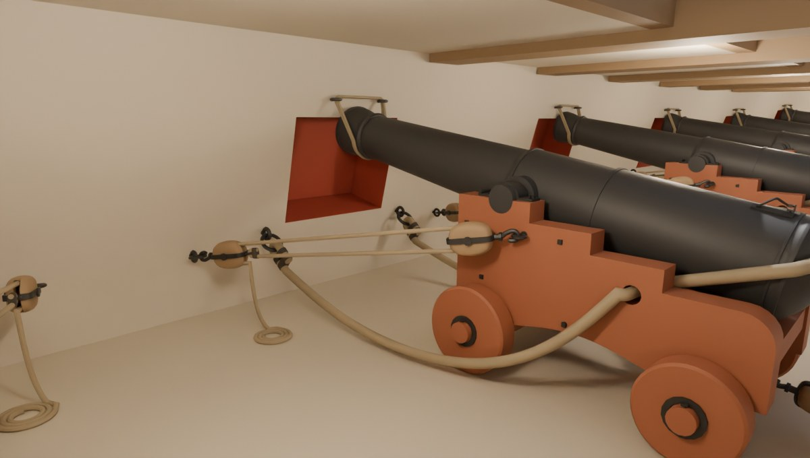
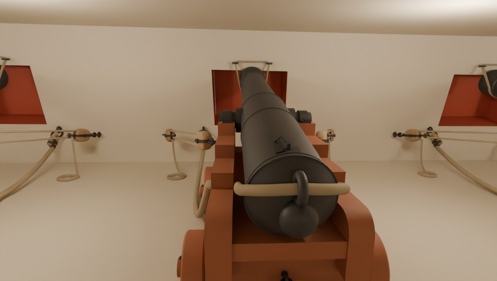
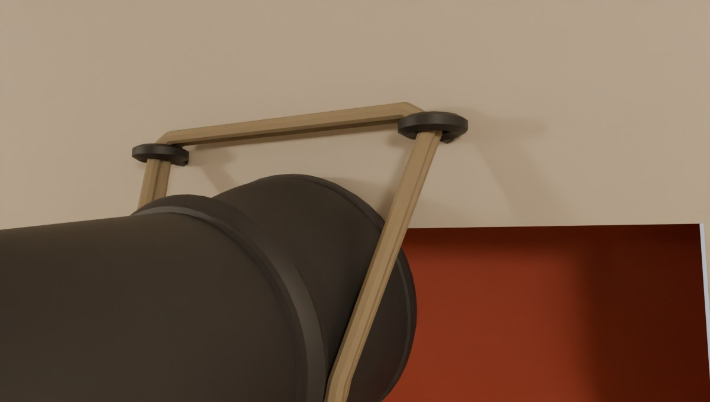
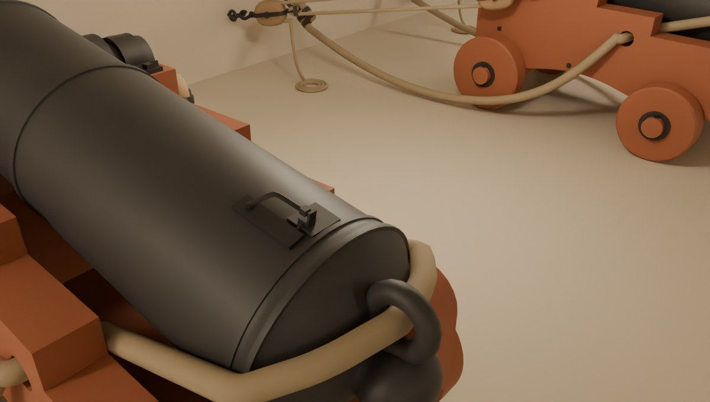
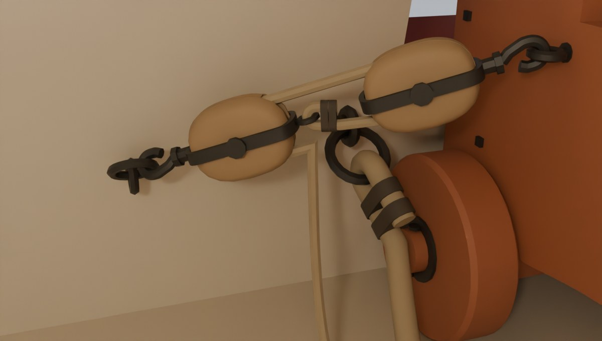

### The 32-pounder carronade

A carronade is short and light for its shot: the Carron Company's 32-pounder of the 1790s, 3 ft 6 in from the base ring
to the muzzle, a 6.25 in bore, about 17 cwt. Carronades on the quarterdeck and forecastle are the plan's choice for an
invented 44: the American 44s carried long 12-pounders there in 1797-98, and carronades soon after.

* **The barrel** (`Carr32_Barrel`), blacked: the cascabel's knob with the breeching loop on it, the base ring, the body
  to a reinforce ring, the chase, and the muzzle flaring into its cup, the carronade's own mark, which keeps the blast
  clear of the side. A carronade has no trunnions: a lug under the barrel at its balance is bolted between the bed's two
  cheeks. A boss under the breech takes the elevating screw. Vent and lock are as on the long gun.
* **The bed** (`Carr32_Bed`): a block 3 ft long sliding on the slide, with a keel under it running in the slide's slot,
  the barrel's lug bolted between the cheeks of its raised head, and the elevating screw with its handle under the
  cascabel's boss.
* **The slide** (`Carr32_Slide`): two rails 6 in square with a 4-in slot between them, joined by three transoms. The
  front transom stands inside the bulwark under the port, with the fighting bolt through it into the deck: the slide
  trains about the bolt, 18 deg each way, on two trucks under its rear transom.
* **The chocks** (`Carr32_Chocks`): an oak chock under each slide's fore end, fitted to the waterway at its own port,
  its outboard end half an inch off the bulwark. The waterway's hollow face differs from port to port, so these are
  drawn in place, not as copies.
* **The gear**, each gun's own: a 6-in breeching from ringbolts beside the port through the cascabel's loop, and two
  side tackles of 2.5-in rope (blocks 7.5 in long) from ringbolts further out to eyebolts on the bed, their falls coiled
  down inboard of the waterway.

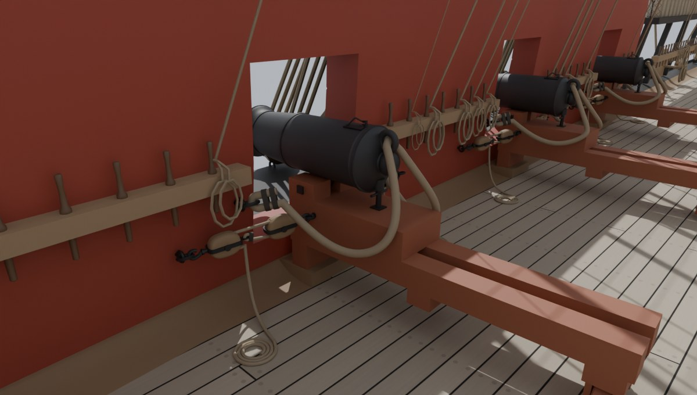
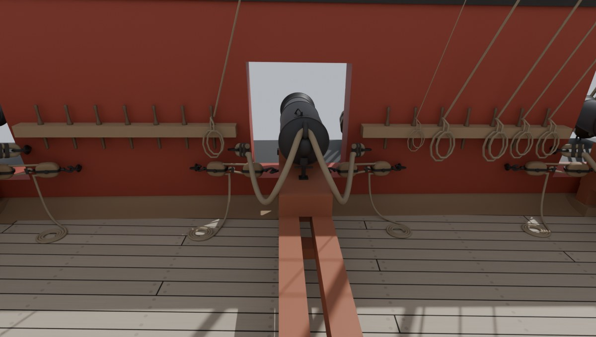

## Where they stand

There is a long gun at each of the gun deck's 14 ports a side and a carronade at each of the spar deck's 11 a side: 28
and 22. The bridle port at the bow (15) is empty: a long gun housed square to it would reach across the centreline into
its twin. So is the spar deck's foremost port (12), a chase port 4 ft 6 in wide that a long gun was shifted into. The
port side guns are the starboard ones turned about the centreline, not mirrored, so the lock is on each gun's right.
(The ship's frame is Unreal's, Y to starboard, so Blender draws her as her mirror image: in these renders the starboard
side has the bow on the left, and each lock shows on its gun's left. The game draws her the right way round.)

Each gun stands in its **port's frame**. Its origin is on the deck under the point where the port's middle line meets
the side's inner face at the ringbolts' height (21 in over the gun deck, 22 in over the spar deck). X points out through
the port, level, along the side's outward normal there. Z is square to the deck under the gun: on the gun deck, to a
plane fitted through the points where its trucks meet the deck in every pose. Y = Z x X, the gun's right. Each frame is
then turned a fraction of a degree about Z (0.03 to 0.58 deg) so that the side stands as far from its ringbolts on
either side of the port. The port's own place is slice 2's.

Each starboard gun's place (the port side's are the same; `guns.json` has both):

| Gun deck port | x (m from midships) | Deck (m over the waterline) | Gun's axis (deg forward of square) | Trunnions inboard of the side: housed, run in, run out (in) | Lid opened for it, its limit (deg) |
| ---: | ---: | ---: | ---: | --- | --- |
| 1 | -21.05 | 2.22 | -3.9 | 66.2, 78.6, 14.3 | 130, 175 |
| 2 | -17.94 | 2.13 | -4.2 | 67.9, 79.4, 13.5 | 95, 175 |
| 3 | -14.44 | 2.05 | -4.1 | 69.0, 80.0, 12.9 | 90, 160 |
| 4 | -11.19 | 1.98 | -4.0 | 70.1, 80.5, 12.5 | 85, 170 |
| 5 | -7.80 | 1.93 | -3.7 | 71.4, 81.2, 12.4 | 85, 175 |
| 6 | -4.34 | 1.90 | -2.7 | 72.5, 81.6, 12.4 | 80, 175 |
| 7 | -1.01 | 1.86 | -2.0 | 73.0, 81.8, 12.3 | 80, 175 |
| 8 | 2.18 | 1.84 | -1.5 | 73.1, 81.9, 12.2 | 80, 175 |
| 9 | 5.50 | 1.82 | -0.3 | 73.2, 82.0, 12.1 | 80, 175 |
| 10 | 8.86 | 1.85 | 2.2 | 73.1, 82.0, 12.1 | 80, 175 |
| 11 | 12.09 | 1.96 | 4.6 | 71.2, 81.3, 12.4 | 85, 140 |
| 12 | 15.48 | 2.07 | 5.6 | 68.0, 79.6, 13.0 | 90, 180 |
| 13 | 18.74 | 2.20 | 7.3 | 67.0, 79.2, 13.5 | 95, 160 |
| 14 | 22.08 | 2.44 | 24.0 | 62.6, 77.9, 15.9 | 175, 175 |

| Spar deck port | x (m from midships) | Deck (m over the waterline) | Gun's axis (deg forward of square) | Fighting bolt inboard of the side (in) | Muzzle run out past the side's outer face (in) |
| ---: | ---: | ---: | ---: | ---: | ---: |
| 1 (quarterdeck) | -26.85 | 4.49 | -3.1 | 5.34 | 5.3 |
| 2 | -23.99 | 4.40 | -2.0 | 5.49 | 5.3 |
| 3 | -20.89 | 4.32 | -2.0 | 5.43 | 5.3 |
| 4 | -16.99 | 4.24 | -3.1 | 5.19 | 5.4 |
| 5 | -13.88 | 4.19 | -3.2 | 4.99 | 5.5 |
| 6 | -10.74 | 4.13 | -2.8 | 4.73 | 5.5 |
| 7 | -7.58 | 4.08 | -2.2 | 4.33 | 5.7 |
| 8 | -4.45 | 4.03 | -2.0 | 4.00 | 5.9 |
| 9 (forecastle) | 12.80 | 4.15 | 2.4 | 4.83 | 5.6 |
| 10 | 15.82 | 4.24 | 3.5 | 5.29 | 5.4 |
| 11 | 18.59 | 4.34 | 4.8 | 5.91 | 3.4 |

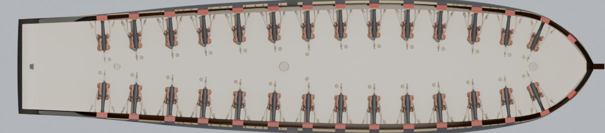
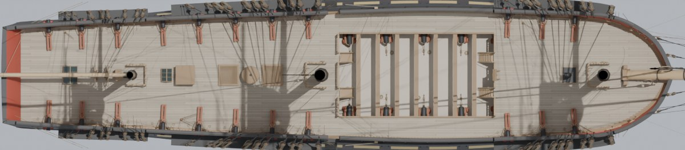

### Each gun's own gear

Every gun's ringbolts, ropes, blocks and coils are laid out in its own port's frame and fitted to its own side and deck.
Each ringbolt's eye stands 0.15 in off the side (or the deck) where it comes nearest it, its shank driven in 2.5 in past
the face, and each ring hangs bearing on its eye's bar toward the rope that pulls it. Every rope that lies on the deck
(the falls, their coils and the run-out breeching's bights) lies on the deck under that gun. Three ports' gear lies
differently (`port_overrides` in `guns_1797.json`; an override can be for one side's gun only, since the same place in
each gun's own frame is forward on one side of the ship and aft on the other):

* **Gun deck port 7**: the quarterdeck's ladders come down to the gun deck just forward of the train tackle's ringbolt,
  so its fall is coiled inboard of the ringbolt and 8 in aft, under the ladder where it stands clear over the coil, not
  on its foot.
* **Gun deck port 14**: the foremast stands just forward of the bow guns and the ship is so narrow there that their
  train coils, laid straight inboard, would meet on the centreline, so each gun's lies aft of its train tackle.
* **Spar deck port 8**: the main course's sheet and tack belay to kevels on the bulwark just forward of the port (slice
  6), where the carronade's forward side tackle ringbolt goes, so that ringbolt stands 3 in higher, over them.

(The first build drew the gear once and copied it to the ports alike enough to share it, in four sets. The review below
found what that cost at the ends of the ship: coils up to a quarter inch off the deck, the port side's copies worst
because their tackles swap fore and aft, and ringbolt eyes up to 1.2 in off the side.)

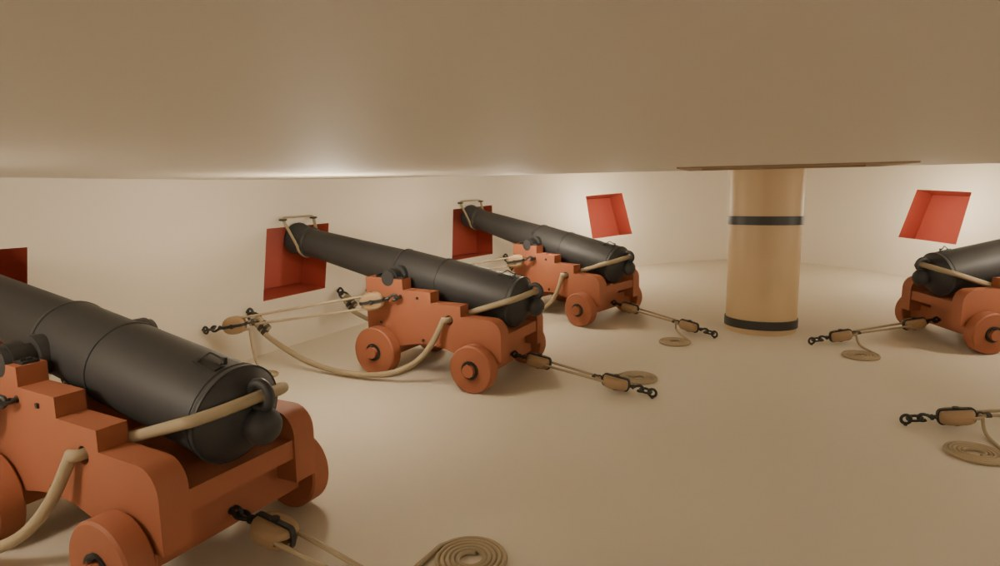

## The poses

The long guns have three poses, each its own collection:

* **Housed** for sea (`Guns_Housed`, shown): the lid shut, the gun hauled out with the quoin out until its muzzle comes
  up against the port's upper sill from inside, the breech down on the bed (10.5 deg), and the muzzle lashed with two
  turns through the two housing bolts over the port. The side tackles and the train tackle are hooked and hauled taut
  against each other; the breeching's slack hangs (its length is set by the recoil).
* **Run in** for loading (`Guns_RunIn`): where the recoil brings the gun up, the breeching taut, the barrel level on its
  quoin and its muzzle a foot inside the port. Slice 17 fires a gun from run out to here.
* **Run out** for firing (`Guns_RunOut`): the lid open (below), the carriage run out until its front stands an inch off
  the side, the barrel level on its quoin, the breeching's slack in bights on the deck, the side tackles' blocks drawn
  together, the train tackle overhauled.

The carronades are **run out** (`Carronades_RunOut`, shown: the bed at the slide's fore end, the breeching slack, the
side tackles' blocks drawn together) or **recoiled** (`Carronades_Recoil`: the bed 30 in back along the slide, the
breeching taut: it stops the recoil). The slide trains 18 deg either way about the fighting bolt. Their gear is drawn
with the slide square to the side.

`Guns` holds what every pose shares (each gun's ringbolts, the carronades' slides and the chocks). The barrel, carriage,
quoin and trucks are the same meshes in each pose, moved along the port's X and the barrel turned about its trunnions;
each gun's gear is one mesh per pose. Every rope is as long in each pose as in the others: the falls' coils take up what
the tackle pays out, and the breeching's hanging legs what its middle gives round the breech as the barrel elevates
(`build.json` `guns.ropes_in`, `guns.breeching_in`; the build fails if a breeching is drawn more than 0.3 in longer in
one pose than another). One gun of each kind, pose by pose:

| Rope, gun deck port 6 (starboard) | Housed | Run in | Run out |
| --- | --- | --- | --- |
| Breeching | 313.6 in, slack | 313.6 in, taut | 313.6 in, slack |
| Side tackle, each | 223.1 in: blocks 49.3 in apart, coil 2.7 turns | 223.1 in: blocks 57.7 in apart, coil 2.1 turns | 223.1 in: blocks 3.5 in apart, coil 5.0 turns |
| Train tackle | 250.0 in: blocks 14.6 in apart, coil 5.4 turns | 250.0 in: blocks 5.6 in apart, coil 5.8 turns | 250.0 in: blocks 74.5 in apart, coil 2.1 turns |

| Rope, spar deck port 6 (starboard) | Run out | Recoiled |
| --- | --- | --- |
| Breeching | 136.5 in, slack | 136.4 in, taut |
| Side tackle, each | 138.3 in: blocks 4.3 in apart, coil 3.2 turns | 138.3 in: blocks 21.3 in apart, coil 2.0 turns |

The ropes' lengths differ from port to port with the ports' spacing and the side's shape: the long guns' breechings 304
to 314 in, their side tackles' ropes 208 to 224 in and train tackles' 236 to 265 in; the carronades' breechings 135 to
140 in and side tackles' 138 to 139 in. As drawn, no breeching differs between its poses by more than 0.2 in; the falls,
measured along the drawn rope by the review, by up to 1 in (their hanging parts stretch a little).

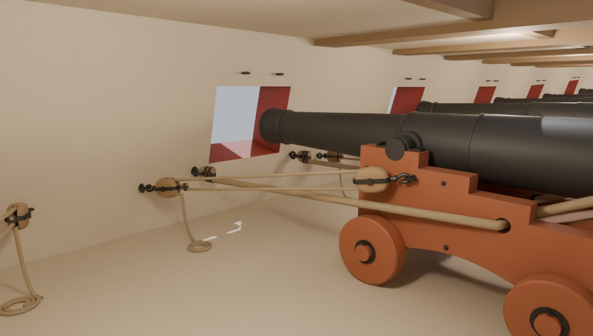
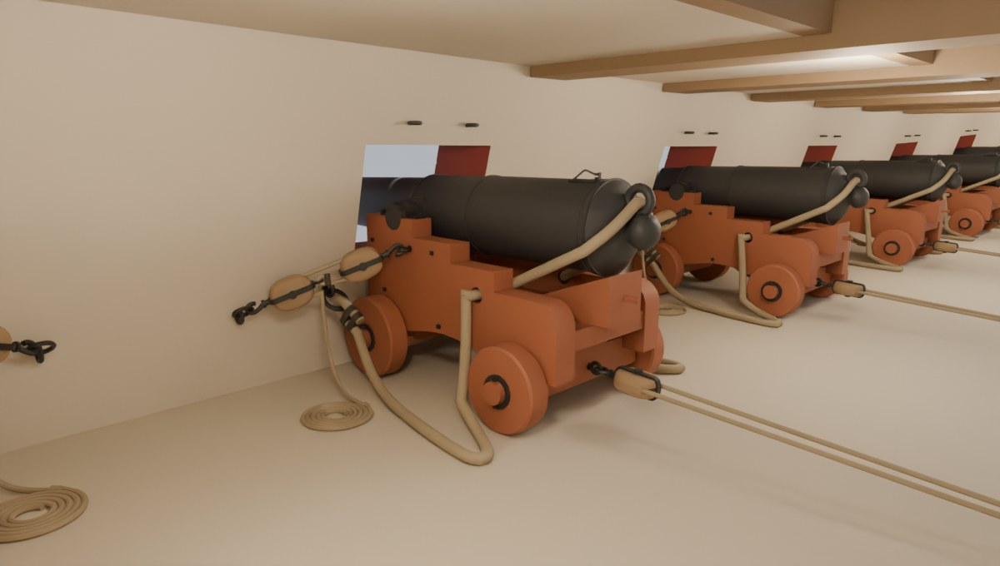
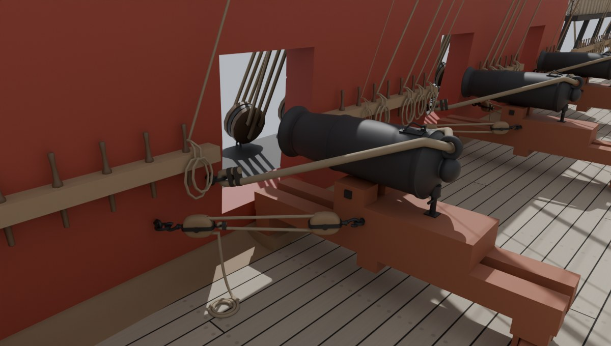

### The lids

The gun deck's lids are shut when the guns are housed. Each lid swings out and up on its hinges until it meets the ship
more than 0.12 in deep (`lid_max_deg`: 140 to 180 deg, its hinge's knuckles left out). To run a gun out its lid opens at
least `lid_open_deg`: the least opening, in 5 deg steps, at which the run-out gun's chase, made an inch fatter all
round, clears the lid at every elevation from quoin home (-1.4 deg) to the breech on the bed (10.5 deg). The lids open
80 deg amidships, where the side leans in most (15 deg), and 85 to 95 deg toward the ends, where it stands more upright
(by port: 1: 130, 2: 95, 3: 90, 4: 85, 5: 85, 6: 80, 7: 80, 8: 80, 9: 80, 10: 80, 11: 85, 12: 90, 13: 95, 14: 175). Port
1's opens 130 deg: its side leans in under 5 deg, so the lid's hinge stands lower over the gun (56.0 in over the deck in
the gun's frame, against 57.6 at port 2 and 59.3 amidships), and the raised chase comes up under the lid's hinged end,
which only opening it that far lifts clear (opened 95, 110 and 125 deg, the lid stops the barrel itself at 10.0, 11.4
and 12.0 deg). Port 14's must open to 175 deg, its limit: its gun is turned 24 deg forward, so its chase lies under the
lid's fore end, and opened that far the lid lets it elevate to 10.1 deg, not 10.5 (`run_out_elevation_deg`). The renders
open each lid to its own `lid_open_deg`.

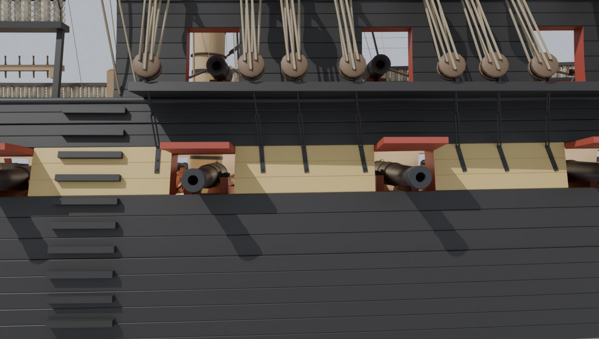
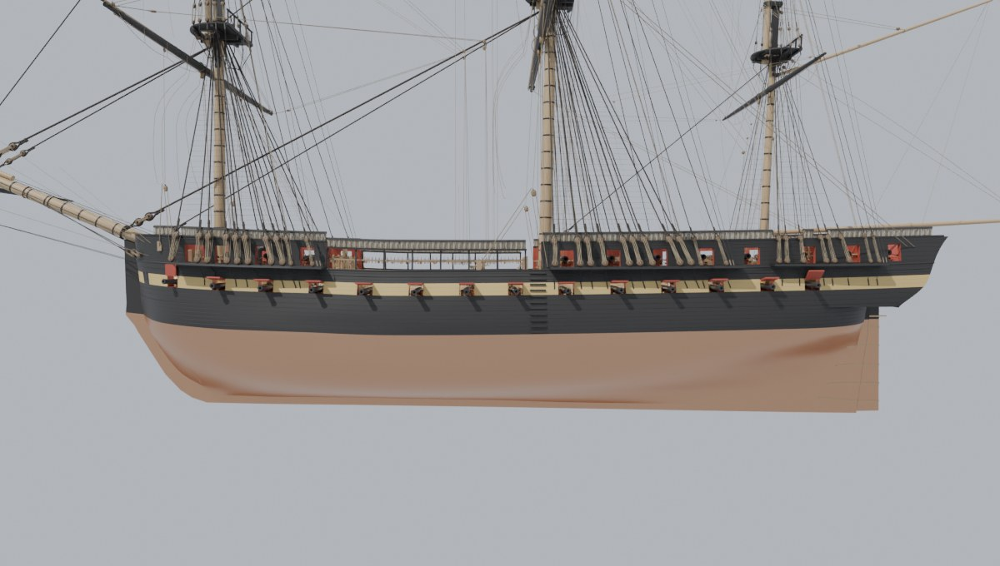

## Clearance

The build checks every copy of every gun, in every pose, against everything else in the ship (the sails and running
rigging in every state too), against the other guns in the same pose, and each gun's parts against each other
(`build.json` `guns.room`). Nothing meets anything it doesn't stand on or in by design, no designed contact goes deeper
than it allows, and no gun meets another. Each long gun run out is also checked with its barrel at quoin home and with
the breech on the bed (`guns.room.elevated`): neither meets anything (the lids are checked on their own, above). The
carronades' slides, beds and barrels, run out and recoiled, are also turned through their 18 deg either way in steps of
6 deg and checked again: none meets anything. A contact's depth is measured at every vertex of either part near where
they meet, behind the other's nearest face.

| Designed contact with the ship (`guns.SHIP_MEETS`) | The ship's part | Allowed | Deepest |
| --- | --- | ---: | ---: |
| The gun deck's ringbolts driven into the side | `GunWall` | 4 in | 2.58 in |
| The carronades' ringbolts driven into the bulwark | `BulwarkIn` | 4 in | 2.56 in |
| The train tackles' ringbolts driven into the gun deck | `GunDeck` | 3 in | 2.50 in |
| The fighting bolt driven down through the chock into the deck | `SparDeck` | 4.5 in | 4.00 in |
| The fighting bolt driven down through the chock and the waterway's inner edge into the deck, as deep in as its own thickness where the waterway is wide | `Waterways` | 1.8 in | 0.76 in |
| The fighting bolt through its chock (the depth counts the chock's points inside the bolt) | `Carr32_Chocks` | 1 in | 0.57 in |
| The slide's front transom on its chock (the depth counts the chock's points inside the fighting bolt through it) | `Carr32_Chocks` | 1 in | 0.57 in |
| The chocks let into the deck | `SparDeck` | 0.2 in | 0.15 in |
| The chocks let into the waterway | `Waterways` | 0.2 in | 0.17 in |
| The trucks on the deck, where its sheer bends under them | `GunDeck` | 0.15 in | 0.07 in |
| The slides' trucks on the deck | `SparDeck` | 0.1 in | 0.10 in |
| The falls and their coils on the deck | `GunDeck` | 0.3 in | 0.00 in |
| The falls and their coils on the deck | `SparDeck` | 0.3 in | 0.00 in |
| The housed and run-out long guns' breechings, slack in bights on the deck | `GunDeck` | 0.3 in | not into it |
| The run-out carronades' breechings, slack on the deck | `SparDeck` | 0.3 in | not into it |

Nearest without touching (the review's `near_ship.py`, from each vertex straight to the nearest surface): the bow guns'
housed barrels come within 0.34 in of their ports' linings, port 7's train tackle blocks within 0.55 in of the ladder
beside them, the bow guns' run-out chases within 0.59 in of their lids opened right back, and carronade 9's tackle
blocks within 0.89 in of the pin rail over them. Guns side by side along each side stand more than 19.7 in apart
(`neighbours.py`, as far as it looks).

Within each gun the designed contacts are the ones a gun is made of: the trunnions cast on the barrel, the cap squares,
axletrees, transom and bed let into or lying on the brackets, the quoin on the bed, the eyebolts driven into the
brackets, the hind axletree and the bed, the breeching rove through the loop and clinched and seized round its rings,
the hooks through the rings and eyes, the tackles' standing parts clinched round their beckets and seized, the muzzle
lashing rove through the housing bolts, and the lock's pan let into the vent's patch. The full list, with each one's
deepest point, is `guns.room.local.by_design`. The tackles' falls run round the sheaves in the blocks' mortises clear of
the shells and straps.

**On the deck.** The gun deck is not flat: its sheer rises toward both ends, and between 7 and 12 m forward of midships
it bends sharply (slice 2's sill line, the deck 24 in under it). Each long gun's frame is fitted to the deck under its
own trucks, so under every truck's axle the deck lies within 0.09 in of the frame's foot in every pose
(`guns.long24.trucks_deck_off_in`; the review's rays from each truck's lowest point find it within 0.07 in of the deck),
and every coil lies within 0.003 in of its own gun's deck (`guns.coils_on_deck`, which the build checks).

## Triangles

| Mesh | Triangles |
| --- | ---: |
| `Gun24_Barrel` | 7,808 |
| `Gun24_Carriage` | 2,992 |
| `Gun24_Quoin` | 48 |
| `Gun24_TruckFore`, `Gun24_TruckHind` | 480 + 480 |
| each long gun's `GearHoused` | 34,324 to 34,372 |
| each long gun's `GearRunIn` | 27,876 to 28,116 |
| each long gun's `GearRunOut` | 29,764 to 30,084 |
| each long gun's `Irons` (ringbolts, rings and housing bolts) | 1,372 |
| `Carr32_Barrel` | 5,016 |
| `Carr32_Bed`, `Carr32_Slide` | 676 + 1,036 |
| each carronade's `GearRunOut` | 18,236 to 18,300 |
| each carronade's `GearRecoil` | 18,460 to 18,600 |
| each carronade's `Irons` | 784 |
| `Carr32_Chocks` (all 22, each fitted to its port) | 5,456 |
| **Unique**: shared by every gun, and each gun's own | **23,992 + 3,452,200 = 3,476,192** |

The plan gave the guns 240k unique triangles, with the gear shared by ports alike enough. Since the review each gun's
gear is its own, one mesh for each pose, so the unique meshes are 3,476,192 triangles, nearly all of them gear. Drawn in
the shown poses (housed, and the carronades run out) the guns are 1,928,808 (the gun deck's 1,356,224 and the spar
deck's 572,584), so the ship as drawn with her sails set is now 3,301,677 (slice 7: 1,372,869), within the plan's 3.9M.
About three quarters of each gun is its gear: the ropes' rings and the coils' turns. In the game the barrels, carriages,
trucks, beds and slides are instances of the shared meshes; each gun shows one of its gear meshes at a time (all the
poses together are 4,802,064).

## For the game: `guns.json`

In the .blend each gun's parts are linked duplicates of the unique meshes, named `Gun24_<S|P><port>_<part>` and
`Carr32_<S|P><port>_<part>` (with `_RunIn`, `_RunOut` or `_Recoil` for the hidden poses), placed by their objects'
matrices. `guns.json` is what the game needs to place them itself:

* `meshes`: each unique mesh, with its own frame (where its origin is and which way its axes point);
* `long24`: for each gun its port, side, the port's frame (origin and axes in the ship's frame), its yaw, where its
  carriage stands along the port's X in each pose, its gear meshes and irons, its lid with `lid_open_deg`, `lid_max_deg`
  and the elevations it then allows (`run_out_elevation_deg`); where the barrel sits in the carriage, the bore over the
  trunnions, the elevation in each pose and the quoin's place for each half degree, the trucks' places and radii (turn
  each about its axle by the distance rolled over its radius as the carriage moves), and the lock's pan and the vent in
  the barrel's frame (where slice 17's flash starts);
* `carronade32`: for each gun its port, side, frame, yaw, the fighting bolt's place along the port's X and its gear
  meshes; the train limits, the bed's place along the slide in each pose and its height, where the barrel sits on the
  bed, the pan and the vent; the chocks are one mesh in the ship's frame.

Run out and run in (recoiled) are the ends of the gun's travel. The game moves the carriage (or the bed) between them,
turns the trucks, raises the barrel with the quoin, and swaps the gear mesh at each end; the ropes are drawn at rest
only.

## Sources and estimates

Every size is an estimate after the period's rules of proportion, each with its note in `guns_1797.json`: Muller's
*Treatise of Artillery* (1757 and 1780), Adye's *The Bombardier and Pocket Gunner* (1801) and Simmons's *The
Sea-Gunner's Vade-Mecum* (1812), as remembered. Their scans could not be fetched from this machine, nor Commons'
photographs of Constitution's guns (Commons answered 429, too many requests, on 14 Nov 2026), nor the Navy's and the
museums' drawings (their hosts are blocked). The one number from a source is the weight: a US Navy photo caption
(050825-N-9076B-006, public domain) gives Constitution's gun deck guns as 5,600 lb 24-pounders, a 9 ft 6 in gun of about
50 cwt. Commons' `Category:Cannons of the USS Constitution` is the first thing to measure against when it can be
fetched.

## Checks

```
python Tools/shipkit/frigate/build_frigate.py <out>
```

(Blender's Python, pip `bpy`; about 32 minutes and 7 GB of memory.) The guns are built last, after everything they must
clear. The build fails if any gun meets the ship, another gun or itself where it shouldn't (`guns.SHIP_MEETS` and
`guns.LOCAL_MEETS` list the contacts by design and how deep each may go), if a run-out long gun meets the ship elevated
or depressed, if a carronade meets anything trained, if a lid can't open clear of its gun at least level, if a coil lies
more than 0.08 in off its gun's deck, or if a breeching is drawn more than 0.3 in longer in one pose than another. It
writes the checks to `build.json` (`guns.room`, `guns.coils_on_deck`) with each gun's placing, the ropes' lengths in
each pose and the triangles, and the game's data to `guns.json`. Everything else in the ship is as slice 7 left it.

## Review

An independent review measured the first full build with its own scripts, given only the build, `guns_1797.json` and
`guns.py`. It found nine defects. Each is fixed, and the review's scripts, adapted to the rebuilt gear (each gun's own,
the blocks' shells in three pieces), were run again on the final build:

| The review found | Fixed | Measured again |
| --- | --- | --- |
| 1. Each lid, opened as far as the build said, stopped its run-out gun elevating (at 0.2 to 2.6 deg) | `lid_open_deg` is now the least opening at which the run-out gun's chase, an inch fatter all round, clears the lid at every elevation from quoin home to the breech on the bed | with each lid at `lid_open_deg`, every run-out gun first touches it at 11.6 to 13.8 deg, past the 10.5 it can reach (`lids2.py`) |
| 2. The breechings' seizings didn't hold their slack ends (the rope up to 1.9 in through the band) | the clinch carries the standing part straight on through both seizings, whatever way the rope then leads | all 2,384 seizing turns hold their rope, its surface at least 0.10 in inside the band (`seizings2.py`) |
| 3. Every block's iron strap ran through its own fall, and the shells were solid | the shell is two cheeks and a crown piece, the mortise cut through to the tail (the swallow); the strap runs over the crown and down both cheeks with the pin through it and crosses under the tail between the rope's two parts | each of the 680 falls runs on its sheave 0.05 in clear of the shell and at least 0.009 in clear of its strap (`blocks3.py`) |
| 4. Coils up to a quarter inch off the deck at the ends, the port side's worst | every gun's gear is its own, laid on its own deck | under every coil the rope lies on the deck: from where each fall first touches it, every point of its coil within 0.05 in of it, both sides (`coils_only.py`, walked along each rope by `coil_lead.py`) |
| 5. Ringbolt eyes up to 1.2 in off the side | each gun's ringbolts fitted to its own side, each eye 0.15 in off it where the face comes nearest | every eye 0.11 to 0.19 in off its side, its shank 2.49 to 2.53 in into it (`irons.py`) |
| 6. "Housed" was the loading position | three poses: housed for sea (the quoin out, the muzzle up against the port's upper sill and lashed to two housing bolts), run in (loading), run out | housed, each muzzle 1.1 to 3.2 in inside the side's inner face under the port's head and 13.9 to 16.8 in short of the shut lid; the lashing 61.0 to 62.7 in (`lids_runout.py`) |
| 7. The carronades' muzzles barely clear the side (judgement) | each slide now runs out as far as its own port allows | 3.4 in (port 11, which allows no more) to 5.9 in (port 8) past the side's outer face; 3.4 to 4.9 before (`muzzle_out.py`) |
| 8. The lock's pan short of the vent (judgement) | the pan at the vent's mouth, 0.2 in from its edge, with a priming channel | the pan's centre 0.85 in from the vent's (2.8 before), their edges 0.2 in apart (`guns.json`) |
| 9. Minor: chocks up to 1.45 in off the bulwark; rings centred in their eyes; trucks up to 0.08 in off the deck at the bow; the carriage level, not down by the stern as its note said; the train tackle two-blocked when housed | each chock fitted 0.5 in off the bulwark at its own port; each ring hangs toward its pull; each port's frame fitted to the deck under its trucks; the note corrected (each axletree's arms stand at their own trucks' radius, so the carriage stands level); the train tackle's ringbolt 6 in further inboard | chocks 0.49 to 0.50 in off (`chocks.py`); every ring through its eye, the bars 0.02 to 0.04 in apart (`hooks.py`); trucks within 0.07 in of the deck (`trucks_deck.py`); housed, the train tackle's blocks 14.2 to 20.7 in apart (`build.json`) |

The first full build after these fixes failed on five more clashes, side effects of fitting each gun's gear to its own
port. At ports 5 to 11 the housed muzzles went up to 3.2 in into the side over the port's head: the side leans in there,
and the rays that measure how far a gun may go out started from a muzzle already past the face. They now start 100 in
further inboard; only those seven guns' housed places moved (1.1 to 2.8 in inboard), and every other place is as it was.
The bow guns' train coils met on the centreline, gun 7's lay on the ladder's foot, carronade 8's forward tackle ringbolt
stood in the main sheet's kevel (the overrides above), and carronade 2's fighting bolt stood 0.76 in into the waterway's
edge, deeper than the 0.5 in allowed; it is driven down through the waterway by design, so it may now go as deep as its
own thickness. Two train tackles whose coils now lie on their +y side are rove the other way round, or their falls rub
their own blocks.

The review's scripts, run again on that build, found one more. Housed, each long gun's breeching came out 1.8 to 4.4 in
longer than run in: nearly taut, its hanging legs were stretched by the solver that hangs them. Each leg is now hung
again from where it lies, asked shorter by what it came out too long, until it is within 0.1 in of its length, and the
build fails if a breeching's length differs between poses by more than 0.3 in. The table's last column is from the final
build. Four of the scripts' readings were their own limits, checked another way: the rope-in-solid test put eight of the
128 breechings as drawn 1.9 to 2.2 in into their barrels or loops (measured again in the barrel's own frame, the same
ropes bear on them no deeper than 0.08 in, as at every other gun: its ray test grazes the mesh's edges in the ship's
frame, `solid_check2.py`); the nearest-approach test signs each distance by the normal of the nearest face, so beside an
edge it reads "behind" where nothing is: it put some carronade gear up to 0.27 in behind the pin rails' faces and gun
parts up to 3.0 in behind the port linings' (no triangle crosses either, no vertex is inside the pin rails, a closed
solid, by ray parity, and measured straight those parts come no nearer than 1.9 in to the pin rails and 0.34 in to the
linings: `corner_check.py`); the rope-length test took the housed muzzle lashing for the train tackle; and the coil
test, which takes all of a rope within its coil's circle and an inch of the deck, read up to 0.9 in off the deck where
each fall comes down into its coil (walked along each rope from its block, every point from where it first touches the
deck lies within 0.05 in of it).

The review's judgement calls kept as drawn are in Known gaps.

## Known gaps

* **28 long guns, not 30.** The plan and slice 2's ports count 15 a side, the 30 long 24-pounders of 1797. A gun housed
  square to the bridle port would cross the centreline, so the bridle ports are empty. Constitution's foremost guns were
  shifted into them for chase fire; whether ours should stand there, angled, is a question for slice 12 (the gun deck's
  fittings), with Marquardt's book or photos of her gun deck.
* **The gun deck's sheer kink** between 7 and 12 m forward of midships (slice 2's sill line). Each gun's gear now lies
  on its own deck, so it no longer shows in the gear, but slice 12, which builds the gun deck properly, should fair it.
* **The carronades' gear** is drawn with the slide square to the side; trained, the ropes would have to be drawn again.
  The long guns' gear is drawn square and level only; elevated, the game raises the barrel and the breeching's middle
  round the breech stays as drawn.
* **Judgement calls** the review raised, kept as drawn: the housed gun's breeching hangs slack rather than being
  frapped; the falls are Flemish-coiled (harbour neatness; at sea they were often simply coiled down); the ropes are
  drawn in untarred hemp's colour; the carronades' muzzles stand only 3.4 to 5.9 in past the side's outer face, because
  the slide's front transom stands inside the bulwark (a carronade on an outboard pivot, through the port's sill, would
  reach further: the period's later fitting).
* **Not drawn yet:** the port lids' tackles and lanyards, the guns' implements (rammers, sponges, worms, handspikes,
  powder horns, shot racks and garlands), the tompions in the muzzles and the aprons over the vents. Their places are
  for slice 12.
* **Estimates throughout** (Sources), and nothing is in the game yet.

## Files

| File | What it does |
| --- | --- |
| `Tools/shipkit/frigate/guns.py` | the long 24-pounder, its carriage, quoin and trucks, the carronade, its bed, slide and chocks, the ringbolts, breechings, tackles, blocks, lashings and coils (`Long24`, `Carr32`, `Guns`): each port's frame fitted to its side and deck, each gun's gear fitted to its port, the poses, the clearance checks (`room`, `SHIP_MEETS`, `LOCAL_MEETS`), the lids' openings, the coils on the deck (`rests`) and `guns.json` |
| `Tools/shipkit/frigate/guns_1797.json` | every size and place, each with its source or marked an estimate |
| `Tools/shipkit/frigate/build_frigate.py` | builds the guns last, their materials and collections, checks their room, writes `guns.json` and the guns' counts and checks in `build.json` |
| `docs/shipkit-8/baseline/` | `build.json`, `guns.json`, and renders |
