# Shipkit 9: the frigate's head and stern

Slice 9 of the frigate *Commonwealth* (plan: <https://claude.ai/artifact/8y6hW8vHjjUPJRovJEuxY7>; slices 0-8 are in
`docs/shipkit-1` to `docs/shipkit-8`). Slice 8 armed her. This slice decorates her two ends. At the bow it builds the
head: the knee that carries the figure out ahead of the stem, its cheeks and carved trailboards, the head rails,
timbers and gratings, the knightheads either side of the bowsprit with the bow opened between them down to the
bowsprit's bed, and the gammoning and bobstays through the knee. On the knee's head stands our figure, made from a
scan of Thorvaldsen's *Goddess of Hope*. At the stern it builds the taffrail and its carved board, the stern's ports,
the cabin's windows under an arch between pilasters, the stars, the name *COMMONWEALTH*, the quarter pieces down the
corners, a quarter gallery and a cabin side light on each quarter, and a lantern off each quarter. It is still
post-slice art: nothing here is imported into Unreal or wired into the game.

Every render on this page is flipped left to right, so it shows her as the game will. The ship's frame is Unreal's (Y
to starboard), so Blender draws her as her mirror image (docs/shipkit-8): unflipped, the name reads backwards.

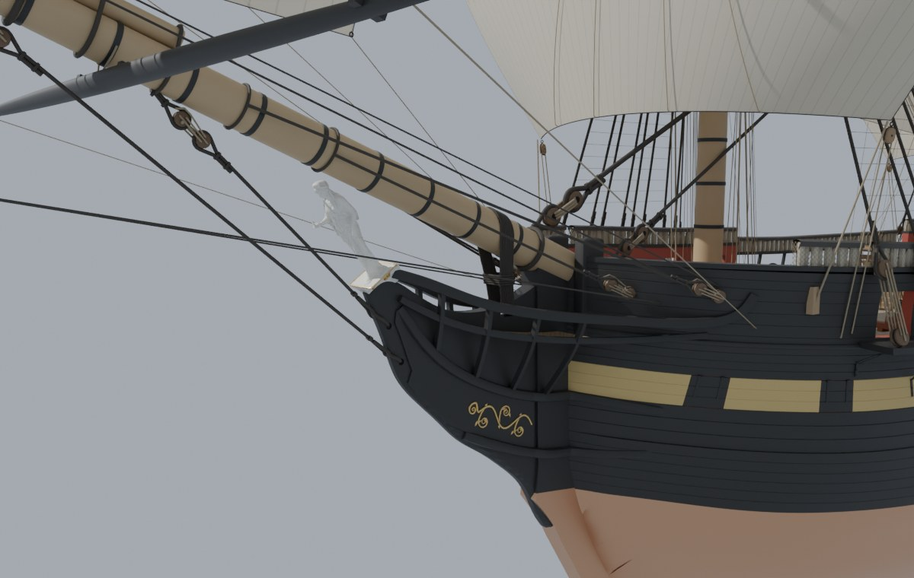

## What slice 9 builds

### The head

The head of a frigate is the structure built out forward of the stem to carry the figure and the bowsprit's gear, with
a platform either side (the gratings) where the crew went to the heads. Our bowsprit steeves from the forecastle
(slice 3) and passes over the stem head about 1.3 m higher than the 1927 lines plan's, so the knee, cheeks and main
rail keep the plan's elevation and the figure stands up into the room under the bowsprit, the rails' fore ends rising
to her console. Each part is its own object:

* **The knee of the head** (`HeadKnee`): a solid timber fayed 0.14 m into the stem's fore face, from the waterline up
  to the figure's seat. Its fore edge (the cutwater) is traced from the 1927 plan. Its top is drawn by eye: it dips
  between the figure's seat (6.55 m over the waterline) and the stem head (6.12 m), so the gammoning's legs and the sky
  show under the bowsprit. It is sided 0.42 m at the stem, a little less than the stem with its rabbet, and tapers to
  0.27 m at its head; its fore edge is taken down to about half that over its last 9 cm. A slot just forward of the
  stem takes the gammoning, and two 6 in holes 0.18 m in from the fore edge take the bobstays.
* **The cheeks** (`HeadCheeks`): an upper and a lower moulded knee on each side, along the two bands the 1927 plan
  draws from the bow onto the knee, 9 in deep and standing 7 in off the side. Their backs are fayed to the bow's
  planking, the stem and the knee (let in an inch where the smooth line would leave them standing off), and their
  fore ends stop 5 cm short of the cutwater's edge.
* **The trailboards** (`Trailboards`, `TrailCarving`): a board on each side of the knee between the cheeks, from just
  forward of the stem to short of the cutwater's edge, its edges tucked under the cheeks. Each is carved with a
  running scroll in gilt: a stem waving along the board, a branch from each wave curling back into the bay under its
  crest, with leaves (`carve.py`).
* **The head rails** (`HeadRails`): the main rail (16 by 22 cm) from the figure's back down and aft along the head,
  then up to land on the bow under the cathead (slice 10's), its after part traced from the 1927 plan; and the lower
  rail (12 by 15 cm) half a metre under it, after the 1817 draught's second rail, the gratings' outer edge. Each lands
  on the bow's planking at its after end.
* **The head timbers** (`HeadTimbers`): four a side, from the upper cheek up through the lower rail to the main rail,
  leaning out with the rails.
* **The head gratings** (`HeadGratings`): a grating each side of the knee, 3 m long: battens and ledges halved
  together, 2.5 in bars round 3 in square openings, 3 in deep (85 openings a side), let into the knee's side and the
  lower rail's inner face, their tops 1.2 in under the rail's top.
* **The knightheads** (`Knightheads`): a timber each side of the bowsprit where it passes over the stem head, 0.3 m
  sided, from the forecastle deck up to about 18 in over the rail cap, their heads rounded. Their inner faces stand
  0.45 m off the middle line, 1.2 to 1.8 cm off the spar.
* **The bow's opening and the bowsprit's bed** (`BowspritBed`): the bow's planking, the bulwark's inside and top, the
  rail cap and the forecastle's bulkhead are cut away between the knightheads, down to the bed (`Head.open_bow`). The
  bed is a timber under the spar on the stem head, filling between the knightheads: its top is hollowed to the lower
  half of a 32-sided polygon round the spar, 3 mm clear of it, and it stands 0.1 m deep under the hollow's lowest
  line. It is 0.89 m across at its after end (3 mm inside the knightheads) and narrows to the stem's siding at its
  fore end, which stops 1.2 cm short of the stem's fore face. The cut is exact: each face is split along the
  knightheads' inner faces and the bed's facets, and what lies between them is taken out. Every edge the cut leaves
  open lies inside a knighthead or the bed, and the build fails if one doesn't.
* **The gammoning and bobstays** (in slice 4's `Rigging_Bowsprit`): eight turns of 6 in rope through the knee's slot
  and over the bowsprit, leading forward, frapped with five turns in the middle; and two bobstays of 9 in rope, each
  doubled through its hole in the knee and set up with deadeyes and a lanyard to a collar on the bowsprit, the lower
  hole's to the outer collar so they don't cross. Practice puts the holes below the lower cheek, but with our higher
  bowsprit a stay from there would lie along the knee's raked fore edge for 3 m: they are in the cutwater's upright
  part, where the stays leave the edge within 0.4 m.

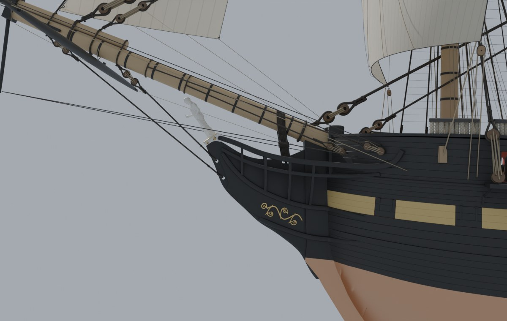
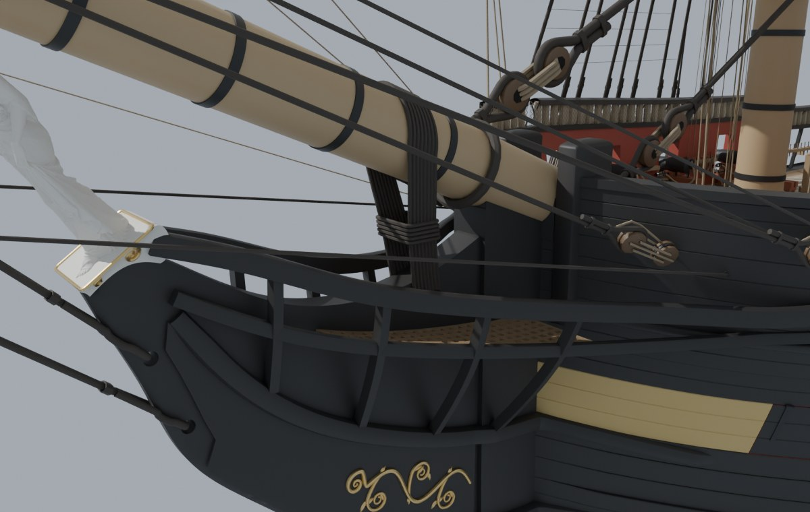
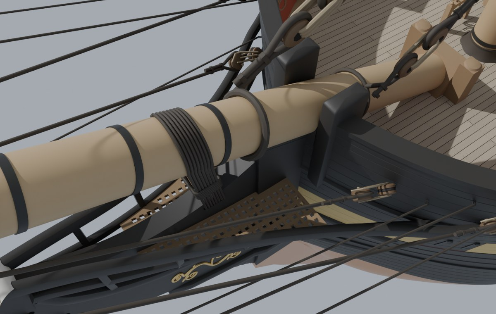
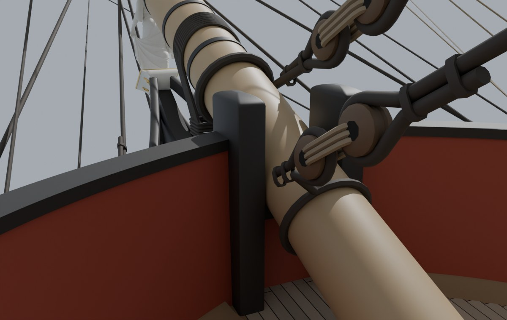

### The figure

Our figure is Bertel Thorvaldsen's *Goddess of Hope* (1817), from Geoffrey Marchal's 3D scan of a cast (Zenodo
record 10242636, CC BY 4.0, credited in `CREDITS.md`). The plan wanted a free statue scan to start from, and a
sculptor only if it fell short; she reads right at the distances the game shows her from (Bean, 15 Nov 2026).
`make_figure.py` turns the scan into `figure_hope.npz`: its pieces joined and welded, turned to face forward and
stood level on her plinth (the plane its top's faces fit: her long axis leans 5.9 deg off upright, her weight on one
foot), cut off the plinth 1.5 cm over its top, stray scan islands dropped, and closed: the cut at her feet capped flat,
and the top of her head, which the scanner's camera never saw (a hole 0.3 m across at her size), filled and faired into
the head round it, with a dozen pinholes. Then she is scaled to stand 1 m and decimated to 150,000 triangles. The
build scales her to 2.3 m, a little over life size, as a 44's figure was, and leans her 35 deg forward as figures of
the 1790s leaned out with the head. She stands on a carved console on the knee's head (`FigureBase`,
`FigureBaseGilt`), curled aft under her heels, her base let 1 cm into its top. The main rails land on its after curl;
forward of them a gilt volute on each side, a small one low forward, and a gilt bead round the top. She and her
console are painted white, as the American frigates' figures were, the console's carving gilt. Her highest point, the
top of her head, is 8.62 m over the waterline; she comes no nearer than 0.14 m to the bowsprit over her.

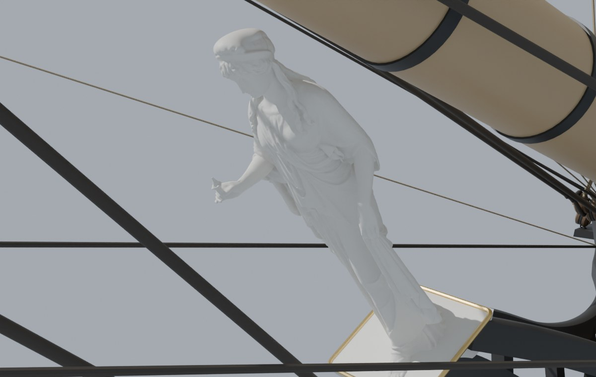

### The stern

On the stern's face things stand by their place across it and their height, on the transom as slice 2 lofted it, and
off it along its normal. Heights are tied to the side's own lines where the 1927 plan's agree with them: the taffrail
is the quarterdeck's rail, the ports stand between the spar deck ports' sill line and the sheer, and the arch's top
is at the plankshear.

* **The taffrail** (`Taffrail`, carving in `SternCarving`): the rail cap's section carried across the stern's top from
  corner to corner at the quarterdeck's rail height, a little over the side caps' ends that run into it, with a gilt
  bead under its after edge and a moulding across at the sheer. The board between them is carved: from a star on the
  middle line, a running scroll in gilt out to each quarter piece.
* **The stern ports** (`SternPorts`): three in the stern's bulwark over the quarterdeck, one on the middle line and one
  each side, between the spar deck ports' sill line and the sheer as the side's are; shown closed, each lid hung from
  its top on two iron straps.
* **The arch** (in `SternFrame`): a band over the cabin's windows, level across at the plankshear's height, its corners
  rounded 3.3 ft, its legs close in to the stern's edge down to the name band, with gilt beads along both edges.
* **The stars** (`SternCarving`): a gilt star over the middle window and one each side, between the windows and the
  arch.
* **The cabin's windows** (`SternFrame`, `SternSash`, `SternGlass`): three, the middle one 4 ft wide and the others 4.4
  to 8 ft out, each three panes by two, from 9.8 to 12.6 ft over the waterline: ochre casings standing off the face,
  white sashes, glass, a head over each and a sill under the row.
* **The pilasters** (`SternFrame`): a pair either side of each side window, each on a base and under a capital, with a
  gilt boss over it.
* **The name** (`SternCarving`, band in `SternFrame`): *COMMONWEALTH* in gilt Roman capitals 0.19 m high (Libre
  Baskerville, as the J-Class yacht's name), 3.45 m long, on a black band across the stern under the windows with a
  gilt bead along each edge. The band stands 0.15 m higher than the 1927 plan's, to clear the rudder head where it
  comes up through the counter, its top 1 cm under the windows' sill.
* **The quarter pieces** (`QuarterPieces`): a moulded piece down each corner of the stern from the taffrail's end,
  over the side planking's ends, with a gilt bead on its outer corner and a gilt volute under the taffrail.
* **The quarter galleries** (`Gallery`, `GalleryFrame`, `GallerySash`, `GalleryGlass`, `GalleryCarving`): an enclosed
  gallery on each quarter, 3.1 m long, raked with the stern. Over a base and a band of six raised panels, the lights
  band has three windows of two panes by three between pilasters, then a cornice with a gilt bead under it, and a roof
  rising from the cornice in to the side, carved with three rows of gilt scales and a garland of leaves down its fore
  edge. Under the base a drop curves down to a point, carved with a fan of gilt leaves. A light of three panes looks
  aft from its after face. Each gallery stands 4 cm clear of the mizzen's aftmost chain, and its roof falls forward to
  clear the aftmost spar deck port's lining.
* **The cabin's side lights** (`CabinWindowFrame`, `CabinWindowSash`, `CabinWindowGlass`): a glazed sash of six panes
  the size of a gun port, forward of each gallery, between the mizzen's second and third chains (4 cm clear of each).
* **The stern lanterns** (`Lanterns`, `LanternGlass`): a six-sided lantern 0.4 m across and 0.83 m high on an iron
  bracket off each quarter piece, aft of the stern's edge and just outboard of the taffrail's end. The spanker boom
  passes over them: swung to its brace limit (39 deg either way), it clears them by 0.60 m, and the build fails
  under 0.3 m.

The stern is black, the casings, pilasters and panels yellow ochre like the side's band, the sashes white (the figure's
paint), the carving gilt, the ironwork iron, and the panes the spar deck's glass.

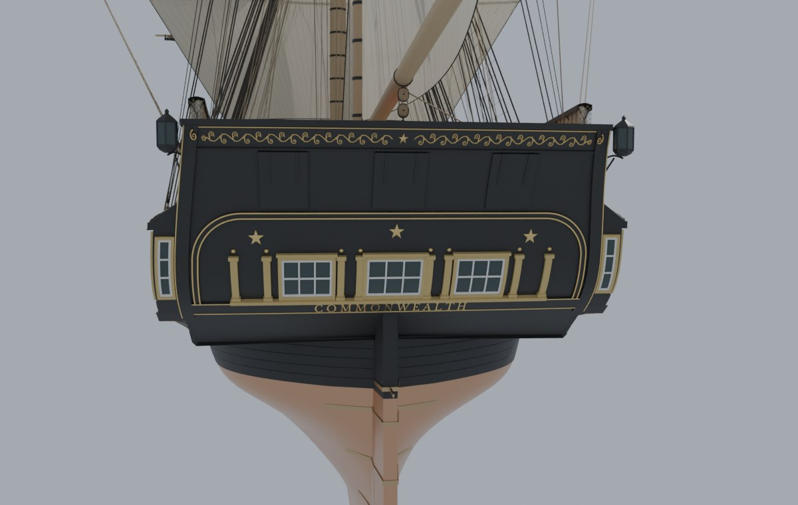
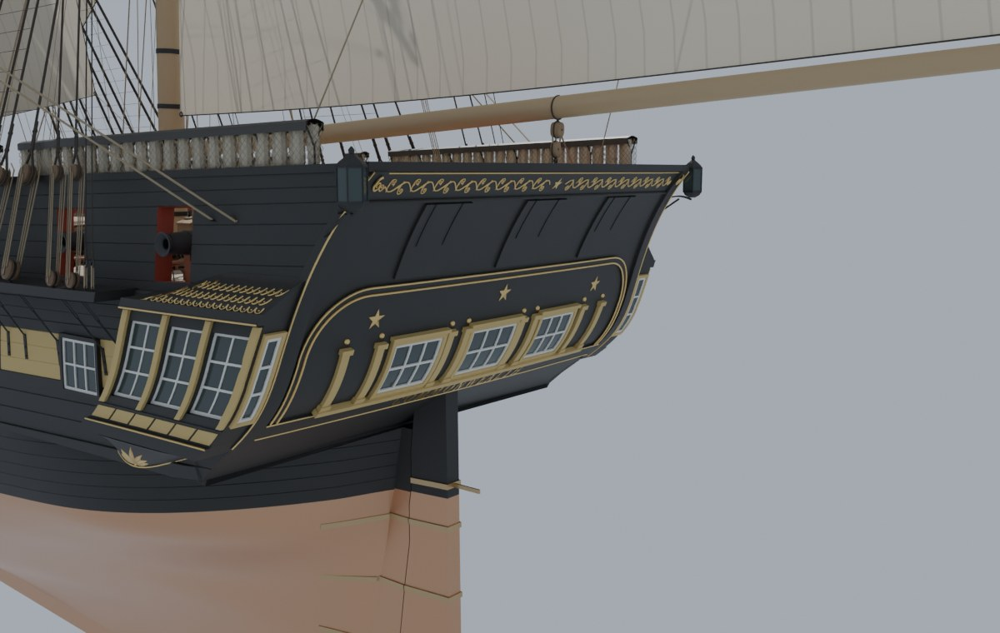
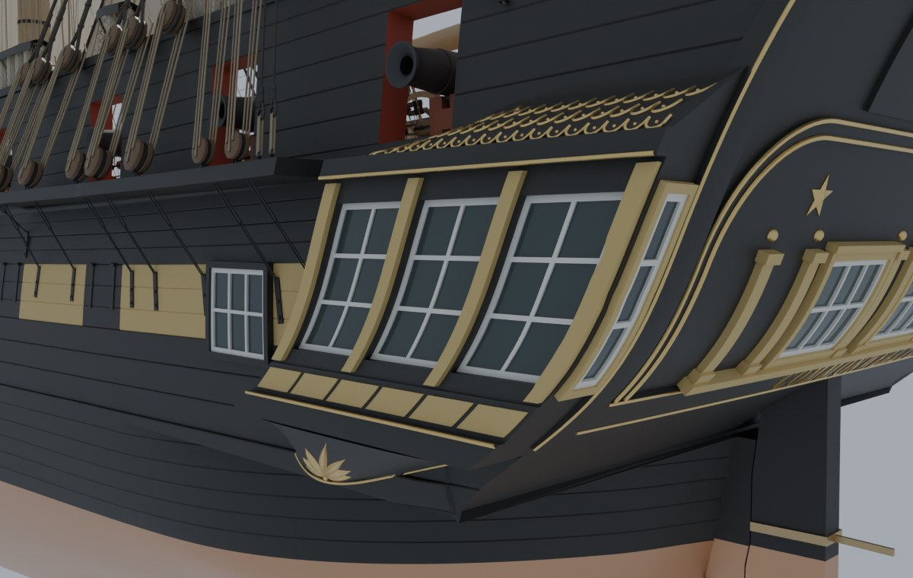
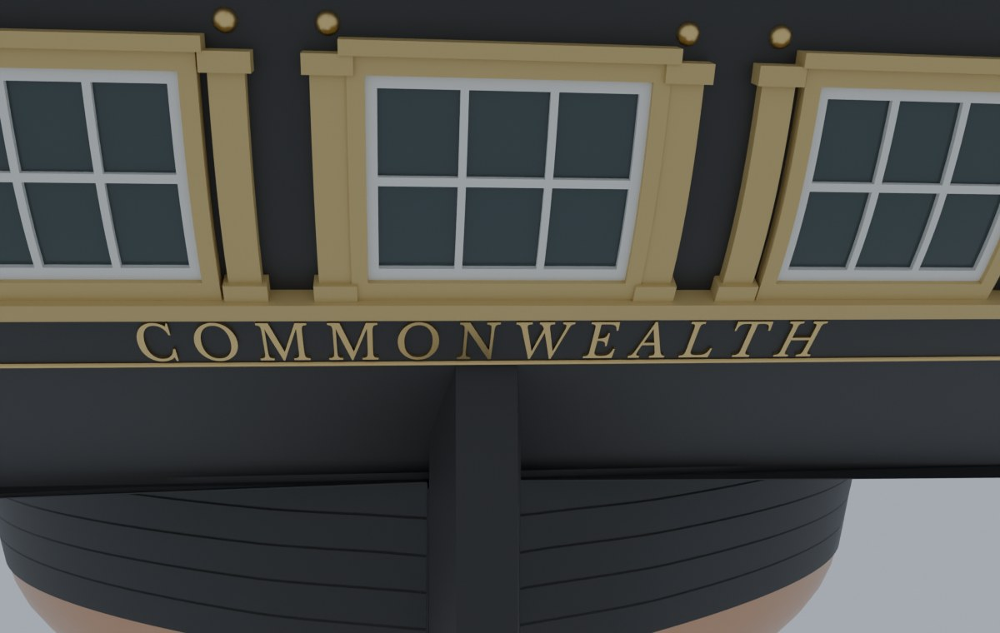
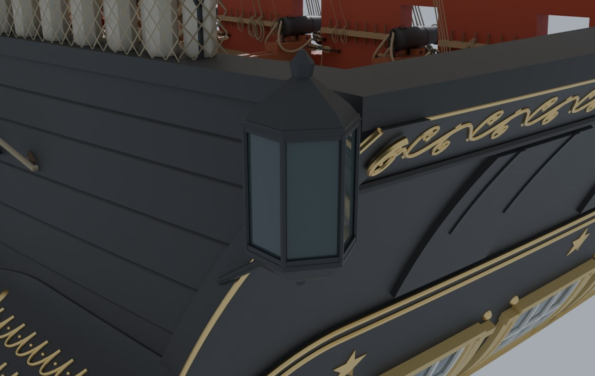
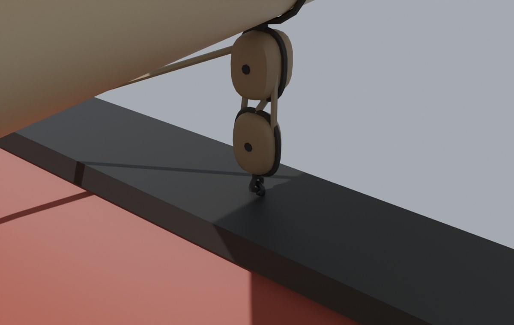

## Clearance

The build checks every part of the head and stern against everything else in the ship (the sails, running rigging
and guns in every state and pose too) and against each other (`decor_room`, `build.json` `decor.room`). Nothing meets
anything it doesn't stand on or in by design. The contacts by design are listed in `decor_1797.json`'s `meets`, each
with why and how deep it may go, and the build fails on any other, on one that goes deeper, or on a pair named twice.
A contact's depth is measured as slice 7's are: at every vertex of either part near where they meet, behind the
other's nearest face. That look reaches 0.3 m (11.8 in) behind a face, so a part let in whole further than that reads
11.8 in. Each allowance is the deepest the final build measured with a quarter inch over, a guard against a part
moving deeper.

| Designed contact | Parts | Allowed (in) | Deepest (in) |
| --- | --- | ---: | ---: |
| The knee is fayed and bolted to the stem's fore face, the cheeks' after ends to its sides | `HeadKnee`, `HeadCheeks` with `Backbone` | 3.23 | 2.98 |
| The gratings' inner ends lie on the stem | `HeadGratings` with `Backbone` | 0.64 | 0.39 |
| The gratings are let into the knee's sides and the lower rails' inner faces | `HeadGratings` with `HeadKnee`, `HeadRails` | 1.04 | 0.79 |
| The cheeks are bolted to the knee's sides | `HeadCheeks` with `HeadKnee` | 1.30 | 1.05 |
| The trailboard is let in between the cheeks | `HeadCheeks` with `Trailboards` | 1.22 | 0.97 |
| The head timbers stand on the upper cheeks and their feet on the knee | `HeadCheeks`, `HeadKnee` with `HeadTimbers` | 1.82 | 1.57 |
| The rails' fore ends and the trailboard are let into the knee | `HeadKnee` with `HeadRails`, `Trailboards` | 0.40 | 0.15 |
| The gammoning and the bobstays pass through the knee's holes | `HeadKnee` with `Rigging_Bowsprit` | 0.53 | 0.28 |
| The cheeks are fayed to the bow's planking, their after ends tapering into it | `HeadCheeks` with `Skin` | 5.19 | 4.94 |
| The rails' after ends are fayed to the bow's planking, over its mouldings | `HeadRails` with `Skin`, `Moulding` | 3.43 | 3.18 |
| The head timbers are let into the rails and carry the gratings | `HeadRails`, `HeadGratings` with `HeadTimbers` | 2.40 | 2.15 |
| Her cut base is let 1 cm into the console's top | `FigureBase` with `Figurehead` | 0.64 | 0.39 |
| The console stands on the knee's head, let into it | `FigureBase` with `HeadKnee` | 1.38 | 1.13 |
| The main rails' fore ends run into the console's after curl, under her heels | `FigureBase` with `HeadRails` | 4.50 | 4.25 |
| The console's gilt bead and volutes laid on it | `FigureBase` with `FigureBaseGilt` | 0.93 | 0.68 |
| The carving is cut in the trailboard | `TrailCarving` with `Trailboards` | 0.99 | 0.74 |
| The knightheads stand up through the forecastle's deck and the bow's opened bulwark, whose cut ends they cover | `Knightheads` with `BulwarkIn`, `BulwarkTop`, `RailCap`, `Skin`, `Moulding`, `SparDeck` | 6.04 | 5.79 |
| The bowsprit's bed lies down on the stem head between the knightheads, the bow's planking and its inside end on its top | `BowspritBed` with `Backbone`, `Skin`, `BulwarkIn`, `Bulkheads` | 3.45 | 3.20 |
| The taffrail sits on the stern's top and the bulwark, over the side caps' ends | `Taffrail` with `TransomTop`, `Transom`, `Skin`, `RailCap`, `BulwarkTop` | 1.41 | 1.16 |
| The spanker boom sheet block's eyebolt is driven into the taffrail, its eye half sunk in it | `Taffrail` with `PinRails` | 1.36 | 1.11 |
| Laid on the stern's face, their backs let in | `SternCarving`, `SternFrame`, `SternSash`, `SternGlass`, `SternPorts` with `Transom` | 1.62 | 1.37 |
| The carved board's work cut in it and under the taffrail's cap; the beads along the arch and the name band | `SternCarving` with `TransomTop`, `Taffrail`, `SternFrame` | 1.05 | 0.80 |
| The sashes and their glass sit in the casings | `SternFrame` with `SternSash`, `SternGlass` | 0.25 | 0.00 |
| The glass sits in the sash's rebates | `SternSash` with `SternGlass` | 0.82 | 0.57 |
| The quarter pieces cover the planking's ends at the stern's corners and the stern's bands' ends | `QuarterPieces` with `Skin`, `Moulding`, `Transom`, `TransomTop`, `Taffrail`, `SternCarving`, `SternFrame` | 1.80 | 1.55 |
| The galleries stand on the side, their backs let into the planking and over the mouldings that run on under them | `Gallery` with `Skin`, `Moulding` | 3.25 | 3.00 |
| The gallery's carving runs to the side where the gallery stands on it | `GalleryCarving` with `Skin` | 0.51 | 0.26 |
| The gallery's frames, sashes, glass and carving in and on its body, the drop's foot in its carved leaves | `Gallery` with `GalleryFrame`, `GallerySash`, `GalleryGlass`, `GalleryCarving` | 4.19 | 3.94 |
| The gallery's sashes and glass in the after light's casing | `GalleryFrame` with `GallerySash`, `GalleryGlass` | 0.25 | 0.00 |
| The glass sits in the sash's rebates | `GallerySash` with `GalleryGlass` | 0.87 | 0.62 |
| The quarter piece runs down the gallery's after edge | `Gallery` with `QuarterPieces` | 2.04 | 1.79 |
| The cabin's side light let into the side | `CabinWindowFrame`, `CabinWindowSash`, `CabinWindowGlass` with `Skin` | 1.14 | 0.89 |
| The sash and its glass sit in the casing | `CabinWindowFrame` with `CabinWindowSash`, `CabinWindowGlass` | 0.25 | 0.00 |
| The glass sits in the sash's rebates | `CabinWindowSash` with `CabinWindowGlass` | 0.58 | 0.33 |
| The lantern's bracket is let into the quarter piece | `Lanterns` with `QuarterPieces` | 1.05 | 0.80 |
| The glass panes sit in the lantern's frame | `LanternGlass` with `Lanterns` | 0.25 | 0.00 |

The running rigging's own checks (slice 6) see the opened bow and the new parts: every rope clears them, and the
spanker boom's sheet block now hangs from an eyebolt half sunk in the taffrail's top, its strop through the eye.

## Triangles

| Part | Triangles |
| --- | ---: |
| **The head** | **72,972** |
| `HeadKnee` | 10,052 |
| `HeadCheeks` | 14,744 |
| `Trailboards` | 10,824 |
| `TrailCarving` | 19,328 |
| `HeadRails` | 12,080 |
| `HeadTimbers` | 992 |
| `HeadGratings` | 4,400 |
| `Knightheads` | 328 |
| `BowspritBed` | 224 |
| **The figure and her console** | **153,460** |
| `Figurehead` | 150,000 |
| `FigureBase` | 788 |
| `FigureBaseGilt` | 2,672 |
| **The stern** | **88,816** |
| `Taffrail` | 3,548 |
| `SternCarving` | 58,836 |
| `SternPorts` | 4,816 |
| `SternFrame` | 14,940 |
| `SternSash` | 3,036 |
| `SternGlass` | 2,048 |
| `QuarterPieces` | 1,592 |
| **The quarter galleries** | **71,952** |
| `Gallery` | 18,080 |
| `GalleryFrame` | 6,928 |
| `GallerySash` | 7,544 |
| `GalleryGlass` | 4,936 |
| `GalleryCarving` | 34,464 |
| **The cabin's side lights** | **4,864** |
| `CabinWindowFrame` | 1,584 |
| `CabinWindowSash` | 2,008 |
| `CabinWindowGlass` | 1,272 |
| **The lanterns** | **1,160** |
| `Lanterns` | 1,120 |
| `LanternGlass` | 40 |
| **All of it** | **393,224** |

The head and stern are 393,224 triangles, within the plan's 600k; the figure is 150,000 of them. Outside them, the
bow's opening adds 1,674 to the planking, bulwark, rail cap and bulkhead where they are cut and closed up to the
knightheads and the bed, the gammoning and bobstays add 19,416 to the bowsprit's rigging, and the spanker sheet's
eyebolt, now half sunk in the taffrail without a washer, has 24 fewer. So the ship as drawn with her sails set is now
3,715,967 (slice 8: 3,301,677), within the plan's 3.9M.

## For the game

In the .blend each part is one object in the ship's frame, both sides in it, with the materials named above
(`HullBlack`, `HullOchre`, `FigurePaint`, `Gilt`, `Iron`, `Glass`). Nothing turns or moves, so there is no
`decor.json`: `build.json`'s `decor.head` and `decor.stern` hold the places a later slice needs, among them the
lanterns' feet and tops (where slice 16's lights go), the figure's top and nearest approach to the bowsprit, the
bowsprit bed's planes and the bow's opening, the name's size, and the galleries' windows. The figure's mesh is
`figure_hope.npz` (1.0 MB, vertices quantised to 16 bits over her box), made by `make_figure.py` from the scan, which
is not kept in the repository (`Data/Figurehead/raw/`, git-ignored; its sha256 is in the script).

## Sources and estimates

* **The 1927 lines plan** (National Archives, slice 1's `refs.json`): the head's profile, traced at the middle of the
  ink and taken to the ship's frame through slice 0's registration (`drawing_1927.json`): the cutwater, the cheeks, the
  main rail's after part. Its body plan's stern view: the taffrail, the ports, the arch, the stars, the windows and
  pilasters, the name band. Its sheer plan: the quarter gallery's lights and the cabin's side light.
* **The 1817 draught** (slice 1's): the head's second rail and the figure's place, and the quarter gallery's carved
  roof and drop. It draws five lights in the gallery; ours has the 1927 plan's three.
* **Period practice** for a large frigate, by eye where no drawing gives it, each value so marked in
  `decor_1797.json`: the knee's siding and top, the cheeks' size, the gratings, the knightheads, the bed, the
  gammoning and bobstays, the carving's designs, the quarter pieces, the lanterns and the paint.
* **The figure:** the scan (Zenodo 10242636, CC BY 4.0). **The name:** Libre Baskerville (SIL Open Font License 1.1,
  `Tools/shipkit/jclass/fonts/`).

The books that would pin the estimates down (Marquardt's *The 44-Gun Frigate USS Constitution*) were not available
here, and Commons' photographs of Constitution's head and stern could not be fetched from this machine.

## Checks

```
python Tools/shipkit/frigate/build_frigate.py <out>
```

(Blender's Python, pip `bpy`; about 32 minutes and 7 GB of memory.) The head and stern are built right after the
planking, so the rigging, sails, deck and guns that follow must clear them with their own checks. The build fails if a
head or stern part meets anything it doesn't by design or goes deeper than its contact allows (`decor_room`), if a
pair of parts is named twice in the meets, if the bow's opening leaves an edge uncovered, if the bowsprit's bed comes
out empty, if the name's band reaches the windows' sill or its letters its beads, if the figure's console doesn't
cover her footprint, or if the spanker boom at its brace limits comes within 0.3 m of a lantern. `make_figure.py`
fails if the figure is left open anywhere, a fill crosses her, or her faces look inward. Everything else in the ship
is as slice 8 left it.

## Review

An independent review measured the first full build with its own scripts, given only the build, `decor_1797.json`
and the slice's code. It found nine defects and four smaller points. Each is fixed, and the review's scripts, adapted to
the rebuilt parts, were run again on the parts as the final code builds them:

| The review found | Fixed | Measured again |
| --- | --- | --- |
| 1. The walls of every hole in a plate faced into the solid (the knee's slot and bobstay holes, the stern's and the galleries' casings and sashes, the cabin's side lights): the plate builder reversed the holes twice. A part in an opening read as buried, so the allowances had been set at the check's 11.8 in reach, where they could never fail | the holes reversed once | no part has an edge whose two faces disagree; a pane in its casing reads 0.0 in deep, so every allowance is now the measured depth with a quarter inch over (Clearance) |
| 2. The figure was inside out: turned upright with a mirroring basis, her faces kept the scan's winding (and another maths library could have turned her the other way) | she is mirrored on purpose, as the name is, so the game shows her as the statue stands, and her winding is reversed with it; `make_figure.py` fails unless her volume comes out positive | closed, +0.0244 m³ at 1 m tall, every face out |
| 3. The port quarter piece's end caps faced in | the starboard piece is built and mirrored, its faces reversed | every cap faces out |
| 4. The name's band ran 6.5 cm up into the windows' sill | the band under the sill, 2.58 to 2.845 m (the rudder head comes out of the counter at 2.54); the build fails if it reaches the sill or the letters reach its beads | the band's top 1 cm under the sill, the letters' tops 1.5 cm under the upper bead |
| 5. The bobstays' runs from their holes to the knee's fore edge passed up to 4.3 cm into the knee | each run follows the knee's side, 2 mm off it | no rope more than 1.8 mm into the knee outside its holes |
| 6. The cheeks' smoothing lifted their backs up to 5.4 cm off the bow and dug their after ends 7.6 cm in; the lower cheek's fore end stood 5.9 cm out past the cutwater | the back takes whichever is further in of the smoothed and the true side, let in an inch; each section is trimmed against the cutwater at its own height, stopping 5 cm short | every vertex of the cheeks' backs lies in the bow, the stem or the knee; of 44,492 points sampled over the starboard backs, 11 stand off, by up to 9 mm, where the upper cheek passes the stem's fore face (Known gaps); the fore ends 5 cm short of the cutwater |
| 7. The head gratings floated, their top 4.5 cm under the rail and 5 mm off the knee, and their battens were laid across a unit span then stretched (1.8 to 8 cm wide) | seated in the knee's side and the lower rail, their top 1.2 in under the rail's; the bars and openings laid in inches | 1.14 to 1.18 in under the rail's top; let into the knee 0.39 in, the rail 0.79 in, the timbers 1.44 in; bars 2.5 in, openings 3 in |
| 8. The bow's opening left slits beside and under the bowsprit, where the planking, bulwark, rail cap and bulkhead were cut and nothing covered the cut | the cut is exact, along the knightheads' inner faces and a bed timber hollowed to the spar; the build fails if a cut edge lies outside a knighthead or the bed | every cut edge covered; the bed 3 mm off the spar |
| 9. Carved strokes that curl back had their end caps facing in: the caps were turned by the stroke's first-to-last chord | each cap turned by its own end | no cap faces in (the trailboards, the stern, the console, the galleries) |
| 10. A pair named twice in the meets kept the later, looser allowance | the build fails on a pair named twice | |
| 11. The lanterns' check against the spanker boom ran before the boom's brace limits were found, with a 40 deg guess | it runs after them, at the final limits | at its limits, 39 deg either way, the boom clears the lanterns by 0.60 m |
| 12. Texts that said something else than the code: the knightheads' height, the lanterns' glass, the meets note, docstrings | corrected | every config key is read |
| 13. Small: the running rigging was checked against the bow before it was opened; `SternFrame` had 30 open and 60 non-manifold edges; two unused helpers; the carving's triangle counts took every face as two | the rigging sees the opened bow; the plate triangulator walks in from its hull (where three of an outline's points lie in a line, a sliver of no area could be kept along the edge, which a centre test can't place); the helpers removed; the counts exact | `SternFrame` 0 open and 0 non-manifold edges; the deck's and the head's plates come out as before |

The review also found that nothing else it measured was wrong: the knee's outline doesn't cross itself and the cutwater
is forward of the stem at every height, the trailboard lies forward of the stem, the stern's face lies on the transom
within 0.43 mm, the gammoning keeps within 0.1 mm of the knee, the figure clears the bowsprit, and the mirroring of
the starboard parts is right.

The decor room then found two more. The spanker boom's sheet block on the taffrail sat in it: it now hangs from an
eyebolt half sunk in the taffrail's top, its strop through the eye, the strop's bight 5 mm over the cap and the block's
shell 8 cm clear of it. And the figure read 11.4 in into her console, because she was open: at her feet, where her
plinth was cut off, and at the top of her head, which the scan never had. She is now closed (The figure) and stood
level on her plinth before it is cut off: she had been stood up by her long axis, which leans 5.9 deg off the plinth's
level, so she leaned a little sideways and a skin of the plinth's top stayed at her feet. She reads 0.39 in into the
console, her base let 1 cm into its top. Looking at each contact before setting its allowance found one last thing: the
main rails' fore ends ran 3.1 in through the gilt volutes on the console's sides. The volutes now stand forward of
where the rails land.

## Known gaps

* **The figure is the scan as it stands.** No sculptor has worked on her: she is Thorvaldsen's Hope, not a figure
  carved for this ship, and the scan's own small faults (a cast's seams, worn detail) are kept. The plan leaves a paid
  sculptor as Bean's call if she falls short in the game.
* **The top of her head is ours.** The scan never had it: the hole is filled with a smooth crown faired into the hair
  and band round it, where Thorvaldsen carved her hair. Leaning out, she shows it to anyone above her and ahead,
  where it reads as a plain cap.
* **The carving is ours, drawn by rules** (running scrolls, leaves, stars, scales and a garland), not traced from a
  carver's drawing: no drawing of the period's carving for a 44 was to hand.
* **Not built here:** the catheads, the hawse holes and the anchors (slice 10); the seats of ease on the gratings; the
  great cabin behind the stern's and the galleries' windows (slice 12: until then the panes are the spar deck's dark,
  opaque glass); the lanterns' light (slice 16).
* **The gallery has three lights,** after the 1927 plan, where the 1817 draught draws five.
* **The cheeks bridge the stem's step.** The knee is 7.7 cm narrower each side than the stem, so where the cheeks pass
  the stem's fore face their backs span the step: of 44,492 points sampled over the starboard cheeks' backs, the 11
  that stand off what they are fayed to are there, up to 9 mm off the knee, under the upper cheek's edge just forward
  of the stem's face. Everywhere else the backs lie in the bow, the stem or the knee.
* **The galleries' blocks share their back edges.** Each gallery is built of its base, panels, lights band, cornice and
  roof as blocks standing on one another; where two meet along the back (on the planking) their edges are shared by
  four faces (156 edges a side). They draw and shade as they should; a tool that wants one closed solid per object
  would have to join them.
* **Carved leaves and berries are open underneath,** sunk 2 mm and a fifth of their radius into what they are carved
  on, as slice 8's eyebolts are.
* **The spanker sheet's blocks hang close.** The boom passes low over the taffrail where its sheet comes down, so with
  the lower block lifted onto its eyebolt the two blocks' shells are 6 cm apart (slice 8 left 21 cm, its lower block
  where the taffrail now stands): the sheet is all but hauled block to block. The boom stands where the spars put it;
  raising it would open the sheet.
* **Estimates throughout** (Sources), and nothing is in the game yet.

## Files

| File | What it does |
| --- | --- |
| `Tools/shipkit/frigate/head.py` | the head (`Head`): the knee, cheeks, trailboards and their carving, rails, timbers, gratings, knightheads, the bow's opening and the bowsprit's bed (`open_bow`, `cut_away`), the figure and her console |
| `Tools/shipkit/frigate/stern.py` | the stern (`Stern`): the taffrail and its carved board, ports, arch, stars, windows, pilasters, the name, the quarter pieces, the galleries, the cabin's side lights, the lanterns and the boom's check over them |
| `Tools/shipkit/frigate/carve.py` | carved relief: running scrolls, spirals, half-round strokes with their end caps turned by their own ends (`tube`), leaves and bosses laid on a surface |
| `Tools/shipkit/frigate/decor_1797.json` | every size and place, each with its source or marked an estimate, and the meets by design |
| `Tools/shipkit/frigate/make_figure.py`, `figure_hope.npz` | the figure from the scan, and her mesh |
| `Tools/shipkit/frigate/rigging.py`, `standing_1797.json` | the gammoning and bobstays through the knee (`Standing.head_rigging`); the bowsprit's shrouds and martingale back ropes lead to the bow over the head's main rail |
| `Tools/shipkit/frigate/running.py` | the spanker sheet's block on its eyebolt in the taffrail; the running rigging's world is the opened bow and the head and stern |
| `Tools/shipkit/frigate/deck.py` | `room` takes another meets list (the decoration's) and can leave out its standing check; the triangulator walks in from its hull (Review) |
| `Tools/shipkit/frigate/build_frigate.py` | builds the head and stern after the planking, opens the bow, checks their room (`decor_room`), the lanterns under the boom, and writes their counts and places in `build.json` |
| `Tools/shipkit/frigate/sections_frigate.json` | the shape loop's sections: `head` and `stern_decor` |
| `CREDITS.md` | the figure's scan and the name's font |
| `docs/shipkit-9/baseline/` | `build.json` and renders |
