# Shipkit stores: the frigate's below-decks stores kit

The movable things the frigate *Commonwealth*'s lower decks are filled with (plan:
<https://claude.ai/artifact/8y6hW8vHjjUPJRovJEuxY7>; the hull and decks are slices 0-14 in `docs/shipkit-1` onward).
The deck slices build the ship's structure: the gun deck, the berth deck, the orlop and the hold. This kit builds what
stands, hangs and lies on them, each as one mesh in its own frame, for those slices to place as linked copies: mess
tables with their forms and kids, sea chests, hammocks slung and lashed with their hooks, casks of the navy's sizes
with the quoins that chock them, shot lockers, the magazine's barrel rack, cartridges and their rack, the passing box,
the filling room's bench and bags of biscuit. It is post-slice art like the rest of the frigate: nothing here is
imported into Unreal or wired into the game yet.

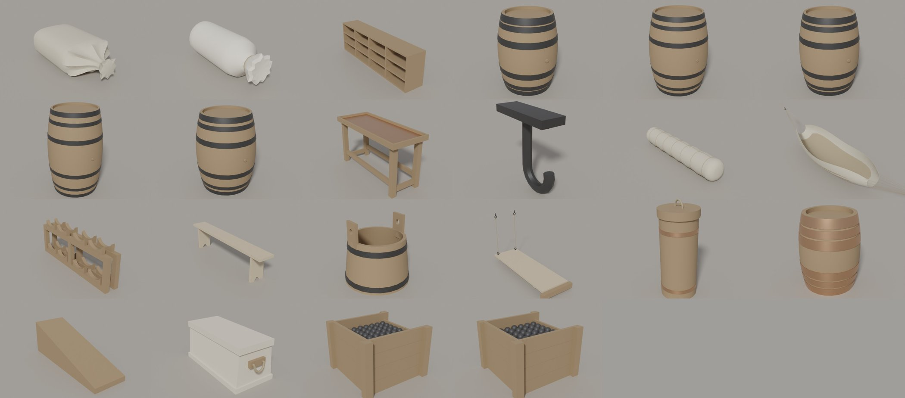

## How to build it

```
cd Tools/shipkit/frigate
python3 -I build_stores.py <out dir> [--render [--res 700] [--only Name,...]]
```

It runs in Blender (or the `bpy` module) in about 6 s and writes `<out>/stores.json` (each item's box, rests, attach
points, slots, triangles, materials, measured contacts and the card's facts), `<out>/stores.blend` (every item, plus
the assemblies below), and with `--render` a still of each into `<out>/renders/`. It exits 1 if any check fails.

* `stores_1797.json` is the card: every size, with its source or the word estimate, and the contacts allowed.
* `stores.py` builds the items from the card (`stores.Kit().build()`). It uses `deck.Part` and `build_frigate.py`'s
  PAINT names, so the deck slices can take its meshes as they take their own; it changes nothing in `build_frigate.py`.
* `build_stores.py` checks and writes them.

## The items

| Item | What it is | L x W x H (in) | Triangles |
| --- | --- | --- | ---: |
| MessTable | a mess of eight's table, hinged to a cleat on the side and hung from the beam over it by two slings | 75.3 x 28.0 x 46.0 | 1,584 |
| MessBench | a form either side of the table | 72.0 x 10.0 x 17.0 | 80 |
| MessKid | the mess's staved tub with two ears | 13.1 x 13.1 x 12.5 | 928 |
| SeaChest | a seaman's chest, its lid's hasp to the front | 41.0 x 18.0 x 17.0 | 508 |
| HammockSlung | Falconer's hammock, 6 ft by 3 ft of hemp cloth with its bed, its nettles seized into a ring at each end, lanyards to two hooks 11 ft apart | 132.2 x 24.1 x 21.7 | 2,632 |
| HammockLashed | a hammock lashed up for stowing in the nettings, seven turns | 58.0 x 10.5 x 10.6 | 1,972 |
| HammockHook | an iron hook on a plate, screwed under a beam | 3.1 x 1.0 x 3.2 | 272 |
| Quoin | an oak wedge to chock a cask on its bilge | 12.0 x 4.0 x 4.0 | 12 |
| Cask_Leaguer | 150 wine gallons: water, the hold's ground tier | 34.5 x 34.1 x 52.9 | 2,076 |
| Cask_Butt | 108 ale gallons: water and beer | 34.9 x 34.5 x 46.6 | 2,028 |
| Cask_Puncheon | 72 ale gallons: spirits, water | 31.2 x 30.8 x 40.1 | 1,884 |
| Cask_Hogshead | 54 ale gallons: provisions, water | 28.7 x 28.2 x 36.7 | 1,884 |
| Cask_Barrel | 36 ale gallons: beef, pork, flour | 25.4 x 25.0 x 32.5 | 1,836 |
| PowderBarrel | 100 lb of powder, copper hoops, no bung | 17.8 x 17.8 x 22.3 | 1,632 |
| ShotLocker24 | a bay of the hold's shot lockers, 24-pounder shot (5.55 in) | 60.0 x 60.0 x 42.0 | 5,456 |
| ShotLocker32 | the same for the carronades' 32-pounder shot (6.1 in) | 60.0 x 60.0 x 42.0 | 4,256 |
| MagazineRack | two tiers of four powder barrels on chocks and bearers (slots) | 91.8 x 12.8 x 34.0 | 800 |
| Cartridge24 | a filled flannel cartridge, its tail choked with twine | 14.5 x 5.4 x 5.4 | 936 |
| CartridgeRack | the filling room's shelves of cartridges, 36 slots | 81.8 x 15.0 x 25.0 | 336 |
| PassingBox | the box a boy carried one cartridge up in | 8.1 x 8.1 x 19.6 | 612 |
| FillingBench | the filling room's bench, a copper sheet inside its rim | 60.0 x 24.0 x 32.5 | 192 |
| BreadBag | a canvas bag of ship's biscuit, flat underneath so the bags stack | 33.0 x 18.1 x 10.1 | 1,224 |

The casks are sized from their gallons: each kind's length over its bilge and head over its bilge are the cooper's
usual proportions, and the bilge is solved so its inside holds the card's gallons. The beer and water casks are gauged in
ale gallons of 282 cubic inches (a butt about 500 litres), the leaguer and the powder barrel in wine gallons of 231.

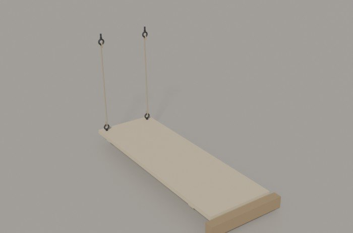
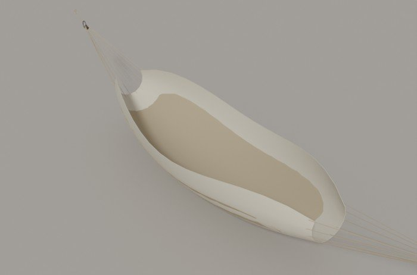
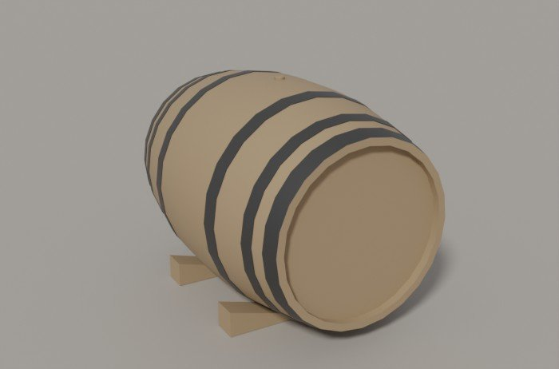
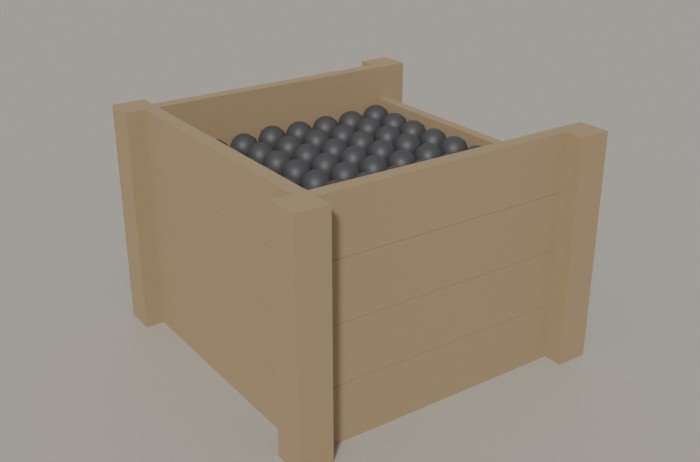
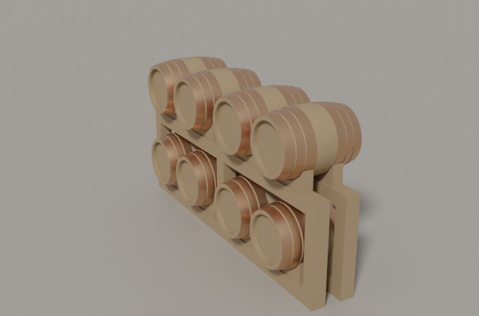
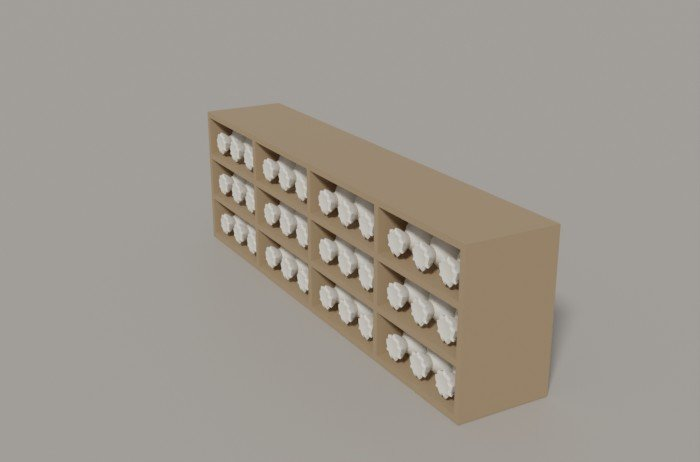
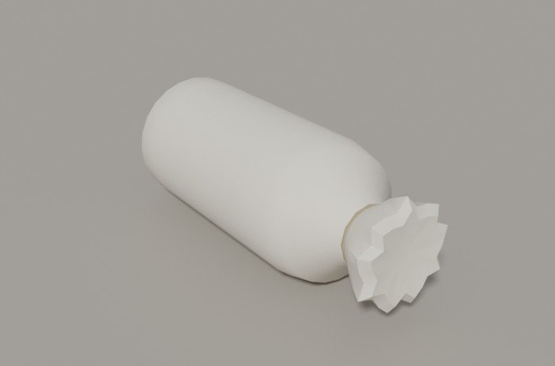
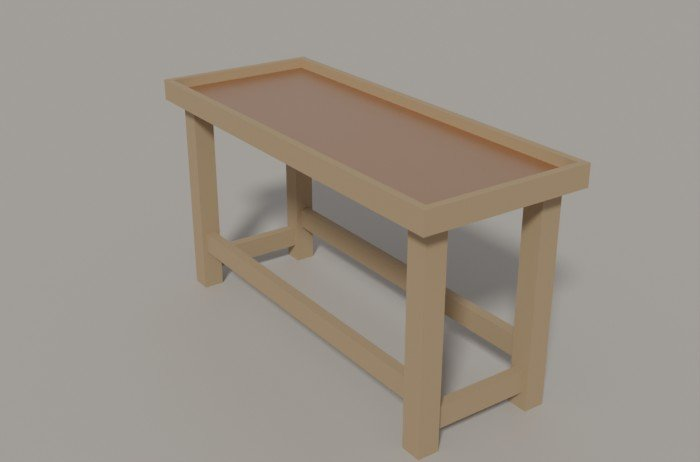
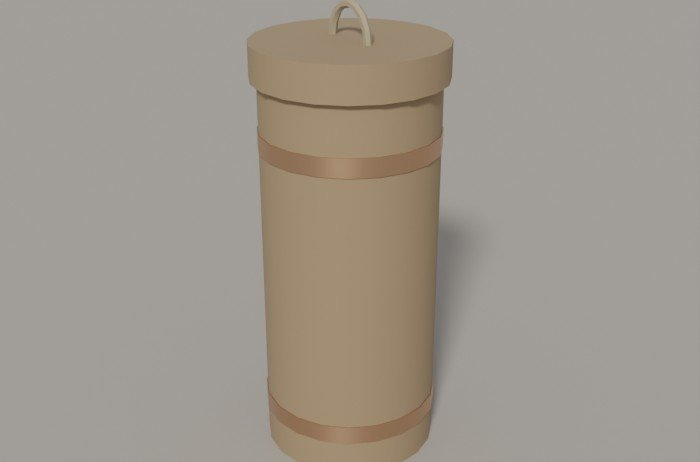
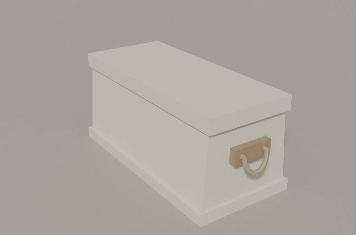
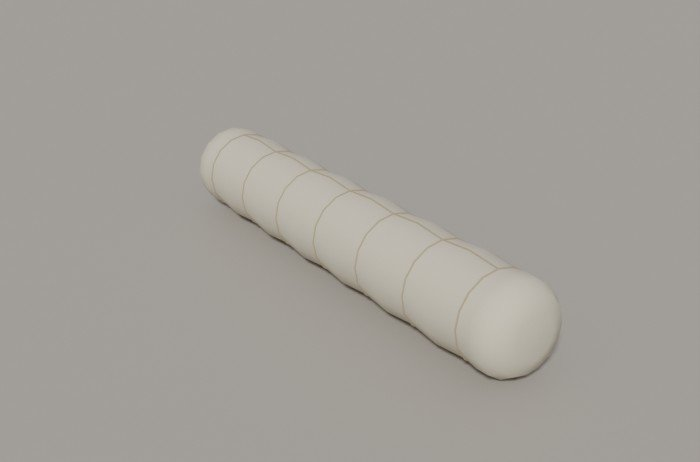
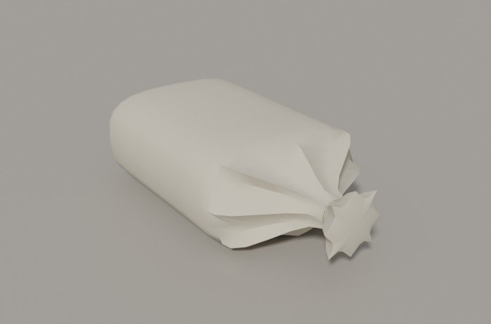

## Placing them

Every item is built in its own frame: metres, X along its length, Y across, Z up, with the origin at the middle of
the face it rests on (z 0 on the deck), or for a hung item midway between the points it hangs from. Each item's
`rests` say how it can lie and its `slots` where other items go in it, all placed the same way: turned about X, then
Y, then Z (`turn_deg`, R = Rz Ry Rx), then moved to `at_m`.

* **Casks** are built standing on end (`on_end`). `on_bilge` lays one along X, centred, bung up, bearing on the deck
  at its widest; a Quoin each side under each bilge hoop chocks it (the `ButtChocked` assembly shows where).
* **HammockSlung** hangs from `hook_aft` and `hook_fore` (z 0 at the hooks' bights). `stores.Kit().hammock_slung(span_ft)`
  builds another span. A HammockHook's top is the beam's underside; its `bight` is where the lanyard's eye lies.
  Falconer allowed each man 14 to 20 inches of beam, so slung side by side the 3 ft hammocks press against their
  neighbours, as they did.
* **MessTable** is hung: its `side` attach point is the hinge cleat's outer face (the ship's side), `beam` the beam
  underside its slings run to (5.5 ft over the deck by default; `stores.Kit().mess_table(sling_m)` for the deck's own
  height).
* **MagazineRack** and **CartridgeRack** carry slots for PowderBarrel and Cartridge24.

`stores.json`'s own copy for the deck threads, with a table of boxes, is in the project's files
(`tall-ship/stores-kit/items.md`).

## What the build checks

Every piece of every item, and every assembly, is checked on the mesh as it will be exported (seams welded):

* **Closed and facing out:** every edge is met by exactly two faces running opposite ways, no solid is inside out, and
  no two faces on an edge fold back on each other.
* **Nothing crosses that shouldn't:** pieces that meet by design are listed in the card's `meets` with the depth
  allowed (the measured depth plus a quarter inch, rounded up to 0.05 in); any other crossing fails, and so does a piece
  crossing itself. A contact marked `each` must hold for every connected part of the piece (every nettle meets the cloth
  and the seizing, every top shot its heap), not just one.
* **Held:** every connected part touches the deck or an anchor (a beam's underside, the ship's side, a hook's bar), or
  touches a part that is held.
* **Stands:** an item that stands has its lowest point on the deck and the middle of its volume over its feet, in
  every rest it has; the assemblies on the deck too.
* **Fits:** the passing box holds a cartridge with its tail; the shot locker's front boards reach the top layer of
  shot.

The assemblies are the kit put together as a deck will put it: `HammockOnHooks` (a hammock on its two hooks),
`MagazineRackFilled` (eight barrels in the rack), `CartridgeRackFilled` (36 cartridges) and `ButtChocked` (a butt
on its bilge in four quoins).

## Triangles

The card's figures (`budget_tris`) are per unique mesh: 2,500 for a hammock or a cask, which are copied by the
hundred, 6,000 for anything else. They are figures to report against, not ceilings (frame rate is the only hard
limit); the light copy decimates the kit further. The slung hammock is a little over at 2,632.

## Sources and estimates

* William Falconer, *An Universal Dictionary of the Marine* (1780, public domain): the hammock's cloth and the room
  allowed each man.
* The gun-deck card (`gundeck_1797.json`): the 24-pounder's shot, and the carronade's bore for the 32-pounder shot.
* The navy's cask sizes as the period's accounts usually give them; their measures (ale for beer and water, wine for
  the leaguer) and the leaguer's 150 gallons are the least certain.
* Everything else (the mess tables, chests, lockers, magazine fittings, cartridges, bread bags) is an estimate from
  the period's practice, marked so on the card. Whether the beer and water casks were hooped in iron or wood in 1797
  is uncertain; iron is shown.

## For the texture lane

* The powder barrels' hoops and the filling bench's sheet are Copper, and PAINT's copper reads new: in a magazine
  they would be dull brown. The trim sheets should age them.
* Every turned piece carries its own UVs (metres round and along it); the cloth and bags carry theirs along and across
  the cloth; everything else is box-projected in metres.
