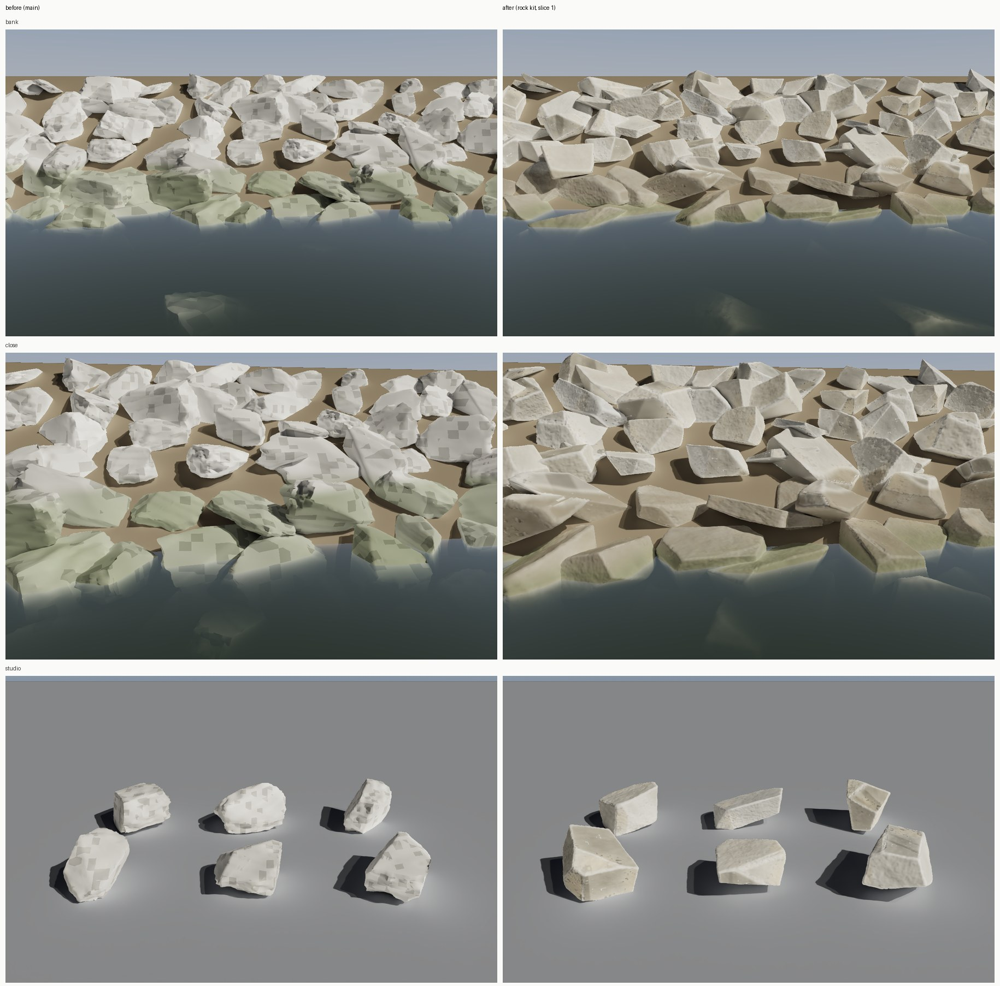

# Shore loop slice 1: the lake rock kit (Nov 12-13 2026)

The club breakwater, the bridges' riprap and the coast piers' riprap all draw the twelve `SM_Rock_<i>` meshes with
`MI_World_Rock` (pattern 4.25 of `M_WorldSurface`). Up close they were the weakest thing on the shore: rounded lumps
from a subdivided cube with noise (about 6k triangles), and a shader whose pits were hashed 11 cm world cells, so every
stone wore grey squares (the "camouflage" every reviewer named). Card: `Tools/shoreloop/cards/rock.json`.

## What changed

- **Stones** (`Tools/blender/rock_kit.py`, called by `build_props.py`'s `rock()`): quarried armour stone is a block cut
  by a few fracture planes, so each stone is the soft intersection of six tilted box planes and 4-13 corner cuts (more on
  the angular kind), on a 64-cut cube grid (24,578 vertices, 49,152 triangles). Some planes are the bed's weathered rind
  (lumpy, pitted by solution at 5.5 and 1.8 cm), the rest fresh fractures (conchoidal undulation, a fine ridged grain,
  small scarps); the edges are chipped by 7.5 cm Voronoi scars. Each stone is fitted to the old stone's bounding box
  (`OLD_SIZE`, measured from main's FBX), so every placement keeps its footprint and packing.
- **Vertex colour** (kept by `import_world.py`'s REPLACE): R open (1) or in a hollow (0), from the mesh's curvature;
  G the weathered rind (1) or a fracture (0); B 1 on a face, toward 0 on an edge's worn crest.
- **Shader** (`make_materials.py`, pattern 4.25): `M_WorldSurface`'s custom node gains a `VC` input (a Vertex Color
  node; meshes without colours read white, so nothing else changes). Detail is smooth value noise in the box UVs at 43,
  11 and 3 cm with its slope as the bump: no lattice, no squares. Fracture faces grey with `aged`; the rind is darker and
  blotchy; dark crustose lichen in spots; buff iron staining in broad patches; each stone a little warmer or greyer
  (custom data 15 on the breakwater, a 1.5 m world noise on the riprap); hollows hold tan clay; edges are worn pale;
  black run-off streaks run downhill. From the pool up: an olive algae film under the water, a green film in the lowest
  hand's breadth, a damp tan-stained band to the wet line (`wetM`, ragged), a pale scum line at its top. Above the pool
  datum the bands stay put, so at a low lake level (the gauge station) they stand high and dry as on the real lake.
- **Renderer** (`Tools/shoreloop/rocks/render_rocks.py`): builds the stones at any revision, lays them as a
  breakwater face (1:1.6, toe stones half drowned), renders exact data passes in Cycles (position, normal, box UVs,
  vertex colour, tangents, which stone) and the light on a white stone (sun and sky apart), then runs the shader's own
  HLSL text on those passes (`Tools/texloop/dock/hlsl_np.py`, which now reads `a ? b : c`), lays turbid water over
  everything under the pool and tone-maps at a metered exposure. `--rev main` is the before. `make_sheet.py` builds
  the sheet above.

## Blind rounds

Three fresh reviewers each saw one side-by-side pair per view (bank from 4 m, close from 1.5 m), sides shuffled per
reviewer, and picked the more real riprap.

| Round | Pair | Bank | Close | Kept | What they said was weakest |
| --- | --- | --- | --- | --- | --- |
| 1 | main vs new kit | 3-0 new | 3-0 new | yes | too uniformly pale and clean; little staining at the waterline |
| 2 | round 1 vs heavier lichen, iron stain, stone hue, darker waterline | 2-1 round 1 | 2-1 round 2 | no (tie) | lichen "sticker-like"; every reviewer picked the right-hand side, so the round told little |
| 3 | round 1 vs round 2 with round 1's lighter lichen (told the sides were shuffled, 0 allowed) | 3-0 round 3 | 2-1 round 3 | yes | staining still faint; no sharp bathtub ring or dark streaks; faces a little smooth |

Round 3 is what this branch carries. The next rounds wait for the Mac's in-engine station captures and Bean's
grey-card photos: the reviewers' standing note (still a little pale and clean, the bathtub ring soft) is a colour
question the photos answer better than more guessing.

## What the Mac does

1. `MATERIALS_ONLY=build_world_surface scripts/make-content.sh` (or the whole `make_materials.py`) for the new `VC`
   input and pattern 4.25.
2. `ONLY=SM_Rock scripts/make-world-models.sh`: builds the FBX and imports only the rocks (the breakwater and riprap
   use them as instances; no bake holds them).
3. Commit the rebuilt `M_WorldSurface` and `SM_Rock_*` assets to this branch.
4. `SCENES=Tools/shoreloop/stations.csv OUT=docs/shore-loop/captures scripts/capture-scenes.sh 8` on main and on the
   branch (move a station camera that misses), and `scripts/gate.sh --scope world` plus the coast views. Each stone
   has 7.7 times the triangles; Nanite draws by screen size, so the cost should be in Nanite's raster and the shadow
   pages near the shore, not in the instance count (Galveston's riprap has about 324k instances).

## On the Mac (Nov 13)

Assets rebuilt in 1b58d818. The world gate passed on main and the branch (343 of 343 tests), every view within about
1.5 fps of main:

| View | fps | View | fps |
| --- | --- | --- | --- |
| marina | 54.1 (main 55.5) | slip | 46.4 |
| coast-day | 52.3 | coast-night | 57.8 |
| helm-eye | 55.8 | bridge | 59.7 |
| marina-night | 55.4 | far-coast | 61.3 |
| far-coast-night | 78.6 | marseille-port | 51.5 |
| stream-run | 50.6 | | |

The first station captures (`captures/main`, `captures/branch`, 9d17510e) used `ShoreTele`, a 15 degree telephoto: each
frame holds a stone or two from a few metres, which shows the surface but not the bank. They show the squares gone,
the chipped edges and the worn pale crests; the faces read smoother and plainer than in the cloud renders. The stations
now use the 80 degree `Drone` lens for the next captures.

## Waiting on

Bean's grey-card photos of the breakwater (card `references_wanted`): until then the colour has no measured target
(dry albedo is held at 0.30-0.38, the literature's weathered limestone) and the blind rounds judge it.
