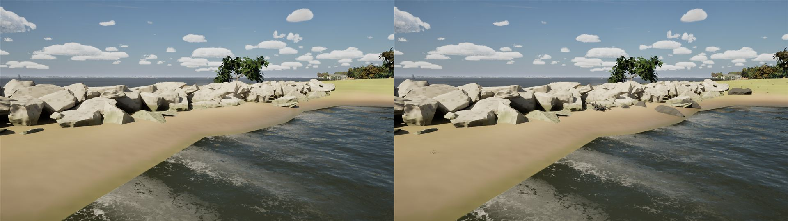
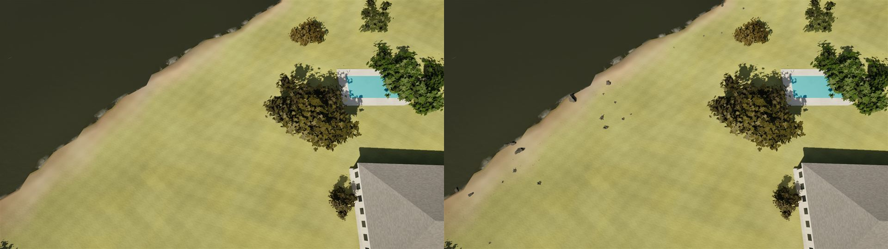

# Club shore dressing from Poly Haven (pc/shore-polyhaven)

The Rush Creek club's shore gets real scanned pieces from Poly Haven (polyhaven.com). Every asset there is CC0: free for
a game we sell, with no attribution required (we credit anyway, in `CREDITS.md`). Bean approved the download.

## The set

`Tools/shore/fetch_polyhaven.py` fetches through Poly Haven's public API only. It fetches CC0 assets as FBX with their
textures into the git-ignored `Data/Shore/raw/<id>/`, with `credits.json` (each asset's authors and page). It refuses
more than 500 MB, and `--dry-run` sizes the set first.

The first pick came to 749 MB, because the coast rock scans are 70-120 MB each. The set was trimmed to 15 assets, 452 MB:
- **Rocks:** coast_rocks_01, 03 and 05, rock_moss_set_01, boulder_01, coast_land_rocks_03.
- **Wood:** dead_tree_trunk and dead_tree_trunk_02, tree_stump_01.
- **Plants:** grass_medium_01, grass_bermuda_01, fern_02.
- **Props:** lifebuoy, wooden_picnic_table, painted_wooden_bench.

`Tools/shore/prep_polyhaven.py` (Blender) turns them into one mesh per piece:
- Each file's LOD0 only; Nanite needs no chain.
- Each piece of a set (the six mossy rocks, the grass and fern clumps) on its own, its origin at its base.
- 35 pieces, written to `Artifacts/models/shore` with `shore.json`.
- The coast rock "patches" (9 to 60 m slabs of shore laid as a scene) and the few-centimetre Bermuda clumps are left out.

`scripts/import_shore.py` imports them to `/Game/World/Shore`:
- The meshes, as `SM_Shore_*`, with Nanite on.
- Their textures. Poly Haven's normals are OpenGL's, so their green channel is flipped; roughness and alpha are linear
  grey, with samplers to match.
- An instance per material of two small parents: `M_ShorePBR` (base colour, normal, roughness) and `M_ShoreFoliage`
  (masked, two-sided, the alpha as its mask).
- In all: 35 meshes, 12 materials, 38 textures, 208 MB.

## Where it goes

`AMarinaActor::BuildShore` dresses the club's own ground: everything the marina lays out, 40 m round it. Cells under the
walkway, the piers and the buildings stay clear. It runs on High and Ultra, seeded from each 1.5 m cell, so nothing moves
between runs. About 1,800 static instances, in these places:
- **Along a true shoreline** (land within 3 m): scanned rocks, half sunk, in one cell in eight, and now and then a drift
  log or stump. "True" matters because off the club the bed is a wide shallow flat. Rocks strewn over all of it read as
  debris on open water, as the first pass showed.
- **On the bank** (0.25-1.2 m up): grass clumps, thick near the water, and a fern here and there. Above that, sparser grass.
  A cell counts as land only when it is land in both the 1 m lidar detail and the 5 m grid. The lidar reads structures
  over the water, such as boathouses and pier decks, as ground.
- **The club's own:** three picnic tables on the lawn by the clubhouse, benches every 20 m along the walkway's landward
  side, and lifebuoys every 25 m on the fixed piers' rails.

Grass and ferns draw to 150 m, the rest to 600 m. `-SailingNoShoreDressing` compares, and `-SailingDebugShore` logs a sample
of grass positions and heights.

## Cost

The marina view (bench-phase3's camera), High, 1920x1080, uncooked, alternating in one session:

| | fps | GPU |
| --- | --- | --- |
| Dressing on | 64.9, 66.0 | 6.57, 6.58 ms |
| Dressing off | 63.6, 65.9 | 6.53, 6.55 ms |

There's no measurable cost.

## Stills

High, 11:00, uncooked. Off (left) and on (right):

| | |
| --- | --- |
| The beach by the breakwater |  |
| From above, the shore by the clubhouse and pool |  |

## Licence

`docs/licences/assets.csv` has a `Content/World/Shore/*` row and one for `Data/Shore/raw` (git-ignored), both CC0 1.0
from polyhaven.com. `CREDITS.md` names the pieces and their authors. `scripts/licence-check.sh` passes.
