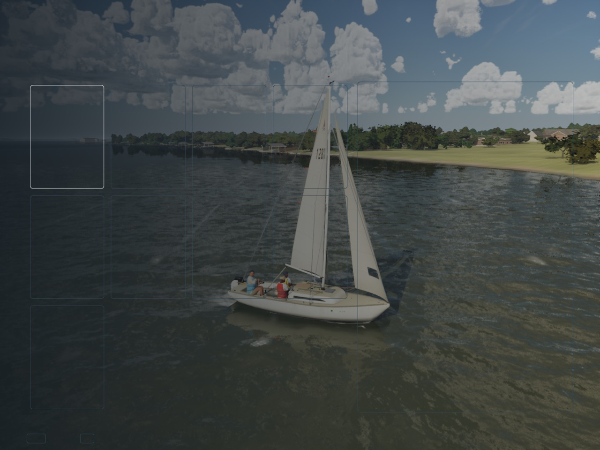
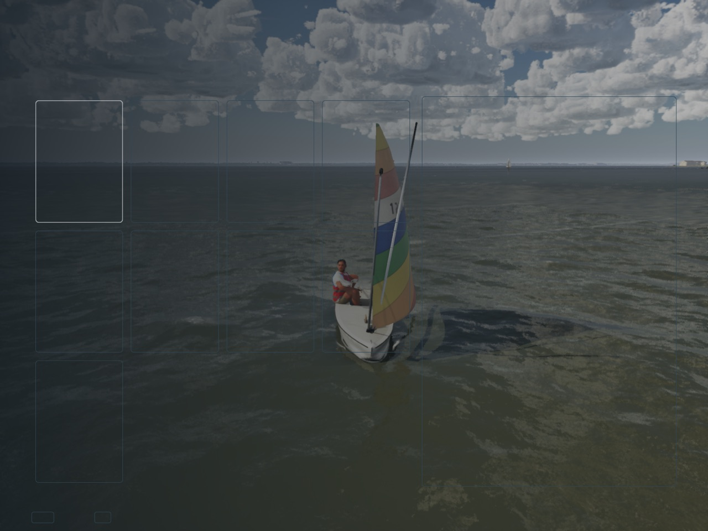
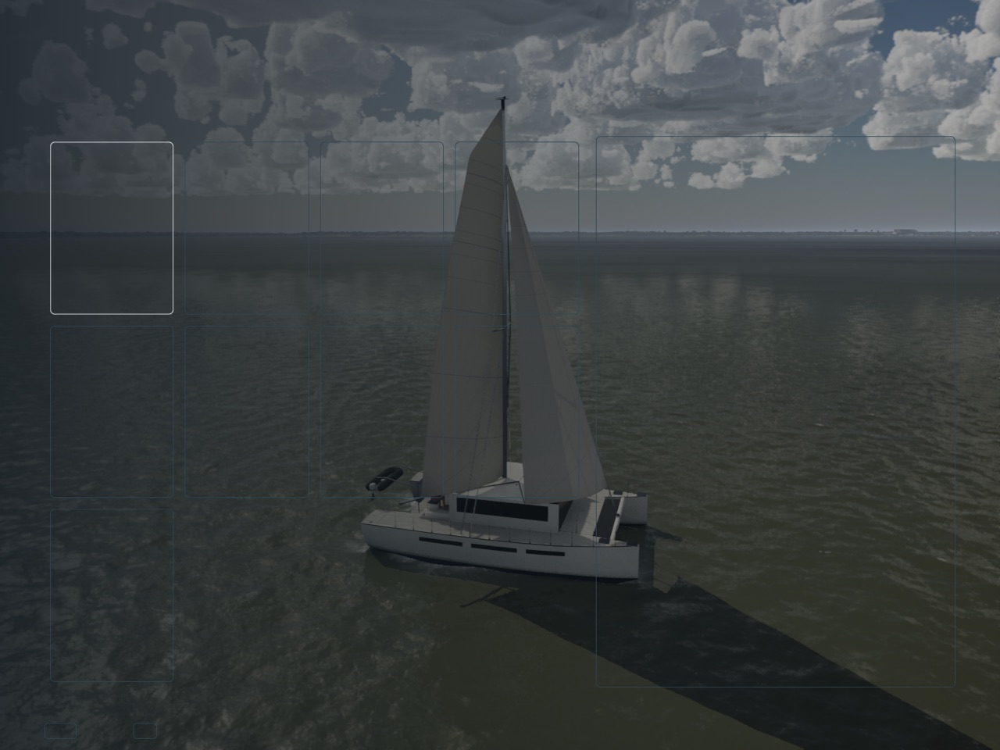
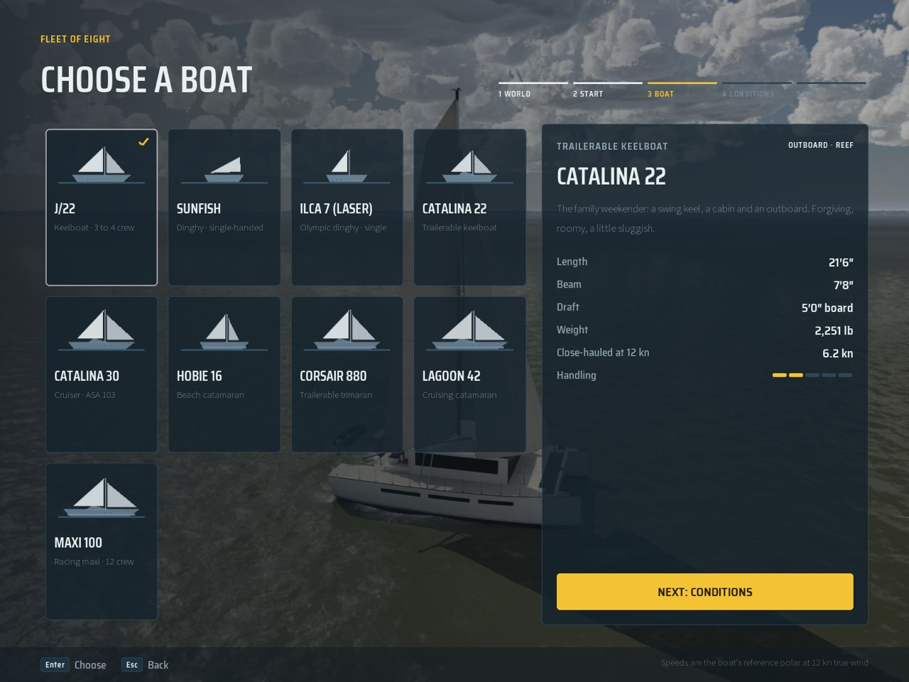
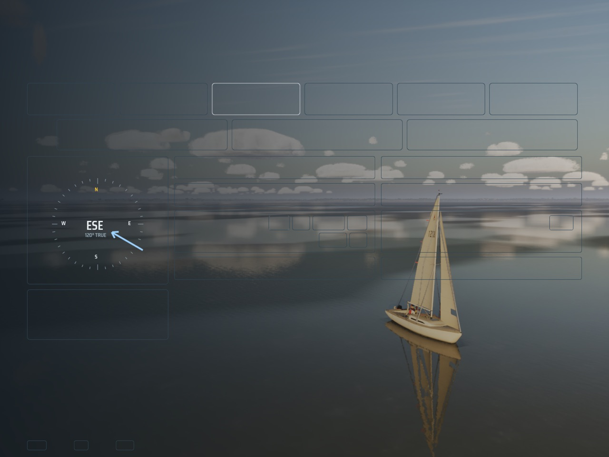
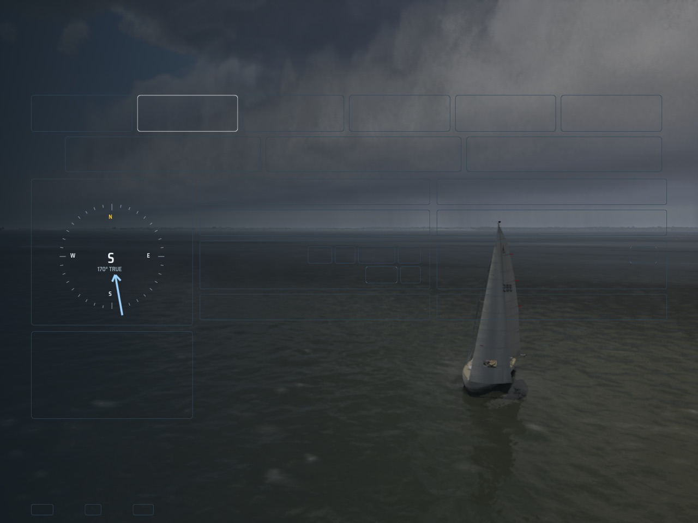
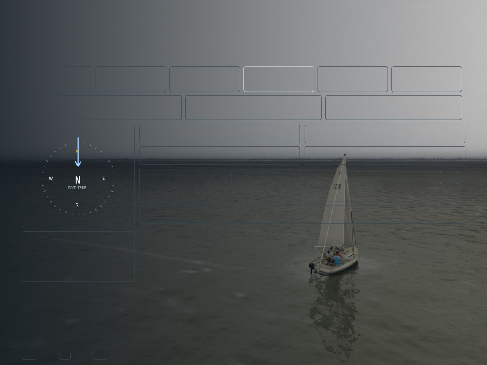
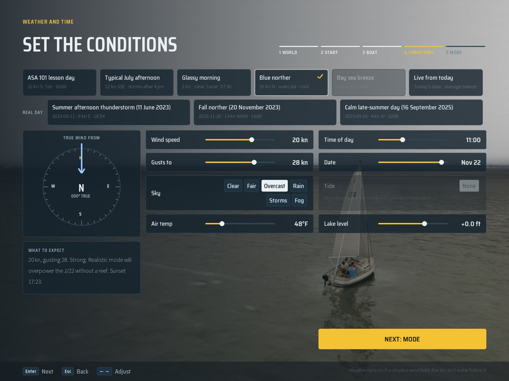

# Showroom wiring: Mac PR 1 (Oct 28 2026)

The brief is `Inputs/ui-showroom/brief.md` (inputs branch, 2a782cdf), with the mockup Bean approved. This PR is the
wiring that the PC's Boat and Conditions screens will sit on:
- the showroom stage on `AFreeCamera`'s orbit;
- the boat swapped in place;
- live conditions behind the menus;
- the world kept running in game while the conditions are previewed;
- the menus' choices carried over.

The screens' layout and visuals are the PC's (brief PRs 2 and 3), including Bean's two notes:
- the fades stop at the panel's edge;
- the picked world loads behind the menus (PR 4).

## What it does

- **Stages** (`Showroom.h`, `FSailShowroom`): `SSailFrontEnd` drives the director every frame with the screen, the boat
  to show and the pending conditions.
  - The Boat screen is the **showroom**, Conditions the **weather preview**. In game, Change conditions is the weather
    preview too.
  - Every other screen is the chase camera with the boat held still, as before.
- **The showroom hold** (`ASailboatPawn::SetShowroomStage`): on a stage the boat is afloat and sailing.
  - The physics steps run, the trim assist trims, and a helm holds a close reach (TWA 70 on her side). She heels,
    pitches and fills her sails with the live wind and waves.
  - Each frame she is put back on her spot, so she keeps her speed and forces but never sails off.
    - An earlier version took her way out through the water current instead. It fed back on itself and flew her 77 km,
      which is how the first still crashed.
  - In the front end she first moves to open water near where she is when she is tied up in her slip, or when the
    shore is within 60 m or the water is shallower than 3 m (`SailShowroom::FindOpenWater`). In game she stays where
    she is.
  - Crew stay aboard.
- **The camera**: the free camera from photo mode (`AFreeCamera`), in its new code-driven orbit (`FFreeCameraOrbit`).
  - Settings: distance, zoom range, pitch limits, a lateral and an up offset in the view's frame, an idle auto-spin and
    an ease time.
  - The showroom framing looks from the starboard quarter at 0.4 of the mast's height, from 2.4 lengths (9 to 40 m;
    zoom 0.6x to 1.6x), 3 to 35 deg above the water. It spins at 6 deg/s after 4 s alone.
  - The weather framing is at 4 lengths, higher, with the boat to the right of the panel.
  - Blends are 0.6 s ease in-out. The floor is half a metre over the waves.
  - The pawn feeds the camera each frame. The menus don't yet send it input: stick, drag and wheel routing is the PC's
    with its layout.
- **The boat swap** (`ASailboatPawn::ShowBoat`):
  - The Boat screen shows the focused boat. Every other screen shows the chosen one, so the title shows the last
    session's boat, and a boat chosen and then backed out of stays.
  - A focus change waits 200 ms, then loads the boat's meshes asynchronously (`FStreamableManager`, on the paths
    `ModelMeshesFor` loads), then builds her in place (`SetBoat`, keeping the spot and heading).
  - The shown boat's meshes stay resident and the one before is let go.
  - The log reads `Showroom swap <boat>: load X ms, build Y ms`.
- **The live preview** (`ASailingGameMode::PreviewConditions` / `EndPreview`):
  - It is the `ApplyConditions` path as local presentation only: the session is untouched.
  - It fires on entering the screen, then on each change once it has stood for 200 ms.
  - In the front end the preview is the choice. In game, Back puts the session's conditions back, and Apply commits.
  - Every value snaps for now: the weather timeline restarts at the chosen hour, as a cast off would. Easing the wind,
    sky and light is the PC's PR 3.
- **The world running** (rule 9): in game, Change conditions unpauses the world while it is open and pauses it again on
  the way back.
  - `ASailingGameMode::SetPreviewLive` wins over `SetWorldHeld`, so a hold such as photo mode's can't stop the preview.
- **Carry-over**: the menus' choices (`USailSessionSubsystem::Pending`) survive the menus closing and opening again
  before a cast off, for example the title's Logbook and back. A session start clears them.

## Numbers (Mac, uncooked editor build, High)

| Swap | Load | Build |
|---|---|---|
| J/22 to Sunfish | 1,259 ms | 12 ms |
| J/22 to Lagoon 42 | 1,040 to 1,058 ms | 39 ms |
| Catalina 22 (the title's last boat) | 0 ms (already loaded) | 31 ms |

The uncooked build loads from the editor's packages. The brief's 800 ms on the Mac is for the packaged build, which the
gate packages but does not time yet. Memory (`memreport` after cycling all eight) and the Shipping cycle check are for
the PR that times the swap with the real strip; brief PR 2 drives it.

## Stills (1440x1080, High, Mac, uncooked)

These are taken with `-SailingFreeSail=1` (every boat open), `-SailingShowroom=<type>`, `-SailingPreviewPreset=<id>`,
and `-SailingHideMenus`, which draws the menus transparent so the stage shows; their outlines remain. The left
darkening is today's backdrop, which the PC's layout replaces.

- The showroom with the J/22, the Sunfish and the Lagoon 42 off the slip in open water:
    
- The Lagoon 42 with today's Boat screen over it:
  
- The weather preview: glassy morning (07:30, 2 kn), July afternoon (storms), blue norther (20 kn, overcast), and the
  norther with the menus:
     

## Tests

- **`SailingSim.UI.Showroom.Logic`**:
  - screens to stages, in the front end and in game;
  - conditions alike or not;
  - the debounce;
  - the showroom spot off a slip (60 to 100 m out on a shelving shore), and staying put in open water or with nothing
    open.
- **`SailingSim.UI.Showroom.Orbit`**: the orbit set from code eases over and faces the pivot. It spins about 6 deg/s,
  holds still for the idle delay after a look, then spins again. It also holds the pitch and zoom limits, and the
  lateral offset puts the subject off centre.
- **`SailingSim.Smoke.ShowroomSwap`**:
  - Held by the menus, the boat is still.
  - On the stage the physics runs, she holds TWA 70 sailing and heeling, and stays within 1.5 m of her spot over 15 s.
  - The Hobie loads asynchronously and is built in place, on the same spot and heading.
  - Off the stage she is held still again.
- **`SailingSim.Smoke.ShowroomPreviewLive`**: the preview lifts photo mode's hold and the clock runs. Off the preview,
  the hold stands again.
