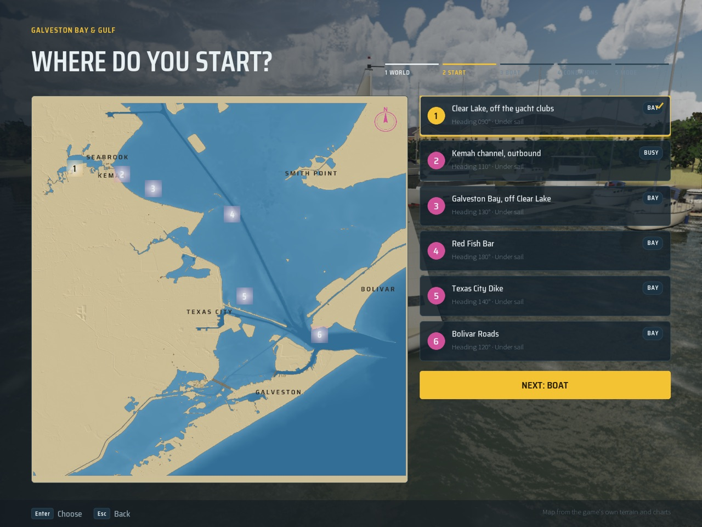
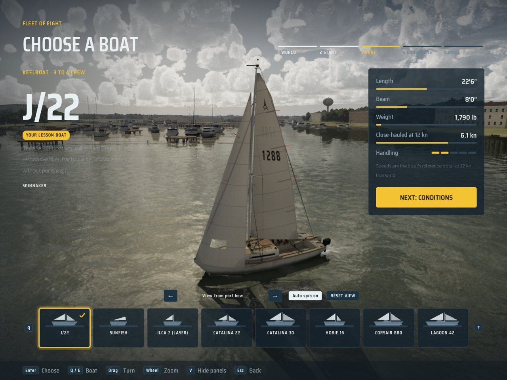

# The picked world loads behind the menus (showroom Mac PR 4, Oct 28 2026)

From the brief (`Inputs/ui-showroom/brief.md`, 2a782cdf, section 6). On Oct 27 Bean chose "load the picked world": the
showroom and the conditions preview should show the real place.

## What it does

- **The travel.** Leaving the World screen for Launch with a world other than the loaded one starts a load
  (`SSailFrontEnd::TravelsOnPush`; not in game).
  - The menus show a short "Loading <world>" wipe.
  - `USailSessionSubsystem::TravelBehindMenus` keeps the choices (`Pending`) and the screen to come back to
    (`MenuResumeScreen`), and puts the picked world and spot in the settings. Nothing is saved.
  - The map then reloads on that world. The HUD opens the menus again and walks the flow to Launch, so Back works, with
    the choices as they were.
  - The travel's world wins over `-SailingWorld`; `run-game.sh` passes one, so stills could otherwise never leave the
    lake.
  - `ASailingGameMode::GetLoadedWorld` tells the menus which world is loaded.
- **Cheap previews.** The PC's Conditions screen re-previews at 5 Hz.
  - `PreviewConditions` returns at once for the conditions it already shows (`SailShowroom::SameConditions`).
  - A real day's `.wxday` is read once per date, not on every apply.
- **Two items from the PC.**
  - The "Typical July afternoon" preset blew from 170 deg, which reads as S under its "SSE" label; it is now 157.5.
  - `CLAUDE.md` notes that `-SailingUIScript` runs need `-SailingNoGpuSlices`: the bench's GPU Visualizer window steals
    keyboard focus mid-run.

## Not in this PR

Cast off still reloads the map even when the loaded world and spot already match. The brief allows skipping that reload,
but the session's other choices (mode, drill, traffic, boat, conditions) are applied at InitGame, and applying them in
place is a change of its own.

## Stills (1440x1080, High, Mac, uncooked)

Taken with `-SailingFrontEnd=World -SailingUIScript=Right,Enter,...` on the Lake. Choosing Galveston Bay loaded it behind
the menus (`Menus: loading Galveston Bay & Gulf behind them (world 1)`, then `Menus: back on screen 2 with world 1
loaded`).

- The Launch screen with Galveston behind it, off the Clear Lake yacht clubs:
  
- Then Enter: the PC's Boat screen, with the J/22 in the showroom on Clear Lake:
  

## Test

`SailingSim.UI.Showroom.WorldBehindMenus` checks:
- when a push travels: World to Launch with another world only, not in game, not for the loaded world;
- that the session carries the choices and the screen to come back to;
- that the settings carry the picked place;
- that a new run clears all of it.
