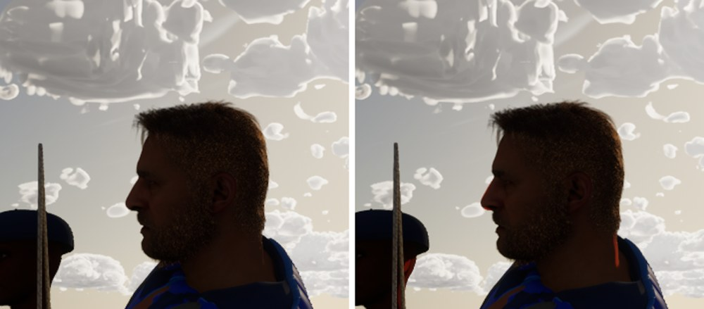
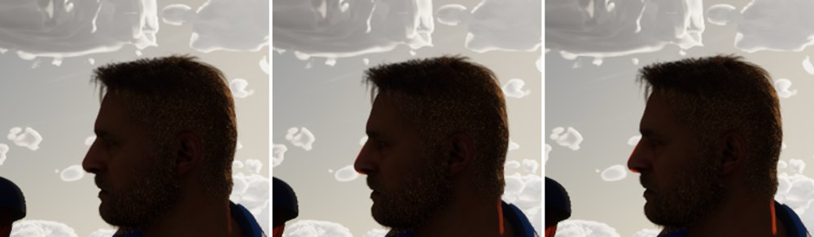

# Skin backlight

Backlit-fill option 2 (the sim thread's decision): against the sun, real skin glows where it's thin, at the ears, the
nostrils' edges and a neck's rim. The crew's never did.

## Why it never glowed

Two things, both needed:

1. **No light in the scene computed transmission.** Under Substrate, a subsurface profile's transmission is evaluated
   only in the deferred light shaders' `USE_TRANSMISSION` permutation (`SUBSTRATE_SSS_TRANSMISSION`,
   `SubstrateEvaluation.ush`). That follows each light's own `Transmission` flag, off by default, and the map's sun
   (`ASailingEnvironment::Sun`) had it off. A profile set to an extreme tint (5, 5, 5) at extinction 0.5 changed the
   backlit helm by a mean of 1.2 levels (noise), with virtual shadow maps or without.
2. **The MetaHuman profile's transmission is near black.** `SSP_skin_unified` (shared by every crew face and body)
   ships a tint of (0.10, 0.033, 0.0) at extinction scale 18.6. With the sun's flag on it still barely shows.

## What changed

- `ASailingEnvironment::FindSceneActors`: the sun's light component gets `SetTransmission(true)`.
  `-SailingNoSunTransmission` compares. It only changes pixels with a subsurface profile, which here are the crew's
  skin. **This is one line in the sky owner's file, a lighting flag: the Mac's call.**
- `scripts/tune_crew_skin.py` (already run after a MetaHuman rebuild by `scripts/make-crew-clothes.sh` on the Mac and
  `scripts/windows/make-crew-clothes.ps1` on the PC) sets `SSP_skin_unified`'s transmission. It's idempotent, and it
  edits only the git-ignored asset:

  | Asset | Setting | Was | Now |
  | --- | --- | --- | --- |
  | `/Game/Crew/MetaHumans/Common/Lookdev_UHM/Skin/Materials/SSP_skin_unified` | Transmission Tint Color | (0.10, 0.033, 0.0) | (0.6, 0.2, 0.06) |
  | | Extinction Scale | 18.6 | 8.0 |
  | | Normal Scale | 0.3 | 0.3 (unchanged, set explicitly) |

  The Mac applies it with `scripts/make-crew-clothes.sh`, or alone with
  `UnrealEditor-Cmd SailingSim.uproject -run=pythonscript -script=scripts/tune_crew_skin.py`. Its log prints
  `Crew skin: SSP_skin_unified: transmission tint (0.6, 0.2, 0.06), extinction 8, normal scale 0.3`.

## The look (Ultra, the helm at 17:00 with the sun ahead of him)

Before (`-SailingNoSunTransmission`, main's) and after:

A red-orange edge at the nose's tip and down the neck's rim against the sun; the rest of the face, the hair's rim light
and the exposure are unchanged. The profile sweep, all with the sun's transmission on: MetaHuman's own (0.1, 0.033, 0)
at 18.6, the shipped (0.6, 0.2, 0.06) at 8, and (1, 0.33, 0.1) at 6, a hard painted rim:

Under the audit's shaded sky (`-SailingCloudShade=0.15`) the sun is mostly behind cloud and the change is small (mean
1.9 levels on the chase's crew). It shows in the sun.

## Cost

Helm eye at 17:00 (the crew close), three 20 s runs each on the 4090: High 5.40 -> 5.41 ms, Ultra 7.62 -> 7.70 ms.
Within noise.

## Checks

Full suite 235/235 on the PC on main 81771c73 plus this branch (MSVC clean).
