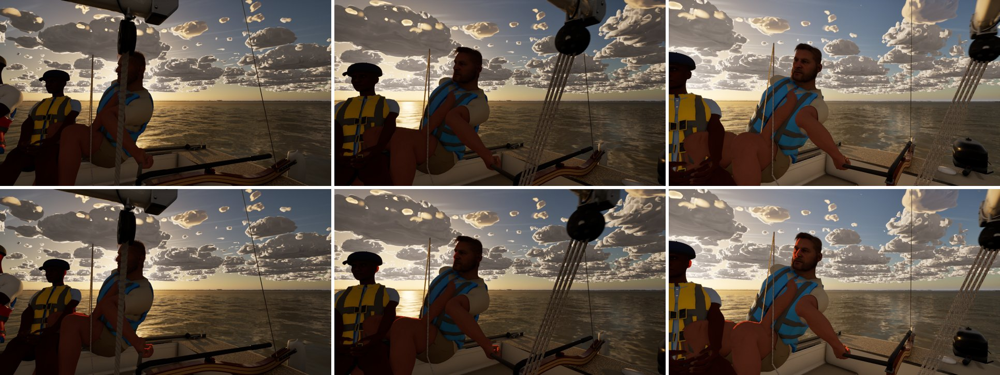
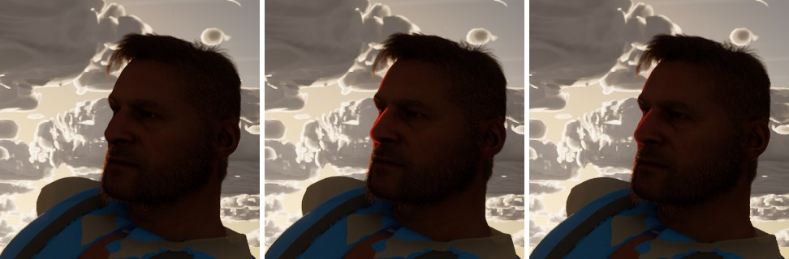
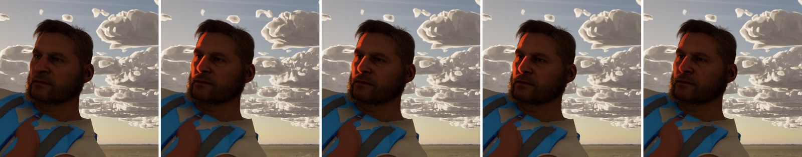

# #319 skin rim, face-on (check only, no code)

The Mac's crew gate couldn't judge #319's rim because the faces were turned away. These are Ultra stills on main 37395aa0
(RTX 4090, 1920x1080, uncooked) of the helm against a low sun. Lake, J/22, 18:00, AfternoonBreeze, 8 kn at TWA 60.
The camera is 1.4 m from the helm's head (`-SailingCamTarget=-2.6,0.55,1.25`) at yaws 120, 135 and 150, so the sun is
behind or beside his head. Each pair is with `-SailingNoSunTransmission` (top row) and without (bottom).

## What it shows

- **The rim works.** In profile against the sun (yaw 135) there is a thin red-orange line along the forehead, the nose's
  edge and the lips. The rest of the face, the hair and the exposure are unchanged. That is #319's intent:

  

  (left to right: transmission off; on, as shipped; on with half the tint, below)

- **With the sun more to the side it is a patch, not a rim.** At yaw 150 the sun grazes the face from behind and to the
  side. The transmission then lights a broad, saturated orange area over the temple, the side of the nose and the upper
  cheek, which reads as orange paint more than light through skin. The trimmer's thighs and the helm's hand show the
  same at yaw 120, smaller. Mean change over the face crop: 7 levels at yaw 150, 3.7 at 135.

  

## What I tried (profile only, restored afterwards)

`SSP_skin_unified` is git-ignored. I set it with a throwaway script, then restored it with the committed
`scripts/tune_crew_skin.py` (its log: tint (0.6, 0.2, 0.06), extinction 8).

- **Extinction 14 and 20:** no visible change from 8. The patch's shape doesn't come from how thick the skin is: the
  transmission's thickness reads as near zero over that area (from the shadow depth), so extinction has nothing to work on.
- **Half the tint (0.3, 0.1, 0.03) at 8:** the patch is softer but the same shape, and the profile rim is subtler but
  still reads.

## Verdict

#319 does what it set out to do in profile. Side-on low sun gives a broad orange patch, which is a matter of taste: it
reads like warm sunset side-light, but more saturated than real skin. If the sim thread wants it calmer, the lever is
the tint, not the extinction. Half the tint, or a less saturated one, keeps the rim and halves the patch. That's a
one-line change in `tune_crew_skin.py`, the Mac's call. Nothing here is committed beyond this page.
