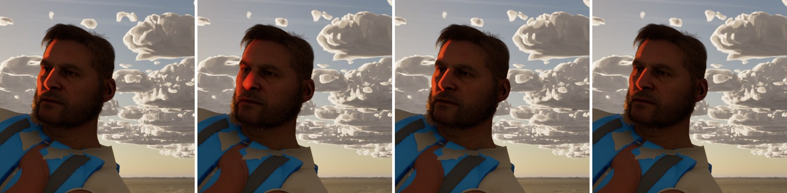
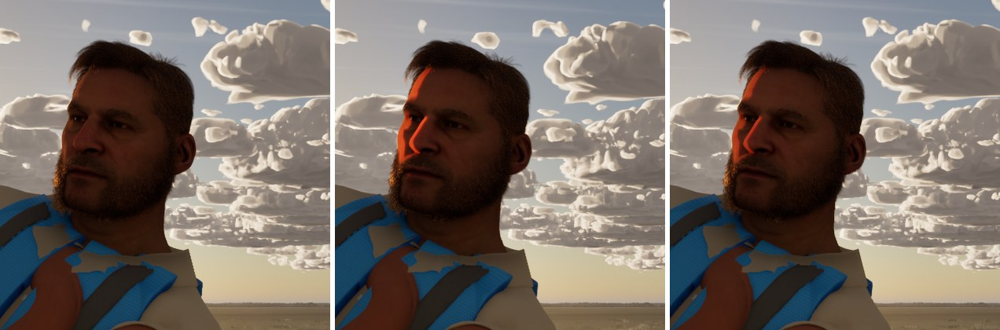
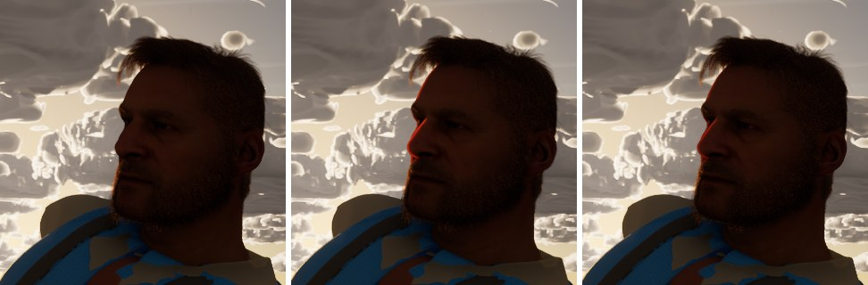
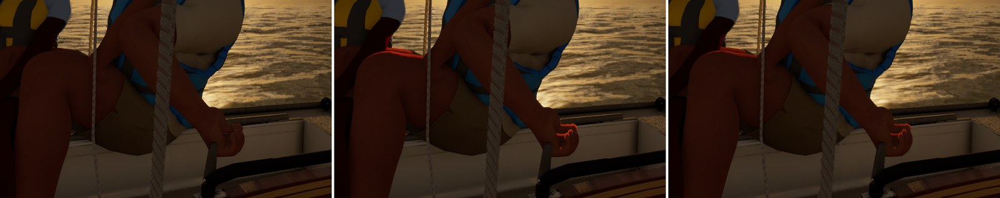

# Skin side-light patch (follow-up to docs/skin-backlight and docs/skin-rim-check)

`docs/skin-rim-check/` (Ultra, on main 37395aa0) found that #319's transmission draws the intended rim in profile against
the sun. With the sun to the side, though, it lit a broad, saturated orange patch on the temple, the side of the nose and
the cheek. Backlit skin glows only where it is thin: ears, nostril wings, lips, fingers. A patch over the cheekbone isn't
real.

## Why: the profile gets no real thickness there

Subsurface-profile transmission is `GetTransmissionProfile(ProfileId, Thickness)` times the profile's phase function
(`SubstrateEvaluation.ush`, `SUBSTRATE_SSS_TRANSMISSION`). The thickness comes from the light's shadow mask
(`ShadowTerms.TransmittanceOrOpticalThickness`, decoded by `DecodeOpticalDepthFromShadowMask`):

- **Virtual shadow maps** (our sun on Medium and up) compute no thickness for a diffusion profile.
  `VirtualShadowMapProjection.usf` writes one shadow term for both the surface and the transmission ("a single term ... to
  avoid artifacts at the point where normals flip"), and `GetSubsurfaceOpacityFromGbuffer` passes profiles through as
  opaque. So `TransmittanceOrOpticalThickness` is the shadow factor itself: any back-facing skin the shadow map leaves
  unshadowed decodes as **0 cm**. Just past the terminator, the head's own surface is within the shadow bias, so thick
  cheek reads as thin as an ear and gets the full tint.
- **Cascaded shadow maps** do estimate a thickness (`TransmissionThickness.ush`, from the shadow depth, the sample pulled in
  by `NormalScale`). But at the terminator the light really does cross only a short chord of the cheek's curve. With
  `r.Shadow.Virtual.Enable 0` the patch was broader still (`levers150.jpg`, second frame).

## Levers tried (Ultra, the same 18:00 frame; profile set by a throwaway script, then restored)

| Lever | Result |
| --- | --- |
| Extinction scale 8, 14, 20 | No visible change: there's no thickness for it to act on |
| Scattering distribution (the phase function's anisotropy) 0.5 (shipped), 0.8, 0.9 | No visible change |
| Cascaded shadows instead of virtual | Broader patch |
| Half the tint, (0.3, 0.1, 0.03) | The patch halved, and the profile rim still reads |

No transmission-thickness setting exists for the virtual shadow map path short of engine changes, and no profile or light
setting limits it to thin regions. So it is an engine limitation, and this takes the fallback.

## What changed

`scripts/tune_crew_skin.py` sets `SSP_skin_unified`'s transmission tint to **(0.3, 0.1, 0.03)** (was (0.6, 0.2, 0.06));
extinction 8 and normal scale 0.3 are unchanged. The profile is git-ignored: the Mac applies it at its next crew gate
(`scripts/make-crew-clothes.sh`, or the script alone). The log line now reads
`Crew skin: SSP_skin_unified: transmission tint (0.3, 0.1, 0.03), extinction 8, normal scale 0.3`. The sun's
`Transmission` flag (#319) stays on.

## Before and after (Ultra, 1920x1080; transmission off, the #319 tint, this tint)

| View | Sheet |
| --- | --- |
| Sun to the side (yaw 150): the patch |  |
| Sun behind the profile (yaw 135): the rim |  |
| The helm's hand and the trimmer's knee (yaw 120) |  |

The profile rim stays as a thinner line, and the side patch is half as strong. Fingers and knees keep a softer warm edge.

The original check, with the full angle sweep, is folded in at `docs/skin-rim-check/`.
