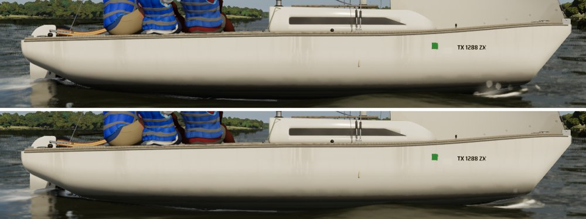
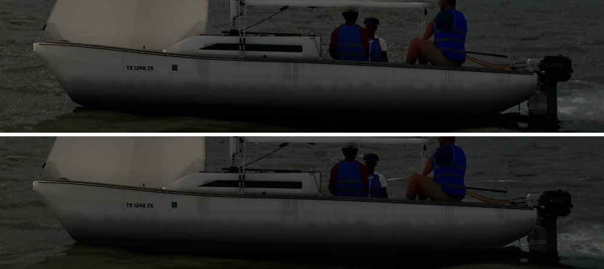
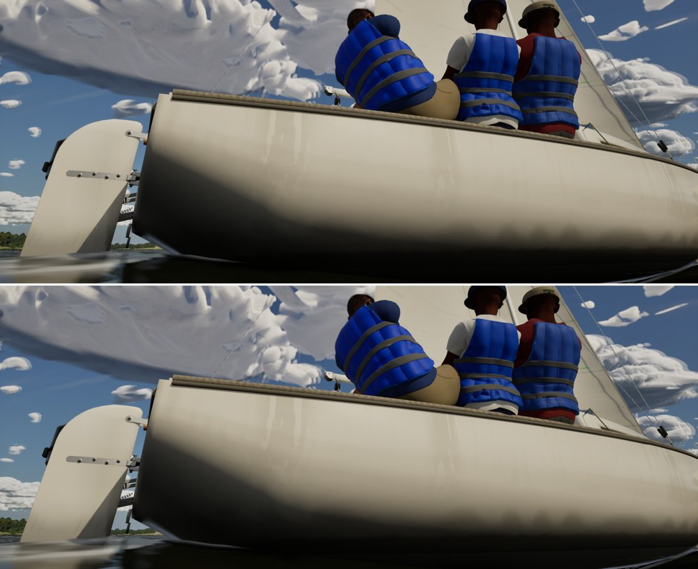
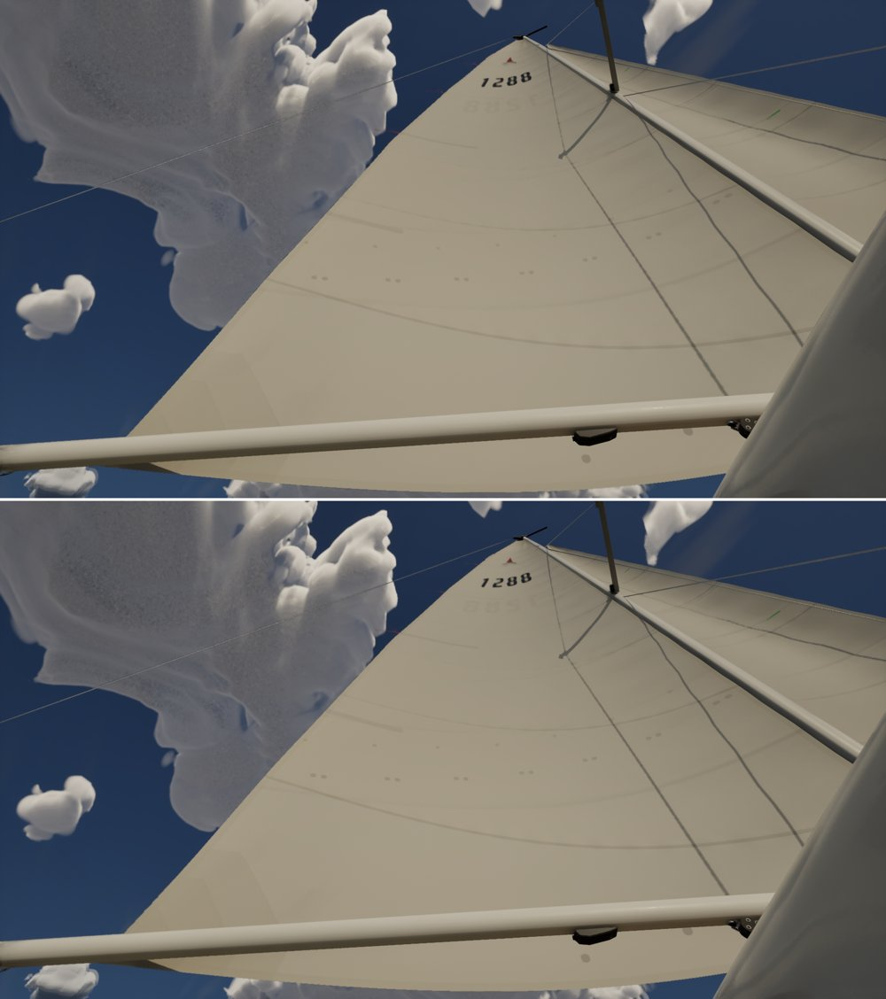

# The water's bounce (sky light lower hemisphere)

Backlit-fill option 3, decided by the sim thread after the investigation (`docs/hull-water-bounce` findings, below):
the water's light reaches the hull's lighting through the sky light's lower hemisphere, grounded in the water's optics.

## Why it was missing

- The water is `UProceduralMeshComponent` rings with a Single Layer Water material. They have no mesh distance field
  and no Lumen cards, so they're outside software Lumen's scene and have no surface cache for hardware ray-traced hits.
- Lumen's screen traces run before SLW is drawn, so they can't see the water either. The deep bed is hidden
  (`HideBelow`).
- So a ray from the topsides going down misses, and returns the sky light's lower hemisphere: black by default
  (`bLowerHemisphereIsBlack`, never set).
- Measured with a stand-in (`-SailingWaterGIProxy=<albedo> -SailingWaterGIProxyVisible`, a visible 4 km plane 3 cm
  under the surface): at albedo 0.08 the lower topsides were about 6% brighter and the water itself unchanged. A hidden
  stand-in (`bAffectIndirectLightingWhileHidden`) doesn't reach Lumen here.

## What changed

`ASailingEnvironment::UpdateLowerHemisphere` (Medium, High and Ultra; Low keeps black):

- **The sky's mean radiance.** Every two seconds `M_SkyEnvProbe` (`build_sky_env_probe`) samples the sky light's cube
  straight up at full roughness: the cosine-weighted mean of the upper hemisphere, its irradiance over pi. It's drawn
  into a 1x1 half-float target and copied back without a stall (`FRHIGPUTextureReadback`, polled on the render thread).
- **What the water sends up**, per channel:
  `(0.066 + R_body) x sky mean / (sky light intensity x colour)`.
  - 0.066 is water's reflectance of a diffuse sky (Fresnel, hemispherically averaged, n = 1.33).
  - `R_body` is the body's upwelling seen from above: a deep medium's diffuse reflectance from its single-scattering
    albedo, `0.55 (1 - sqrt(1 - a)) / (1 + sqrt(1 - a))`. The 0.55 is the light crossing the surface down and back up.
    The albedos mirror `WaterBodyFor` (WaterSurface.cpp). Lake (0.16, 0.18, 0.11) gives about (0.023, 0.027, 0.016).
  - The probe includes the sky light's intensity and colour, and the lower hemisphere colour doesn't, so they're divided out.
- Set when it moves by 2%, so it follows dusk and storm decks by itself.
- `-SailingNoWaterBounce` keeps the old black. `-SailingSkyLowerHemisphere=<grey>` sets a fixed grey (measuring), and
  the automatic value then stands aside.

**The computed value** in the test scene (lake, AfternoonBreeze 15:00): sky mean (0.0061, 0.0075, 0.0101), lower
hemisphere (0.0005, 0.0007, 0.0008) in the sky light's units (log: `Water bounce: ...`). These units aren't comparable with
the fixed-grey test's: 0.05 there lightened the topsides 15% and 36%, so "about 0.02 grey" from that test doesn't carry
over. The physical check is the effect against the albedo-0.08 stand-in, below.

## Effect (Ultra, linear luminance)

| View | Before (`-SailingNoWaterBounce`) | After | Change |
| --- | --- | --- | --- |
| Side, lower topsides (`-SailingCloudShade=0.15`; mean of 3 runs, sd 0.0004) | 0.3104 | 0.3205 | **+3.3%** |
| Backlit chase topsides (3 runs) | 0.0350 (sd 0.0022) | 0.0344 (sd 0.0010) | within the runs' spread (the sky region itself differed 5%) |
| Crew underside view, hull lower | 0.2210 | 0.2210 | none |
| Boom underside | 0.2352 | 0.2350 | none |
| The albedo-0.08 stand-in, side lower topsides (one run) | 0.2990 | 0.3184 | +6.5% |

About half the stand-in's effect. That's expected: the formula is the water's response to the sky only, while a lit
stand-in also bounces the sun, which a real lake's upwelling does too. Where Lumen's rays find the lake bed or the hull
itself first (the close underside views), the lower hemisphere isn't reached and nothing changes.

| Side | Chase | Crew underside | Boom from below |
| --- | --- | --- | --- |
|  |  |  |  |

(Before above, after below.)

## Cost

Helm eye, two 20 s runs each on the 4090, GPU ms before -> after: Medium 4.21 -> 4.00, High 5.56 -> 5.61, Ultra 7.96 ->
8.11. Within noise. The probe is one 1x1 draw and a 4-byte-per-channel copy every two seconds.

## Checks

Full suite 235/235 on the PC on main 81771c73 plus this branch (MSVC clean).
