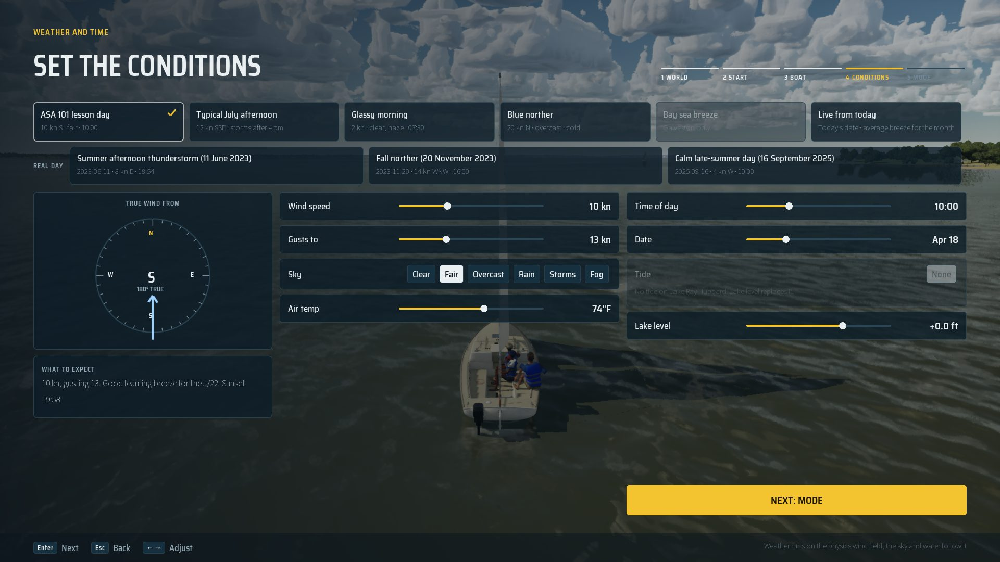

# Rain on the Sky row

The Conditions screen's Sky row (and the in-game Change conditions screen, which builds the same panel) offers **Rain**:
steady rain from the start of the session, the `Rain` weather preset (0.6 rain, a low grey deck, 4 km visibility, 14 kn
NE). Before, the row had no rain: Storms runs the thunderstorm, whose rain only comes with its front, and the Rain preset
could only be picked from the in-game Settings panel.

- `ESailSky::Rain` is appended last, so saves (string ids) and the int uses of the others (`SailCatalog::Expect`) keep
  their meaning. The row shows Clear, Fair, Overcast, Rain, Storms, Fog (`SkyRowOrder` in `SailFrontEnd.cpp`).
- `USailSessionSubsystem::WeatherPresetFor(Rain)` is the Rain preset, the same path every Sky choice takes to the game
  mode (`ApplyToSettings`, `SailingGameMode` on the cast-off reload).
- "What to expect" says so. Tests: `SailingSim.UI.SessionFlow` (Rain runs the Rain preset, its name) and
  `SailingSim.Save.*` (the sky sweep covers all six by name).

| Before | After |
| --- | --- |
|  |  |
