# Slice audit: the first hour (#400)

A new player's first hour in the vertical slice (#399): **Lake Ray Hubbard, the J/22 and the Sunfish, Day Sailor and Club
Racer**, Career mode, from a fresh save, on keyboard and controller. Galveston Bay and the Catalina 22 are the stretch
(#407) and stay reachable; they are listed under "Outside the slice" only.

**Status: done, and every finding is fixed on main (064350b6, Nov 2 2026).** Part A comes from the data
(`Content/Career/career.json`, `Content/Learning/*.json`) and the menu code (`SSailFrontEnd`, `ASailingHUD`,
`FSailSessionConfig`) at main 964ccdcd; Part B, the scripted play-through with stills, ran on main 8ab0048c. Each finding
says whether it was **seen** (in a run) or **read** (in code or data). The table below says which pull request fixed it.

## Fixed since

Findings 1 to 8 were fixed by the first-launch build (#422, main 127081ee, `docs/first-launch/`); Part B's stills
checked them on the game itself. Findings 9 to 21 were fixed by #441 to #448 (Nov 1 and 2 2026), and `SailingSim.Slice.FirstHour` (#404)
plays the first hour start to finish on the physics: the first job, all six Day Sailor lessons, the checkride.

| # | Finding | Now | Fixed by |
|---|---|---|---|
| 1 | Two ways to learn on the title | A new save opens on the first-launch screen and the first job; the title's "ASA 101 drills" item is gone | #422 |
| 2 | Five screens from a lesson row | Start lesson casts off from the row (`MakeLesson`) | #422 |
| 3 | Easy caps at bronze, no certificate | Easy earns up to silver, enough for the checkride | #422 |
| 4 | Light traffic can take the medal | Lessons sail with their own `traffic` (off) | #422 |
| 5 | Any weather, same medals | Lessons sail in their own `conditions` (the lesson day) | #422 |
| 6 | "ASA 101" in the menus | Gone from the title, Mode card, briefing, quiz footer, preset name and HUD | #422 |
| 7 | No quiz retake | Retake the quiz after a lesson; Take the quiz on its Career row | #422 |
| 8 | No next lesson | Next lesson and Sail it again on the finish panel | #422 |
| 9 | Replays with no run | Greyed on the title with "Sail a run first" | #447 |
| 10 | Gallery on the title | Hidden in a slice build (#431), and `DeveloperTools()` is off in one whatever the ini says | #441, #444 |
| 11 | Club Racer behind the checkride | Bean's call (Nov 1): Club Racer and the Sunfish open after Day Sailor's first three lessons (`opens_after`) | #448 |
| 12 | The Sunfish's J/22 text | Dinghy briefings, steps and tips for a boat with no jib | #443 |
| 13 | J/22 questions in the Sunfish quizzes | Questions tagged keelboat or dinghy; a dinghy's quizzes and checkride ask no keelboat questions | #443 |
| 14 | Jib drills on the Sunfish | Heave to and the figure-eight not offered on a boat with no jib | #443 |
| 15 | "Captain" in the first job | "Instructor" | #442 |
| 16 | "Free sail" on the first job's loading screen | "Your first job" | #442 |
| 17 | Developer text | Player wording in Settings, no build label, no career notes on screen | #444 |
| 18 | World card facts run together | Labels wrap in their columns; two shorter | #445 |
| 19 | Career Down walks the tiers | Focus starts on the next lesson; the prompt bar says Left / Right | #445 |
| 20 | No way back to the first job | A First job card on the Career screen after Skip | #446 |
| 21 | Coastal Cruiser "Open" with no lessons | "Coming" until it has lessons | #445 |

## How it was run

- Packaged Development build of main (`Packaged/Mac/SailingSim.app`), 1920x1080 windowed, Medium.
- **Fresh profile.** The container's `Saved/Config` and `Saved/SaveGames` are moved aside for the run and restored byte
  for byte after it (`diff -r` clean), so the game starts as on a new Mac: no `profile.json`, no `GameUserSettings.ini`.
- **Keys.** `-SailingUIScript` sends keys through Slate (menus only; `Gamepad_*` names give the controller's menu path). It
  can't sail: the boat's input is Enhanced Input. The drills themselves need Bean's hand on the keyboard and a pad (list
  at the end). Whether each lesson can be completed is taken from the scripted helmsmen's tests
  (`SailingSim.Drills.SailATriangle`, `SailingSim.Drills.SunfishLessons`, the drill tests).
- **Stills.** Only the game's own screenshot (one launch per screen): never the desktop.

## Ranked blockers (by how early in the first hour they bite)

| # | Minute | Category | Finding | Source |
|---|---|---|---|---|
| 1 | 0 | Unclear objective | The title offers **two ways to learn**: Career (lessons, medals, certificates) and **"ASA 101 drills"** (six drills, "N passed", from the older `DrillsPassed` list). Sail, the free-sail flow, is the first item, and a new player's Enter goes there, not to lessons. Nothing says which one is the course. | read |
| 2 | 1 | Unclear objective | From a Career lesson row to sailing is **five screens and a load**: Launch, Boat, Conditions, Mode, then cast off. Each lets the player wander off the lesson: another boat, a thunderstorm, Free sail or another drill on the Mode screen. The lesson's name isn't carried onto those screens. | read |
| 3 | 1 | Unfair medal | **Difficulty defaults to Easy** (`FSailSessionConfig::bEasy = true`), and Easy earns at most bronze (`easy_max_medal`). The Day Sailor checkride needs silver in every lesson, so a player who never finds the Difficulty switch on the Mode screen can never certify, and never reaches Club Racer. The Career screen explains it only on the checkride line. | read |
| 4 | 2 | Unfair medal | **Traffic defaults to Light** in lessons. Silver and gold ask for zero rules infractions, so an AI boat in the fairway can take the medal on Leave the dock. | read |
| 5 | 2 | Unfair medal | A lesson doesn't set its conditions: the Conditions screen's default is the Lesson day, but any preset (Thunderstorm) earns the same medals against the same times. | read |
| 6 | 3 | Naming | **"ASA 101"** shows in the menus: the title item and the Mode card ("ASA 101 drills"), and the quiz footer ("Questions in ASA 101 wording"). `docs/career/README.md` keeps ASA to the descriptive `learning` text. | read |
| 7 | 10 | No retry | The lesson quiz opens only after a completed drill in Learning mode. Esc ("Skip the quiz"), a failed quiz, or Game mode means **sailing the whole drill again** to retake it; the Career screen has no quiz button for a lesson. | read |
| 8 | 10 | Dead end | After a lesson there is no "next lesson". The way on is pause, Quit to title, Career, the next row, and the five screens again. | read |
| 9 | 0 | Dead end | Title **Replays** with no run in this session: the menus close and nothing plays (`WatchLastRun` does nothing when `LastRun` is empty), leaving the player in the world with no menu. The last run isn't kept across launches. | read |
| 10 | 0 | Developer leftovers | **Gallery** ("Developer · every asset") is on the title by default (`bShowDeveloperTools = true`; an ini line turns it off). | read |
| 11 | 60+ | Slice design | **Club Racer is locked** behind the Day Sailor certificate: six lessons at silver plus a 12-question written test at 80%. A first hour won't reach the Sunfish. | read |
| 12 | 60+ | Missing explanation | **Club Racer's text is the J/22's.** The Sunfish lessons run the keelboat drills with their briefings and coaching: "the crew hoists the sails", jib telltales, "five J/22 lengths", "the J/22 weighs over 800 kg", and on the quick-stop "leave the jib backed" (a Sunfish has no jib). | read |
| 13 | 60+ | Unfair medal | **Club Racer's quizzes ask J/22 questions**, for example qs-02 "During the quick-stop, the jib is:", tri-02 (jib telltales), tri-14 ("a boat like the J/22"), ld-11 ("brief the crew"), dk-03 ("in a keelboat"). 28 questions in the four drills' pools mention a jib, a crew, the J/22 or a keelboat (some still fit a dinghy), and a Sunfish sailor can fail a lesson quiz on them. | read |
| 14 | 60+ | Stuck state | The Mode screen's drill grid offers all six drills on any boat, so **Heave to and the figure-eight on the Sunfish**, which both need a jib to back. | read |

## Outside the slice, reachable from the menus

From the menu code (to confirm with stills):

- **World screen:** Lake Ray Hubbard, Galveston Bay & Gulf, Marseille & Cassis and the Texas coast. In Career on a fresh
  save the last three are greyed with their lock reason: Galveston and the Texas coast open with the Day Sailor certificate
  (Galveston through the Coastal Cruiser tier it opens), and Marseille is "Not in the career yet".
- **Boat screen:** the whole fleet except the maxi (J/22, Sunfish, ILCA 7, Catalina 22 and 30, Hobie 16, Corsair 880,
  Lagoon 42), locked by certificate in Career.
- **Mode screen:** Race, and Passage (greyed on the lake, with the note "Galveston and Marseille only").
- **Title:** Race and Gallery (developer tools).
- **Free Sail** (the title's Mode switch, one key away) opens all of the above at once, with no warning that it leaves
  the course.
- **Not reachable:** the maxi prologue (`-SailingPrologue` only) and the maxi (the Boat screen skips it).

Galveston and the Catalina 22 stay reachable (stretch, #407).

## Needs Bean's hand

- Sailing each lesson on the keyboard and on a pad: Leave the dock, the triangle, heave to, both crew-overboard methods,
  docking; then the Sunfish's four.
- On the pad: casting off (`DockLines`), backing the jib (`BackJib`), the sheets, and whether the drill steps' key names
  follow the pad (`FLearningContent::ResolveKeys` uses the pad's labels when the pad is in use).
- Decided (Nov 1 2026): Club Racer opens after Day Sailor's first three lessons (finding 11, #448).

## Part B: the play-through (Nov 1 2026, main 8ab0048c)

34 stills of the packaged Development build at 1920x1080 on Medium, each the game's own screenshot of its window (never
the desktop), on a fresh profile (Config and SaveGames moved aside, restored byte for byte after: `diff -r` clean), an
existing save part way through Day Sailor (`docs/career/still-save.json`) and one with the Day Sailor certificate
(`docs/free-sail/still-save.json`); keys and pad buttons through `-SailingUIScript`. Script and runner:
`Artifacts/claude-6e6e/audit/` on the Mac (`night.sh`, `shot.sh`).

### Seen

| Still | What it shows |
|---|---|
| 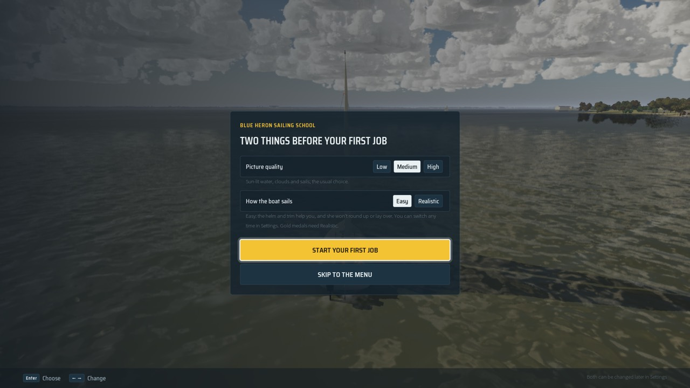 | **A new save opens on the first-launch screen** (#402): the school, quality pre-picked (Medium), Easy pre-picked, Start your first job focused. Finding 1 fixed. |
| 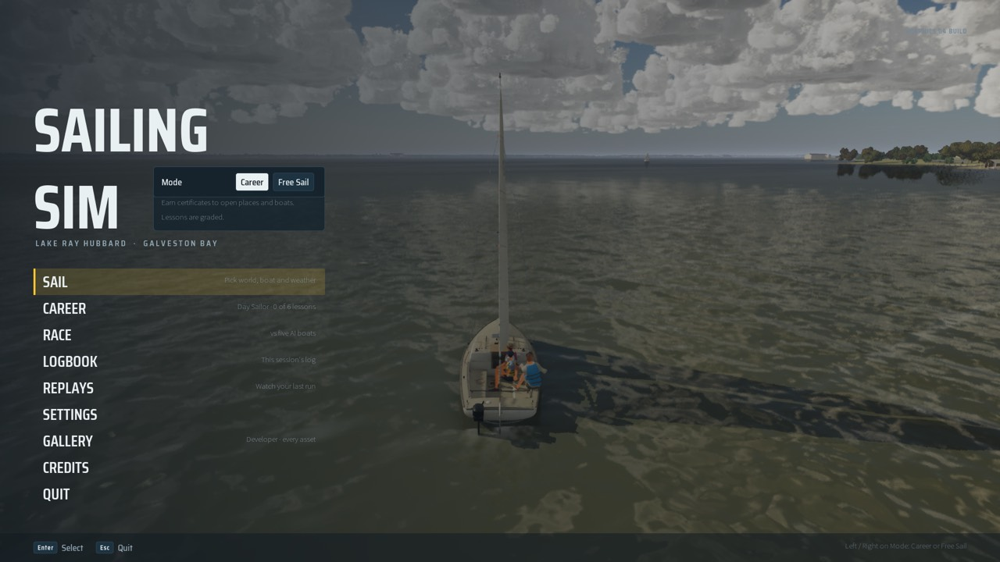 | **The title** after Skip: no "ASA 101 drills" (finding 6 fixed), Career shows "Day Sailor · 0 of 6 lessons". Still there: **Gallery** (finding 10, developer tools on) and a faint **"GRAPHICS G4 BUILD"** label top right (17). Sail is still the first item and focused for a player who skipped. |
| 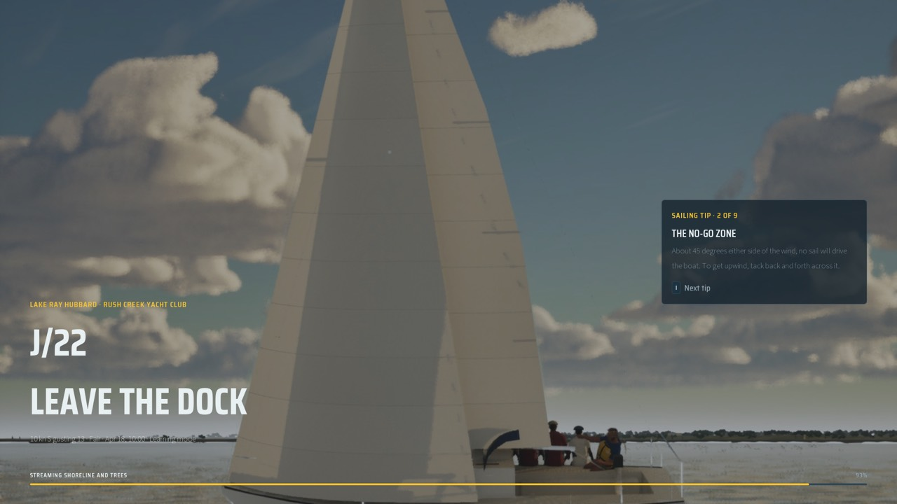 | **Start lesson**: Right then Enter on Day Sailor's first row goes straight to its loading screen, "J/22 · Leave the dock", the lesson day, Learning mode (finding 2 fixed). |
| 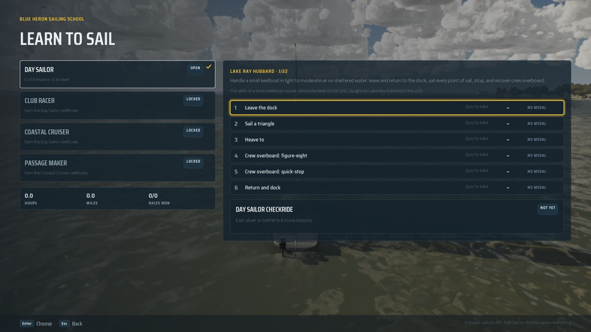 | **The Career screen** on a fresh save. Focus starts on the tiers; Down walks the tiers, not the lessons (19). |
| 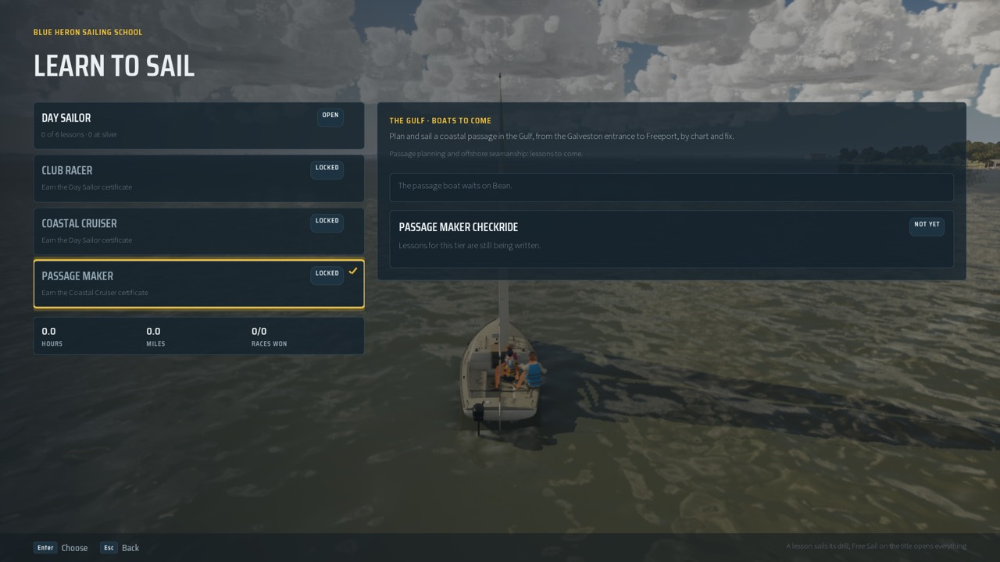 | Down five times from the Career screen ends on **Passage Maker**, whose panel says **"The passage boat waits on Bean."** (17: developer notes shown to players). |
| 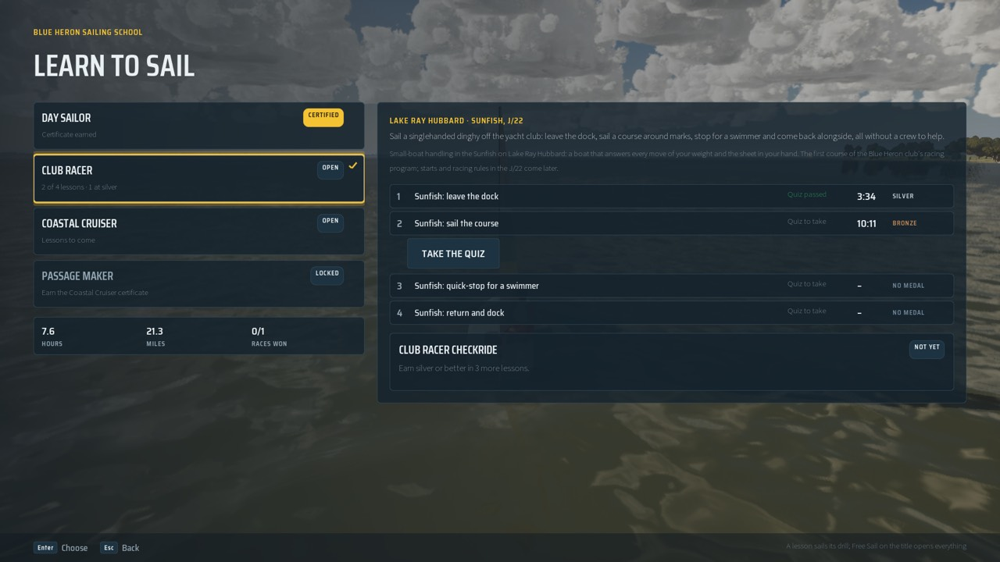 | **Day Sailor certified**: Club Racer open with its Sunfish lessons; **Take the quiz** under a lesson with a medal and an unpassed quiz (finding 7 fixed). Coastal Cruiser is open but "Lessons to come" (21). |
| 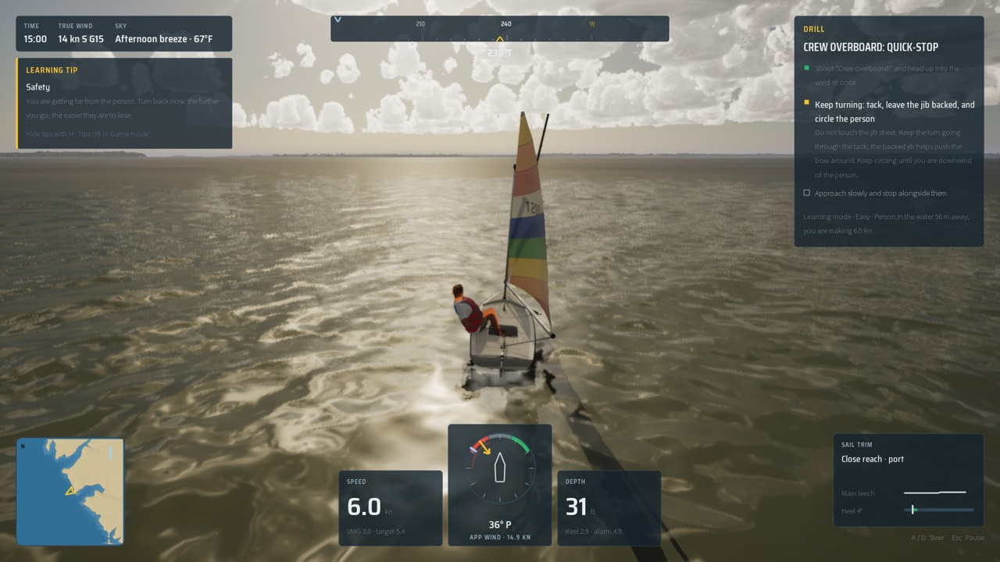 | **The Sunfish's quick-stop** tells the player to "tack, leave the jib backed" (finding 12 seen): a Sunfish has no jib. |
|  | **Heave to on the Sunfish**: "Back the jib ... (B)" (finding 14 seen: a drill the boat cannot sail, reachable from the Mode screen). |
| 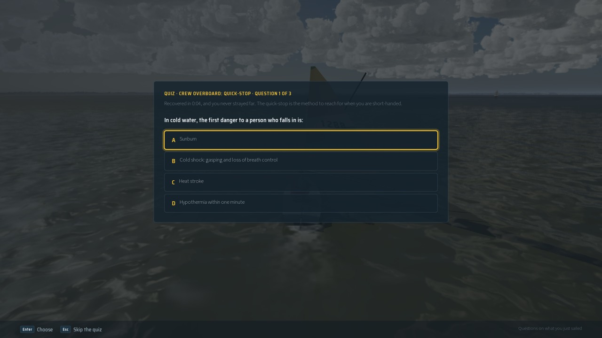 | **The quiz** after the Sunfish quick-stop; footer "Questions on what you just sailed" (finding 6 fixed). |
| 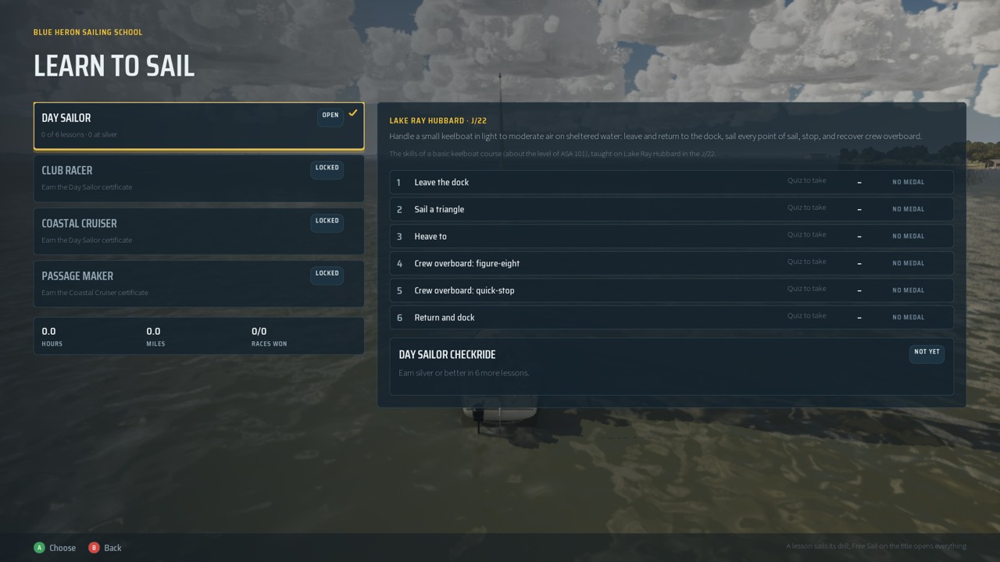 | **On the pad**: the prompts become A Choose, B Back (`SailingSim.Slice.PadCoverage` holds every first-hour action on the pad). |
| 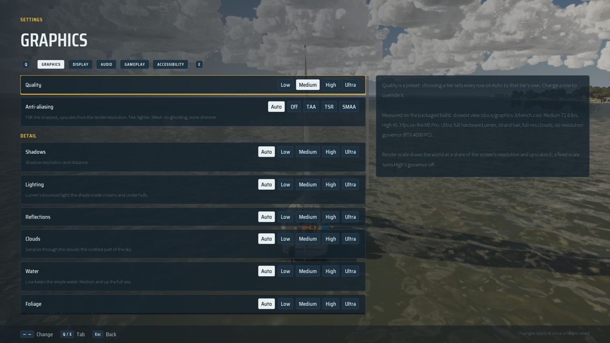 | **Settings > Graphics** (five Downs from the title now reach Settings, not Replays): the help panel quotes "Measured on the packaged build, slowest view (docs/graphics-3/bench.csv) ... on the M5 Pro" (17). |
| 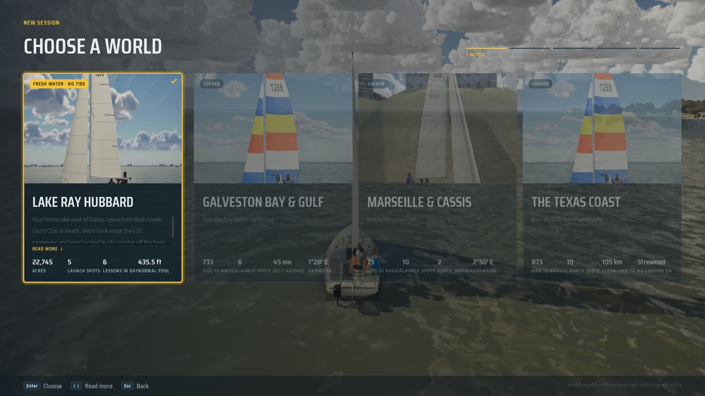 | **Sail > World**: Galveston locked (Day Sailor certificate), Marseille "Not in the career yet", the Texas coast; the cards' facts run into each other ("AIDS TO NAVIGALAUNCH SPOTS", "LESSONS IN DAYNORMAL POOL") (18). |

### New findings from Part B and the PC's Windows check

| # | Category | Finding |
|---|---|---|
| 15 | Missing explanation | The first job's caption header read "Captain"; the design says Instructor (PC, Windows Shipping 127081ee). Fixed by #442. |
| 16 | Unclear objective | The first job's loading screen read "J/22 · Free sail" (PC). Fixed by #442 ("Your first job"). |
| 17 | Developer leftovers | Player-facing developer text: the Settings help quotes bench numbers and a docs path; Passage Maker says "The passage boat waits on Bean."; a "GRAPHICS G4 BUILD" label on the title. |
| 18 | Layout | The World screen's card facts overflow into each other. |
| 19 | Unclear objective | On the Career screen Down walks the tiers; the lessons are reached with Right, which nothing says. |
| 20 | Dead end | A player who chose "Skip to the menu" has no way back to the first job (the design's "First job" entry on the Career screen isn't there). |
| 21 | Dead end | Coastal Cruiser opens with the Day Sailor certificate but has no lessons ("Lessons to come"). |

Not reached by the script: Replays with no run (9: still read only), the Sunfish's J/22 quiz questions (13: read; the
still's first question happened to fit a dinghy), and every drill sailed by hand (Bean's, on keyboard and pad).

## Second audit (Nov 6 2026, main ffe85d69)

The same method as Part B: a fresh `FULL=1` package of main as a **slice build** (`-SailingSlice=1`, the testers'
menus), 1920x1080 windowed, Medium. There were 42 stills, each the game's own screenshot. The profiles were a fresh one, the
part-way save (`docs/career/still-save.json`) and the certified one (`docs/free-sail/still-save.json`). The Mac's own Config
and SaveGames were backed up and restored after every launch (`diff -r` clean). Keys and pad buttons went only through
`-SailingUIScript`. It covers the first launch and the first job (keys and pad), every title item, the Career screen's focus
and tiers, the Settings tabs, the Mode screen on the pad, Feedback, the J/22's and the Sunfish's briefings, quizzes and drill
HUD, and Club Racer from a certified save. Stills: `stills2/`.

### The 21 findings

**None regressed.** The fixes for 1–21 still hold on the game, including:
- **First launch.** Medium and Easy pre-picked, and focus on Start your first job ([first-launch](stills2/first-launch.jpg)).
- **First job.** Its loading screen reads "Your first job" ([first-job-loading](stills2/first-job-loading.jpg)).
- **Title.** No "ASA 101" item, no Gallery and no build label, and Replays greyed ([title](stills2/title.jpg)).
- **Career screen.**
  - Focus starts on the next lesson, and the prompts say Left / Right ([career](stills2/career.jpg)), with pad prompts on a controller ([career-pad](stills2/career-pad.jpg)).
  - Club Racer is locked with "Sail Day Sailor's first three lessons", then opens with Take the quiz ([career-certified](stills2/career-certified.jpg)).
  - Coastal Cruiser reads "Coming", and Passage Maker is gone from a slice build.
- **World screen.** The cards' facts sit in their columns ([world](stills2/world.jpg)).
- **The Sunfish.** Its briefings, quizzes and HUD use the dinghy wording, and there is no jib drill.
- **Mode screen on the pad.** The choice keeps the focus (#468) ([mode-pad](stills2/mode-pad.jpg)).

### New

| # | Category | Finding | Still | Issue |
|---|---|---|---|---|
| 22 | Developer leftovers | Title > **Credits** renders `CREDITS.md` as it is: code paths (`Source/SailingSim/Private/SailingAudio.cpp`, `/Game/Materials`, `scripts/make_materials.py`), "Since Graphics G7", "placeholder art until a later phase". Settings > Gameplay > Headings says "the lake's **bake** has no variation". | [credits](stills2/credits.jpg), [settings-gameplay](stills2/settings-gameplay.jpg) | #487 |
| 23 | Missing explanation | Learning tips fire while the boat is still **tied up** at the start of Leave the dock: "Jib is luffing" on the J/22, "In irons" on the Sunfish, while the drill asks the player to plan and cast off. | [hud-j22-dock](stills2/hud-j22-dock.jpg), [hud-sunfish-dock](stills2/hud-sunfish-dock.jpg) | #488 |
| 24 | Polish (PC lane) | A Club Racer lesson's loading screen shows the J/22 artwork under "SUNFISH". | [clubracer-loading](stills2/clubracer-loading.jpg) | (art; not filed) |
| 25 | Unclear objective (noted Nov 1) | A returning Career player's title still focuses **Sail** first, not Career. | [title-returning](stills2/title-returning.jpg) | fixed (Nov 7): Career is focused for a returning Career player, over Continue too ([career](../career/README.md#the-title-for-a-returning-player)) |

### Also seen

- **No crash or stuck state** in 42 launches.
- **Two handled ensures at every launch, both already there on Nov 1:**
  - `PSOPrecache.cpp:296`;
  - a matrix precision check (`DoubleFloat.cpp:21`, from `FDistanceFieldSceneData::UpdateDistanceFieldObjectBuffers`): one distance-field object's transform is past the renderer's range.

  They are logged in Development builds and don't reach players. They're worth a look if the distance-field one turns out to be a mis-placed object.
- **Not reached by the script:** Replays with no run (read only), a finish panel and medal moment (they need a sailed drill), and every lesson sailed by hand on keyboard and pad (Bean's). `SailingSim.UI.PadCoversLessonKeys` (#486) now holds that every key a lesson names has a controller binding.
