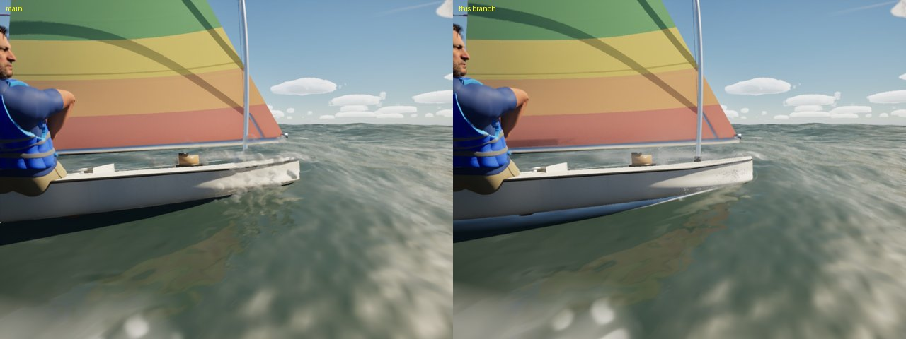
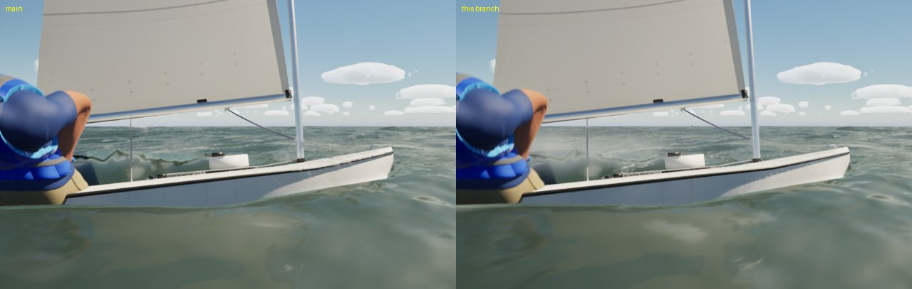
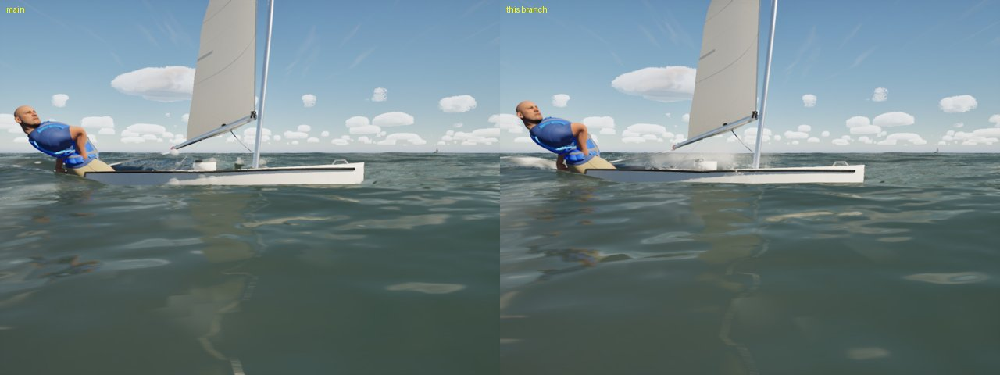
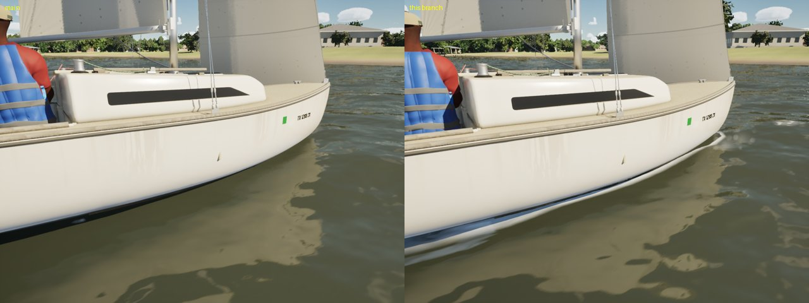
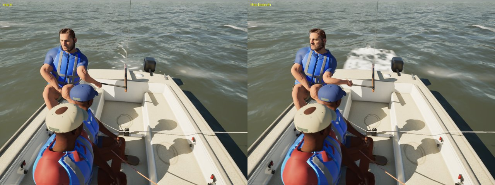
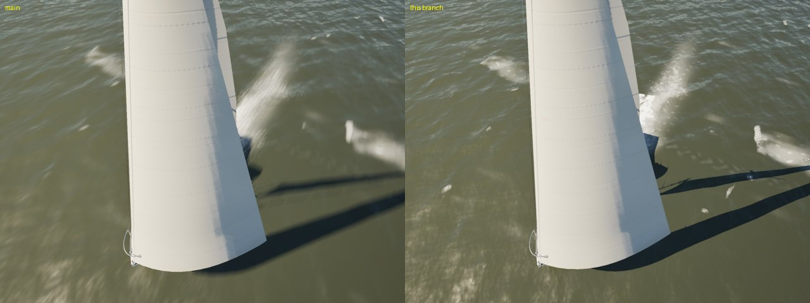
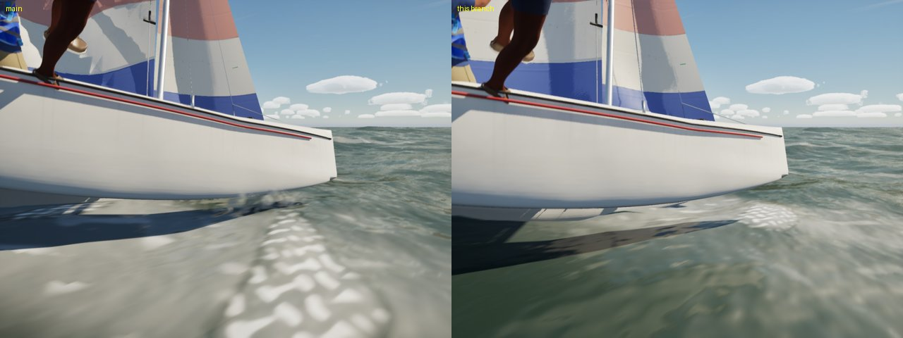
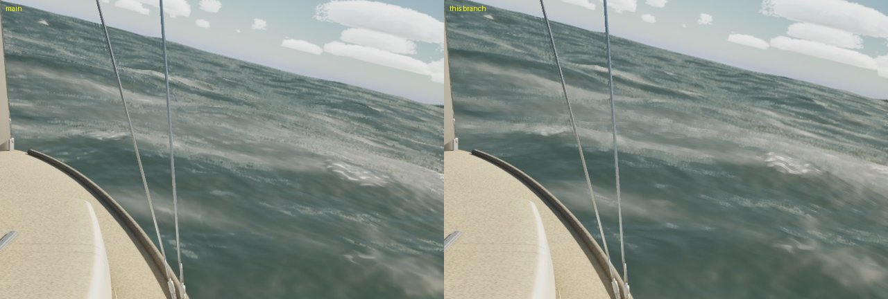

# Spray and the water at the hull (Oct 21 2026)

Water effects ahead of more location work: the spray read as opaque white balls, and the PC's Ultra audit of the near
water found no foam at the hull, no bow-wave sheet, sparse spray, a flat stern wake, no slam splash and blurred foam at
grazing angles. All the stills are Mac High, uncooked (`scripts/run-game.sh`). Each pair has main on the left and this
branch on the right, taken on the same run (same seed, time and camera).

## Spray

**Before:** `AWaterSurface::UpdateSpray` flew CPU droplets and drew each one as an engine sphere with a masked, dithered
material. Close up they were white balls 4 to 12 cm across, and the Sunfish's and ILCA's bow spray read as a heap of
ping-pong balls.

**Now:** the same CPU sim, on a pool of 1,200 on High (3,000 on Ultra), drawn as quads facing the camera (the
engine's 1 m plane, `M_Spray`).

- Each quad is stretched along its motion across the view: its length grows by its speed over 1/60 s, the blur of an
  exposure.
- The per-instance data are opacity, grain and seed. Grain 1 is a clump of droplets: round drops on a jittered grid over
  a faint veil. Grain 0 is smooth mist.
- `M_Spray` is lit translucent: the sun and sky through the translucency lighting, plus a Henyey-Greenstein forward
  lobe (g 0.75) of the sun's illuminance, so spray glows when you look toward the sun.
- There are three kinds:
  - **drops** (clumps of 10 to 25 cm), fading with age and as they fall back;
  - **sheets**, short-lived and wide, the bow wave torn off;
  - **mist**, which spreads, hangs and drifts with the wind for 1 to 3 s.
- Past 25 m, drops turn into mist (no grain, wider, fainter).
- **The bow wave:** at speed (past 2 m/s), sheets peel off each side of the bow at the waterline, slam or no slam, in
  proportion to the speed.
- **Slams:** the old trigger (the closing speed between the bow and the water) throws twice the drops it did. Past
  1.2 m/s it also throws a burst of mist and torn sheets that hangs over the bow and blows aft.
- A dinghy throws less and lower than a keelboat (scaled by her half beam).
- `-SailingDebugSpray` puts a steady fountain of every kind 3 m ahead of the camera, for tuning.

(The engine plane's UVs don't reach the material here, so `M_Spray` works from the quad's local position.)

## The water at the hull

`M_WaterV4`'s pixel shader now reads the same hull map the clip uses (`FHullClipMap`, `docs/boat-water-clip/`) in the
player's boat frame, with her velocity (`HullClipV`). The water's height at the pixel comes from the vertex shader in
`LongN.w`. Two new things are drawn, both growing with her speed from 0.8 m/s and both broken up by bubble noise:

- **Foam along the waterline**, clinging where the water meets her skin: the hull's bottom just above the drawn surface,
  inside the deck plan, in a band 3 to 10 cm high.
- **Churned water behind the transom:** past the hull's end aft, within its beam (the map's side margin past an end is
  now the end section's), fading over a distance that grows with her speed.

**The wake's tread-plate lattice.** The foam the boats push around was broken up by two multiplied sines about 0.5 m
apart. From above, that is a regular diamond lattice: the Catalina 30's and the Lagoon's wakes looked like tread plate.
They are now three octaves of rotated, drifting value noise (0.4 m, 0.14 m and 5 cm) with the same mean, so there is as
much wash as before.

## Foam at grazing angles

The caps' lace, streaks and bubble cells, and the trails the caps leave, faded to their flat means by the pixel
footprint's long axis (`fwidth`). At a grazing view that axis is many times the short one, so every cap, paw and
windrow went to a smooth smear a few boat lengths out. They now fade by the footprint the anisotropic filter resolves:
the short axis, or a quarter of the long one. Helm eye at 22 kn in the Gulf, the far water:

What is left of the blur in the middle distance is the long waves' fold. It is computed per vertex and interpolated
across the far rings' large triangles (V4_WPO), so a cap there is a smooth patch. Sharpening it means carrying the fold
per pixel: a bigger change, left for the next pass.

## Left for later

- **Wet darkening on the topsides:** `M_BoatSurface` darkens below `MPC_Boat.WaterZ` (the wet line in
  `BoatModelVisuals.cpp`). The PC is editing that file's rig lines, so I left it alone. To do: a darker, glossier band
  just above the waterline, refreshed by spray and waves.
- **Bow-wave shape:** the sheet is spray, not geometry. A real curl of water standing off the bow needs a mesh or the
  wake grid's own bow wave, not particles.
- **AI boats:** the waterline foam and transom churn are drawn for the player's boat only (the one hull map).
- **Spray on Medium:** spray is still High and Ultra only.

## Reproduce

Gulf spray: `-SailingWorld=Gulf -SailingSwell=1.5 -SailingWind=20 -SailingTWA=45 -SailingHoldTWA=45
-SailingBoat=ILCA -SailingCamTarget=1,0,0.2 -SailingCamDist=3.4 -SailingCamYaw=-60 -SailingCamPitch=-8` (backlit:
`-SailingHour=17.5 -SailingCamYaw=-120 -SailingCamPitch=-6`).

Waterline and transom: `-SailingBoat=J22 -SailingWind=16 -SailingTWA=100 -SailingHoldTWA=100`, with
`-SailingCamTarget=1,0,0 -SailingCamDist=3.5 -SailingCamYaw=-60 -SailingCamPitch=-20` for the waterline, or
`-SailingCamTarget=-3.5,0,0 -SailingCamDist=4 -SailingCamYaw=180 -SailingCamPitch=-30` for the transom.

Grazing: `-SailingCapture=HelmEye -SailingCaptureBearing=90 -SailingWind=22`.

## Gate

`scripts/gate.sh --scope water` and `--scope boats` on this branch (merged with main 1a432c3f) both pass: 209 tests,
the package, and every view over its floor ([gate-water.csv](gate-water.csv), [gate-boats.csv](gate-boats.csv)).
Against `docs/boat-water-clip/`'s water gate (Oct 20, the clip alone):

| view | fps then | fps now | water GPU ms then | now | water CPU ms then | now |
|---|---|---|---|---|---|---|
| beam8 High | 60.6 | 63.0 | 3.10 | 3.44 | 0.163 | 0.171 |
| beat15 High | 63.1 | 61.9 | 3.21 | 3.18 | 0.167 | 0.183 |
| storm High | 45.8 | 45.4 | 2.54 | 2.64 | 0.174 | 0.196 |
| marina High | 62.0 | 61.2 | 2.99 | 3.19 | 0.159 | 0.172 |
| coast-day High | 54.6 | 54.0 | 3.11 | 3.37 | 0.540 | 0.552 |
| gulf-sea High | 66.7 | 64.4 | 3.09 | 3.16 | 0.318 | 0.351 |
| helm-eye High | 60.7 | 59.9 | 2.38 | 2.50 | 0.173 | 0.177 |
| bridge High | 65.7 | 65.1 | 3.26 | 3.26 | 0.154 | 0.168 |
| storm Medium | 66.7 | 66.5 | 2.22 | 2.42 | 0.066 | 0.066 |

The water slice costs up to 0.34 ms more (the hull-foam branch near the boat and its noise), and the spray's CPU sim
0.01 to 0.03 ms more for twice the pool. Boats scope on High: beam8 63.8, beat15 61.8, marina 61.0, helm-eye 59.8,
slip 53.1, crew 53.5 fps, against 64.9, 63.4, 62.1, 60.7, 53.8 and 53.8 on main plus #193 today, about 1 fps less.
