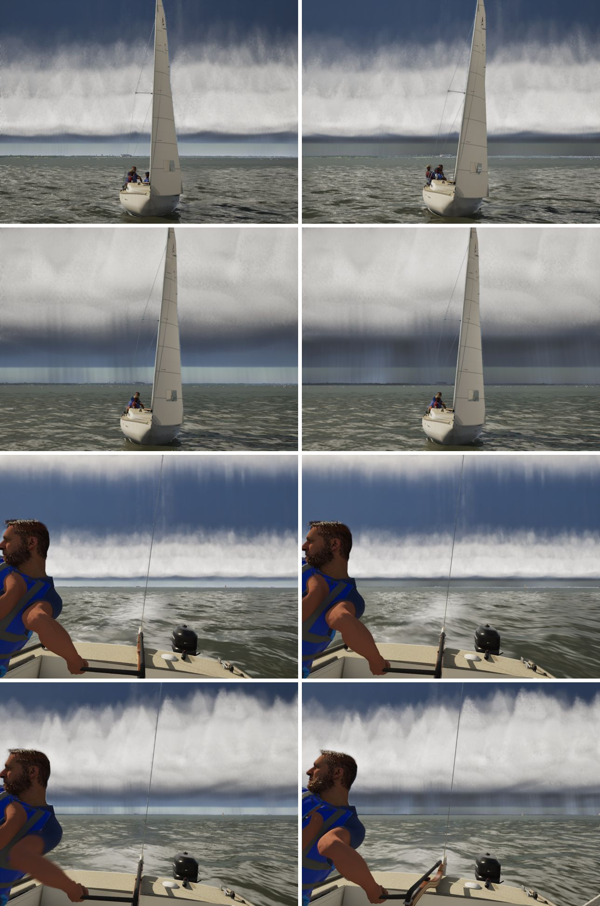

# Storm gloom: the air under the deck

The other half of fix-list item 7, after `docs/shelf-structure/`. Seen from ahead of the front, the gap under the shelf
and the horizon beneath the core read pale: lit like a clear horizon. In photos that air is grey and laden with rain.

The pale band is the height fog's inscatter. The fog is uniform and takes no shadow from the deck. A rain curtain 3–7 km
off is drawn under that inscatter too: darkening its own light changed nothing.

## The rain wall

The fix is one long card on the front's line, 1.2 km behind the front, under the core's leading edge, drawn by
`ASailingEnvironment::UpdateRainWall` in `M_RainWall`:
- **Size and shape:** 40 km along the front, from the water up to 420 m, just under the shelf's base. It is densest at
  the water (the rain foot), thins out toward its top, has broad slow shafts, and fades over a fifth of its length at
  each end.
- **Unfogged:** "Apply Fogging" is off, so the fog's inscatter doesn't light it.
- **Its own light:** the sun's illuminance (`SkyAtmosphereLightIlluminance`) times a small grey-blue factor (`WallLum`,
  0.012) and its share of the sun through the deck (`FWeatherMap::SunTransmittance`). It brightens toward twice that by
  15 km for the haze in front of it.
- **Placement:** it stands abeam of the camera, facing the way the storm moves.
- **Fade:** it fades as the camera comes within 3.5–1.5 km of it. Closer than that, the haze and fog carry the storm's
  visibility (`FWeatherState::LocalizeStorm`).
- **Ahead of the front:** it is behind the front, so the clear sky ahead is untouched.
- **Comparing:** `-SailingNoRainWall` turns it off.

The first try put the gloom in the cloud march: a dim, grey medium under the deck in `CLOUD_CODE`. It looked the same,
but it cost about 5 ms on the storm view (51.2 → 40.0 fps on High, 69.5 → 56.3 on Medium, benched back to back),
because every view sample under the deck took shadow rays. Shortening it, or fading it near the camera, didn't help, so
it was taken out. The wall costs nothing measurable: the storm view is 52.4 and 71.4 fps, against 52.5 and 70.8 on main.

## Stills

Left is #255 (the shelf's structure), right is this branch. Same views as `docs/shelf-structure/` (`scenes.csv`,
`helm-views.txt`), from the top:
- the chase with the front about 6.7 km off;
- the chase with the front about 2.2 km off;
- the same two from the helm's height, looking aft into the storm.

The band between the shelf's base and the water is grey now, with the rain shafts showing through it. Its mean
brightness on the chase stills went from 137 to 117 at 6.7 km and from 109 to 88 at 2.2 km.
