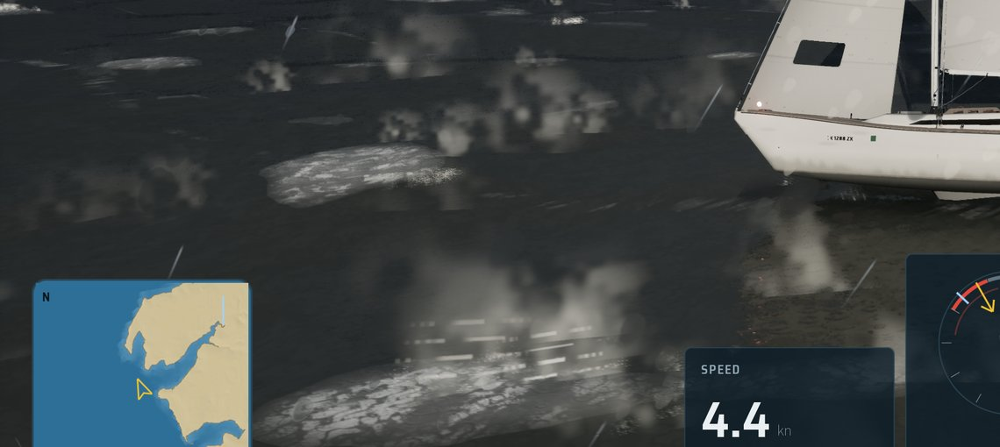

# Crest spray: streaks along the wind, not puffs

This is a follow-up to the storm look ([../README.md](../README.md)). BEN-PC's 4K Ultra stills of PR #703 (round 2, a
downpour at 29 kn) showed grey-white puffs, like steam, over the breaking crests. They were just as dense on main at the same
moment and camera, so they came from the crest spray the game already had, not from #703.

## Why they were puffs

`AWaterSurface::UpdateSpray` searches for breaking crests within 60 m of the camera. Each crest it finds throws two kinds of
spray:

- **About 20 drop clumps** (8 to 20 cm quads, each a scatter of millimetre dots in M_Spray). Past 25 m a dot is under a
  pixel, so a clump was drawn as a smooth disc instead, 2.5 times as wide and 0.4 times as opaque. A smooth disc covers five
  times as much of its quad as a clump of dots does (M_Spray's mean cover per unit opacity, measured from `SPRAY_CODE`:
  0.131 for mist, 0.026 for drops). So a far clump carried about **twelve times the ink** of a near one, and twenty of them
  together made a white ball.
- **One mist quad** of 0.6 to 1.2 m, spreading to 2.5 times that, rising at up to 0.8 m/s. It was a round, soft cloud. On
  Ultra, M_Spray's two octaves of noise give mist a cauliflower edge, which is what made it read as steam.

## What changed

`AWaterSurface::SprayQuadFor` now decides how every spray instance is drawn. The engine side and M_Spray are unchanged.

1. **Far drops keep their ink.** Past 25 m a clump still loses its grain and grows (so it doesn't alias), but its opacity
   is scaled by `SprayInkPerAlpha(1) / (SprayInkPerAlpha(grain) x growth^2)`. Its cover times its area stays what it was
   near. At 50 m a clump is 0.03 times as opaque as it was before this change.
2. **Spume.** The crest's mist is a new kind, `ESprayKind::Spume`. It hangs like mist and is carried at 0.4 to 0.7 of the
   wind, barely rising (0.2 m/s). It is drawn as a low streak:
   - its width is half that of mist the same size;
   - its length is that width plus `SpumeStreakSeconds` (0.3 s) of its level motion across the view;
   - its opacity is 0.18 of the mist envelope (mist 0.22).

   Beaufort 7 and 8 describe foam and spray blown in streaks along the wind. Across the view in a 30 kn wind (about 13 m/s
   at 2 m), a streak is 4 to 5 m long and under a metre wide. Seen along the wind it is short and about a fifth of the old
   puff's ink. The quad lies along the water: it is oriented by the spume's level motion, never its rise.
3. **Spindrift is spume too.** From 33 kn the gale's spindrift was a 1.2 to 2.4 m mist puff; it is now drawn as a streak
   the same way.

Within 25 m, the drops, the sheets, the bow wave's mist, a slam's mist and the torn crests' sheets draw exactly as before.

## Checks

- `SailingSim.Visual.SprayQuad`:
  - near drops are drawn as before;
  - drops at 30, 40, 50 and 80 m keep their near ink within 5%;
  - spume across a 13 m/s wind is more than three times as long as it is wide;
  - spume seen along the wind has under 0.3 of the old mist puff's ink.
- To do: BEN-PC 4K Ultra stills of the same downpour and 30 kn storm frames as #703's round 2, to compare against
  `Inputs/storm-look-703/pc-r2/`.
