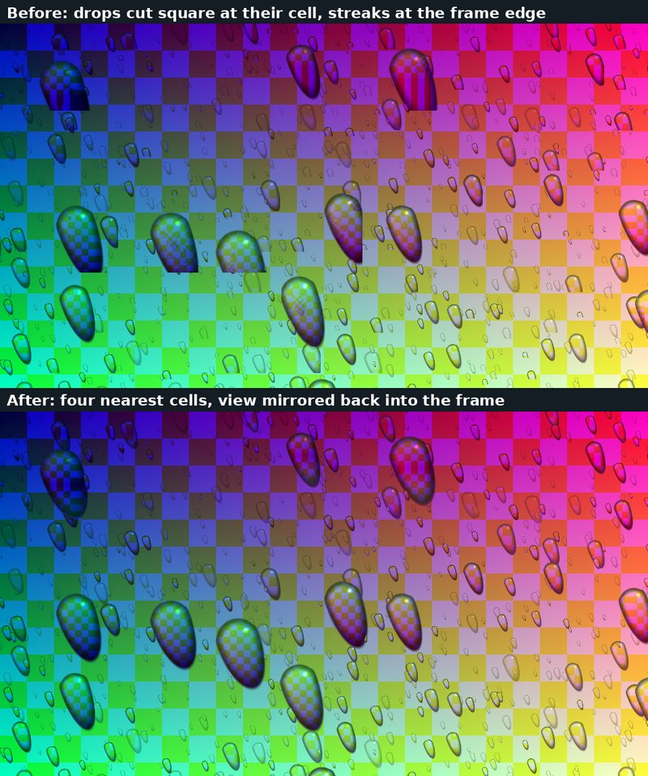

# Storm look 5: refractive lens water (`LENS_CODE`, M_LensWater)

Bean's report (sailing-feedback #24) was that the lens drops read as grey discs. The V5 drop shifted the scene a little
and dimmed it by a constant. A real drop on a lens is a cap of water with a short focal length, so it behaves like a
small lens of its own:

- **Upside down and wide.** It shows the scene behind it inverted and wide: the upside-down horizon in every wet
  action-camera frame. The shader mirrors the sample point through the drop's centre and spreads the view over
  `LENS_FIELD` (4) times the drop's own size.
- **A dark rim.** Its steep edge turns the light inside away (total internal reflection). The light through it is
  multiplied by 1 at the centre, falling to 0.4 at the rim.
- **A glint.** One sharp highlight sits high on the drop, toward the sky (up to x2.2).
- **A sharp edge.** The drop's edge on the glass is sharp: a 10% feather, where V5 used 40%.
- **Slams.** A slam's spray (`Spray`, from `AWaterSurface::LensSpray`) throws big splashes (a fourth layer, scale 4.5,
  as many as 0.35 x Spray squared). For a moment it also films the whole glass: up to 55% mask, the view through it
  wobbling.

The custom node now returns a float4: the UV shift, the water's mask and the gain on the refracted light. The gain
replaces the constant 1.06.

It is on High and up, outside the capture mode, as before. Settings > Graphics > Water on the lens (on by default, saved
as `display.lensWater`) sets the blendable's weight to 1 or 0 each frame in `ASailingEnvironment::UpdateRain`.

## Fix: drops cut off square, and streaks at the frame's edge (Nov 15)

The Mac's bow-down slam stills of #703 showed two faults in the big drops. Both are in `LENS_CODE`, so they showed with
and without `-SailingClassicFoam`.

- **Cut off square.** Each layer looked for a drop only in the pixel's own cell. A drop's tail runs downwind up to three
  times its radius, and a slam's splash is up to 0.3 of a cell across. So a big drop ran past its cell, and the part
  outside was never drawn: a hard straight edge through the drop. Now each layer looks in the four cells nearest the
  pixel. A drop is held within 0.66 of a cell of its centre (the stretch is capped at `0.66 / radius`), and drop centres
  sit 0.2 to 0.8 into their cell, so those four cells always hold every drop over the pixel. Only a slam's biggest
  splashes in a strong apparent wind have shorter tails; rain drops are unchanged.
- **Streaks at the edge.** A drop mirrors the view through its centre, five times its own size, so near the frame's edge
  it looked past the frame. The scene texture is clamped there, so the frame's last row or column of pixels was smeared
  across the drop. Now the source point is mirrored back into the frame.
- **One drop per pixel.** Where drops overlap, the pixel looks through the strongest one. The shifts used to add up.

Each layer now hashes four cells instead of one, 16 per pixel. That is a few hundred ALU operations, about
0.1 ms at 4K on the 4090 by estimate.

## Fix: the drops read as a repeating pattern (feedback #28, Nov 16)

A tester on the 4090 (Ultra, Ray Hubbard thunderstorm, 27 kn) found the near drops "too consistent and constant, so they
look like a repeating pattern". Three causes, all in `LENS_CODE`:

- **They never left.** Each layer's lattice scrolled with the wind as a whole, and a cell's drop was drawn once for ever
  (it only dimmed and brightened on a five-second cycle). So the same drops slid across the glass together, in step.
- **They were alike.** A cell held a drop when its one `sin` hash fell under the rain's chance (under 0.3), and the drop's
  place and size were fractions of that same small number. Every drop came out of a narrow band of the same few shapes, all
  with the glint in the same spot.
- **Too many.** About 550 drops on the screen at full rain.

Now (`SailingLens::DropAt` in `LensDrops.h` is the CPU twin of the placement; `SailingSim.Visual.LensDrops` holds it and
checks `LENS_CODE` still carries the same constants):

- **Each cell keeps its own clock.** Its time runs in epochs of 2.7 to 8.1 s (rain; 3.6 to 8.4 s for a slam's splashes)
  in its own phase, from an integer hash of the cell (lowbias32). Each epoch draws anew: a drop or none, where it sits, its
  size, its shape, its glint, whether it runs. A drop lands at once, sits, and dries: it shrinks by a third and fades over
  the last part of its stay. No two cells keep step, and a drop never comes back to the same place. Ten seconds on, almost none
  of the drops are the same ones.
- **The lattices don't line up.** Each layer's lattice is turned (0.7 rad a layer) and shifted, and the three rain scales
  are 11, 17 and 26 cells a screen height (no common grid).
- **Every drop is its own.** Twelve independent draws per drop: many small ones and a few big ones (radius 0.07 to 0.3 of a
  cell, by the square of a draw), a slightly oval outline with a wobble of up to 10% (no drop on glass is a circle), and
  the glint moved and brightened a little on each.
- **Fewer.** About 190 drops at full rain (a third of before); the rain rate sets how many (about 55 at 0.3).
- **The air over the glass.** `WindScreen.z` is the wind less the camera's own motion (gravity included), so it is camera
  speed too. From 3 m/s up to 15 m/s a drop's stay falls from 0.9 to 0.4 of its epoch (about 3 s to 1.4 s on average) and up
  to 70% of them run downwind, dragging a tail, as far as their cell allows. In still air none run. The lattices no longer
  scroll.
- **Dry glass costs nothing.** With no rain and no spray a layer is skipped.

A drop still stays within 0.66 of a cell of its centre and its centre 0.2 to 0.8 into its cell (a running one too: it runs
only as far as that box allows), so the four nearest cells still hold every drop over a pixel.

Offline preview (a numpy port of the shader over a plain storm frame; before and now, three moments 2 s apart; and now with
12 m/s over the glass): `python3 -I Tools/water/lens_preview.py <out dir> [rain=1] [air=0]`.
