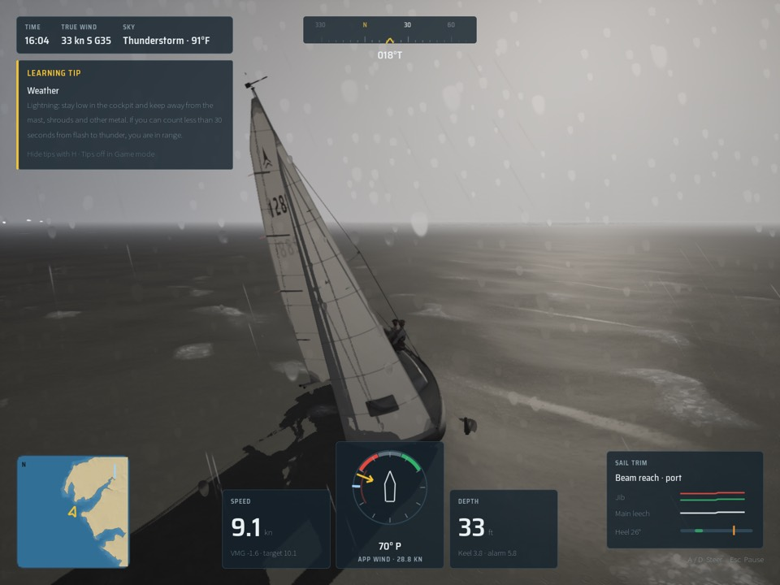
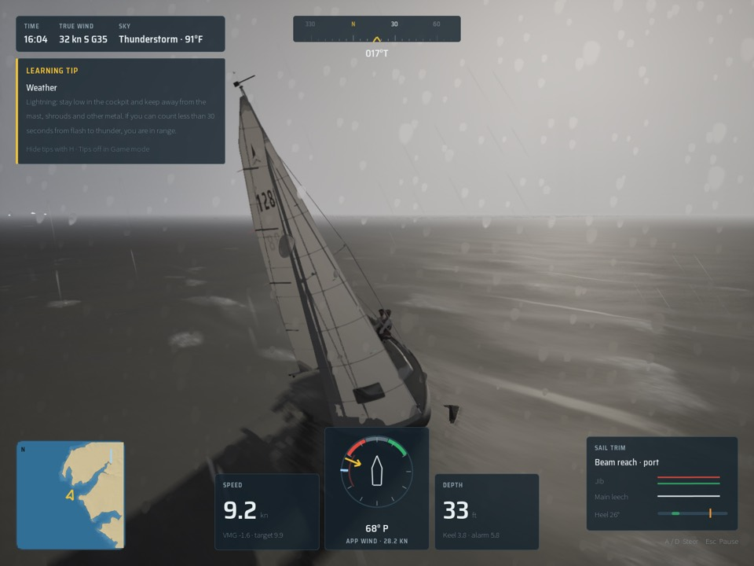
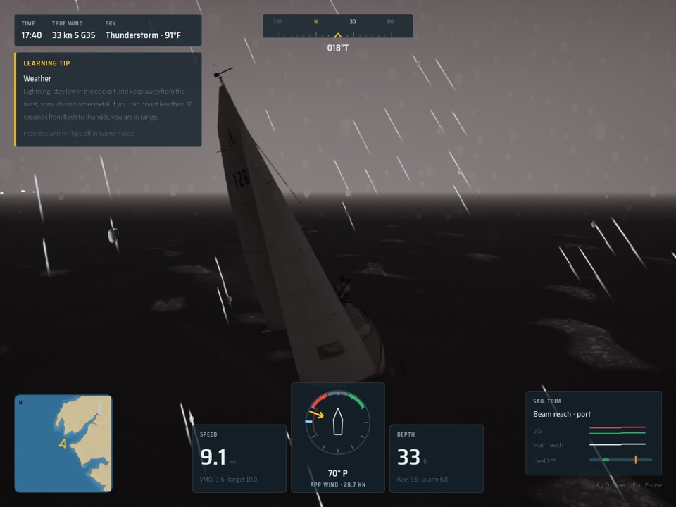
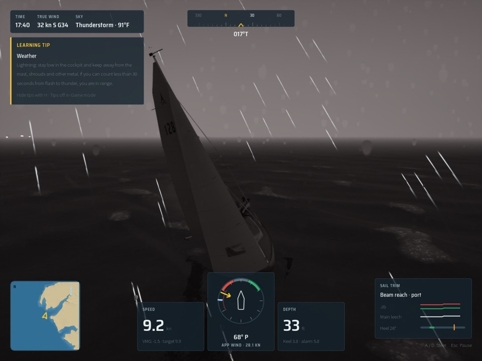
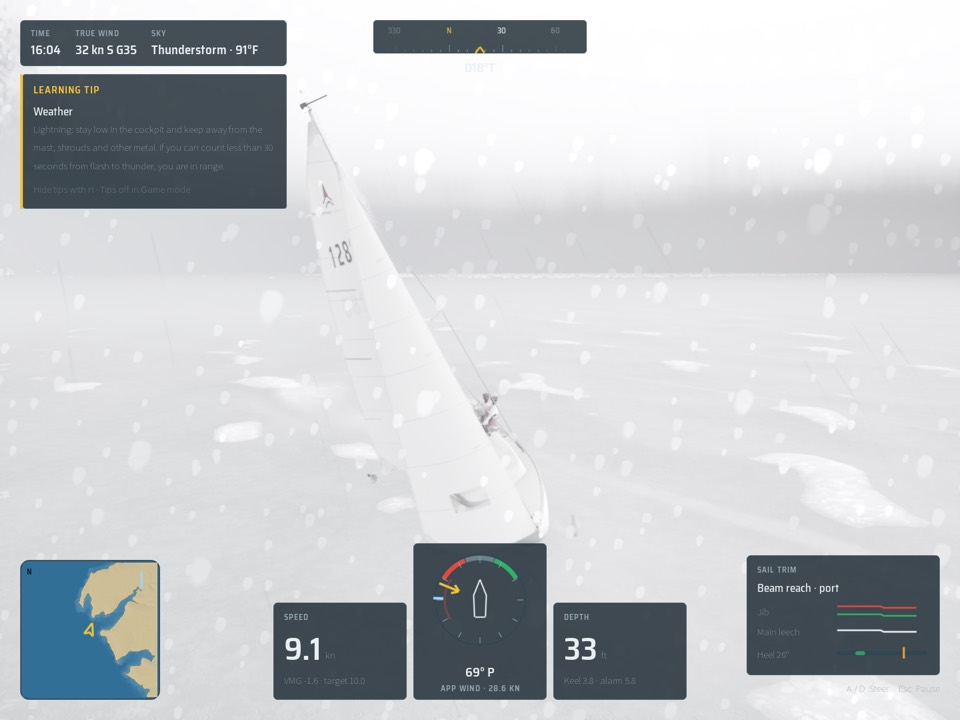
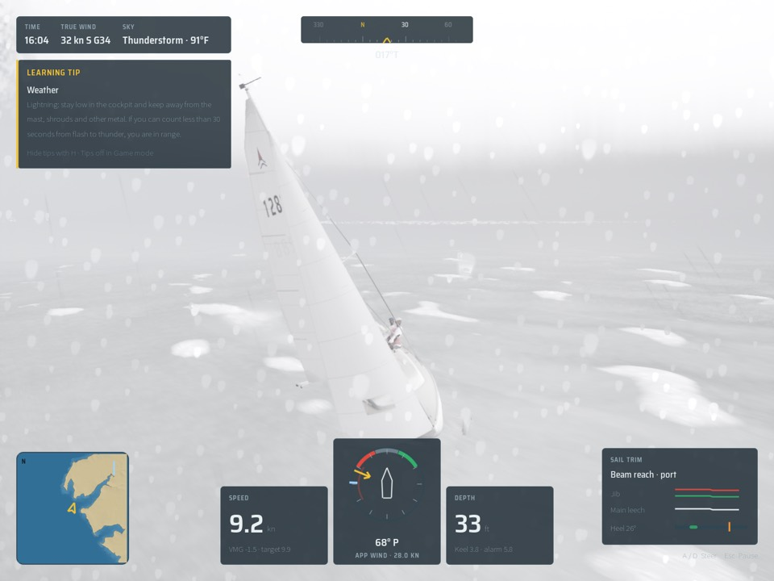

# Storm Lumen: Lumen's diffuse GI off under the storm deck on High

The storm view sat on its High floor of 45 fps, reading either side of it from run to run (44.7 to 45.6 in one session,
Nov 2 2026). That spread was the same before and after the merges first suspected. The view is GPU bound, and Lumen's
diffuse GI is about 1.7 ms of its frame.

Under the storm deck the light is the deck's flat overcast. The GI adds nothing the skylight doesn't show, so on High
`ASailingEnvironment` turns `r.Lumen.DiffuseIndirect.Allow` off past 0.7 cloud darkness and back on under 0.6. The gap
keeps the edge from flickering. The setting is put back in `EndPlay`. Ultra keeps the GI. Medium and Low aren't touched.
`-SailingFullStormLumen` keeps the GI on, to compare.

## Probes (main's package, one session, storm High, each alternating with the baseline at 44.7 to 45.6)

| Probe | fps | Lumen ms |
|---|---|---|
| Baseline | 44.7, 44.9, 45.4, 45.6 | 1.9-2.4 |
| `r.Lumen.ScreenProbeGather.DownsampleFactor=32` | 45.1, 44.7 | 1.9 |
| `r.Lumen.ScreenProbeGather.TracingOctahedronResolution=4` | 44.9, 45.4 | 1.9-2.2 |
| GI scalability Medium (`-SailingGI=1`) | 45.5, 45.2 | 1.6-1.7 |
| `r.Lumen.DiffuseIndirect.Allow=0` | 46.9, 47.1, 47.7, 47.3 | 0.3-0.4 |

Only turning the GI off buys a frame.

## The change (one package, one session, High, with it and with `-SailingFullStormLumen`)

| View | With | Without |
|---|---|---|
| storm | 48.0, 47.0 | 45.3, 44.8 |
| helm-eye (control) | 57.9, 55.6 | 58.3, 56.6 |
| crew (control) | 46.2, 46.2 | 46.7, 46.2 |
| storm, no random lightning (still) | 47.4 | 44.8 |
| storm at dusk, 17:40 (still) | 58.0 | 52.3 |
| storm, held flash (still, `-SailingFlashHold`) | 47.4 | 43.9 |

## Stills (with the change on the left, without on the right)

Random lightning is off for the day and dusk pairs. A flash lights the scene white at random moments, which made an
earlier pair look different for no reason. `-SailingFlashHold` (a stills-only flag) holds the storm's first strike at full
flash, so the flash pair shows the scene lit by lightning.

| With | Without |
|---|---|
|  |  |
|  |  |
|  |  |
