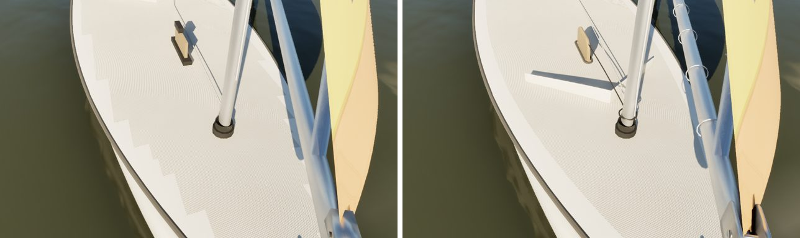
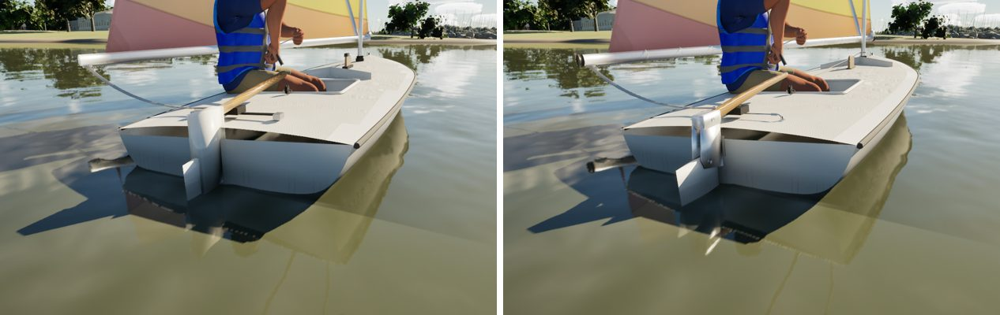
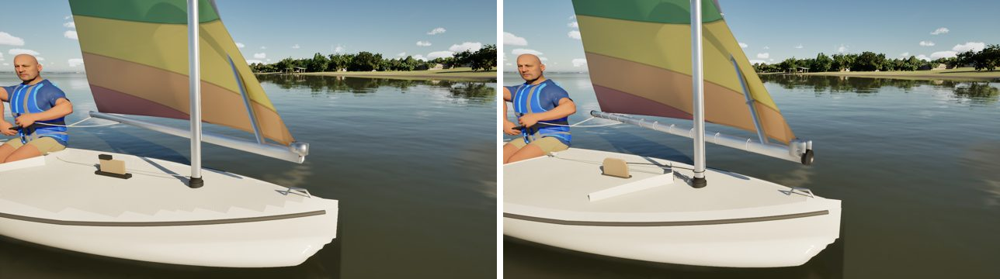
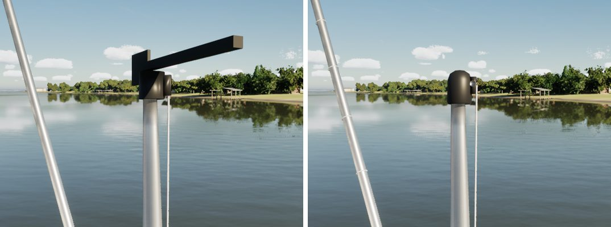
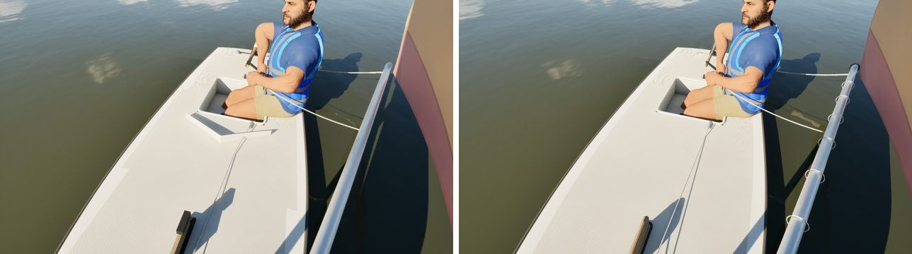
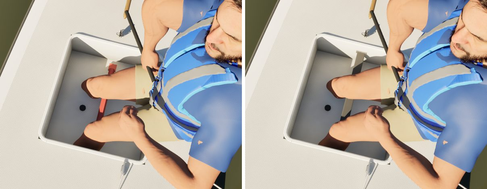

# Sunfish, assembly by assembly (boat fidelity: pc/sunfish-fidelity)

This is the boat-fidelity queue's first fleet boat, done with the J/22's method: one assembly at a time, a reference
against the render for each, sockets checked before baking, and FleetMesh, BoatBudget and HardwareKit kept green.
Bean's own Sunfish photos aren't in yet (`Data/Reference/raw/boats/Sunfish` is empty), so this is the non-photo pass:

- **References:** class layout, plus five Wikimedia Commons Sunfish photos already on this machine (CC BY 2.0,
  CC BY-SA 3.0 and 4.0, public domain; `Artifacts/commons-sails`).
- **Comparisons:** reference, before and after for each assembly, in `compare/`. That folder is git-ignored and never
  committed, because the photos show people.

When Bean's photos land, the boat gets a photo pass.

Everything is in `Tools/blender/build_fleet.py`. The renders are the game at Ultra.

## What changed

| Assembly | Before | Now |
| --- | --- | --- |
| Rudder head | a white box | the cast aluminium head: two cheeks round the blade's top on a through-bolt with nuts (the blade's kick-up pivot), a barrel round the pintle on the pivot axis, split where the transom's gudgeon takes it, the pin and its head |
| Rudder blade | its leading edge 4 cm ahead of the pivot, inside the transom | hung aft of the pintle |
| Gudgeon | none | a stainless plate on the transom with four screws, its barrel between the head's two |
| Tiller | a round stick | varnished, deeper than wide (30 x 42 mm at the head, tapering to a rounded grip), in the head's socket under a bolt |
| Bridle | a black rope and two boxes | a stainless wire with swaged eyes on two eye straps; the mainsheet's lower block hooked on it |
| Daggerboard | a plank and a black box | varnished, 19 mm thick, 12 cm proud, its top corners rounded and its top edge eased; the black rubber gasket round the slot; the shock cord from an eye on the board to the mast |
| Splash guard | behind the trunk, at the well | between the trunk and the mast, as on the boat: a 6 mm moulded wall 7 cm tall at the point, with a rolled top |
| Halyard | from the mast foot straight to the cleat, through the guard | down the mast's forward face, round to a fairlead at its foot, over the guard's port arm, to the cleat |
| Bailer | a black box | the oval cast rim screwed to the sole, its scoop and the flap |
| Deck | the non-skid border stepped like a staircase, cell by cell | the border follows the sheer 8 cm in |
| Spars | bare | the sail laced to the yard and boom with line ties every 30 cm; the tack's jaw as two stainless cheeks on a bolt with nuts; the halyard's band and eye on the yard; black plugs in the boom's ends |
| Masthead | a cylinder, and the game's 45 cm stand-in wind fly | a turned cap with its sheave; no fly (`SailboatPawn`: a Sunfish carries none) |

The deck's smooth border is an option of `deck()` (`smooth_margin`). Only the Sunfish uses it here; the ILCA can take it
in its own pass.

## Kept as they were

- **Sockets:** all eight are unchanged (`Sunfish_sockets.json` is identical before and after), so there were no socket
  moves to report.
- **Measures:** LOA, beam, canoe volume and centre of buoyancy are unchanged (FleetMesh).
- **The well:** it stays at x -1.18 to -0.52. On the boat it sits right behind the trunk, but `CrewPose.cpp` places the
  crew by this well (the crew's lane), so it can't move from here. That is the one layout gap left, and the photo pass
  should take it up with the crew lane.
- **Budgets:**
  - Triangles: hull 31,158 (was 28,332), mast 719 (643), boom 2,358 (320), rudder 548 (340).
  - Material slots: hull 3, mast 2, boom 1, rudder 2, all unchanged.
  - The kit's hero padeyes and block would have taken the hull past its 40,000 triangles, so the bridle's parts are
    built light here.

## Renders (before | after)

## Hiking strap (pc/sunfish-strap)

The Mac saw a red bar on the well's floor under the sailor's shin. It was the hiking strap: a red tube 36 mm round,
6 cm off the sole, with two red pads at its ends. It is now flat black webbing, 50 mm wide, down the well's middle and
taut between its end walls under screwed stainless retainer plates, with 2 cm of sag so the sailor's feet tuck under it
(`sunfish_hiking_strap`, `STRAP_TOP_ABOVE_SOLE`).

Coordinates are the boat frame in metres: x forward, z up from the design waterline. The sole is at z 0.047.

- **Ends:** x -1.176 (aft wall) and -0.524 (forward wall). The strap's top is 12 cm over the sole there, at z 0.167.
- **Middle:** at x -0.85 the top is 10 cm over the sole, at z 0.147.
- **Width:** y -0.025 to 0.025. The webbing is 3 mm thick.

Sockets are unchanged. The hull is 31,558 triangles. FleetMesh, BoatBudget and HardwareKit pass.

