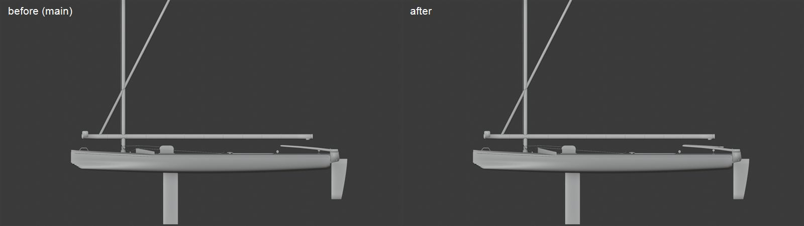
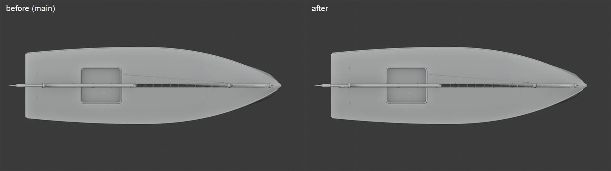
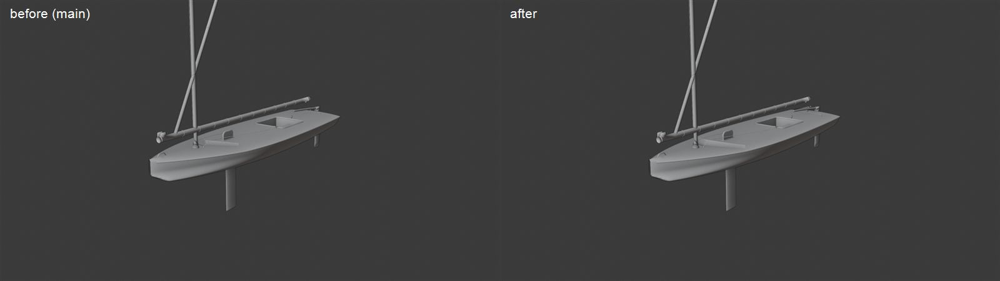
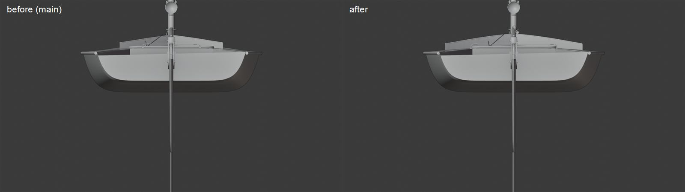
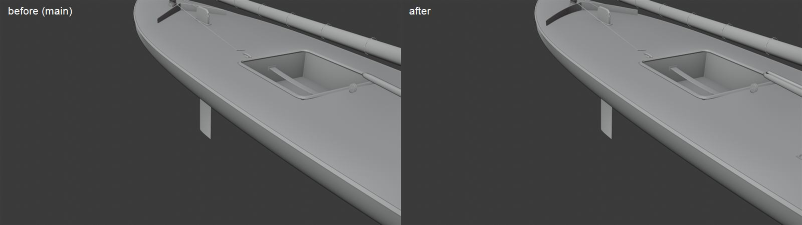

# Sunfish hero (slice #405, part 1: pc/sunfish-hero)

The Sunfish brought closer to the real boat, with a bought model as a measured shape reference. Everything is built in
`Tools/blender/build_fleet.py` and still sits exactly on the physics hull below the waterline
(`SailingSim.Visual.FleetMesh`). Rebuild with `scripts\windows\make-boat-models.ps1 -Parts fleet -Fleet Sunfish`.

## The reference

Sunfish shape reference: TurboSquid model 1460907 (Standard License); proportions only, not redistributed. Its file
stays on the PC in the git-ignored `Data/Reference/raw/boats/Sunfish`. None of its geometry or textures ship, and its
renders aren't in the repo. Its logos (the class's on the hull and sail, and a sponsor's on the sail) are never copied.

Measured in Blender (its hull is 4.23 x 1.27 m against the class's 4.19 x 1.24; ours is the physics', 4.19 x 1.24):

| | Reference | Ours |
| --- | --- | --- |
| Hull depth | 0.355 m | about 0.34 m |
| Mast | 3.05 m tube, its step 0.11 m up, 1.00 m aft of the bow | masthead about 3.4 m over the hull bottom, 0.85 m aft of the bow |
| Daggerboard | 0.236 m chord, centre 1.94 m aft of the bow | 0.24 m chord, centre 1.55 m aft of the bow |
| Splash guard | a curved V 1.1 m across, 8 cm tall, just ahead of the trunk | was a straight V 0.72 m across |
| Bridle eyes | 0.30 m in from the transom, 0.30 m out | were 0.18 m in, 0.20 m out |
| Tiller | 1.23 m, with a 0.90 m extension | 0.80 m (the physics' `tiller_length`), no extension |
| Spars | lower and upper about 4.07 and 4.14 m; sail 3.96 m along the boat | the physics rig's 3.6 m foot |

## Changed in this step

- **Splash guard:** the arms reach 0.48 m out and bow forward in a curve, the moulded guard's sweep (it was a narrow
  straight wedge), 8 cm tall at the point. The halyard still crosses its port arm where it did.
- **Bridle:** its eyes 0.30 m in and 0.30 m out, so the wire spans the after deck as on the boat. The traveler sockets
  move with it (they only place the mainsheet's rig lines).
- **Tiller extension:** a black tube on a rubber universal joint at the tiller's end, stowed back along it. The crew's
  hand stays on `TillerEnd`.

Hull 31,686 triangles (the budget is 40,000).

## Left for the physics (frozen for the slice: the sim lane's follow-up)

- The mast steps about 15 cm forward of the reference's, and the daggerboard's centre about 39 cm forward (`FBoatConfig`'s
  `mast_x` and the board's `Center`, which set the balance and the polar).
- The masthead is about 20 cm higher, the spars shorter, and the tiller shorter than the reference's (the physics rig's
  numbers, which the crew and the sail follow).
- Because the board is forward, the trunk sits about 1 m ahead of the well, where on the boat it is at the well's front.
  The well's place is visual (`SPECS`), but the crew's seat and the hull-clip checks follow it, so it moves with the board.

## Stills

Our model in Blender (workbench), before (main) and after, from the same cameras:

| View | Still |
| --- | --- |
| Profile |  |
| Plan |  |
| Three-quarter |  |
| Stern |  |
| Deck |  |
