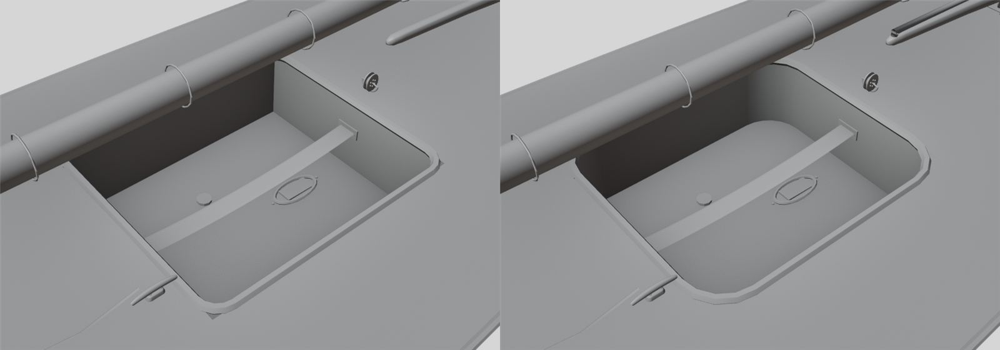
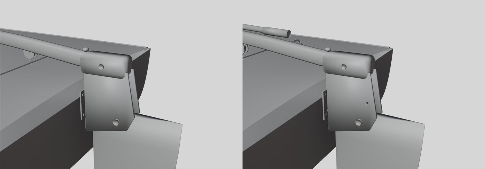

# Sunfish hero, step 2 (slice #405: pc/sunfish-hero-2)

Visual only, in `Tools/blender/build_fleet.py`, against the TurboSquid model 1460907 reference (Standard License;
proportions only, not redistributed: see step 1's README). Mast, board, spar and tiller lengths stay the physics'.

Most of the reference's fittings were already on our boat from the earlier passes (`docs/sunfish-detail`,
`docs/fleet-hero`): the bridle's eye straps and wire with the mainsheet's lower block, the halyard down the mast to its
fairlead and horn cleat, the gooseneck jaw, the sail tied to both spars every 30 cm, the rudder head's cheeks, gudgeon
and pintle, the bailer, the drain plug and the hiking strap. The sail's insignia is our made-up emblem (`M_SailCloth`);
no class or sponsor logo. This step adds what was still missing:

- **The well's corners** are moulded round, 10 cm (`WELL_CORNER`), as on the boat; they had been square. The walls, sole
  and moulded lip follow them. The deck's cut stays the rectangle, and deck-level fillets close its corners.
- **The kick-up's spring pin** goes through both cheeks aft of the pivot, holding the blade down, with its pull ring.

Hull 31,612 triangles (budget 40,000), rudder 596. `SailingSim.Visual.FleetMesh`, `HardwareKit` and `BoatBudget` pass.

Our model in Blender (workbench), before (main, left) and after (right):

| | |
| --- | --- |
| The well |  |
| The rudder head |  |
