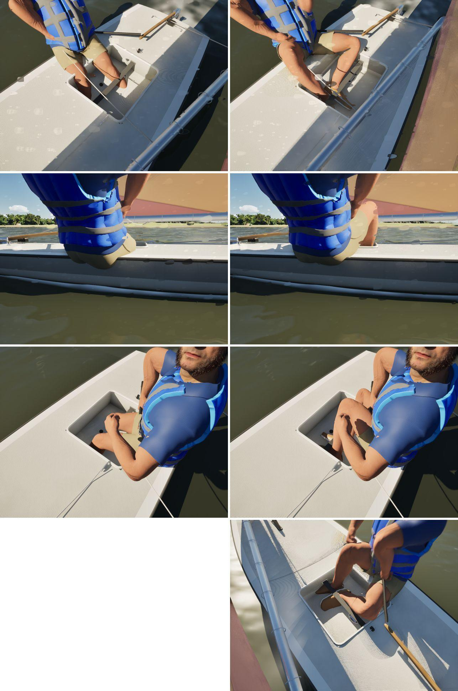

# The Sunfish sailor's feet under the hiking strap

With pc/sunfish-strap (#279), the Sunfish's hiking strap is flat webbing along her cockpit well's centreline. The
sailor's feet stood beside it on the well floor and a shin went through it. The well's floor was also 2.7 cm below the
one the model draws.

## Changes

- **The well** (`CrewCockpitWell`, `CrewPose.cpp`):
  - The sole is the model's, 0.047 m up from the waterline. It used to be the sheer less the well's depth: 0.020.
  - The well has a strap: from x -1.176 to -0.524 (the well's aft and forward walls), its top 0.120 m over the sole at
    the ends and 0.100 midway (a parabola), 3 mm of webbing, 25 mm either side of the centreline. These are the PC's
    numbers from `build_fleet.py`.
  - `CrewInsideBoat` counts the strap solid, like the J/22's traveller track: never a floor.
- **The feet** (`CrewMotionPose`, `CrewMotion.cpp`). In the dinghy stance on a boat with a strap:
  - Each ankle goes just to windward of the webbing, 7.5 cm over the sole. The feet are 0.12 and 0.30 m ahead of the
    hips, and at least 10 cm off the forward wall, where the toes met it.
  - Each foot is then turned about the ankle so the ball is across the centreline, low over the sole, under the strap.
    Hiked, the legs' reach had tipped the toes up through it.
  - The feet are levelled on the sole, as a seated sailor's are.
  - With a foot at the hips' own station, the hiked aft leg folded back and splayed its knee out over the deck.
- **The seat** is unchanged: the crew position (x -0.9) is already beside the well.

## Test

`SailingSim.Visual.SunfishStrap` (new; since the ILCA seat, `SailingSim.Visual.DinghyStrap`) covers SK_Sailor and the MetaHuman crew, sitting up and hiked, on both tacks:
- each ankle is within the strap's length and close beside it;
- the foot from ankle to ball goes beneath the webbing, never over it;
- no point along either shin is within 4 cm of it.

The other crew visual tests all pass (12 of 12), including `CrewMotionFeet` and `CrewHullClearance`.

## Stills

Main with #279 left, this branch right. From the top: the well from above while hiking, the hiking sailor from
leeward, sitting up in light air, and (right only) hiking on port.

