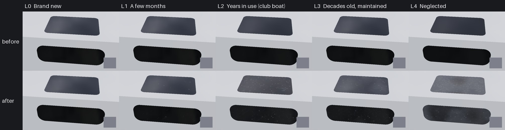

# Texture loop: smoked acrylic portlights and hatches (Nov 9 2026)

The smoked panes in the boats' portlights and hatch lids (`CabinWindow`, and the hero J/22's `PortlightAcrylic` and
`HatchAcrylic`) had no wear of their own. Because the slot carries a clear coat for its gloss, an aged boat's panes
were treated as gelcoat: they took the gelcoat's chalk, yellowing and rust weeps, which hardly show on a near-black
pane. They now wear as acrylic does, with the boat's Age and Care through the loop's Time/Dirt split
(`docs/texture-loop`), on the boats (`M_BoatSurface`, `M_BoatPacked`), the hardware kit (`M_BoatKit`) and the hero
J/22's glass (`M_J22HeroGlass`).

## What changed

- **Surface kind 14, smoked acrylic glazing** (`scripts/make_materials.py` `BOAT_SURFACE`): the `CabinWindow` slot.
  With an Age, kind 14 no longer counts as gelcoat (`gel` is zeroed), and BOAT_CODE's detail-map block skips it (no
  gelcoat orange peel on acrylic).
- **The wear lines** sit in `BOAT_CODE` between `// ACRYLIC_WEAR >>>` and `// ACRYLIC_WEAR <<<`, run when `surf == 14`:
  - *bleach*: the smoke dye fades a little toward bronze on faces that see the sky (`0.6 timeK`);
  - *haze*: a milky scatter over the smoke, the gloss and clear coat going, by `timeK (0.12 + 0.55 dirtK)`, halved
    by polishing (Care), in 2.5 and 0.8 cm patches;
  - *dust*: the lake's tan clay film on the tops, by `dirtK`;
  - *crazing*: patches (a 6 cm noise) of a broken net of 60 micron hairline cracks about 2.5 mm apart, silvery,
    from about the tenth year (`saturate((timeK - 0.3) / 0.5)`), more on a left boat; the crazed patch hazes too;
  - *wiping scratches*: fine bent hairlines 0.6 to 1.7 cm long, two offset layers of 1.2 cm cells, more each year;
  - *water spots*: hard lake water dries to white mineral rings 1 to 2.4 mm across, mostly on the tops, by `dirtK`;
  - *mildew*: dark specks on a left boat (`dirtK` over 0.6, low Care).
  The cracks, scratches and ring edges are filtered to the pixel (`fwidth` of the pane's projection) and fade out
  between 1.5 and 4 m, so far boats don't shimmer.
- **Age unset (-1: the player's and the AI boats in play): exactly as before.** Every line is gated on `age >= 0`.
- **M_BoatKit** (`scripts/import_hardware_kit.py`) runs the same lines for kind 14 (the `Portlight` panes and the
  `HatchFwd` lid), copied out of `BOAT_CODE` at import time, as it does the black plastic.
- **M_J22HeroGlass** (`scripts/import_j22_hero.py`) gains `Age`, `Care` and `Acrylic` (0 on the bilge water) and runs
  the same lines; the haze, crazing, dust and spots also make the pane less see-through (opacity toward 0.97).
  `-SailingBoatAge` now ages the hero's glass too (`BoatModelVisuals.cpp`), so the stills show it.
- No new textures, no texture reads: Medium included.

## Levels

Albedo on the panes (Lab L*), from the swatch renderer (`Tools/texloop/acrylic/render_levels.py`):

| Level | Hatch top L* | Portlight L* | What shows |
| --- | --- | --- | --- |
| L0 new | 7.0 | 7.1 | clear glossy smoke |
| L1 months | 9.6 | 7.9 | a few faint wipe scratches, a stray spot |
| L2 club boat | 24.2 | 16.4 | dust film and water spots on the hatch, scratches, light haze |
| L3 decades, kept | 23.0 | 15.4 | clean; crazed patches, many fine scratches, some haze |
| L4 neglected | 39.8 | 31.6 | milky, crazed over most of the pane, dust, spots, mildew |

All five are estimates: no CC0 or CC BY photo of weathered smoked portlights could be fetched from the cloud
(Wikimedia's image host refuses it). The marks are sized from CC0 ambientCG imperfection scans (scratches, water spots,
smears: `Tools/texloop/refs/acrylic.json`). Close-ups of the club J/22's portlights and fore hatch, overcast with a coin
for scale, would give real targets. Card `Tools/texloop/cards/acrylic.json`.

## Rounds

Three fresh blind reviewers a round (`Tools/texloop/reviews/acrylic.json`):

| Round | Change | Ladder | A/B vs last |
| --- | --- | --- | --- |
| 1 | first build | 5, 5, 5 | beat main 3/3 at L2 and L4 |
| 2 | scratches gathered where hands wipe, spots in drying patches | 5, 5, 5 | L2 1/3, L4 2/3: reverted |

**This PR is round 1.** Every reviewer called it smoked acrylic. What they still see: the water spots read as stamped
dots and the scratches as short random dashes rather than wipe arcs; the swatch panes show little reflection (the
numpy renderer has no screen-space reflections) and no rim. In-game stills on the real portlights are the better judge.

## Checks

`python Tools/texloop/acrylic/test_acrylic.py` (HLSL, kit, hero glass and port agree; Age unset and new unchanged;
ladder order), `python Tools/texloop/test_wear.py`. `SailingSim.Visual.BoatLibrary` now also checks
`MI_Boat_CabinWindow` is kind 14. Still to run on the machines: the Mac shader compile and boats gate (a 3 x 3 Voronoi
loop inside a near-camera branch is the one new cost), then PC import (`make-content`, `import_hardware_kit.py`,
`import_j22_hero.py` with `HERO_MATERIALS_ONLY=1`) and `-SailingBoatAge` stills of the J/22's portlights.

## Tools

`Tools/texloop/acrylic/port.py` (numpy copy of the block), `render_levels.py` (a cabin corner with a hatch lid and a
portlight, same sky as the loop), `make_sheet.py`, `test_acrylic.py`.
