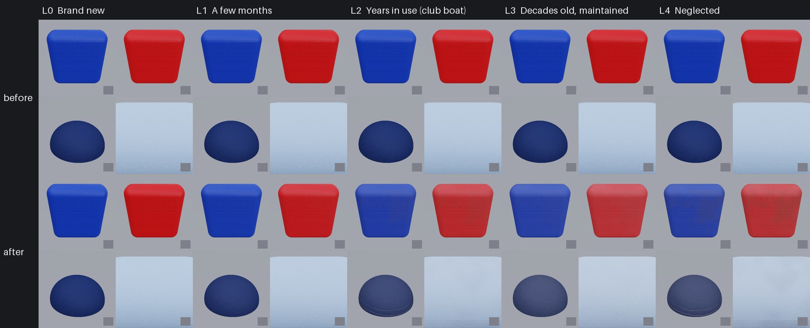

# Texture loop: crew gear cloth (Nov 9 2026)

The crew's cloth (`M_CrewFabric`: the life jackets' nylon shells, the knit polos, the cotton caps and shorts) had no
wear: every sailor's gear looked new on every boat. It now wears with an Age and Care through the loop's Time/Dirt split
(`docs/texture-loop`), five levels from new to a vest left damp in a locker.

## What changed

- **`FABRIC_WEAR`** in `scripts/make_materials.py` `FABRIC_CODE` (between `// FABRIC_WEAR >>>` and `<<<`), after the
  scan's colour, normal and roughness:
  - *sun fade*: the dye loses chroma and lifts toward a warm pale grey (royal blue to powder blue, red to salmon,
    yellow to cream), by `timeK^0.7`, most where the cloth sees the sky (shoulders, the cap's crown), patchy in 9 cm
    blotches and on the knit's raised loops;
  - *coating loss*: the nylon shell's polyurethane coat goes matt (roughness toward 0.88 by `0.6 timeK`);
  - *grime*: an even dinge plus 14 cm grey-tan blotches (sweat, sunscreen, the lake's clay dust) by `dirtK`, more on
    faces that don't see the sky;
  - *pilling*: the polo's knit balls up in a share of 1.2 mm cells that grows with wear (within 1.5 m; a little fuzzier);
  - *sweat lines*: wavering pale lines with a darker edge, 1.6 cm apart, round the cap's sweatband once `dirtK` passes 0.2;
  - *mildew*: 5 cm clusters of dark grey-green specks on gear put away wet (`dirtK` over 0.5, low Care); from afar a
    shadow, the specks themselves within 1.5 m.
- Everything is laid out in the garment's own UVs (new `UVm`: metres a UV unit), so it rides with the sailor instead of
  swimming through the world.
- **New parameters on `M_CrewFabric`**: `Age` (-1: off), `Care`, `Kind` (0 none, 1 nylon shell, 2 knit, 3 twill cap,
  4 twill shorts), `UVm`, and the vertex normal for the sun's dose. `FABRIC_WEAR_KIND` gives each instance its kind:
  PFD shell 1, polo and rib 2, cap 3 (UVm 0.106: its UVs are in the unit mesh), shorts 4. Webbing and shoe leather stay
  kind 0 (the webbing is the webbing/rubber pass's).
- **The pawn** (`SailboatPawn::AddMetaHumanFigure`) sets Age and Care on the crew's cloth instances (shorts, polo, vest,
  the fallback vest, cap), only where the instance's material is `M_CrewFabric`. **By default the player's crew wear the
  club's gear at L2** (6 years, Care 0.5: Bean's choice, Nov 9, like the sailing school's vests); `-SailingCrewAge=<years>[,<care>]`
  or `-SailingBoatAge` set it, and a negative age (`-SailingCrewAge=-1`) shows the gear new, as before.
- **Age unset on the material: exactly as before.** No new textures, no extra texture reads: Medium included.

## Checks (round 2, the PR)

| Check | Result |
| --- | --- |
| Colour | L2 royal blue vest a* 17.6, b* -45.7 against Bean's lesson photo (school vest after several seasons) a* 16.0, b* -47.0 (white balance corrected on the grey webbing): dE 2.1, pass. L0, L1, L3, L4 are estimates (no other worn-gear photos reachable; Wikimedia's image host refuses the cloud) |
| Size | fade 9 cm, grime 14 cm, mildew clusters 5 cm, pills 1.2 mm, sweat lines 1.6 cm apart; closest crew camera about 0.6 m |
| Tiling | procedural in garment space, no new maps |
| Wear ladder | 5, 5, 5 of 5 |
| Blind A/B | L2 won 3 of 3 against round 1; L4 1 of 3 (two reviewers liked round 1's heavier look). Round 1 beat main 3 of 3. Nobody called it the wrong material |
| Budget | no new maps or samples; about 40 ALU lines on the crew cloth only |

Rounds in `Tools/texloop/reviews/crewfabric.json`. Round 3 (denser mildew) lost and was reverted.

What the reviewers still see: the test shapes have no seams or straps (the game's vest does); the existing Fabric048
scan's fine grid shows at 50 cm; wear could gather at edges, straps and creases (needs an edge mask in the garments).

## Files

| Path | What |
| --- | --- |
| `Tools/texloop/crewfabric/port.py` | FABRIC_WEAR in numpy, line for line |
| `Tools/texloop/crewfabric/test_crewfabric.py` | the HLSL, port and pawn agree; Age unset changes nothing; the ladder's order |
| `Tools/texloop/crewfabric/render_levels.py` | the swatches (vest blue and red, cap, polo) with the CC0 scans (`Tools/fabrics/fetch_fabrics.sh`) |
| `Tools/texloop/crewfabric/make_sheet.py` | the sheet above |
| `Tools/texloop/{cards,refs,targets,reviews}/crewfabric.json` | card, references (Bean's photos measured only: they show people), targets, reviews |

## Still to do

- Mac: `scripts/make-content.sh` (rebuilds M_CrewFabric and its instances), the build (SailboatPawn.cpp), `-SailingCrewAge`
  stills, the crew gate. The PC has nothing to do: the crew cloth is built by make_materials.py on the Mac.
- Bean chose L2 gear for club crews by default (Nov 9). A per-boat or per-sailor spread (some newer vests) could follow.
