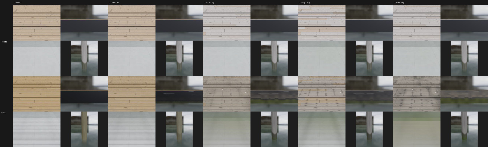

# Texture loop: club dock surfaces (Nov 9 2026)

The Rush Creek docks are where every lesson starts and most end, a few metres from the camera. Their surfaces had little
or no wear ladder: the deck silvered on `age / 4` and darkened on `aged x (1 - care)`, the pilings read `aged`, the black
floats and rub strips were one flat 0.05 black (pattern 0), and the launch ramp was plain concrete with no grooves (though
the ramp code's comment said it had them). They now wear with the structure's E1 Age and Care through the texture loop's
time/dirt split (`docs/texture-loop`), in `M_WorldSurface`.

Top row main, bottom row this branch; each panel is deck boards from standing height, a floating dock's edge at the
waterline, the launch ramp, and a piling. Rendered from the shader text itself (`Tools/texloop/dock/hlsl_np.py` runs the
HLSL on numpy) under the loop's CC0 overcast sky.

## What changed

- **`dkT` and `dkD`** (top of `WORLD_SURFACE_CODE`, after `zw`): the boats' `timeK` and `dirtK` on the same Age and Care.
  `test_dock.py` checks them against `Tools/texloop/wear.py`. Only the dock patterns read them; the rest keep `aged`.
- **Deck boards (pattern 1).** Fresh pressure-treated pine is honey-tan; the years silver it within two or three
  (`saturate(1.8 dkT)`, faster facing the sun), open more and wider checks, raise the grain and cup the boards; a kept old
  dock has replaced boards (browner). Screws go from bright zinc to dull, and bleed black iron-tannin stains along the
  grain. Dirt is mildew in 25 cm clusters (darkening plus a few specks), green at the gaps and board ends on a left
  dock, and gull droppings.
- **Pilings (pattern 9).** New: treated green-tan with tight cracks and hardly a band (the band takes a season). Years
  silver them and open the cracks; dirt darkens the band, greens its lowest part with slime, and thickens the growth below.
  Salt water's barnacles unchanged.
- **Black polyethylene (new pattern 11): floats and rub strips.** `MI_World_Floats` (and `KitLook` in `WorldKit.cpp`)
  moves to pattern 11 at 0.025 black, 0.55 roughness. UV chalk in blotches with the years; pale scuffs along the rub
  strips (above 0.27 m only) where boats lie; at the float's waterline a slime line within a season, green-brown and
  taller on a left dock, dark growth below it, the lake's tan silt dried on above. The dock-kit float drum
  (`SM_Dock_Float`, `Tools/blender/build_docks.py`) moves from the `Dark` slot (`MI_World_Tyre`, shared with car tyres)
  to `Floats`; `import_world.py` maps the slot.
- **Launch ramp (concrete with UV1 flag 4).** `MarinaActor` tags the ramp slab (`UV1.y = -1004`; the kerbs stay plain).
  Grooves across it every 6 cm (fading to their mean where a pixel can't resolve them), two darker tyre lanes, a damp
  band above the water, a slick green-brown film at and below it (most on a left ramp), silt above that. The rest of the
  world's concrete is unchanged.
- No new textures or texture reads: Medium included.

## Levels and numbers

Deck albedo (dry boards, gaps included) against the median of the CC0 Poly Haven scans per level
(`Tools/texloop/targets/dock.json`, refs `Tools/texloop/refs/dock.json`); the colour check is a* and b* within 6:

| Level | Render L*, a*, b* | Scan target L*, a*, b* | a*b* distance |
| --- | --- | --- | --- |
| L0 new | 54, 4.7, 23 | 48, 8.8, 26 | 4.9 |
| L1 months | 54, 3.9, 20 | 45, 6.4, 16 | 5.1 |
| L2 club, 6 y | 47, 0.9, 9.7 | 34, 3.8, 14 | 5.3 |
| L3 kept, 30 y | 52, 1.2, 10 | 29, 1.8, 5.2 | 5.2 |
| L4 left, 20 y | 41, 0.0, 7.6 | 37, 4.8, 10 | 5.6 |

All pass, narrowly. The scans are darker than the renders in L* (scanned albedo tends to be), so L* isn't held to them.
The black float starts at L* 18 (scans 13-18). Pilings: dry wood a*b* within 2.5 of the weathered scan at L2/L3; the L4
moss scans describe the wet band, not dry wood. The concrete scans differ too much from one another to give the ramp a
colour target. Real club photos with a grey card (boards, floats, the ramp at the water) would settle all of this.

## Rounds

Three fresh blind reviewers a round (`Tools/texloop/reviews/dock.json`):

| Round | Change | Ladder | A/B |
| --- | --- | --- | --- |
| 1 | first build | 5, 5, 5 | beat main 3/3 at L2 and L4 (main read as white composite decking) |
| 2 | straighter, fewer rub-strip scuffs; fuzzy slime edge; mildew in darker clusters; ramp grooves fade with distance, damp band; less regular piling grain | 5, 5, 5 | beat round 1 3/3 at L2 and L4 |
| 3 | float chalk capped greyer; fewer droppings; darker, gritty ramp | 5, 5, 5 | lost (L2 0/3, L4 1/3): reverted |

**This PR is round 2.** What reviewers still see: the ramp reads flat (grooves and grit don't resolve at swatch
distance), the piling reads as a smooth pipe with a hard band, the L4 float's chalk can read beige, droppings look like
confetti, and mildew specks are still a little even. Next round: piling checks and a ragged band, a ramp with real wet/dry
grading, and maybe a foot-traffic lane on the boards.

## Still to do

- **Mac**: shader compile of `M_WorldSurface` and the world gate (`scripts/gate.sh --scope world`); the C++ change is two
  lines in `MarinaActor.cpp` (the ramp tag) and one in `WorldKit.cpp` (the Floats look).
- **PC**: rebuild materials (`MI_World_Floats`), rebake the marina (the ramp's UV1 tag lives in the baked tiles), rebuild
  and reimport the dock kit (`make-world-models`) for the float drum's slot; then stills at the club.

Tools: `Tools/texloop/dock/` (see its README).
