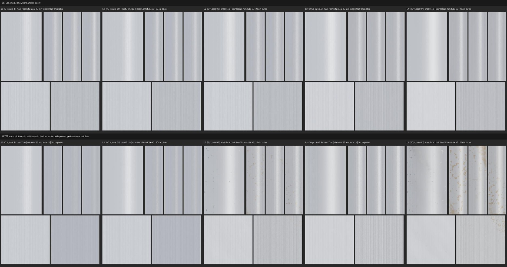

# Texture loop: aluminium and stainless (Nov 8 2026)

Bean's ask: run the texture loop (`docs/texture-loop`) one surface at a time. This is the metals: clear-anodised
aluminium (J/22 mast and boom, Sunfish spars; BOAT_CODE surface 4) and 316 stainless (stanchions, pulpits,
chainplates, shackles; surface 3). Card: `Tools/texloop/cards/metal.json`. References, targets, results and reviews:
`Tools/texloop/refs/metal.json`.

## What changed in BOAT_CODE

Both blocks now read the shared `timeK` / `dirtK` split instead of `ageK`.

- **Stainless.** New is polished (roughness 0.18, was 0.30 at every age). Fine scratches dull it with timeK, and the
  brushing in the detail map shows more with time. dirtK brings a grey-brown film and tea staining: translucent
  golden-brown freckles first, then hazy patches, in the pits first. Lake numbers: L2 about 2% of the area, L4 about
  13%, a kept L3 none. Salt about doubles it.
- **Anodised aluminium.** timeK fades it to a greyer, matt satin. dirtK brings a grime film and white oxide powder,
  scattered spots first and mottled patches later (L2 about 1%, L4 about 7%, kept L3 none). The powder is not metal:
  a new `metChalk` value turns those pixels into a white dielectric in `AlbedoOut`/`F0Out` (the only shared lines
  touched, two of them).
- The freckles and spots are smooth 3D value noise (a small `MET_VN3` macro), so there are no hash blocks and no new
  textures. Medium gets the same look minus the detail map.

## Scores (numpy copy of the shader, 1 m swatch)

| Level | Stainless roughness (before) | Tea stain | Aluminium roughness (before) | Oxide |
| --- | --- | --- | --- | --- |
| L0 new | 0.18 (0.30) | 0% | 0.32 (0.32) | 0% |
| L1 months | 0.21 (0.30) | 0% | 0.34 (0.32) | 0% |
| L2 club | 0.37 (0.31) | 2.1% | 0.46 (0.36) | 1.3% |
| L3 old, kept | 0.40 (0.32) | 0% | 0.51 (0.40) | 0% |
| L4 neglected | 0.48 (0.34) | 12.6% | 0.55 (0.49) | 6.8% |

All within the targets in `refs/metal.json`. Blind reviews (three fresh reviewers each round): round 8 beat round 7
on 3 of 4 pairs (stainless L2 and L4 3-0, aluminium L4 3-0; aluminium L2 lost 1-2 at the lowest confidence, the two
nearly identical). Round 7's L4 stainless was called "gold paint" by two reviewers; round 8's was not. All three put
L0, L2 and L4 in the right order; L0 and L1 can't be told apart, which the plan allows for metals.

## Not done yet

- No real-boat photos: Wikimedia refused the cloud session, and there are no club photos of masts or stanchions yet.
  The targets come from CC0 ambientCG scans (roughness), published reflectance (colour) and coverage estimates.
- In-game check on the PC (paused), then the Mac boats gate. The renders here are a numpy copy, not Unreal.
- Leftovers the reviewers still see: the oxide reads more grey than chalky white, tea stain sits evenly instead of in
  drips and undersides, and the shared brushed detail map looks like regular stripes on anodising.
