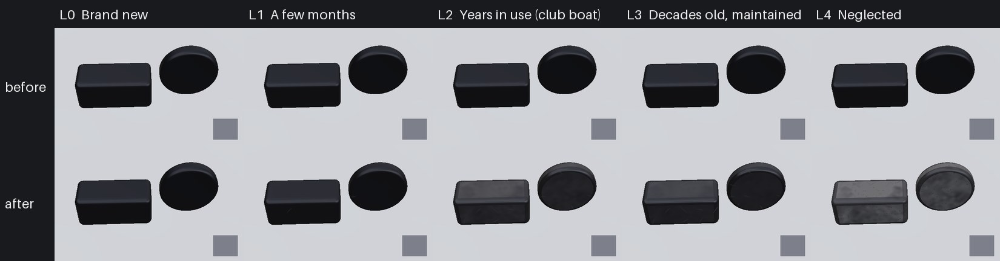

# Texture loop: black plastic hardware (Nov 8 2026)

The flat black on the deck hardware (blocks, cam cleats and their bases, fairleads, ratchets, clutches, track cars) had
no weathering: surface kind 0, the same satin black on a new boat and a neglected one. It now wears with the boat's Age
and Care through the loop's Time/Dirt split (`docs/texture-loop`), on the boats (`M_BoatSurface`, `M_BoatPacked`) and
on the hardware kit (`M_BoatKit`).

## What changed

- **Surface kind 13, black moulded plastic** (`scripts/make_materials.py` `BOAT_SURFACE`): the `BlackPlastic` library
  slot (Sunfish, fleet, kit) and the hero J/22's `BlackPlastic` and `CamBase` (`scripts/import_j22_hero.py`).
- **The wear lines** sit in `BOAT_CODE` between `// PLASTIC_WEAR >>>` and `// PLASTIC_WEAR <<<`, run when `surf == 13`:
  - *chalk*: UV chalking to a warm pale grey, matt, by `timeK (0.25 + 1.3 dirtK)`, most on faces that see the sky
    (`0.5 + 0.5 n.z`), blotchy in proportion to dirt (1.2 and 0.39 cm noise); a kept boat's is wiped with protectant,
    so darker and satin (`0.85 - 0.45 Care` of the colour, roughness 0.55 instead of 0.82);
  - *dust*: the lake's tan clay on the tops and, on the kit, in the trim sheet's hollows, by `dirtK`;
  - *rope and hand polish*: sharp edges (curvature from the normal's screen derivatives, radius under about 1.4 cm)
    rubbed back to a glossy black by `saturate(2 timeK)`, within 4 m;
  - *scuffs*: stress-whitened scratches, tapered and slightly bent, 0.5-1.2 cm, in a share of 1.5 cm cells that grows
    from the first months (`saturate(4 timeK)`), within 4 m;
  - *mildew*: round sub-millimetre dark specks on a left boat (`dirtK` over 0.6, low Care).
- **Age unset (-1: the player's and the AI boats): exactly as before.** Every line is gated on `age >= 0`.
- **M_BoatKit** (`scripts/import_hardware_kit.py`) gains `Surface`, `Age`, `Care` and per-instance custom data 10/11
  (as on `M_BoatSurface`); `MI_Kit_<slot>` gets the slot's kind. The kit copies the block out of `BOAT_CODE` at import
  time, so the two never drift. Defaults leave every kit part as it was.
- No new textures, no texture reads: Medium included. BOAT_CODE's detail-map block now skips kind 13 (it would have put
  gelcoat orange peel on plastic).

## Levels

Albedo on the sky-facing tops (Lab L*), from the swatch renderer (`Tools/texloop/plastic/render_levels.py`):

| Level | Top L* | Side L* | What shows |
| --- | --- | --- | --- |
| L0 new | 14.5 | 14.5 | satin black |
| L1 months | 16.2 | 15.1 | a stray scuff |
| L2 club boat | 30.0 | 24.0 | blotchy chalk, rubbed black edges, scuffs, a little dust |
| L3 decades, kept | 26.6 | 21.8 | even, darker satin fade, polished edges, more scuffs |
| L4 neglected | 40.1 | 35.5 | heavy pale blotchy chalk, tan dust, mildew specks |

L0's colour is the library's (L* 14.5); ambientCG's CC0 black plastic scan Plastic012A measures 17.6 with b* +1.5, so
the base is a touch darker than that scan, left as it is. L1 to L4 are estimates: no CC0 or CC BY photo of sun-chalked
black boat hardware could be fetched from the cloud (Wikimedia's image host refuses it). Close-ups of the club's J/22
blocks and cam cleats with a grey card would give real targets. Refs `Tools/texloop/refs/plastic.json`, targets
`Tools/texloop/targets/plastic.json`, card `Tools/texloop/cards/plastic.json`.

## Rounds

Three fresh blind reviewers a round (`Tools/texloop/reviews/plastic.json`):

| Round | Change | Ladder | A/B vs last round |
| --- | --- | --- | --- |
| 1 | first build | 5, 3, 5 | - |
| 2 | tapered, bent scuffs; a kept boat's chalk darker and satin; fewer mildew specks | 5, 3, 5 | L2 won 3/3, L4 lost 0/3 |
| 3 | chalk grows faster with dirt; mildew density of round 1 back | 5, 5, 3 | L2 1/3, L4 2/3 |
| 4 | chalk only on sky-facing faces | 3, 5, 5 | lost 0/3 at both: reverted |

**This PR is round 3.** Every reviewer in every round called it black moulded plastic and matched L0, L1 and L4; the
one miss each round is a reviewer swapping L2 (club boat) and L3 (kept old boat), which differ by about 3 L* and
blotchiness. Strictly the ladder check (4 of 5 for all three) fails on that one reviewer. What the reviewers still see:
the chalk blotches read as cloud noise rather than following the moulding, the scuffs are too thin and even, and the
tan dust hardly shows at swatch distance. The swatch shapes are a plain rounded block and a disc; in-game stills on the
real cleats and blocks are the better judge.

## Checks

`python Tools/texloop/plastic/test_plastic.py` (HLSL, kit and port agree; Age unset and new unchanged; ladder order),
`python Tools/texloop/test_wear.py`. `SailingSim.Visual.BoatLibrary` now also checks `MI_Boat_BlackPlastic` is kind 13.
Still to run on the machines: the Mac shader compile and boats gate (`fwidth` inside a branch on a packed material is
the one new shader construct), then PC import (`make-content`, `import_hardware_kit.py`) and `-SailingBoatAge` stills.

## Tools

`Tools/texloop/plastic/port.py` (numpy copy of the block), `render_levels.py` (sphere-traced swatch, same sky as the loop),
`make_sheet.py`, `test_plastic.py`. References are CC0 ambientCG scans (Plastic001/006/012A/012B/018A/018B,
Rubber001-004), downloaded to the git-ignored `Data/Reference/raw/textures/BlackPlastic/`.
