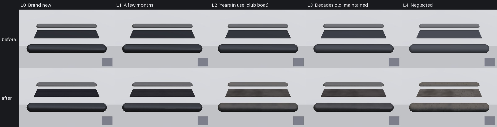

# Texture loop: webbing and rubber (Nov 9 2026)

Rubber and soft PVC (surface kind 8: rub strakes, gaskets, the tiller extension's grip, the ratchet's sheave) had one
wear line, `col + 0.05 ageK` and a rougher finish, the same grey lift on a club boat and a neglected one. Webbing had no
kind at all: the Sunfish and ILCA hiking strap was drawn in the Rubber slot, and the hero J/22's spare vests' straps as
canvas. Both now wear with the boat's Age and Care through the loop's Time/Dirt split (`docs/texture-loop`).

## What changed

- **Rubber, kind 8, with an Age** (`scripts/make_materials.py` BOAT_CODE, between `// RUBBER_WEAR >>>` and `<<<`):
  - *bloom*: the sun brings a waxy grey-brown film up through black rubber (a pale PVC goes duller and yellower), by
    `timeK (0.3 + 1.2 dirtK)`, most on faces that see the sky, blotchy (2 and 0.65 cm noise) in proportion to dirt; a
    kept boat's is wiped with protectant, so darker and satin (weight `0.85 - 0.6 Care`, roughness 0.62 instead of 0.92);
  - *ozone cracks*: short, slanted, kinked cracks across the part (one in some 0.35 x 0.9 cm cells) from a decade or so
    (`smoothstep(0.45, 0.85, timeK)`), mostly on a left boat and on black rubber (`1 - 0.85 Care`, `1 - 0.7` on pale PVC);
    a kept boat's rubber is satin from protectant (roughness 0.45);
  - *dock rash*: thin matt streaks along the part on its upright faces (6 x 0.35 cm cells, most within the first years):
    grey abrasion on black, black marks on a pale PVC, a share that follows dirt more than years (care cleans them off);
  - *dust and mildew*: the lake's tan clay on the tops, dark specks on a left boat.
- **Woven webbing, new kind 14** (between `// WEBBING_WEAR >>>` and `<<<`; new library slot `Webbing`, black polyester):
  - *the weave*: warp ribs 1.2 mm apart along the strap shade it within 3 m (any age); on High the canvas detail normal
    at a 2 cm tile (no new map);
  - *fade*: the sun bleaches the dye to a brownish charcoal (colours go greyer and paler), by `wbTime`, which is `timeK`
    except that a kept boat replaces its straps every eight years or so;
  - *fuzz* (broken filaments, paler and matt), *grit* in the weave (`dirtK`), *frayed edges* (curvature, close up),
    *mildew* in black clusters on a left strap.
- **Age unset (-1: the player's and the AI boats): exactly as before.** Kind 8 keeps its old line, kind 14 the rope and
  canvas line, behind `age < 0`.
- **Where it lands**: the library `Rubrail` and `Rubber` slots (every built boat), the hero J/22's `RubRail` and
  `ExtensionBlack` (kind 8) and `Webbing` (now 14, was 11), the kit's `MI_Kit_Rubrail` (M_BoatKit copies RUBBER_WEAR out
  of BOAT_CODE at import, as it does PLASTIC_WEAR), and the Sunfish and ILCA hiking strap, which moves from the Rubber
  slot to the new Webbing slot (`Tools/blender/build_fleet.py`).
- **One more slot on the two dinghy hulls**: every pack is full (8 entries), so Webbing is a slot of its own;
  `SailingSim.Visual.BoatBudget` raises the Sunfish and ILCA7 hull ratchet from 3 to 4 (the 8-slot target holds).
  `SailingSim.Visual.BoatLibrary` checks `MI_Boat_Webbing` is kind 14.

## Levels

Albedo on the sky-facing tops (Lab L*), from the swatch renderer (`Tools/texloop/rubber/render_levels.py`):

| Level | Black rub rail top | Webbing strap top | Grey PVC rail top | What shows |
| --- | --- | --- | --- | --- |
| L0 new | 20.0 | 16.8 | 37.4 | satin black, black woven strap |
| L1 months | 21.3 | 20.2 | 37.5 | a stray dock scuff |
| L2 club boat | 30.9 | 31.1 | 38.6 | blotchy bloom, dock rash, dust; charcoal fuzzy strap |
| L3 decades, kept | 26.8 | 29.5 | 38.1 | darker satin bloom, few fine cracks, clean; a part-faded strap |
| L4 neglected | 37.2 | 36.8 | 39.3 | heavy pale bloom, cracks, dust, mildew; bleached, frayed strap |

L0 sits near ambientCG's CC0 black rubber scan Rubber004 (L* 17.6). L1 to L4 are estimates: no CC0 or CC BY photo of
sun-bloomed rubber or faded black webbing could be fetched from the cloud, and Bean's lesson photos show the J/22's
toe rail, not a rub strake. Close-ups at the club (the rub strake, a Sunfish hiking strap, the tiller extension) with a
grey card would give real targets. Card `Tools/texloop/cards/rubber.json`, refs `refs/rubber.json`, targets
`targets/rubber.json`, reviews `reviews/rubber.json`.

## Rounds

Three fresh blind reviewers a round (`Tools/texloop/reviews/rubber.json`):

| Round | Change | Ladder | A/B vs last round |
| --- | --- | --- | --- |
| 1 | first build | 3, 5, 1 | - |
| 2 | fewer, kinked cracks, mostly on a left boat and on black rubber; thinner matt dock rash; warp ribs on the webbing; browner fade | 3, 3, 3 (all swapped L2 and L3) | L2 won 3/3, L4 won 3/3 |
| 3 | dock rash and dust follow dirt (care cleans the marks off); a kept boat's rubber satin from protectant; the webbing's weft | 5, 3, 5 | L2 0/3 (called nearly identical), L4 3/3 |

**This PR is round 3.** It is the first round where every reviewer put the club boat (L2) and the kept old boat (L3)
the right way round; the one miss is a reviewer swapping new and a few months (L0, L1), which differ by a stray scuff.
Strictly the ladder check (4 of 5 for all three) fails on that reviewer. What the reviewers still see: the strap does
not read as webbing in the swatch (a flat ribbed sheet: the swatch's strap is a 3 mm slab with no stitching or
selvedge, and in game it is a sagging bar seen from further off), the neglected rubber's cracks and mildew specks read
as a decal repeated over all three parts, and the renderer's crisp sky reflections on the rail read as stickers. In-game
stills on the real strake, strap and extension are the better judge, and club close-ups would settle the colours.

## Checks

`python Tools/texloop/rubber/test_rubber.py` (the HLSL, the kit and port.py agree; Age unset and new unchanged; the
ladder's order), `python Tools/texloop/test_wear.py`, `python Tools/texloop/plastic/test_plastic.py`.

## Follow-ups

- The crew's vest webbing (`MI_Crew_Webbing` on `M_CrewFabric`) is left for after the crew fabric pass (#558) merges:
  give it a webbing kind in that PR's `FABRIC_WEAR_KIND` table.
- The strap still does not read as webbing in the swatch; if in-game stills agree, a real webbing normal map (twill
  ribs, selvedge) on High is the next step (+0.3 MB).

## Still to do on the machines

- **Mac** (sim thread): compile M_BoatSurface, M_BoatPacked and the hero materials (`fwidth` inside a branch again, as
  the plastic block, and the new kind 14 detail branch), then `scripts/gate.sh --scope boats`; `SailingSim.Visual.BoatLibrary`
  needs `make-content` first (the new `MI_Boat_Webbing`).
- **PC (paused)**, on resume: `make_materials.py` (MI_Boat_Webbing), rebuild the Sunfish and ILCA (`build_fleet.py`:
  the strap's new slot; it can ride along with the #553 Sunfish rebuild), `import_hardware_kit.py` (M_BoatKit's rubber
  lines), the hero J/22 import (Webbing kind 14), then `-SailingBoatAge` stills of the rub strake, the strap and the
  tiller extension.

## Tools

`Tools/texloop/rubber/port.py` (numpy copy of both blocks), `render_levels.py` (sphere-traced swatch: a rub strake on
the topsides' edge, a strap on deck, the grey PVC rail, same sky as the loop), `make_sheet.py`, `test_rubber.py`.
