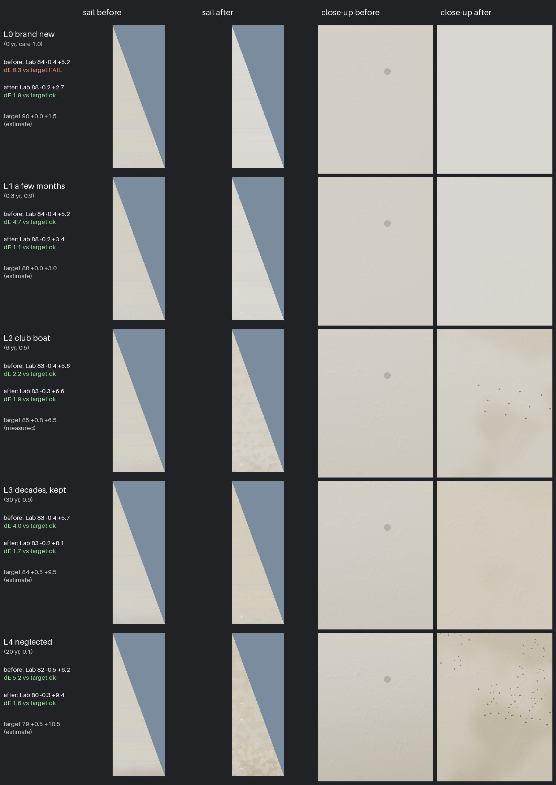

# Texture loop: sailcloth

The fourth surface of the texture and wear loop (plan: "Boat texture and wear loop", Nov 8 2026). One surface, five
wear levels, the Time/Dirt split. Card: `Tools/texloop/cards/sailcloth.json`; references and targets:
`Tools/texloop/refs/sailcloth.json`.

## What was wrong

In `SAIL_CODE` (M_SailCloth) the white cloth's yellowing (leech and head) and its mildew specks were fixed: every sail
had them, whatever its Age and Care. Only the foot grime and the crinkle followed Age/Care, through one wear number. So a
brand-new sail was already yellow and speckled (its colour fails the L0 target, ΔE 6.3), the five levels read as one
(three blind reviewers could not order them), and every speck was the same 1.35 cm grey dot.

## What changed

Only when the boat's Age is set (`Age >= 0`: berthed boats and `-SailingBoatAge`). With Age unset (the player's and AI
boats) the cloth is exactly as before.

- **Time** (care can't undo it): a new sail is a bright, slightly cool white (brightener) that goes with time; the sun
  yellows the cloth, most at the leech and head; the crinkle's cover and fold strength follow Time, with none on a new
  sail; the resin's sheen goes (roughness 0.43 new to about 0.73 at 30 years); a few white sail-tape repairs collect.
- **Dirt** (care removes it): a grey-brown dinge, tan clay smudges (two octaves turned off the cloth's axes, so they
  don't read as squares from the dock), foot grime, and on a dirty boat clusters of 1-4 mm mildew dots low on the sail.
- Medium and Low get all of it: colour and roughness math, no new textures, no texture reads. The crinkle part is
  High/Ultra only, as before.

`SAIL_WEAR_SPLIT` holds the Time/Dirt formulas, mirrored from the shared loop's `Tools/texloop/wear.py`
(time_k, dirt_k; PR #535). `sailcloth_swatch.py` imports `wear.py` when present and falls back to the same formulas.

## Look (CPU swatches, not the engine)

`Tools/texloop/sailcloth_swatch.py` ports the white-cloth part of `SAIL_CODE` to numpy (panel tone, weave, yellowing,
grime, specks, crinkle and folds as normals) under a plain overcast light. It leaves out the marks, stitching, the window,
the belly and wrinkle shading and the light through the cloth, so the swatches read flatter than the game. In-game stills
(`-SailingBoatAge=<years>,<care>`) wait for the PC to resume.

    python3 -I Tools/texloop/sailcloth_swatch.py OUT        # swatches + stats.json for L0..L4, before and after
    python3 -I Tools/texloop/sailcloth_sheet.py OUT sheet.jpg [L2=photo.jpg:x0,y0,x1,y1]
    python3 -I Tools/texloop/sailcloth_measure.py PHOTO --cloth x0,y0,x1,y1 --white x0,y0,x1,y1

## Scorecard

| Check | Before | After |
| --- | --- | --- |
| Colour (clew, ΔE to target, pass ≤ 6) | L0 6.3 fail; L1 4.7, L2 2.2, L3 4.0, L4 5.2 | 1.9, 1.1, 1.9, 1.7, 1.6 |
| Size | weave 0.6 mm, panels 0.9 m: unchanged | unchanged |
| Tiling | procedural, no tiles | procedural; smudges de-gridded |
| Wear ladder (3 fresh reviewers) | no clear order; most neighbours "can't tell" | round 1: 3 of 3 exact; round 2: 1 exact, 2 with one neighbour swap (rank ≥ 0.9) |
| Blind A/B against the L2 photo | | after beat before 3 of 3; round 2 beat round 1 3 of 3 (all low confidence) |
| Budget | | no new maps or texture reads; about 60 ALU ops, only when Age is set. Frame time: Mac boats gate |

Only L2's target is measured (the hue of the lesson J/22's mainsail at the clew, from Bean's photo; its L* is held at 85
because the photo's sail is lit through from behind). L0, L1, L3 and L4 are estimates until photos are measured:
Wikimedia rate-limited the cloud on Nov 8, and Bean's club photos are the better source.

What the reviewers still see: no weave at this scale, faint creases, the photo cooler and greyer with more contrast. The
creases and contrast come from the cloth's geometry and the shading the port leaves out; the game stills will show
whether they hold.
